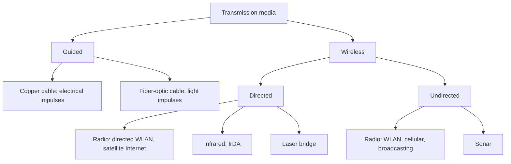
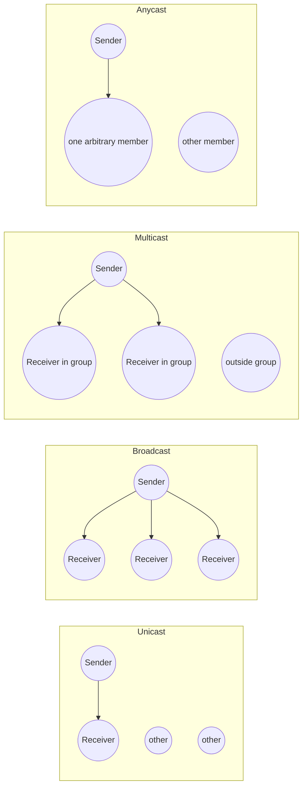
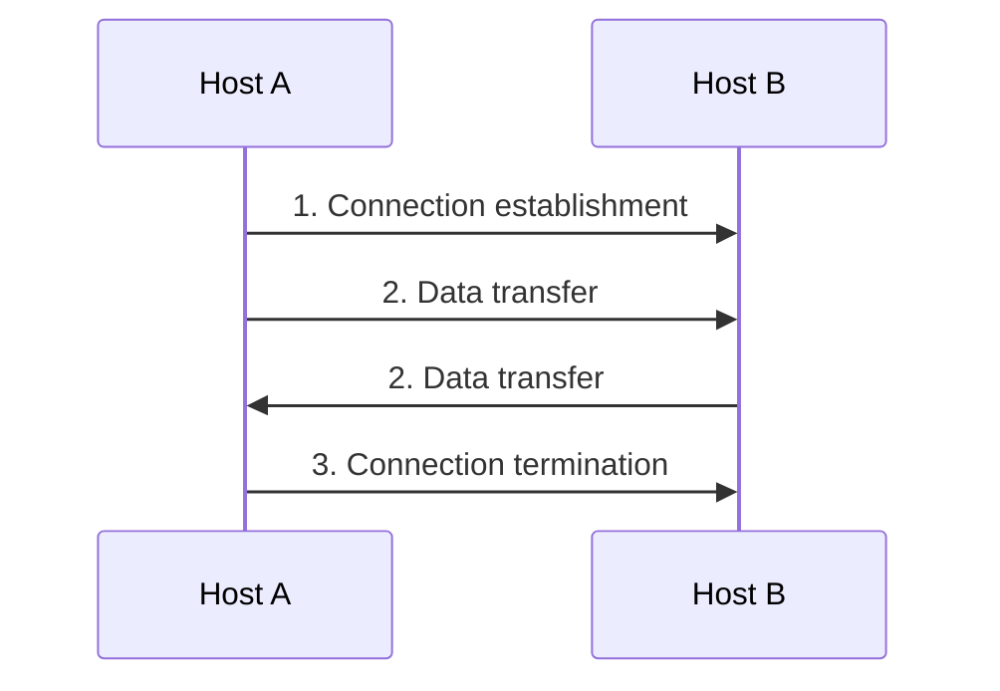
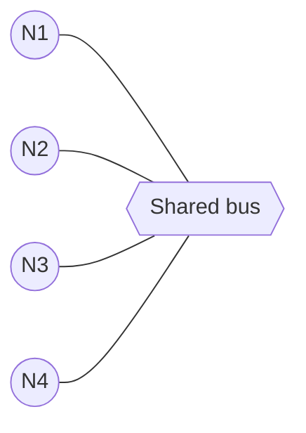
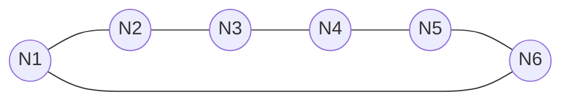
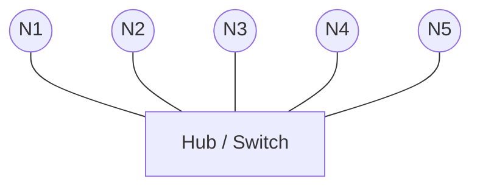
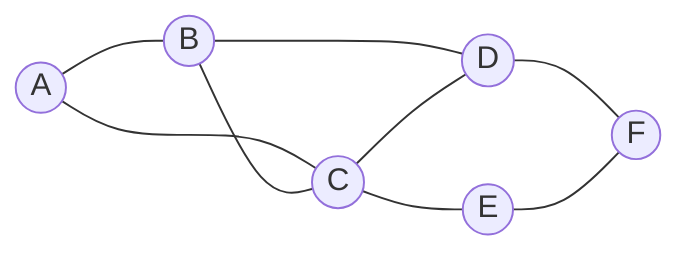
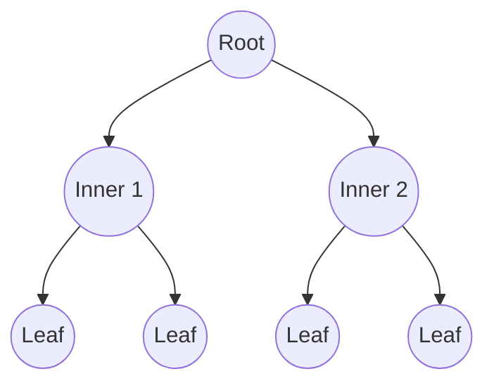
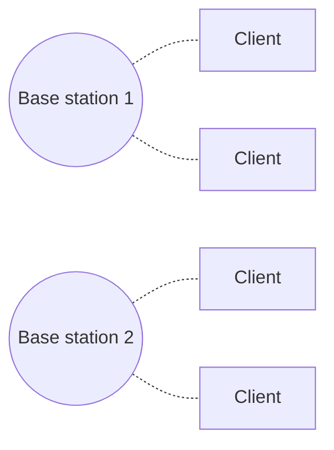
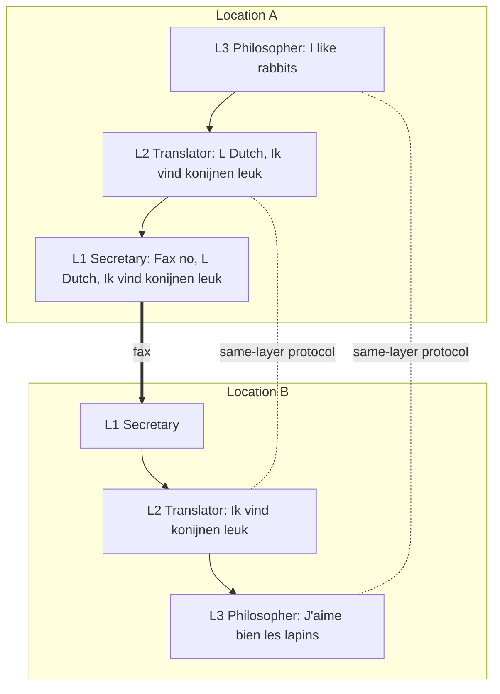

# Computer Networks — Basics

> [!Note] 💡 Notation Conventions
> **1.** Data rates are written in $\text{bit/s}$ (slides also use bps). $\text{B}$ = byte $= 8$ bit.
> **2.** Decimal prefixes (used for data rates **and** hardware capacities): $\text{k}=10^3$, $\text{M}=10^6$, $\text{G}=10^9$, $\text{T}=10^{12}$, $\text{P}=10^{15}$. Binary prefix: $1\,\text{PiB}=2^{50}\,\text{B}$.
> **3.** $R$ = bandwidth / data rate (bit/s), $L$ = message size (bit), $d$ = distance (m), $c = 299\,792\,458\ \text{m/s}$ = speed of light, $v_f$ = velocity factor, $t_{prop}$ = propagation delay, $t_{trans}$ = transmission delay, $t_{wait}$ = waiting time, $t_{lat}$ = latency.
> **4.** TCP = *Transmission Control Protocol* (one slide says "Transport Control Protocol"; standardized here).
> **5.** TCP/IP layers are named (Application, Transport, Internet, Link). OSI layers are numbered L1 (Physical) to L7 (Application). The slides use "Internet Layer" (TCP/IP) and "Network Layer" (OSI) for the same functional level.

---

## 1. Network Components and Terms

### 1.1 Required components

> [!Definition] 📖 Computer network (minimal setup)
> A computer network needs three components:
> **1.** $\ge 2$ **hosts** (computers) with **network services** running, which communicate or access shared resources.
> **2.** A **transmission medium** to send and receive data.
> **3.** **Network protocols**, the rules specifying how the computers communicate.
>
> The general task of a network is to enable communication among the participants.

### 1.2 Network services: server, client, peer

> [!Definition] 📖 Network service, server, client, peer
> **Network service:** provides a service for communication or shared-resource usage to other devices.
> **Server:** provides a network service. **Client:** uses (consumes) a network service.
> **Peer:** a participant that is both server and client. A network of peers is a **peer-to-peer (P2P) network**.

> [!Property] ⚙️ Roles describe services, not hardware
> The terms server, client and peer refer to **network services**, not to hardware. Almost any computer acting as a server also runs client applications.

### 1.3 Transmission media

> [!Definition] 📖 Transmission media
> **Guided:** copper cable (data as electrical impulses) and fiber-optic cable (data as light impulses).
> **Wireless:** no physical medium is needed. It can be *directed* or *undirected*.
> **Directed** wireless technologies:
> **1.** *Radio:* electromagnetic waves in the radio spectrum (e.g., directed WLAN, satellite Internet access).
> **2.** *Infrared:* e.g., IrDA.
> **3.** *Laser:* data as light impulses via a laser bridge.
>
> **Undirected** wireless: mostly radio (WLAN, cellular networks, terrestrial and satellite broadcasting) or sonar.



> [!Warning] ⚠️ Possible Gap
> The slide describes infrared as "electromagnetic waves in the spectral range" and the word "infrared" is missing from the sentence. I assumed it means the infrared spectral range.

### 1.4 Protocols

> [!Definition] 📖 Protocol
> A protocol is the set of all agreements made beforehand between communication partners. It covers:
> **1.** rules for connection establishment and termination
> **2.** synchronization between sender and receiver (if any)
> **3.** detection and treatment of transmission errors
> **4.** definition of valid messages (vocabulary)
> **5.** format and encoding of messages
>
> Protocols specify the **syntax** (format of valid messages) and the **semantics** (vocabulary and meaning of valid messages).

## 📘 Examples & Applications

> [!Example] 📘 Example 1.1 — Roles in a web and file-sharing scenario
> **Using:** host, network service, server, client, peer
>
> A laptop opens a web page from a web server. The laptop also runs a file-sharing program that exchanges files with another laptop.
> **1.** Web service: the server host runs the web *server*, and the laptop's browser is the *client*.
> **2.** File-sharing: each laptop both offers and consumes files, so both are *peers* (P2P).
> **3.** The laptop is a client in (1) and a peer in (2). The roles belong to the services, not to the machine.

> [!Example] 📘 Example 1.2 — Syntax vs. semantics (constructed toy protocol)
> **Using:** protocol, syntax, semantics
>
> Toy protocol: a message is `HELLO <name>` and the receiver must answer `HI <name>`.
> **1.** *Syntax:* keyword `HELLO` followed by exactly one name, so `HELLO Anna` is valid and `HELLO` alone is invalid.
> **2.** *Semantics:* `HELLO` means "greeting, please acknowledge" and `HI` means "greeting received".
> **3.** Rules such as "answer within a time limit" belong to the agreements on connection handling and error treatment.

> [!Example] 📘 Example 1.3 — Classifying transmission media
> **Using:** transmission media
>
> **1.** Building backbone with fiber: guided, light impulses.
> **2.** Directed WLAN link between two buildings: wireless, directed, radio.
> **3.** Cellular phone network: wireless, undirected, radio.
> **4.** TV remote control (IrDA-style): wireless, directed, infrared.

---

## 2. Purpose and Dimension of Networks

> [!Definition] 📖 Purposes of computer networks
> **Resource sharing:** assign different tasks to different computers, which avoids bottlenecks.
> **Resource pooling:** combine the resources and functionalities of multiple machines.
> **Resource balancing:** increase the availability of services by redundancy.

> [!Definition] 📖 Network classes by dimension
> | Class | Name | Range | Typical technologies |
> |---|---|---|---|
> | PAN / BAN | Personal / Body Area Network (small mobile devices, e.g., smartphones) | few meters | USB, FireWire, WLAN, Bluetooth, IrDA |
> | LAN | Local Area Network (apartment, building, company site, campus) | 500–1000 m | Ethernet, WLAN |
> | MAN | Metropolitan Area Network (connects LANs; city / agglomeration) | $\approx 100$ km | Fiber, WiMAX (IEEE 802.16) |
> | WAN | Wide Area Network (connects several networks; country / continent) | $\approx 1000$ km | Ethernet (10 Gbit/s), ATM |

> [!Property] ⚙️ Why fiber in MANs
> Fiber is used because of lower **attenuation** (signal weakening) and higher data rates.

## 📘 Examples & Applications

> [!Example] 📘 Example 2.1 — Classify by dimension
> **Using:** network classes by dimension
>
> **1.** Smartphone to earbuds via Bluetooth, a few meters: PAN.
> **2.** Ethernet on a university campus, $\approx 800$ m: LAN.
> **3.** Fiber connecting LANs across a city, $\approx 80$ km: MAN.
> **4.** 10 Gbit/s Ethernet between two cities $\approx 900$ km apart: WAN.

> [!Example] 📘 Example 2.2 — Map situations to purposes
> **Using:** resource sharing, pooling, balancing
>
> **1.** Many office PCs use one network printer: *sharing*.
> **2.** Several machines combine computing power for a job: *pooling*.
> **3.** Two redundant servers provide the same service so it stays available if one fails: *balancing*.

---

## 3. Communication Schemes: Unicast, Broadcast, Multicast, Anycast

> [!Definition] 📖 Cast schemes
> **Unicast:** one-to-one. One host sends to *exactly one* other host.
> **Broadcast:** one-to-all. One host sends to *all* other hosts in the network.
> **Multicast:** one-to-many (group communication). One host sends to *all hosts in a given group*.
> **Anycast:** one-to-any. One host sends to *one host in a given group*.

> [!Property] ⚙️ Group requirement
> Multicast and anycast require the notion of a **group** to exist. Unicast and broadcast need no group.



## 📘 Examples & Applications

> [!Example] 📘 Example 3.1 — Slide analogies
> **Using:** unicast, broadcast, multicast, anycast
>
> **1.** *Unicast:* calling the name of one person and talking to them. All others may overhear.
> **2.** *Broadcast:* making an announcement for everyone. The range of a broadcast may differ.
> **3.** *Multicast:* addressing a subset (e.g., everyone living in Frankfurt) and talking to all of them.
> **4.** *Anycast:* addressing a subset and talking to one arbitrary member of it.

> [!Example] 📘 Example 3.2 — Exercise: match analogies to schemes
> **Using:** unicast, broadcast, multicast, anycast, group notion
>
> | Analogy | Scheme | Reason |
> |---|---|---|
> | WhatsApp message to a classmate | Unicast | exactly one receiver |
> | Shouting to a friend in the university yard | Unicast | one addressed person (others may overhear) |
> | Opening a ticket at the CIT service desk | Anycast | the group of agents exists, and *one* of them handles it |
> | Fire alarm siren | Broadcast | everyone in range is addressed |
> | Message to a Telegram group | Multicast | all members of a defined group |
> | Radio program | Broadcast | sent to all receivers in range |
> | Email to the Linux kernel mailing list | Multicast | all list subscribers (a group) receive it |

> [!Warning] ⚠️ Possible Gap
> The sheet gives no solution key. The mapping above is my interpretation using the slide definitions. The service-desk case (anycast) and the mailing list (multicast) depend on how the group is understood.

---

## 4. Connection-Orientation

> [!Definition] 📖 Connection-oriented vs. connectionless
> **Connection-oriented** (stateful):
> **1.** Three phases: connection establishment, data transfer, connection termination.
> **2.** A virtual path between the involved hosts is established.
> **3.** Sequent data is exchanged between the same hosts.
> **4.** Typically used for reliable services.
>
> **Connectionless** (stateless):
> **1.** No path between the involved hosts is established.
> **2.** Typically used for low-latency services.



> [!Property] ⚙️ Link to transport protocols
> In TCP/IP networks, connectionless communication is typically UDP and connection-oriented communication is typically TCP (see §9).

## 📘 Examples & Applications

> [!Example] 📘 Example 4.1 — Choosing the service type
> **Using:** connection-oriented, connectionless, stateful/stateless
>
> **1.** A file download that must arrive completely and in order: connection-oriented (TCP), reliable, three phases.
> **2.** A short status message where low delay matters more than reliability: connectionless (UDP), no path is set up, each message stands alone.
> **3.** The server in (1) must remember the connection state (stateful). The one in (2) keeps no state about earlier messages (stateless).

---

## 5. Directional Dependence (Anisotropy) of Data Transmission

> [!Definition] 📖 Simplex, duplex, half-duplex
> Given a channel with two or more endpoints:
> **Simplex:** only one side can send, so the channel is used in one direction only (radio, TV, pager).
> **Duplex (full-duplex):** both sides can send *simultaneously* (phone; twisted-pair networks, which have separate wires for send and receive).
> **Half-duplex:** both sides can send, but *not simultaneously*, so the channel is used in one direction at a time. Slide examples are fiber-optic or coaxial networks (a single line for sending and receiving) and wireless networks with a single channel.

> [!Warning] ⚠️ Possible Gap
> The slide's claim that fiber-optic and coaxial networks are half-duplex is a simplification. It reflects the single-line argument only. I keep it as stated for the course but do not generalize it.

## 📘 Examples & Applications

> [!Example] 📘 Example 5.1 — Exercise: walkie-talkies and duplex principles
> **Using:** simplex, half-duplex, full-duplex
>
> **1.** *Why only one participant can speak:* all participants share a single channel. Two simultaneous transmissions on it would interfere (collide).
> **2.** *Principle:* **half-duplex**. Both sides can send, but only one at a time.
> **3.** *Two simplex systems:* radio broadcasting, TV, pager.
> **4.** *Simplex advantage / drawback* (derived from the definition): advantage is that it needs only one direction (no collision between the two ends). Drawback is that the receiver cannot send anything back (no feedback or acknowledgments).
> **5.** *Two full-duplex systems:* telephone, networks with twisted-pair cables (separate wires for send and receive).
> **6.** *Full-duplex advantage / drawback* (derived from the definition): advantage is simultaneous communication in both directions. Drawback is that it needs separate channels or wires for each direction, so more resources.

---

## 6. Performance: Bandwidth, Throughput, Goodput, Latency

### 6.1 Data-rate measures

> [!Definition] 📖 Bandwidth, throughput, goodput
> **Bandwidth** $R$: how many bits can be transmitted within a period via the network (e.g., $1\,\text{Gbit/s} = 10^9$ bit/s).
> **Throughput:** the *actual* achieved data rate. The bandwidth is its upper bound.
> **Goodput:** the actual rate of data the user *benefits from*.

> [!Property] ⚙️ Ordering (tube analogy)
> Bandwidth is the tube's diameter (water per time that *may* pass). Throughput is the water that *actually* passes. Goodput is the desired particles in that water. Hence

$$\text{goodput} \le \text{throughput} \le R$$

### 6.2 Latency

> [!Definition] 📖 Latency
> The time a message needs to travel from one end of the network to the most distant end:
> $$t_{lat} = t_{prop} + t_{trans} + t_{wait}$$
> **1.** *Propagation delay:* $t_{prop} = \dfrac{d}{c \cdot v_f}$, where $d$ is the length of the connection, $c = 299\,792\,458\ \text{m/s}$ and $v_f$ is the velocity factor.
> **2.** *Transmission delay:* $t_{trans} = \dfrac{L}{R}$, where $L$ is the message size and $R$ the bandwidth.
> **3.** *Waiting time* $t_{wait}$: caused by network devices (e.g., switches) that must first cache received data before forwarding it.

> [!Property] ⚙️ Velocity factors and special cases
> | Medium | $v_f$ |
> |---|---|
> | Vacuum | $1$ |
> | Twisted-pair cable | $0.6$ |
> | Optical fiber | $0.67$ |
> | Coaxial cable | $0.77$ |
>
> **1.** $t_{trans} = 0$ if the message is a single bit.
> **2.** $t_{wait} = 0$ if the connection between sender and destination is a single line or a single channel.

> [!Note] 💡 Implication (derived)
> Bandwidth only influences $t_{trans}$, which grows with message size. A higher bandwidth does not shorten $t_{prop}$ or $t_{wait}$.

> [!Property] ⚙️ Link volume (derived from Exercise 6.2)
> The maximum number of bits "inside the line" at once is $V = R \cdot t_{prop}$. The slides give no name for this quantity.

## 📘 Examples & Applications

> [!Example] 📘 Example 6.1 — Exercise 6: MP3 transfer and line volume
> **Using:** $t_{lat}$, $t_{prop}$, $t_{trans}$, link volume
>
> Given $L = 30\cdot10^{6}$ bit, $d = 5000$ km, signal speed $2\cdot10^{5}$ km/s, $t_{wait}=0$.
>
> **Step 1 — propagation delay (same for all rates):**
> $$t_{prop} = \frac{5000\ \text{km}}{200\,000\ \text{km/s}} = 0.025\ \text{s}$$
> **Step 2 — transmission delay and latency:**
> $$56\ \text{kbit/s}:\ t_{trans} = \frac{3\cdot10^{7}}{5.6\cdot10^{4}} \approx 535.714\ \text{s} \Rightarrow t_{lat} \approx 535.739\ \text{s} \approx 8\ \text{min}\ 55.7\ \text{s}$$
> $$1\ \text{Mbit/s}:\ t_{trans} = \frac{3\cdot10^{7}}{10^{6}} = 30\ \text{s} \Rightarrow t_{lat} = 30.025\ \text{s}$$
> $$100\ \text{Mbit/s}:\ t_{trans} = \frac{3\cdot10^{7}}{10^{8}} = 0.3\ \text{s} \Rightarrow t_{lat} = 0.325\ \text{s}$$
> **Step 3 — volume of the connection** $V = R\cdot t_{prop}$:
> $$56\ \text{kbit/s}: 5.6\cdot10^{4}\cdot 0.025 = 1\,400\ \text{bit}$$
> $$1\ \text{Mbit/s}: 10^{6}\cdot 0.025 = 25\,000\ \text{bit}$$
> $$100\ \text{Mbit/s}: 10^{8}\cdot 0.025 = 2.5\cdot10^{6}\ \text{bit}$$
> **Interpretation:** in all three cases $V < L$, so the sender is still transmitting when the first bit has already arrived. For small bandwidth $t_{trans}$ dominates, for large bandwidth $t_{prop}$ dominates.

> [!Example] 📘 Example 6.2 — Exercise 1: Prussian semaphore telegraph
> **Using:** bandwidth, $t_{prop}$, $t_{trans}$, $t_{wait}$
>
> Data: 62 stations, $d = 550$ km, $v_f = 1$, 6 arms with 4 positions each, new setting every 10 s. The last station does not forward, so there are $62-1 = 61$ forwardings.
>
> **1. Data rate.** One arm with 4 positions encodes $\log_2 4 = 2$ bit, so six arms encode $12$ bit per setting:
> $$R = \frac{12\ \text{bit}}{10\ \text{s}} = 1.2\ \text{bit/s}$$
> **2. Latency.**
> $$t_{prop} = \frac{5.5\cdot10^{5}\ \text{m}}{2.998\cdot10^{8}\ \text{m/s}} \approx 1.83\ \text{ms}, \qquad t_{wait} = 61\cdot 60\ \text{s} = 3660\ \text{s}\ (61\ \text{min})$$
> End-to-end delay (negligible message): $t_{lat} \approx 3660\ \text{s} = 61$ min.
> $$L=24\ \text{bit}: t_{trans} = \frac{24}{1.2} = 20\ \text{s} \Rightarrow t_{lat} = 3660 + 20 + 0.0018 \approx 3680\ \text{s} \approx 61\ \text{min}\ 20\ \text{s}$$
> $$L=512\ \text{bit}: t_{trans} = \frac{512}{1.2} \approx 426.7\ \text{s} \Rightarrow t_{lat} \approx 4086.7\ \text{s} \approx 68\ \text{min}\ 6.7\ \text{s}$$
> **3a. Setting every 5 s:**
> $$R = \frac{12}{5} = 2.4\ \text{bit/s}\ (\text{doubled})$$
> $$24\ \text{bit}: t_{trans} = 10\ \text{s} \Rightarrow t_{lat} \approx 3670\ \text{s} \approx 61\ \text{min}\ 10\ \text{s}$$
> $$512\ \text{bit}: t_{trans} \approx 213.3\ \text{s} \Rightarrow t_{lat} \approx 3873.3\ \text{s} \approx 64\ \text{min}\ 33.3\ \text{s}$$
> **3b. Forwarding takes 5 min** (setting every 10 s, so $R = 1.2$ bit/s is unchanged):
> $$t_{wait} = 61\cdot 300\ \text{s} = 18\,300\ \text{s} = 305\ \text{min}$$
> $$24\ \text{bit}: t_{lat} \approx 18\,320\ \text{s} \approx 305\ \text{min}\ 20\ \text{s}$$
> $$512\ \text{bit}: t_{lat} \approx 18\,726.7\ \text{s} \approx 312\ \text{min}\ 6.7\ \text{s}$$
> **Conclusion:** a faster setting rate raises bandwidth and lowers $t_{trans}$. Slower forwarding raises only $t_{wait}$ and leaves bandwidth unchanged.
>
> **4. Why only four positions** (own reasoning, not in the sources): with four positions per arm, each arm carries exactly $2$ bit ($4 = 2^2$). The positions must be recognizable at a distance and under distortion (the slides' requirement of a *robust* encoding). More positions would be harder to tell apart and therefore error-prone.

> [!Warning] ⚠️ Possible Gap
> The sheet does not say whether the transmission delay is incurred once or at every station. Following Hint 1 (no complex formula), I applied $t_{trans}$ once and added $61$ forwarding waits. Question 4 has no source answer, so my reasoning above is labeled as such.

> [!Example] 📘 Example 6.3 — Exercise 3: image transfer time
> **Using:** bandwidth, $t_{trans} = L/R$, units
>
> **Step 1 — image size:**
> $$L = 1920\cdot1080\cdot 3\ \text{B}\cdot 8\ \tfrac{\text{bit}}{\text{B}} = 6\,220\,800\ \text{B}\cdot 8 = 49\,766\,400\ \text{bit}$$
> **Step 2 — uncompressed:** $t = L/R$
> $$56\ \text{kbit/s}: \frac{49\,766\,400}{56\,000} \approx 888.7\ \text{s} \approx 14\ \text{min}\ 49\ \text{s}$$
> $$16\ \text{Mbit/s}: \frac{49\,766\,400}{16\cdot10^{6}} \approx 3.110\ \text{s}$$
> $$100\ \text{Mbit/s}: \approx 0.4977\ \text{s}$$
> $$1\ \text{Gbit/s}: \approx 0.0498\ \text{s}$$
> **Step 3 — compressed by 85 %** (15 % remains): $L' = 0.15\cdot 49\,766\,400 = 7\,464\,960$ bit
> $$56\ \text{kbit/s}: \frac{7\,464\,960}{56\,000} \approx 133.3\ \text{s} \approx 2\ \text{min}\ 13\ \text{s}$$
> $$16\ \text{Mbit/s}: \approx 0.4666\ \text{s}$$
> $$100\ \text{Mbit/s}: \approx 0.0746\ \text{s}$$
> $$1\ \text{Gbit/s}: \approx 0.0075\ \text{s}$$
> All times scale by the factor $0.15$.

> [!Example] 📘 Example 6.4 — Exercise 4: storing and transmitting 15 PB
> **Using:** units (decimal vs. binary), $t_{trans}$
>
> **Part 1 — stack height.**
> *Decimal* ($15\ \text{PB} = 15\cdot10^{15}$ B):
> $$N_{CD} = \frac{15\cdot10^{15}}{600\cdot10^{6}} = 2.5\cdot10^{7}\ \Rightarrow\ h = 2.5\cdot10^{7}\cdot1.2\ \text{mm} = 3\cdot10^{4}\ \text{m} = 30\ \text{km}$$
> $$N_{HDD} = \frac{15\cdot10^{15}}{2\cdot10^{12}} = 7500\ \Rightarrow\ h = 7500\cdot 2.5\ \text{cm} = 187.5\ \text{m}$$
> *Binary* ($15\ \text{PiB} = 15\cdot2^{50}\ \text{B} \approx 1.6888\cdot10^{16}$ B):
> $$N_{CD} \approx \frac{1.6888\cdot10^{16}}{6\cdot10^{8}} \approx 2.8147\cdot10^{7}\ \Rightarrow\ h \approx 33.8\ \text{km}$$
> $$N_{HDD} \approx \frac{1.6888\cdot10^{16}}{2\cdot10^{12}} \approx 8444.25\ (\text{round up: } 8445) \Rightarrow\ h \approx 211.1\ \text{m}$$
> **Part 2 — transfer time.**
> *Decimal:* $L = 15\cdot10^{15}\cdot 8 = 1.2\cdot10^{17}$ bit
> $$40\ \text{Gbit/s}: \frac{1.2\cdot10^{17}}{4\cdot10^{10}} = 3\cdot10^{6}\ \text{s} \approx 34.7\ \text{days}$$
> $$100\ \text{Mbit/s}: \frac{1.2\cdot10^{17}}{10^{8}} = 1.2\cdot10^{9}\ \text{s} \approx 13\,889\ \text{days} \approx 38.0\ \text{years}$$
> *Binary:* $L \approx 1.6888\cdot10^{16}\cdot 8 \approx 1.3511\cdot10^{17}$ bit
> $$40\ \text{Gbit/s}: \approx 3.378\cdot10^{6}\ \text{s} \approx 39.1\ \text{days}$$
> $$100\ \text{Mbit/s}: \approx 1.351\cdot10^{9}\ \text{s} \approx 15\,637\ \text{days} \approx 42.8\ \text{years}$$
> (365.25 days per year; overhead and latency ignored.)
> **Takeaway:** the binary result is $2^{50}/10^{15} \approx 1.126$ times the decimal one (about $12.6\,\%$ more). Storing the data is feasible (e.g., about $190$–$210$ m of stacked HDDs), but transmitting it over a slow link takes decades, so "easy to transmit" depends strongly on bandwidth.

> [!Example] 📘 Example 6.5 — Velocity factor check (links the two source files)
> **Using:** $t_{prop}$, velocity factor
>
> The Physical Layer slides state a propagation speed in glass of about $200\,000$ km/s. Check with the fiber factor $v_f = 0.67$:
> $$c\cdot v_f = 299\,792\,458\cdot 0.67 \approx 2.009\cdot10^{8}\ \text{m/s} \approx 200\,900\ \text{km/s} \approx 2\cdot10^{5}\ \text{km/s}$$
> This matches the speed used in Exercise 6.

> [!Example] 📘 Example 6.6 — Lab: measuring throughput with iperf3 (Exercise 10)
> **Using:** bandwidth, throughput, $t_{trans} = L/R$
>
> **Procedure from the sheet:**
> **1.** Check that the computer is physically attached to a network.
> **2.** Boot the image **PCNA-Lab** (Debian). User and password: `labor`.
> **3.** Run `sudo dhclient` in a terminal (enable the network connection).
> **4.** Read the `iperf3` documentation (`man iperf3`).
> **5.** Start an iperf3 server in one terminal and a client in another (client connects to `localhost`). Measure: **(a)** target rate 3 Mbit/s for 10 s; **(b)** transfer 10 GB and measure the time.
> **6.** Show the IPv4 address with `ip -4 address show eno2` (line `inet`, expected prefix `10.16.37.`).
> **7.** Repeat the tests against the neighbor's IP address instead of `localhost`.
>
> **Expected values (theory):**
> $$\text{(a)}\ L = 3\cdot10^{6}\ \tfrac{\text{bit}}{\text{s}}\cdot 10\ \text{s} = 3\cdot10^{7}\ \text{bit} = 3.75\ \text{MB}, \ \text{measured throughput} \approx 3\ \text{Mbit/s}$$
> $$\text{(b)}\ L = 10\ \text{GB} = 8\cdot10^{10}\ \text{bit}: \quad t \ge \frac{8\cdot10^{10}}{10^{9}} = 80\ \text{s}\ (1\ \text{Gbit/s}), \qquad t \ge \frac{8\cdot10^{10}}{10^{8}} = 800\ \text{s}\ (100\ \text{Mbit/s})$$
> Measured throughput must never exceed the bandwidth ($\text{throughput} \le R$).

> [!Warning] ⚠️ Possible Gap
> The sheet only says "read the manpage". The flags usually used (`iperf3 -s`; `iperf3 -c <host> -b 3M -t 10`; `iperf3 -c <host> -n 10G`) are **not in the sources**, so confirm them with `man iperf3`. The sources also do not state the expected measured values.

---

## 7. Topologies

### 7.1 Basics

> [!Definition] 📖 Topology
> The topology of a network determines how the communication partners are connected and strongly affects its reliability.
> **Physical topology:** the wiring. **Logical topology:** the flow of data between the terminal devices. The two may differ.
> Topologies are drawn as **nodes and edges**. Large networks often combine several topologies.

### 7.2 The six topologies

> [!Definition] 📖 Bus network
> All terminal devices are connected via a **shared communication medium** (the bus).
> **1.** No active components between the devices and the cable, so a failing node does not affect the network.
> **2.** Advantage: cheap to implement. Drawback: the shared cable is a single point of failure.
> **3.** Only one node may send at a time, otherwise collisions occur, so **bus arbitration** is required.
> **4.** Examples: (original) Ethernet, CAN, I²C, SPI.



> [!Definition] 📖 Ring network
> Connects node to node, and data is passed from node to node until the destination is reached.
> **1.** Disruption of a single link means network failure.
> **2.** Each node is also a **repeater** that amplifies the signal, so large rings are possible (medium-dependent). Maximum ring length for Token Ring: 800 m.
> **3.** Examples: Token Ring (**logical**, 4–16 Mbit/s), FDDI (100–1000 Mbit/s), Profinet.



> [!Definition] 📖 Star network
> All nodes are connected directly to a central component (hub or switch).
> **1.** Failure of the central component means failure of the network. The central component can be implemented redundantly.
> **2.** Failure of a node does not cause failure of the network.
> **3.** Advantages: expandability and stability.
> **4.** Examples: (modern) Ethernet, Token Ring (**physical**, 4–16 Mbit/s), Fibre Channel (storage, 2–16 Gbit/s), InfiniBand (cluster, 10–40 Gbit/s).



> [!Definition] 📖 Mesh network
> Each node is connected to one or more other nodes. In a **fully connected mesh**, all nodes are connected to each other.
> **1.** If nodes or connections fail, communication is typically still possible because frames are redirected.
> **2.** Advantage: failure-safe (depends on the degree). Drawbacks: cabling effort and energy consumption.
> **3.** Additional challenge: finding the best path from sender to receiver (cf. travelling salesman problem).
> **4.** Examples: logical topology between routers, ad-hoc (wireless) networks.



> [!Definition] 📖 Tree network
> A dedicated **root node** exists. Every edge leads to a leaf node or to the root of another tree. Several star networks are connected hierarchically.
> **1.** Advantages: failure of a leaf has no consequences, good expandability and long distances, well suited for searching and sorting algorithms.
> **2.** Drawbacks: if a node fails, the complete (sub-)tree behind it becomes inaccessible. In a large tree the **root may become a bottleneck**, because communication from one half of the tree to the other always passes the root.
> **3.** Example: connecting hubs or switches via an uplink port.



> [!Definition] 📖 Cellular network
> Implemented by wireless networks. A **cell** is the area where nodes can communicate with the base station.
> **1.** Advantage: failure of nodes does not affect the network.
> **2.** Drawback: the maximum dimension is limited by the number and position of base stations.
> **3.** Only one node can send at a time, otherwise collisions occur, so a medium access control method such as **CSMA/CA** is required.
> **4.** Examples: Wireless LAN = Wi-Fi (IEEE 802.11), GSM.



> [!Missing] Figure: hexagonal cell layout of a cellular network (seven overlapping cells, each with a base station in the center).

### 7.3 Current situation

> [!Property] ⚙️ Topologies in practice
> **1.** Wired LAN standard today: Ethernet (1–10 Gbit/s) with switches, i.e., a **star**.
> **2.** Connecting hubs and switches gives a **tree** if there are no loops in the cabling.
> **3.** Wireless networks: **cell** topology is the standard.
> **4.** **Mesh** is one possible wireless use case and the logical topology between routers.
> **5.** Bus and ring are no longer used for new infrastructures (10BASE2 and 10BASE5 obsolete since the mid/late 1990s, IBM sold its Token Ring line in May 2004).

## 📘 Examples & Applications

> [!Example] 📘 Example 7.1 — Exercise 8: match statements to topologies
> **Using:** bus, ring, star, mesh, tree, cellular; single point of failure; bottleneck
>
> | Statement | Topology |
> |---|---|
> | Cable failure can separate the network into two functioning parts | Bus, Tree (a sparse Mesh only if the cable is a bridge link) |
> | Contains a single point of failure | Bus (cable), Ring (any link), Star (central component), Tree (inner nodes and root), Cellular (base station of a cell) |
> | Contains a performance bottleneck | Tree (root); Bus and Cellular as shared media where only one node sends at a time |
> | WLAN when no access point exists | Mesh (ad-hoc) |
> | Mobile phones (GSM) | Cellular |
> | Cable failure leads to complete network failure | Ring |
> | Contains no central component | Bus, Ring, Mesh |
> | WLAN when an access point exists | Cellular (the slides list Wi-Fi under cellular) |
> | Modern Ethernet standards | Star (Tree when switches are linked) |

> [!Warning] ⚠️ Possible Gap
> The sheet has no solution key and several statements can fit more than one topology. The slide wording is explicit for Ring (single link means failure), Tree (root bottleneck, subtree loss), Star (central component), Mesh (ad-hoc) and Cellular (GSM, Wi-Fi). The Bus and Cellular entries under "bottleneck" and the Cellular entry under "single point of failure" are my inferences from the shared-medium property.

> [!Example] 📘 Example 7.2 — Cabling effort of a fully connected mesh (derived)
> **Using:** mesh, fully connected mesh, star, ring
>
> A fully connected mesh with $n$ nodes needs a link for every node pair:
> $$\text{links} = \binom{n}{2} = \frac{n(n-1)}{2}$$
> For $n=6$:
> $$\binom{6}{2} = \frac{6\cdot5}{2} = 15\ \text{links}, \quad \text{degree of each node} = n-1 = 5$$
> A star or a ring with $6$ nodes needs only $6$ links. This illustrates the *cabling effort* drawback of mesh, while the failure tolerance is the highest.

> [!Example] 📘 Example 7.3 — Physical vs. logical topology
> **Using:** physical topology, logical topology, star, ring
>
> Token Ring appears in the slides both as **logical** ring and as **physical** star. The data flows around a ring from node to node (logical), while the cabling runs from each node to a central device (physical). Physical and logical topology need not be identical.

---

## 8. Reference Models

### 8.1 Layering concepts

> [!Definition] 📖 Reference model
> A reference model describes computer networks independently of concrete technologies and consists of several **layers**.
> **1.** Each layer addresses one aspect of communication and offers interfaces to the neighboring layer.
> **2.** Each layer defines its own protocols, which define syntax and semantics of parts of a transmitted message (e.g., header and trailer).
> **3.** These message parts are **encapsulated**.
> **4.** Because each layer is complete in itself, single protocols can be modified or replaced without affecting all aspects of communication.
> The most popular models are **TCP/IP** and **ISO/OSI**.



### 8.2 TCP/IP (DoD) model

> [!Definition] 📖 TCP/IP reference model
> Developed from 1970 onwards by the US Department of Defense (DoD) in the Arpanet project (RFC 1122). It divides the functionality needed for communication into **4 layers** and specifies for each layer *what* it provides. The functionality is realized by protocols. Concrete implementation is not specified, so several protocols exist per layer.
>
> | No. | Layer | Protocols (examples) |
> |---|---|---|
> | 4 | Application | HTTP, FTP, SMTP, POP3, DNS, SSH, Telnet |
> | 3 | Transport | TCP, UDP |
> | 2 | Internet | IPv4, IPv6, IPX |
> | 1 | Link | Ethernet, WLAN, ATM, FDDI, PPP, Token Ring |

> [!Property] ⚙️ Message structure (encapsulation)
> Each layer adds information as a **header**. Some protocols (e.g., Ethernet) also add a **trailer** at the link layer. The receiver analyzes the header (and trailer) on the same layer.
>
> | Link Header | Internet Header | Transport Header | Message (Payload) | Link Trailer |
> |---|---|---|---|---|

### 8.3 OSI model

> [!Definition] 📖 ISO/OSI reference model
> OSI (Open Systems Interconnection) was developed from 1979 onwards, some years after TCP/IP, and standardized by the International Organization for Standardization (ISO) in 1983. Relative to the TCP/IP model, **two additional layers** (Presentation and Session) lie below the Application layer and above the Transport layer.
>
> | TCP/IP | OSI |
> |---|---|
> | Application | L7 Application, L6 Presentation, L5 Session |
> | Transport | L4 Transport |
> | Internet | L3 Network |
> | Link | L2 Data Link, L1 Physical |

> [!Definition] 📖 OSI model concepts
> **Services:** define what the layer does (its semantics). **Interfaces:** define how to access it. **Protocols:** describe how the layer is implemented.

> [!Warning] ⚠️ Possible Gap
> The slides call the TCP/IP model the "hybrid reference model" in one sentence without defining that term. I interpreted it as the 4-layer TCP/IP model, consistent with the comparison figure.

## 📘 Examples & Applications

> [!Example] 📘 Example 8.1 — Philosopher–Translator–Secretary architecture
> **Using:** layers, interfaces, same-layer protocols, encapsulation
>
> **1.** The philosopher at A (top layer) produces the message "I like rabbits".
> **2.** The translator (middle layer) translates it to Dutch and adds the information for the remote translator ("L: Dutch").
> **3.** The secretary (bottom layer) adds the fax number, the information for the remote secretary, and sends it by fax.
> **4.** At B the secretary removes the fax information, the translator translates to French, and the philosopher reads "J'aime bien les lapins".
> **5.** Each layer talks only to the layer above and below (interfaces) and logically to the same layer at the other site. Replacing fax by another transport would only change the secretary layer.

> [!Example] 📘 Example 8.2 — Overhead, latency and goodput of one frame (exam-style, hypothetical numbers)
> **Using:** encapsulation, $t_{prop}$, $t_{trans}$, $t_{wait}$, goodput, velocity factor
>
> Hypothetical values: payload $1000$ B, transport header $20$ B, internet header $20$ B, link header $14$ B, link trailer $4$ B. One twisted-pair line, $d = 2$ km, $v_f = 0.6$, $R = 100$ Mbit/s, no waiting time.
>
> **Step 1 — frame size:**
> $$F = 1000 + 20 + 20 + 14 + 4 = 1058\ \text{B} = 8464\ \text{bit}$$
> **Step 2 — delays:**
> $$t_{trans} = \frac{8464}{10^{8}} = 84.64\ \mu\text{s}, \qquad t_{prop} = \frac{2000}{2.998\cdot10^{8}\cdot0.6} \approx 11.12\ \mu\text{s}, \qquad t_{wait}=0$$
> $$t_{lat} = 84.64 + 11.12 + 0 \approx 95.76\ \mu\text{s}$$
> **Step 3 — goodput** (only payload counts as useful):
> $$\text{goodput} = \frac{8000\ \text{bit}}{84.64\ \mu\text{s}} \approx 94.5\ \text{Mbit/s} < R = 100\ \text{Mbit/s}$$
> Headers and trailers lower the goodput below the bandwidth.

---

## 9. The Layers in Detail (OSI)

> [!Definition] 📖 L1 Physical Layer
> **1.** Transmits the ones and zeros: physical connection to the network and conversion of data into signals.
> **2.** Protocol and medium specify how information is encoded on the medium and whether transmission can run simultaneously in both directions.
> **3.** Sender: signals are modulated onto the medium. Receiver: signals are demodulated from the medium.
> **4.** Devices: repeater, hub (multiport repeater).

> [!Definition] 📖 L2 Data Link Layer
> **1.** Ensures error-free exchange of **frames** between devices in physical networks. Transmission errors are handled with **checksums**.
> **2.** Controls access to the medium (e.g., CSMA/CD or CSMA/CA).
> **3.** Specifies physical network addresses (**MAC addresses**).
> **4.** Sender: packs network-layer packets into frames and transmits them reliably from one device to another. Receiver: identifies frames in the bit stream from the physical layer.
> **5.** Devices: bridges, layer-2 switches (multiport bridges), WLAN APs and modems, which connect physical networks.

> [!Warning] ⚠️ Possible Gap
> The slides list **modems** under L2, but the Physical Layer slides describe modulation and demodulation (a physical-layer function). I keep the slide wording here.

> [!Definition] 📖 L3 Network Layer
> **1.** Forwards **packets** between logical networks (over physical networks), called *internetworking*.
> **2.** Defines logical addresses (most commonly **IP addresses**). Each IP packet is routed independently to its destination, so IP is connectionless.
> **3.** Sender packs transport segments into packets. Receiver unpacks the packets in the frames from L2.
> **4.** Devices: routers and layer-3 switches connect logical networks.
> **5.** Usually the Internet Protocol (IP) is used. Other protocols (e.g., IPX) have been replaced by IP.

> [!Definition] 📖 L4 Transport Layer
> **1.** Transports **segments** between *processes* on different devices via end-to-end protocols.
> **2.** Connectionless: typically UDP (User Datagram Protocol). Connection-oriented: typically TCP (Transmission Control Protocol).
> **3.** Sender: packs application data into segments. Receiver: unpacks the segments inside the packets from L3.
> **4.** Processes are addressed with **port numbers**.
> **5.** TCP/IP is the de facto standard for computer networks.

> [!Definition] 📖 L5 Session Layer
> **1.** Controls the dialogues (connections) between processes.
> **2.** Services: checkpointing (and recovery), authentication, authorization.
> **3.** Protocols: H.245, L2TP, PAP, SOCKS. Commonly used for RPCs.
> **4.** Many network applications do not need a dedicated session-layer protocol.

> [!Definition] 📖 L6 Presentation Layer
> **1.** Rules for the format (presentation) of messages. The sender can tell the receiver that a message has a specific format (e.g., ASCII) so a necessary conversion can happen.
> **2.** Data records with fields (e.g., name, student ID), data types and their lengths can be defined here.
> **3.** Compression and encryption could be implemented here.
> **4.** Its functionality is often implemented as part of the application layer.

> [!Definition] 📖 L7 Application Layer
> **1.** Contains all protocols that interact with application programs (e.g., browser, email program).
> **2.** Holds the actual payload (e.g., HTML pages, emails) formatted according to the application protocol.
> **3.** Protocols: HTTP, FTP, SMTP, POP3, DNS, SSH, Telnet.

> [!Property] ⚙️ Layer overview
> | Layer | Data unit | Addressing | Devices |
> |---|---|---|---|
> | L1 Physical | bits / signals | none (bit stream) | repeater, hub |
> | L2 Data Link | frame | MAC address | bridge, L2 switch, WLAN AP, modem |
> | L3 Network | packet | IP address | router, L3 switch |
> | L4 Transport | segment | port number | none named in slides |
> | L5–L7 | application data | none named in slides | none named in slides |

## 📘 Examples & Applications

> [!Example] 📘 Example 9.1 — Which layer?
> **Using:** layer functions
>
> **1.** A switch forwarding frames by MAC address: L2.
> **2.** A router connecting two logical IP networks: L3.
> **3.** A hub copying signals to all ports: L1.
> **4.** Port number selecting a process: L4.
> **5.** Checksum detecting transmission errors: L2.
> **6.** Compression or encryption of messages: L6 (often done in the application).
> **7.** Authentication and checkpointing: L5.

> [!Example] 📘 Example 9.2 — A web page request through the layers (exam-style, constructed)
> **Using:** encapsulation, all layers, connection-orientation
>
> **1.** L7: the browser formats an HTTP request.
> **2.** L4: TCP (connection-oriented) wraps it into a segment with port numbers.
> **3.** L3: IP wraps the segment into a packet with IP addresses. Each packet is routed independently.
> **4.** L2: Ethernet wraps the packet into a frame (header and trailer) with MAC addresses.
> **5.** L1: the frame is sent as signals over the medium.
> **6.** At the receiver the headers are removed in reverse order, each layer evaluating the header of its own level.

> [!Example] 📘 Example 9.3 — DNS resolution (Application layer figure)
> **Using:** application layer protocols (DNS)
>
> ```mermaid
> sequenceDiagram
>   participant T as Requesting terminal device
>   participant L as DNS server of the terminal device
>   participant R as DNS root name server
>   participant TL as Top level name server
>   participant A as Authoritative name server
>   T->>L: 1
>   L->>R: 2
>   R->>L: 3
>   L->>TL: 4
>   TL->>L: 5
>   L->>A: 6
>   A->>L: 7
>   L->>T: 8
> ```
> The terminal device asks its own DNS server (1), which queries root, top-level and authoritative servers in turn (2–7) and returns the answer (8).

> [!Warning] ⚠️ Possible Gap
> The slide shows only the numbered arrows without text. The roles of the servers are given by their labels, but the content of each message is not stated in the sources.

> [!Missing] Figure: photographs of a hub, a fiber media converter, a BNC connector, an RJ45 plug, an 8-port switch, a Wi-Fi router, a browser address bar and email icons (illustrations of devices and application protocols).

---

## 10. Internet Growth and Success Factors (compact)

> [!Definition] 📖 Autonomous System (AS)
> An AS is an administrative routing domain.

> [!Property] ⚙️ Key dates and facts
> | Year | Event |
> |---|---|
> | 1957 | ARPA founded by the US DoD (response to Sputnik) |
> | 1962 | Idea of the "Internet" as a tool to create critical mass of intellectual resources (Licklider, Taylor) |
> | 1967 | Plan for ARPANET published (architects: Vinton Cerf, Bob Kahn) |
> | 1969 | First RFC and first functioning network (rented 50 kbit/s lines, Interface Message Processors by BBN) |
> | 1972 | First public demo (remote login) with the Network Control Protocol (NCP) |
> | 1974 | TCP/IP basics written down by Cerf/Kahn |
> | 1982 / 1983 | Transition to IPv4 / dissemination of TCP/IP via Berkeley UNIX 4.2 BSD |
> | 1986 | IETF founded (open standardization organization) |
> | 1989 | RIPE founded (forum for administrative and technical coordination in Europe) |
> | 1990 | Hypertext project at CERN (Berners-Lee, Cailliau): origin of the World Wide Web |
> | 1995 | IPv6 specification published by the IETF |
> | 1996 | First search engines with site-scoring algorithm (e.g., Google) |
> | 1998 | Start of the dot-com boom |
> | 2004 | Web 2.0 (blogs, RSS, Facebook, Twitter) |
> | 2007 | iPhone and Android start the "Mobile Revolution" |
> | 2008 | Rise of the Internet of Things (IoT) |
>
> **Growth:** about 120,000 AS numbers (doubled since 2015; stable core, growth at the fringe), traffic growth about $20\,\%$ per year, about three quarters of the world population (about 6 billion people) online in 2026 (more than doubled in 15 years, strongest growth outside EU, Japan, USA).

> [!Property] ⚙️ Success factor: Freedom and Openness
> Free and open **systems**, **standards** and **source** had the biggest impact on the Internet's success. They matter for diversity, security, sustainability, (digital) sovereignty, privacy and freedom.

> [!Missing] Figure: ARPANET maps (4 nodes in December 1969, logical map of May 1973).

## 📘 Examples & Applications

> [!Example] 📘 Example 10.1 — Reading the growth figures (derived)
> **Using:** AS growth, traffic growth rate
>
> **1.** AS numbers doubled since 2015 to about $120\,000$, so in 2015 there were about $\frac{120\,000}{2} = 60\,000$.
> **2.** With $20\,\%$ traffic growth per year, the traffic after $5$ years is multiplied by
> $$1.2^{5} = 2.48832 \approx 2.5$$
> **3.** After $10$ years: $1.2^{10} \approx 6.19$.

---

## 🗂️ Summary

**Components and terms**
- A network needs $\ge 2$ hosts with network services, a transmission medium and protocols.
- Server provides, client consumes, peer does both (P2P). Roles refer to services, not hardware.
- Media: guided (copper = electrical, fiber = light) and wireless (directed: radio, infrared, laser; undirected: radio, sonar).
- Protocol = agreements on connection handling, synchronization, error treatment, vocabulary, format. It specifies syntax and semantics.
- Purposes: resource sharing, pooling, balancing (redundancy).
- Dimensions: PAN (few m), LAN (500–1000 m), MAN ($\approx100$ km, fiber), WAN ($\approx1000$ km).

**Communication properties**
- Cast schemes: unicast (1), broadcast (all), multicast (all in a group), anycast (one in a group). Multicast and anycast need a group.
- Connection-oriented = stateful (establish, transfer, terminate, reliable). Connectionless = stateless (no path, low latency).
- Simplex = one direction. Full-duplex = both simultaneously. Half-duplex = both, but one at a time.

**Performance**
- $\text{goodput} \le \text{throughput} \le R$.
- $t_{lat} = t_{prop} + t_{trans} + t_{wait}$, with $t_{prop} = \dfrac{d}{c\cdot v_f}$, $t_{trans} = \dfrac{L}{R}$.
- $c = 299\,792\,458$ m/s. $v_f$: vacuum 1, twisted pair 0.6, fiber 0.67, coax 0.77.
- $t_{trans}=0$ for a single bit. $t_{wait}=0$ for a single line or channel.
- Derived: line volume $V = R\cdot t_{prop}$. Decimal ($10^{15}$) vs. binary ($2^{50}$) prefixes differ by about $12.6\,\%$ at PB level.

**Topologies**
- Bus: shared cable, cheap, single point of failure, arbitration needed.
- Ring: node to node, each node a repeater, one link failure means network failure.
- Star: central hub/switch, node failure harmless, center is a single point of failure, standard for wired LAN.
- Mesh: failure-safe, high cabling effort, routing challenge.
- Tree: hierarchical stars, subtree loss on node failure, root bottleneck.
- Cellular: wireless, base stations, one sender at a time (CSMA/CA), used for Wi-Fi and GSM.
- Physical topology (wiring) can differ from logical topology (data flow).
- Bus and ring are no longer used for new infrastructures.

**Reference models**
- Layers address one aspect each, offer interfaces to neighbors, use header/trailer encapsulation, and can be replaced independently.
- TCP/IP: Application, Transport, Internet, Link (RFC 1122).
- OSI (ISO 1983): Application, Presentation, Session, Transport, Network, Data Link, Physical.
- OSI concepts: services (what), interfaces (how to access), protocols (how implemented).
- L1: bits/signals, modulation, repeater, hub. L2: frames, checksums, MAC, medium access, bridge, switch, AP. L3: packets, IP addresses, routers, connectionless. L4: segments, ports, TCP/UDP. L5: dialogue control. L6: format, compression, encryption. L7: application protocols (HTTP, FTP, SMTP, POP3, DNS, SSH, Telnet).

**Internet**
- Key dates from ARPANET (1969) to IPv6 (1995). About 120,000 AS, about $20\,\%$ traffic growth per year.
- Success factor: freedom and openness (systems, standards, source).

**Self-check (from the lecture)**
- What is a computer network and what are its objectives?
- How do bandwidth, throughput and latency differ?
- What is a reference model and what do its layers represent?
