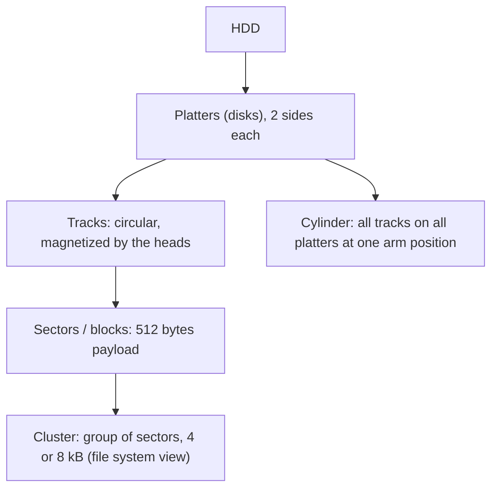
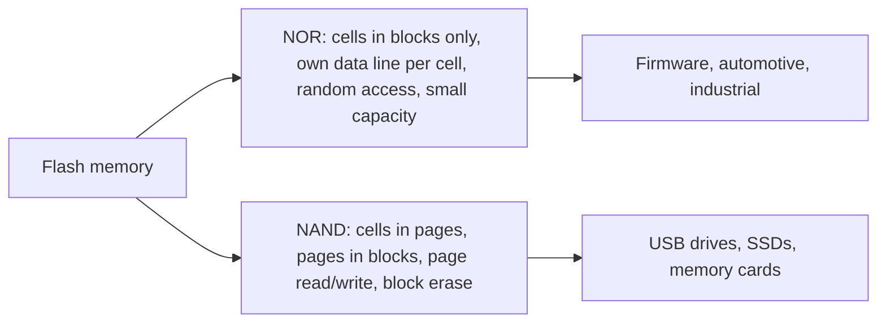
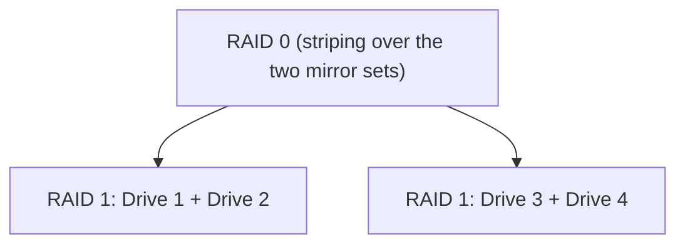

# Hard Disk Drives, Solid State Drives & RAID

> [!Note] 💡 Notation Conventions
> - **HDD** = hard disk drive; **SSD** = solid state drive; **RPM** = revolutions per minute; **CHS** = Cylinder-Head-Sector addressing; **LBA** = Logical Block Addressing; **P/E cycle** = program/erase cycle; **RAID** = Redundant Array of Independent Disks (the cited 1988 paper says *Inexpensive* Disks).
> - **Units:** GB in the CHS calculation is binary: $1\,\text{GB} = 1024^3$ bytes, $1\,\text{kB} = 1024$ bytes.
> - **RAID symbols (from the summary table):** $n$ = number of drives, $k$ = net capacity measured in **drive capacities** (equal-size drives), $X$ = performance (read or write) of a **single** drive.
> - **Binary values** in the parity examples are written as bit strings, e.g. `1010`. $\oplus$ denotes **XOR**.
> - "$\Rightarrow$ slide set $k$" marks a topic treated in slide set $k$.
> - This slide set contains no theorems or proofs. **Exercise sheet 4 was not provided**, so all examples below are taken from the slide content or constructed from it.

---

## 1. Learning Objectives

> [!Property] ⚙️ What You Must Know
> After slide set 4 you should know or understand:
> **1.** the **structure, functioning and characteristics of Hard Disk Drives**;
> **2.** the **structure, functioning and characteristics of Solid State Drives**;
> **3.** the functioning and the most commonly implemented variants of **RAID**.
>
> Knowing how HDDs and SSDs work also helps in understanding file systems and their design principles ($\Rightarrow$ slide set 6). Exercise sheet 4 repeats the contents relevant for these objectives.

---

## 2. Hard Disk Drives: Structure and Characteristics

> [!Definition] 📖 Hard Disk Drive (HDD)
> An **HDD** is a **mechanical** storage device containing one or more **discs (platters)** rotating with **4200, 5400, 7200, 10800 or 15000 RPM**. For **each side of each platter** an arm with a **read-and-write head** exists. The head **detects and modifies the magnetization** of the material, and floats about **20 nanometers** above the disk. HDDs also have a **cache** (usually $\leq 32$ MB) that buffers read and write operations.

> [!Property] ⚙️ Price, Capacity and Speed Compared with Main Memory
> **1.** HDDs are approx. **100 times less expensive per bit** than main memory and offer approx. **100 times more capacity**.
> **2.** **Drawback:** accessing data on HDDs is approx. **1000 times slower**.
> **3.** **Reason for the poorer access time:** HDDs are mechanical devices.

## 📘 Examples & Applications

### Example 2.1: Reading the HDD characteristics (constructed)

**Using:** HDD structure, RPM, platters and heads

> [!Example] 📘 Number of heads and revolution time
> **Given:** an HDD with $3$ platters at $7200$ RPM.
> **Step 1.** One head exists per platter side: $3 \cdot 2 = 6$ heads.
> **Step 2.** One revolution takes $\dfrac{60\,\text{s}}{7200} = 8.33$ ms.
> **Step 3.** A head floating $20$ nm above the disk is the reason for the mechanical sensitivity of HDDs.

---

## 3. Logical Structure of Hard Disk Drives

> [!Definition] 📖 Track, Cylinder, Sector (Block)
> **Track:** the platter surfaces are magnetized by the heads in **circular tracks**.
> **Cylinder:** all tracks on all disks at a **specific arm position**.
> **Sector (block):** the tracks are divided into **logical units (segments of a circle)** called **sectors** or **blocks**. Typically a sector contains **512 bytes** of payload. **Sectors are the smallest addressable units of HDDs.**

> [!Definition] 📖 Cluster
> A **cluster** is a **group of sectors with a fixed size**, e.g. **4 or 8 kB**. Software addresses clusters today ($\Rightarrow$ slide set 6). In file systems of modern operating systems, **clusters are the smallest addressable unit of HDDs**.

> [!Property] ⚙️ Modifying Data
> If data needs to be modified, the **entire sector must be read and rewritten**.



> [!Missing] Figure: Slides 4 and 5, HDD structure (3 platters, tracks, sectors, cylinder, head floating on a cushion of air above the magnetic layer on an aluminum plate), a photo of an opened HDD, and a platter top view with track, track sector, disk sector, cluster, actuator arm and head.

## 📘 Examples & Applications

### Example 3.1: Sectors per cluster and wasted space (constructed)

**Using:** sector, cluster

> [!Example] 📘 A 5000-byte file on an HDD with $512$ B sectors and $4$ kB clusters
> **Step 1.** Sectors per cluster: $\dfrac{4096}{512} = 8$.
> **Step 2.** The file needs $\lceil 5000 / 4096 \rceil = 2$ clusters $= 8192$ bytes.
> **Step 3.** Unused space inside the last cluster: $8192 - 5000 = 3192$ bytes.
> **Step 4.** Modifying one byte forces the whole $512$ B sector to be read and rewritten.

---

## 4. Addressing Data on Hard Disk Drives

> [!Definition] 📖 Cylinder-Head-Sector (CHS) Addressing
> HDDs with a capacity $\leq 8$ GB use **CHS**. The **Parallel ATA** interface and the **BIOS** offer only:
> **10 bits** for cylinders (up to $1024$, cylinder number $0$ is used),
> **8 bits** for heads (up to $255$, head number $0$ is used),
> **6 bits** for sectors per track (up to $63$, sector number $0$ is **not** used).
> Therefore **at most $7.844$ GB** can be addressed this way.

$$1024 \cdot 255 \cdot 63 \cdot 512\,\text{B} = 8\,422\,686\,720\,\text{B}, \qquad \frac{8\,422\,686\,720}{1024^3} = 7.844\,\text{GB}$$

> [!Property] ⚙️ Logical Heads
> **No 2.5" or 3.5" HDD contains more than 16 heads.** **Logical heads** were used to reach the $255$ addressable heads.

> [!Definition] 📖 Logical Block Addressing (LBA)
> HDDs with a capacity $> 7.844$ GB use **LBA**: **all sectors are numbered consecutively, beginning with 0**.

> [!Property] ⚙️ CHS vs. LBA
> With CHS, **all tracks contain the same number of sectors** (each sector stores $512$ bytes). **Drawback: storage capacity is wasted**, because the **data density decreases from the inner to the outer tracks**. With LBA **this drawback does not exist**.

> [!Missing] Figure: Slide 7, CHS addressing (concentric tracks with equal sector counts, cylinders 0, 1, ...) next to LBA addressing (more sectors on outer tracks, sectors numbered consecutively). Source: IT-Handbuch für Fachinformatiker, S. Kersken.

## 📘 Examples & Applications

### Example 4.1: The CHS capacity limit (slide calculation, step by step)

**Using:** CHS addressing, bit widths

> [!Example] 📘 Derive $7.844$ GB
> **Step 1.** Cylinders: $2^{10} = 1024$. Heads: $255$. Sectors per track: $63$ (since $2^6 = 64$ and sector $0$ is not used).
> **Step 2.** Number of sectors: $1024 \cdot 255 \cdot 63 = 16\,450\,560$.
> **Step 3.** Bytes: $16\,450\,560 \cdot 512 = 8\,422\,686\,720$.
> **Step 4.** In GB: $\dfrac{8\,422\,686\,720}{1024 \cdot 1024 \cdot 1024} = 7.844$ GB.

### Example 4.2: What if only $16$ heads could be addressed? (constructed)

**Using:** CHS addressing, logical heads

> [!Example] 📘 Capacity with $16$ heads
> **Step 1.** Replace $255$ by $16$: $1024 \cdot 16 \cdot 63 \cdot 512 = 528\,482\,304$ bytes.
> **Step 2.** $\dfrac{528\,482\,304}{1024^2} = 504$ MB.
> **Step 3.** This shows why **logical heads** (which let a drive report up to $255$ heads) were used when real drives have $\leq 16$ heads.

### Example 4.3: Which addressing method? (constructed)

**Using:** CHS, LBA

> [!Example] 📘 Decide
> **Step 1.** A $2$ GB drive: capacity $\leq 7.844$ GB $\Rightarrow$ CHS is possible.
> **Step 2.** A $500$ GB drive: $> 7.844$ GB $\Rightarrow$ **LBA** is required, with sectors $0, 1, 2, \dots$ numbered consecutively.

---

## 5. Required Time to Access Data on HDDs

> [!Definition] 📖 Average Seek Time
> The **time the arm needs to reach a desired track**. For modern HDDs it is between **5 and 15 ms**.

> [!Definition] 📖 Average Rotational Latency Time
> The **delay until the required sector is located under the head**. It depends **entirely on the rotational speed** and is for modern HDDs between **2 and 7.1 ms**.

$$\text{Average rot. latency}\,[\text{ms}] = \frac{1000\,\frac{\text{ms}}{\text{s}} \cdot 60\,\frac{\text{s}}{\text{min}} \cdot 0.5}{\text{revolutions per min}} = \frac{30\,000\,\frac{\text{ms}}{\text{min}}}{\text{revolutions per min}}$$

> [!Property] ⚙️ Why the Factor $0.5$?
> After the head has reached the right track, **on average a half rotation** of the disk must be waited for the correct sector to be under the head. Hence the average rotational latency is **half the rotational latency**.

> [!Property] ⚙️ Two Factors Influence the Access Time
> The **access time** of an HDD is influenced by the **average seek time** and the **average rotational latency time**. These are the two factors the slides name.

> [!Warning] ⚠️ Possible Gap
> The slide names the two factors but does **not state the formula** "access time $=$ seek time $+$ rotational latency", nor does it include the **transfer time**. The sum used in the examples below is my reading of "two factors influence the access time".

## 📘 Examples & Applications

### Example 5.1: Rotational latency for all RPM values on the slide (constructed)

**Using:** average rotational latency formula

> [!Example] 📘 Compute $30\,000 / \text{RPM}$
> | RPM | Average rotational latency |
> |:-:|:-:|
> | 4200 | $\dfrac{30\,000}{4200} = 7.14$ ms |
> | 5400 | $\dfrac{30\,000}{5400} = 5.56$ ms |
> | 7200 | $\dfrac{30\,000}{7200} = 4.17$ ms |
> | 10 800 | $\dfrac{30\,000}{10\,800} = 2.78$ ms |
> | 15 000 | $\dfrac{30\,000}{15\,000} = 2.00$ ms |
>
> The extremes $7.14$ ms ($\approx 7.1$) and $2.00$ ms match the range $2$ to $7.1$ ms on the slide.

### Example 5.2: Expected access time (constructed)

**Using:** seek time, rotational latency

> [!Example] 📘 A $7200$ RPM drive with $9$ ms average seek time
> **Step 1.** Rotation time: $\dfrac{60\,000\,\text{ms}}{7200} = 8.33$ ms, half of it: $4.17$ ms.
> **Step 2.** Access time $\approx 9 + 4.17 = 13.17$ ms (seek plus rotational latency).
> **Step 3.** Compare a $15\,000$ RPM drive with $5$ ms seek time: $5 + 2.00 = 7.00$ ms, so roughly $1.9$ times faster.

---

## 6. Solid State Drives (SSD)

> [!Definition] 📖 Solid State Drive (SSD)
> SSDs are sometimes **falsely called "Solid State Disks"**. They contain **no moving parts** and store data in **flash memory** (NAND, see §8).

> [!Property] ⚙️ Benefits and Drawbacks
> **Benefits:** **fast access time**, **low power consumption**, **no noise**, **mechanical robustness**, **low weight**. **The location of data does not matter $\Rightarrow$ defragmenting makes no sense.**
> **Drawbacks:** **higher price** than HDDs of the same capacity, **secure delete or overwrite is hard to implement**, **limited number of program/erase cycles**.

> [!Missing] Figure: Slide 9, a photo of an SSD circuit board (NAND chips, controller, SATA connector) next to an opened HDD.

## 📘 Examples & Applications

### Example 6.1: HDD vs. SSD (constructed from slides 3, 9 and 19)

**Using:** SSD benefits and drawbacks, HDD characteristics

> [!Example] 📘 Comparison table
> | Aspect | HDD | SSD |
> |---|---|---|
> | Moving parts | yes (platters, arms) | none |
> | Latency | $4$ to $5$ ms (2018 model $4$ to $5$ ms, 2025 model $4.16$ ms) | $\leq 20$ to $100\,\mu$s |
> | Power / noise / robustness | higher / noisy / sensitive | low / silent / robust |
> | Price for same capacity | lower | higher |
> | Defragmentation | useful (data location matters) | pointless (location does not matter) |
> | Wear | no P/E limit | limited P/E cycles |

---

## 7. Functioning of Flash Memory Cells

> [!Definition] 📖 Flash Memory Cell
> Data is stored as **electrical charges**. **In contrast to main memory, no electricity is required to keep the data.** Each cell is a **transistor with 3 connectors**:
> **Gate** = control electrode (the cell has a **control gate** above an **insulator** and a **floating gate**),
> **Drain** = electrode,
> **Source** = electrode.
> The **floating gate stores electrons (the data)**. It is **completely surrounded by an insulator**, so the charge **remains stable for years**.
> Structure: Source (n-doped layer) and Drain (n-doped layer) are separated by a **p-doped semiconductor**.

> [!Missing] Figure: Slides 10 to 13, cross-section of a flash cell (control gate, insulator, floating gate on top; source and drain n-doped layers with a p-doped semiconductor between them) with the voltages for idle, read, write and erase.

### 7.1 Reading

> [!Property] ⚙️ Reading a Cell
> **1.** The p-doped semiconductor separates the two n-doped electrodes. As in an **npn transistor**, the npn passage is **not conductive without a base current**.
> **2.** Above a certain positive gate voltage (the **threshold**, about **5 V**), an **n-type channel** forms in the p-area and **current can flow between source and drain**.
> **3.** If the **floating gate contains electrons**, the **threshold is different**: a **higher positive voltage** at the gate is required for current to flow.
> **4.** This way the **stored value is read out**.
> Voltages in the figure: control gate approx. $5$ V, source $0$ V, drain approx. $1$ V.

### 7.2 Writing

> [!Definition] 📖 Fowler-Nordheim Tunneling (Programming)
> Data is stored by applying a **high positive voltage to the control gate** (approx. **12 V**, sufficient range **6 to 20 V**, drain approx. **5 V**, source $0$ V). Electrons flow between source and drain, and **some electrons are tunneled through the insulator into the floating gate**.

### 7.3 Erasing

> [!Property] ⚙️ Erasing a Cell
> A **negative voltage** ($-6$ to $-20$ V, approx. **$-12$ V**) is applied at the control gate (source approx. $5$ V, drain **open**). **Electrons tunnel in the reverse direction out of the floating gate.**
> **Wear:** the insulating layer around the floating gate **suffers from each erase cycle**. At some point it can no longer hold the charge, so flash memory **survives only a limited number of program/erase cycles**.

## 📘 Examples & Applications

### Example 7.1: Reading a stored bit (constructed)

**Using:** read operation, threshold voltage

> [!Example] 📘 Decide the cell state from the threshold
> **Step 1.** Apply the normal gate voltage of about $5$ V with $1$ V at the drain.
> **Step 2.** If **current flows**, the threshold was not raised, so the floating gate holds **no (or few) electrons**.
> **Step 3.** If **no current flows** at that voltage, a **higher threshold** is in force, so the floating gate **contains electrons**.
> **Step 4.** Which of the two states means logical $0$ or $1$ is not defined on the slides (see the SLC figure in §9, where the charged state corresponds to the higher-voltage level).

### Example 7.2: Voltage summary

**Using:** read, write, erase voltages

> [!Example] 📘 Table of the slide values
> | Operation | Control gate | Source | Drain | Effect |
> |---|:-:|:-:|:-:|---|
> | Read | approx. $5$ V | $0$ V | approx. $1$ V | current flow depends on the charge in the floating gate |
> | Write | approx. $12$ V ($6$ to $20$ V) | $0$ V | approx. $5$ V | electrons tunnel into the floating gate |
> | Erase | approx. $-12$ V ($-6$ to $-20$ V) | approx. $5$ V | open | electrons tunnel out of the floating gate |

---

## 8. Organization of Flash Memory: Blocks, Pages, NOR and NAND

> [!Definition] 📖 Blocks and Pages
> Memory cells are connected to **blocks** and (depending on the structure) **pages**. A **block always contains a fixed number of pages**. **Write and erase operations can only be carried out for entire pages or blocks**, so they are **more complex than read operations**.

> [!Property] ⚙️ Modifying Data in a Page
> If data in a page needs to be modified, the **entire block must be erased**:
> **1.** the block is **copied into a buffer memory (cache)**;
> **2.** inside the cache the data is **modified**;
> **3.** the block is **erased** from the flash memory;
> **4.** the **modified block is written** into the flash memory.

> [!Definition] 📖 NOR Memory
> **Each memory cell has its own data line.**
> **Benefit:** **random access** for read and write $\Rightarrow$ **better latency** than NAND.
> **Drawbacks:** **more complex ($\Rightarrow$ expensive)** construction, **higher power consumption** than NAND, typically **small capacities ($\leq 32$ MB)**.
> **No pages:** the cells are grouped into **blocks** (typical sizes **64, 128 or 256 kB**). **No random access for erase operations:** erasing is only possible for entire blocks.
> **Applications:** industrial environment (e.g. automotive), storing the **firmware** of a computer system (example: iPhone 3G).

> [!Definition] 📖 NAND Memory
> The memory cells are grouped into **pages** (typical page size **512 to 8192 bytes**, each page has its own data line). **Each block consists of a number of pages** (typical **32, 64, 128 or 256 pages**).
> **Benefit:** fewer data lines $\Rightarrow$ needs **less than $50\%$ of the surface area of NOR** and has **lower manufacturing cost**.
> **Drawbacks:** **no random access** $\Rightarrow$ poorer latency than NOR. **Read and write** only for **entire pages**, **erase** only for **entire blocks**.
> **Applications:** USB flash drives, **SSDs**, memory cards.



| Property | NOR | NAND |
|---|---|---|
| Data lines | one per cell | one per page |
| Random access | yes (read/write) | no |
| Latency | better | poorer |
| Surface area / cost | larger / more expensive | $< 50\%$ of NOR / cheaper |
| Power consumption | higher | lower |
| Capacity | typically $\leq 32$ MB | large |
| Structure | blocks (64, 128, 256 kB) | pages (512 B to 8 kB) in blocks (32 to 256 pages) |
| Erase | entire blocks | entire blocks |

> [!Missing] Figure: Slide 16, a NAND block drawn as $128$ pages $\times$ $4$ kB $= 512$ kB. Slide 15, NOR flash on the iPhone 3G mainboard. Slide 16, photos of a USB drive, SD card, CompactFlash card and a Samsung SSD.

## 📘 Examples & Applications

### Example 8.1: Block size and rewriting one page (from slide 16, constructed numbers)

**Using:** NAND blocks and pages, modification of data

> [!Example] 📘 Change $1$ byte in a block of $128$ pages $\times$ $4$ kB
> **Step 1.** Block size: $128 \cdot 4\,\text{kB} = 512$ kB (as in the slide figure).
> **Step 2.** The block is **copied into the cache**.
> **Step 3.** The byte is **modified in the cache**.
> **Step 4.** The block is **erased** in the flash memory.
> **Step 5.** The **entire modified block** is written back: $512$ kB are programmed for a $1$ byte change.
> **Step 6.** Ratio $512\,\text{kB} / 1\,\text{B} = 524\,288$. This extreme overhead is why writes are more complex than reads and why SSDs wear out when pages are rewritten often. (A real SSD controller reduces it; this is the slide's simplified model.)

### Example 8.2: Which flash type? (constructed)

**Using:** NOR vs. NAND

> [!Example] 📘 Decide
> **Step 1.** A car's engine controller stores its firmware and needs **random access** and good latency with a small capacity $\Rightarrow$ **NOR**.
> **Step 2.** A $512$ GB SSD needs **large capacity at low cost** $\Rightarrow$ **NAND**.
> **Step 3.** A USB stick or SD card $\Rightarrow$ **NAND**.

---

## 9. Single-, Multi-, Triple- and Quad-Level Cells

> [!Definition] 📖 SLC, MLC, TLC, QLC
> **4 types of NAND flash memory** exist, by the number of bits stored per cell:
> **SLC** (Single-Level Cell): **1 bit**. **MLC** (Multi-Level Cell): **2 bits**. **TLC** (Triple-Level Cell): **3 bits**. **QLC** (Quad-Level Cell): **4 bits**.
> A cell storing $b$ bits must distinguish $2^b$ voltage levels.

| Type | Bits per cell $b$ | Voltage levels $2^b$ | Approx. P/E cycles survived |
|---|:-:|:-:|:-:|
| SLC | 1 | 2 | $100\,000$ to $300\,000$ |
| MLC | 2 | 4 | $10\,000$ |
| TLC | 3 | 8 | $1000$ |
| QLC | 4 | 16 | $1000$ |

> [!Property] ⚙️ SLC Properties
> **SLC storage** is the **most expensive**, provides the **best write speed**, and **survives the most P/E cycles**. Also memory cells exist that survive **millions** of P/E cycles.

> [!Missing] Figure: Slide 17, voltage ranges for SLC ($0$/$1$), MLC ($00$ to $11$), TLC ($000$ to $111$) and QLC ($0000$ to $1111$) over a voltage axis from $0$ V. More bits per cell means more, narrower voltage ranges.

## 📘 Examples & Applications

### Example 9.1: Levels and capacity (constructed)

**Using:** SLC, MLC, TLC, QLC

> [!Example] 📘 Same number of cells, different types
> **Given:** $8 \cdot 10^9$ cells.
> **Step 1.** SLC stores $1$ bit per cell: $8$ Gbit $= 1$ GB (decimal).
> **Step 2.** MLC: $16$ Gbit $= 2$ GB. TLC: $24$ Gbit $= 3$ GB. QLC: $32$ Gbit $= 4$ GB.
> **Step 3.** Cost per bit falls with more bits per cell, but endurance falls from $\approx 100\,000$ (SLC) to $\approx 1000$ P/E cycles (TLC/QLC).

### Example 9.2: Idealized lifetime (constructed)

**Using:** P/E cycles, wear leveling

> [!Example] 📘 A $500$ GB TLC SSD
> **Assumptions (not from the slides):** perfect wear leveling, no write amplification.
> **Step 1.** Total data writable $\approx 1000 \cdot 500\,\text{GB} = 500\,000$ GB $= 500$ TB.
> **Step 2.** At $100$ GB written per day: $\dfrac{500\,000}{100} = 5000$ days $\approx 13.7$ years.
> **Step 3.** Without wear leveling, the hot blocks reach the P/E limit long before this (see §10).

---

## 10. Wear Leveling

> [!Definition] 📖 Wear Leveling
> **Wear leveling algorithms evenly distribute write operations** over all blocks. Without them **hot blocks** (blocks written very often) reach the P/E limit $X$ and **wear out**, while other blocks are hardly used.

> [!Property] ⚙️ File Systems for Flash
> File systems designed for flash memory minimize write operations, e.g. **JFFS, JFFS2, YAFFS and LogFS**. **JFFS contains its own wear leveling algorithm**, which is often required in **embedded systems where flash memory is directly connected**.

> [!Missing] Figure: Slide 18, two bar charts of the P/E count per block number $0$ to $9$. Left: hot blocks $0$ to $3$ with high counts approaching the limit $X$, blocks $4$ to $9$ nearly unused. Right: after wear leveling, all blocks have a similar low count.

## 📘 Examples & Applications

### Example 10.1: Effect of wear leveling (constructed from slide 18)

**Using:** wear leveling, P/E count

> [!Example] 📘 $10$ blocks, $40$ erase operations
> **Without wear leveling:** all erases hit the $4$ hot blocks $0$ to $3$: each block is erased $\dfrac{40}{4} = 10$ times.
> **With wear leveling:** the erases are spread over all $10$ blocks: each is erased $\dfrac{40}{10} = 4$ times.
> **Result:** the highest P/E count drops from $10$ to $4$, so the first block reaches the limit $X$ about $2.5$ times later.

---

## 11. Latency Gap and the Motivation for RAID

> [!Property] ⚙️ CPU Speed Grows Faster Than HDD Latency
> The performance of **CPUs, cache and main memory is growing faster than the data access time (latency) of HDDs**.
> **SSD latency:** $\leq 20$ to $100\,\mu$s $\Rightarrow$ roughly **a factor of $100$ better than HDDs**. The gap grows because of **interface limitations and multiple CPU cores**.
> **Further challenge:** storage drives can **fail** $\Rightarrow$ **risk of data loss**.
> Solution to enhance **latency and reliability** of HDDs and SSDs: **RAID**.

| Year | HDD (model) | Capacity | Latency |
|:-:|---|:-:|:-:|
| 1973 | IBM 3340 | 30 MB | 30 ms |
| 1989 | Maxtor LXT100S | 96 MB | 29 ms |
| 1998 | IBM DHEA-36481 | 6 GB | 16 ms |
| 2006 | Maxtor STM320820A | 320 GB | 14 ms |
| 2011 | Western Digital WD30EZRSDTL | 3 TB | 8 ms |
| 2018 | Seagate BarraCuda Pro ST14000DM001 | 14 TB | 4 to 5 ms |
| 2025 | Seagate Exos M ST30000NM004K | 30 TB | 4.16 ms |

| Year | CPU | Clock speed |
|:-:|---|:-:|
| 1971 | Intel 4004 | 740 kHz |
| 1989 | Intel 486DX | 25 MHz |
| 1997 | AMD K6-2 | 550 MHz |
| 2007 | AMD Opteron Santa Rosa F3 | 2.8 GHz |
| 2010 | Intel Core i7 980X Extreme (6 cores) | 3.33 GHz |
| 2018 | AMD Ryzen Threadripper 2990WX (32 cores) | 3 GHz |
| 2020 | AMD Ryzen Threadripper 3990X (64 cores) | 2.9 GHz |
| 2025 | AMD Ryzen Threadripper PRO 9995WX (96 cores) | 2.5 GHz |

## 📘 Examples & Applications

### Example 11.1: How much did latency and clock speed change? (constructed from the tables)

**Using:** latency table, CPU table

> [!Example] 📘 Ratios
> **HDD latency 1973 $\rightarrow$ 2025:** $\dfrac{30}{4.16} \approx 7.2$ times better, while capacity grew $\dfrac{30\,\text{TB}}{30\,\text{MB}} = 10^6$ times.
> **CPU clock 1971 $\rightarrow$ 2010:** $\dfrac{3.33\,\text{GHz}}{740\,\text{kHz}} \approx 4500$ times faster, and since then the number of cores grew (up to $96$).
> **Conclusion:** latency barely improved compared with CPU performance, so the gap grows $\Rightarrow$ SSDs and RAID.
> **SSD vs. HDD (2025):** $\dfrac{4160\,\mu\text{s}}{100\,\mu\text{s}} = 41.6$ up to $\dfrac{4160}{20} = 208$, i.e. on the order of the slide's factor $100$.

---

## 12. RAID: Redundant Array of Independent Disks

> [!Definition] 📖 RAID
> The performance of HDDs **cannot be improved infinitely** (moving parts, physical boundaries). One way around limits in **speed, capacity and reliability** is the **parallel use of multiple components**. A **RAID consists of multiple drives (HDDs or SSDs)**. For users and processes **a RAID behaves like a single large drive**. **Data is distributed across the drives**, and the **RAID level specifies how**. The most commonly used levels are **RAID 0, RAID 1 and RAID 5**.
> Source: Patterson, Gibson, Katz, *A Case for Redundant Arrays of Inexpensive Disks (RAID)*, ACM (1988).

### 12.1 RAID 0: Striping

> [!Definition] 📖 RAID 0
> **No redundancy.** It **increases only the data rate**. Drives are partitioned into **blocks of equal size**. If read/write operations are big enough ($> 4$ or $8$ kB), they can be carried out **in parallel on multiple or all drives**.
> **Drive failure:** the **entire data cannot be reconstructed**; only small files stored entirely on the remaining drives can (in theory) be reconstructed.
> **Use only when security is irrelevant or backups are made regularly.**

| Drive 1 | Drive 2 |
|:-:|:-:|
| Block 0 | Block 1 |
| Block 2 | Block 3 |
| Block 4 | Block 5 |
| Block 6 | Block 7 |
| Block 8 | Block 9 |
| Block 10 | Block 11 |

### 12.2 RAID 1: Mirroring

> [!Definition] 📖 RAID 1
> **At least 2 drives of the same capacity** store **identical data**. If the drives differ in size, RAID 1 provides **only the capacity of the smallest drive**. **Failure of a single drive causes no data loss**, because the remaining drives hold identical data. **A total loss occurs only if all drives fail.** Any change of data is written to **all drives**.
> **Not a backup replacement:** corrupted file operations or virus attacks happen on **all** drives.
> **Read performance** can be increased by an **intelligent distribution of requests** to the attached drives.

| Drive 1 | Drive 2 |
|:-:|:-:|
| Block 0 | Block 0 |
| Block 1 | Block 1 |
| Block 2 | Block 2 |
| Block 3 | Block 3 |
| Block 4 | Block 4 |
| Block 5 | Block 5 |

### 12.3 RAID 2 and RAID 3

> [!Definition] 📖 RAID 2
> **Bit-level striping with Hamming code error correction.** **Each sequential bit is stored on a different drive.** Bits whose positions are **powers of 2** ($1, 2, 4, 8, 16, \dots$) are **parity bits**. The individual parity bits are **distributed over multiple drives** $\Rightarrow$ increases throughput. **Used only in mainframes, no longer relevant.**

> [!Warning] ⚠️ Possible Gap
> The slide text says positions that are powers of $2$ are parity bits, but its figure shows **drives 1 to 4 holding the data bits (Bit 0 to 23)** and **drives 5 to 7 holding Parity 1, 2, 3** (groups of 4 bits, e.g. Bit 0 to 3). How the parity positions map to the figure is not explained on the slide.

> [!Definition] 📖 RAID 3
> **Byte-level striping with parity information on a dedicated parity drive.** Each write on the RAID causes a **write on the dedicated parity drive** $\Rightarrow$ **bottleneck**. **Replaced by RAID 5.**
> **Parity rule:** sum the bits on the payload drives. If the **sum is even**, the parity bit is **$0$**. If the **sum is odd**, the parity bit is **$1$**. This is the **XOR** of the payload bits.

| Payload bits | Sum | Even/odd | Parity bit |
|:-:|:-:|:-:|:-:|
| $0+0+0$ | 0 | even | 0 |
| $1+0+0$ | 1 | odd | 1 |
| $1+1+0$ | 2 | even | 0 |
| $1+1+1$ | 3 | odd | 1 |
| $1+0+1$ | 2 | even | 0 |
| $0+1+1$ | 2 | even | 0 |
| $0+1+0$ | 1 | odd | 1 |
| $0+0+1$ | 1 | odd | 1 |

| Drive 1 | Drive 2 | Drive 3 | Drive 4 (parity) |
|:-:|:-:|:-:|:-:|
| Byte 0 | Byte 1 | Byte 2 | Parity (Byte 0-2) |
| Byte 3 | Byte 4 | Byte 5 | Parity (Byte 3-5) |
| Byte 6 | Byte 7 | Byte 8 | Parity (Byte 6-8) |
| Byte 9 | Byte 10 | Byte 11 | Parity (Byte 9-11) |

### 12.4 RAID 4

> [!Definition] 📖 RAID 4
> **Block-level striping with parity on a dedicated parity drive.** Difference to RAID 3: not individual bits or bytes but **blocks (chunks)** are stored. $P(16\text{-}19) = \text{Block 16} \oplus \text{Block 17} \oplus \text{Block 18} \oplus \text{Block 19}$.
> **Drawbacks:** every write causes a write on the parity drive $\Rightarrow$ **bottleneck**, and the **dedicated parity drive fails more frequently**.
> **Seldom implemented**, because RAID 5 avoids these drawbacks. **NetApp implements RAID 4** in its NAS servers (FAS2020, FAS2050, FAS3040, FAS3140, FAS6080).

| Drive 1 | Drive 2 | Drive 3 | Drive 4 | Drive 5 (parity) |
|:-:|:-:|:-:|:-:|:-:|
| Block 0 | Block 1 | Block 2 | Block 3 | P(0-3) |
| Block 4 | Block 5 | Block 6 | Block 7 | P(4-7) |
| Block 8 | Block 9 | Block 10 | Block 11 | P(8-11) |
| Block 12 | Block 13 | Block 14 | Block 15 | P(12-15) |
| Block 16 | Block 17 | Block 18 | Block 19 | P(16-19) |
| Block 20 | Block 21 | Block 22 | Block 23 | P(20-23) |

### 12.5 RAID 5

> [!Definition] 📖 RAID 5
> **Block-level striping with distributed parity.** Payload and parity are **distributed to all drives**.
> **Benefits:** **high throughput**, **high security level against data loss**, parity spread across all drives (no dedicated parity drive).
> **The overhead of small writes remains.** $P(16\text{-}19) = \text{block 16} \oplus \text{17} \oplus \text{18} \oplus \text{19}$.

| Drive 1 | Drive 2 | Drive 3 | Drive 4 | Drive 5 |
|:-:|:-:|:-:|:-:|:-:|
| Block 0 | Block 1 | Block 2 | Block 3 | **P(0-3)** |
| Block 4 | Block 5 | Block 6 | **P(4-7)** | Block 7 |
| Block 8 | Block 9 | **P(8-11)** | Block 10 | Block 11 |
| Block 12 | **P(12-15)** | Block 13 | Block 14 | Block 15 |
| **P(16-19)** | Block 16 | Block 17 | Block 18 | Block 19 |
| Block 20 | Block 21 | Block 22 | Block 23 | **P(20-23)** |

### 12.6 RAID 6

> [!Definition] 📖 RAID 6
> **Block-level striping with double distributed parity.** Functioning is **similar to RAID 5**, but it can handle the **simultaneous failure of up to 2 drives**. Compared with RAID 5: **better availability, lower write performance**, and **higher effort to write the parity information**.

| Drive 1 | Drive 2 | Drive 3 | Drive 4 | Drive 5 |
|:-:|:-:|:-:|:-:|:-:|
| Block 0 | Block 1 | Block 2 | **P(0-2)** | **P(0-2)** |
| Block 3 | Block 4 | **P(3-5)** | **P(3-5)** | Block 5 |
| Block 6 | **P(6-8)** | **P(6-8)** | Block 7 | Block 8 |
| **P(9-11)** | **P(9-11)** | Block 9 | Block 10 | Block 11 |
| **P(12-14)** | Block 12 | Block 13 | Block 14 | **P(12-14)** |
| Block 15 | Block 16 | Block 17 | **P(15-17)** | **P(15-17)** |

> [!Note] 💡 Reading the RAID 6 Figure
> Each stripe stores $3$ data blocks and **two** parity blocks (labelled with the same name on the slide, e.g. $P(0\text{-}2)$ on drives 4 and 5), and the parity position rotates from stripe to stripe. The slide does not explain how the two parity values differ.

## 📘 Examples & Applications

### Example 12.1: RAID 0 and RAID 1 block placement (constructed from the figures)

**Using:** RAID 0 striping, RAID 1 mirroring

> [!Example] 📘 Where does block $b$ live?
> **RAID 0 (2 drives):** block $b$ is on drive $(b \bmod 2) + 1$: block $6$ on drive $1$, block $7$ on drive $2$, block $11$ on drive $2$.
> **RAID 1 (2 drives):** block $b$ is on **both** drives. A read can be served by either drive (read performance up to $2X$), but a write must go to both (write performance $X$).
> **Drive 2 fails:** RAID 0 loses every odd block (the file data is destroyed), RAID 1 loses nothing.

### Example 12.2: RAID 3, 4, 5 parity and reconstruction (constructed)

**Using:** parity, XOR, RAID 3, RAID 4, RAID 5

> [!Example] 📘 Parity of three blocks and recovery of a lost block
> **Given:** $B_1 = 1010$, $B_2 = 0110$, $B_3 = 1100$ on three payload drives.
> **Step 1 (compute parity).** $P = B_1 \oplus B_2 \oplus B_3$:
> $1010 \oplus 0110 = 1100$, then $1100 \oplus 1100 = 0000$. So $P = 0000$.
> **Step 2 (drive 2 fails).** Recover $B_2 = P \oplus B_1 \oplus B_3$:
> $0000 \oplus 1010 = 1010$, then $1010 \oplus 1100 = 0110$. So $B_2 = 0110$ is restored.
> **Step 3 (RAID 3 view, one bit).** Payload bits $1, 1, 0$: sum $= 2$ is even, so parity bit $= 0$. If the second bit is lost: known bits $1 + 0 = 1$, the total must be even, so the lost bit is $1$.
> **Step 4.** If the **parity** drive fails, it is simply recomputed from the payload blocks.

### Example 12.3: Parity position in RAID 5 (derived from the figure)

**Using:** RAID 5 layout

> [!Example] 📘 Which drive holds the parity of stripe $s$ in the $5$-drive figure?
> **Step 1.** Stripes $0$ to $5$ place their parity on drives $5, 4, 3, 2, 1, 5$.
> **Step 2.** Rule (read from the figure): drive $= 5 - (s \bmod 5)$.
> **Step 3.** Stripe $6$: $5 - 1 = 4$, drive $4$. Stripe $7$: drive $3$.
> **Step 4.** Because every drive takes a share of the parity writes, **no dedicated parity drive becomes a bottleneck**, unlike RAID 3 and 4.

### Example 12.4: Why is RAID 6 safer than RAID 5? (constructed)

**Using:** RAID 5, RAID 6

> [!Example] 📘 Two drives fail at once
> **Step 1.** RAID 5 stores **one** parity block per stripe $\Rightarrow$ it can restore **one** missing block per stripe.
> **Step 2.** With two failed drives, a stripe misses **two** blocks $\Rightarrow$ RAID 5 cannot recover.
> **Step 3.** RAID 6 stores **two** parity blocks per stripe $\Rightarrow$ it can recover from up to **two** failed drives.
> **Step 4.** Price: **lower write performance** and **less net capacity** ($n-2$ instead of $n-1$).

---

## 13. Summary Table and RAID Combinations

> [!Property] ⚙️ Choosing a Level
> **The best performance, availability not important** $\Rightarrow$ **RAID 0**.
> **The best availability, performance not important** $\Rightarrow$ **RAID 1**.
> **A combination of performance and availability** $\Rightarrow$ **RAID 5 or RAID 6**.

| RAID | $n$ (drives) | $k$ (net capacity) | Allowed to fail | Performance (read) | Performance (write) |
|:-:|:-:|:-:|:-:|:-:|:-:|
| 0 | $\geq 2$ | $n$ | 0 (none) | $n \cdot X$ | $n \cdot X$ |
| 1 | $\geq 2$ | $1$ | $n-1$ drives | $n \cdot X$ | $X$ |
| 2 | $\geq 3$ | $n - \lfloor\log_2 n\rfloor$ | 1 drive | variable | variable |
| 3 | $\geq 3$ | $n-1$ | 1 drive | $(n-1) \cdot X$ | $(n-1) \cdot X$ |
| 4 | $\geq 3$ | $n-1$ | 1 drive | $(n-1) \cdot X$ | $(n-1) \cdot X$ |
| 5 | $\geq 3$ | $n-1$ | 1 drive | $(n-1) \cdot X$ | $(n-1) \cdot X$ |
| 6 | $\geq 4$ | $n-2$ | 2 drives | $(n-2) \cdot X$ | $(n-2) \cdot X$ |

> [!Property] ⚙️ Remarks to the Table
> $X$ is the performance of a **single drive** during read or write. The **maximum possible performance in theory is often limited by the controller and the computing power of the CPU**. If the drives of a RAID 1 differ in size, the net capacity of a RAID 1 equals the capacity of its **smallest drive**.

> [!Warning] ⚠️ Possible Gap
> The table gives the **theoretical** values. RAID 3 and 4 are said to suffer a **write bottleneck at the dedicated parity drive**, and RAID 5 keeps the **small-write overhead**, so the write column $(n-1) \cdot X$ is an upper bound and not what these levels deliver for small writes. The slide's $\log_2 n$ for RAID 2 is written with brackets and is read here as the integer part.

> [!Definition] 📖 RAID Combinations
> **At least 2 RAIDs are combined to a bigger RAID.** Usually RAID **0, 1 or 5** is used. Naming "RAID $xy$": **multiple RAID $x$ are connected to a RAID $y$.**
> **RAID 00:** multiple RAID 0 connected to a RAID 0. **RAID 01:** multiple RAID 0 connected to a RAID 1. **RAID 05:** multiple RAID 0 connected to a RAID 5. **RAID 10:** multiple RAID 1 connected to a RAID 0. **RAID 15:** multiple RAID 1 connected to a RAID 5. **RAID 50:** multiple RAID 5 connected to a RAID 0. **RAID 51:** multiple RAID 5 connected to a RAID 1.

| Mirror set A (RAID 1) | Mirror set A (RAID 1) | Mirror set B (RAID 1) | Mirror set B (RAID 1) |
|:-:|:-:|:-:|:-:|
| **Drive 1** | **Drive 2** | **Drive 3** | **Drive 4** |
| Block 0 | Block 0 | Block 1 | Block 1 |
| Block 2 | Block 2 | Block 3 | Block 3 |
| Block 4 | Block 4 | Block 5 | Block 5 |

> [!Note] 💡 RAID 10 Figure
> Two RAID 1 mirror sets (drives 1+2 and drives 3+4) are striped by a RAID 0: even blocks go to set A, odd blocks to set B.



## 📘 Examples & Applications

### Example 13.1: Net capacity, fault tolerance and speed for $6 \times 2$ TB (constructed)

**Using:** RAID summary table, combinations

> [!Example] 📘 Fill the table with $n = 6$, drive capacity $2$ TB
> | RAID | Net capacity $k \cdot 2$ TB | Failures tolerated | Read | Write |
> |:-:|:-:|:-:|:-:|:-:|
> | 0 | $6 \cdot 2 = 12$ TB | 0 | $6X$ | $6X$ |
> | 1 | $1 \cdot 2 = 2$ TB | $5$ | $6X$ | $X$ |
> | 5 | $5 \cdot 2 = 10$ TB | 1 | $5X$ | $5X$ (theory) |
> | 6 | $4 \cdot 2 = 8$ TB | 2 | $4X$ | $4X$ (theory) |
> | 10 (3 mirror pairs) | $3 \cdot 2 = 6$ TB | at least 1 (one drive per pair may fail, derived) | not in the table | not in the table |

### Example 13.2: RAID 1 with different drive sizes

**Using:** RAID 1

> [!Example] 📘 A $2$ TB and a $3$ TB drive
> **Step 1.** The mirror needs identical data on both drives.
> **Step 2.** The net capacity is that of the smaller drive: $\min(2, 3) = 2$ TB. The extra $1$ TB of the larger drive is unused.

### Example 13.3: Choosing a level (constructed)

**Using:** RAID selection rules

> [!Example] 📘 Decide
> **Step 1.** A video-editing scratch disk with regular backups, speed matters $\Rightarrow$ **RAID 0**.
> **Step 2.** A small server where uptime matters more than speed or capacity $\Rightarrow$ **RAID 1**.
> **Step 3.** A file server needing both throughput and fault tolerance $\Rightarrow$ **RAID 5** (one failure) or **RAID 6** (two failures).

---

## 14. Hardware, Host and Software RAID

> [!Definition] 📖 Hardware RAID
> A **RAID controller with its own processor** calculates the parity information and **monitors the state of the RAID**.
> **Benefits:** **operating system independent**, **no additional CPU load**.
> **Drawback:** **high price** (approx. 200 EUR on the slide).

> [!Definition] 📖 Host RAID / Firmware RAID / FakeRAID
> Either an **inexpensive RAID controller** or the **motherboard firmware (BIOS/UEFI)** provides the RAID functionality. **The CPU does all the RAID-related workload.** It usually supports **only RAID 0 and RAID 1**.
> **Benefit:** **lower price** (approx. 50 EUR).
> **Drawbacks:** **operating system dependent (hardware drivers)**, **additional CPU load**, possible dependence on **rare hardware**.

> [!Definition] 📖 Software RAID
> **Linux, Windows and macOS** allow connecting drives to a RAID **without a RAID controller**.
> **Benefit:** **no cost for additional hardware**. **Drawbacks:** **operating system dependent**, **additional CPU load**.

| Variant | Who computes parity | OS independent | CPU load | Price (slide) | Levels |
|---|---|:-:|:-:|:-:|---|
| Hardware RAID | controller with processor | yes | none | approx. 200 EUR | all |
| Host / Firmware RAID | CPU | no (drivers) | yes | approx. 50 EUR | usually 0 and 1 |
| Software RAID | CPU (OS) | no | yes | none | OS dependent |

> [!Property] ⚙️ Linux Software RAID with `mdadm`
> ```bash
> # Create a RAID 1 (md0) with the partitions sda1 and sdb1
> mdadm --create /dev/md0 --auto md --level=1 --raid-devices=2 /dev/sda1 /dev/sdb1
>
> # Information about any software RAID in the system
> cat /proc/mdstat
>
> # Information about a specific software RAID
> mdadm --detail /dev/md0
>
> # Remove partition sdb1 and add partition sdc1 to the RAID
> mdadm /dev/md0 --remove /dev/sdb1
> mdadm /dev/md0 --add /dev/sdc1
> ```

> [!Missing] Figure: Slide 30, photos of the Adaptec SATA RAID 2410SA and SATA II RAID 1220SA controller cards.

## 📘 Examples & Applications

### Example 14.1: Replacing a failed drive in a software RAID 1 (from slide 31)

**Using:** software RAID, `mdadm`

> [!Example] 📘 `sdb1` fails, `sdc1` is the new partition
> **Step 1.** Check the state: `cat /proc/mdstat` and `mdadm --detail /dev/md0` show the degraded array.
> **Step 2.** Remove the failed partition: `mdadm /dev/md0 --remove /dev/sdb1`.
> **Step 3.** Add the new partition: `mdadm /dev/md0 --add /dev/sdc1`.
> **Step 4.** The data is mirrored onto `sdc1`. During this time the RAID 1 runs with a single complete copy.

### Example 14.2: Choosing the RAID implementation (constructed)

**Using:** hardware, host, software RAID

> [!Example] 📘 Decide
> **Step 1.** A server must keep a low CPU load and run any OS $\Rightarrow$ **hardware RAID**.
> **Step 2.** A cheap home NAS with $2$ disks mirrored $\Rightarrow$ **host RAID** (RAID 0/1) or **software RAID** (no extra hardware cost).
> **Step 3.** A RAID 5 with no budget for a controller $\Rightarrow$ **software RAID** (the CPU computes the parity).

---

## 15. Combined Exam-Style Problem

## 📘 Examples & Applications

### Example 15.1: Planning a file server

**Using:** HDD access time, SSD properties, RAID levels, parity, hardware vs. software RAID

> [!Example] 📘 Problem and full solution
> **Problem.** A file server has $5$ HDDs of $4$ TB each, $7200$ RPM, average seek time $9$ ms.
> **(a)** Compute the average rotational latency and the average access time.
> **(b)** Give the net capacity and the number of tolerated drive failures for RAID 0, 1, 5 and 6.
> **(c)** In a RAID 5 stripe the data blocks are $1011$, $0110$, $1100$, $0001$. Compute the parity, then recover the third block if its drive fails.
> **(d)** The admin considers replacing the HDDs by SSDs. Give two benefits, two drawbacks, and say why defragmenting is pointless and what wear leveling does.
> **(e)** Which implementation (hardware, host, software RAID) avoids CPU load and OS dependence?
>
> **Solution (a).**
> **Step 1.** $\dfrac{30\,000}{7200} = 4.17$ ms.
> **Step 2.** Access time $\approx 9 + 4.17 = 13.17$ ms.
>
> **Solution (b).** $n = 5$, drive capacity $4$ TB.
> **RAID 0:** $k = 5 \Rightarrow 20$ TB, $0$ failures.
> **RAID 1:** $k = 1 \Rightarrow 4$ TB, up to $n - 1 = 4$ failures.
> **RAID 5:** $k = n-1 = 4 \Rightarrow 16$ TB, $1$ failure.
> **RAID 6:** $k = n-2 = 3 \Rightarrow 12$ TB, $2$ failures.
>
> **Solution (c).**
> **Step 1.** $1011 \oplus 0110 = 1101$. **Step 2.** $1101 \oplus 1100 = 0001$. **Step 3.** $0001 \oplus 0001 = 0000$. So $P = 0000$.
> **Step 4 (third block lost).** $B_3 = P \oplus B_1 \oplus B_2 \oplus B_4 = 0000 \oplus 1011 \oplus 0110 \oplus 0001$:
> $1011 \oplus 0110 = 1101$, then $1101 \oplus 0001 = 1100$. So $B_3 = 1100$ is restored.
>
> **Solution (d).**
> **Benefits:** fast access time ($\leq 20$ to $100\,\mu$s), low power consumption, no noise, mechanical robustness.
> **Drawbacks:** higher price per capacity, limited P/E cycles (secure delete is also hard).
> **Defragmenting is pointless**, since the location of data does not matter on an SSD.
> **Wear leveling** distributes write operations evenly over all blocks so that no hot block reaches the P/E limit early.
>
> **Solution (e).** **Hardware RAID** (own controller with a processor, OS independent, no additional CPU load). Host and software RAID both burden the CPU and depend on the OS.

---

## 🗂️ Summary

**Hard disk drives**
- Mechanical: platters at $4200$ to $15\,000$ RPM, one head per platter side, head about $20$ nm above the disk, cache $\leq 32$ MB. About $100\times$ cheaper per bit and $100\times$ larger than main memory, but about $1000\times$ slower.
- **Track**, **cylinder** (all tracks at one arm position), **sector/block** ($512$ B, smallest addressable unit), **cluster** (group of sectors, $4$ or $8$ kB, file system unit). Modifying data rewrites the whole sector.
- **CHS** ($\leq 8$ GB): $10$ + $8$ + $6$ bits, $1024 \cdot 255 \cdot 63 \cdot 512 = 8\,422\,686\,720$ B $= 7.844$ GB; logical heads because $\leq 16$ real heads. **LBA** ($> 7.844$ GB): consecutive sector numbers from $0$, no wasted capacity from equal sectors per track.
- Access time factors: **average seek time** ($5$ to $15$ ms) and **average rotational latency** $= \dfrac{30\,000}{\text{RPM}}$ ms ($2$ to $7.1$ ms). Factor $0.5$ = half a rotation on average.

**Solid state drives and flash**
- No moving parts: fast, low power, silent, robust, light; defragmenting pointless. Drawbacks: price, hard secure delete, **limited P/E cycles**.
- Cell = transistor (gate, drain, source) with **floating gate** holding electrons (stable for years). **Read:** threshold about $5$ V shifts when the floating gate holds electrons. **Write:** high voltage ($6$ to $20$ V) $\Rightarrow$ Fowler-Nordheim tunneling into the floating gate. **Erase:** negative voltage ($-6$ to $-20$ V), electrons tunnel back. Each erase damages the insulator.
- Cells in **blocks** and **pages**; write/erase only for whole pages/blocks; changing data in a page means copy block to cache, modify, erase block, write block.
- **NOR:** own data line per cell, random access, better latency, expensive, power hungry, $\leq 32$ MB, blocks $64$ to $256$ kB, firmware/automotive. **NAND:** pages ($512$ to $8192$ B) in blocks ($32$ to $256$ pages), $< 50\%$ area of NOR, cheaper, no random access, page read/write, block erase, USB/SSD/cards.
- **SLC/MLC/TLC/QLC** $= 1/2/3/4$ bits per cell, $2^b$ levels. SLC: most expensive, best write speed, about $100\,000$ to $300\,000$ P/E cycles. MLC about $10\,000$, TLC and QLC about $1000$.
- **Wear leveling** spreads writes evenly. Flash file systems: JFFS, JFFS2, YAFFS, LogFS (JFFS has its own wear leveling).
- CPU speed grows faster than HDD latency. SSD latency $\leq 20$ to $100\,\mu$s $\approx$ factor $100$ better. Drives fail $\Rightarrow$ RAID.

**RAID**
- Multiple drives behave like one large drive; levels define data distribution. Most used: **0, 1, 5**.
- **RAID 0:** striping, no redundancy, only more speed. **RAID 1:** mirroring, $\geq 2$ equal drives, survives $n-1$ failures, not a backup. **RAID 2:** bit-level striping + Hamming code, obsolete. **RAID 3:** byte-level, dedicated parity drive (XOR, even sum $\Rightarrow$ 0), bottleneck, replaced by RAID 5. **RAID 4:** block-level (chunks), dedicated parity drive, bottleneck, used by NetApp. **RAID 5:** block-level, **distributed parity**, 1 failure, $k = n-1$. **RAID 6:** double distributed parity, 2 failures, $k = n-2$, lower write performance.
- Parity: $P = B_1 \oplus B_2 \oplus \dots$; a lost block $= P \oplus$ all remaining blocks.
- Summary table: $k$ = $n$ (0), $1$ (1), $n-\log_2 n$ (2), $n-1$ (3/4/5), $n-2$ (6). Read/write performance with $X$ = single drive. Best speed $\Rightarrow$ RAID 0, best availability $\Rightarrow$ RAID 1, both $\Rightarrow$ RAID 5/6.
- **Combinations** "RAID $xy$": RAID $x$ sets combined by RAID $y$ (00, 01, 05, 10, 15, 50, 51). RAID 10 $=$ mirrors striped.
- **Hardware RAID:** controller with processor, OS independent, no CPU load, about 200 EUR. **Host/Firmware/FakeRAID:** CPU does the work, usually RAID 0/1, about 50 EUR, OS dependent. **Software RAID:** OS feature, no hardware cost, CPU load. Linux: `mdadm --create ... --level=1 --raid-devices=2`, `cat /proc/mdstat`, `mdadm --detail`, `--remove`, `--add`.
