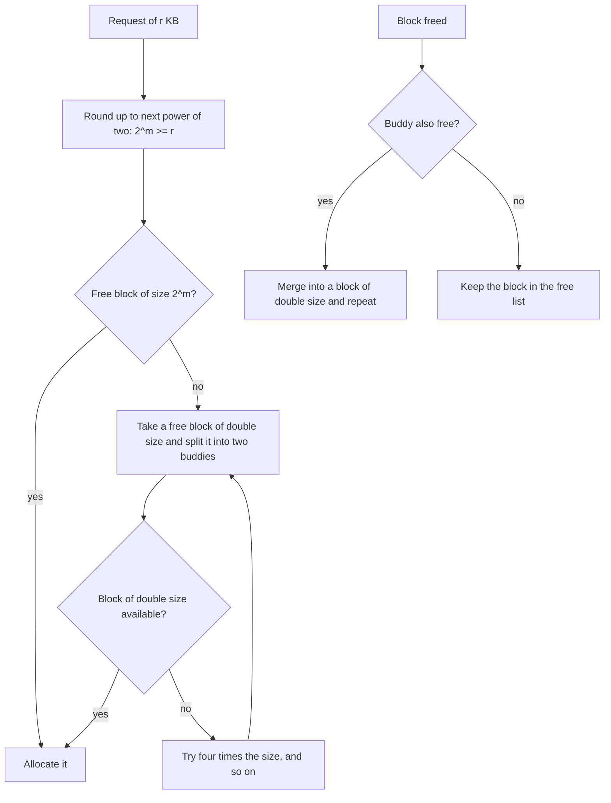
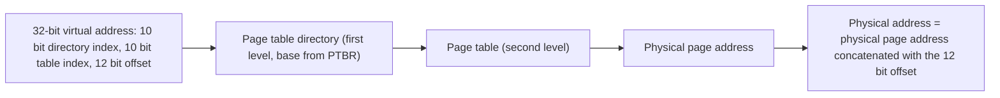
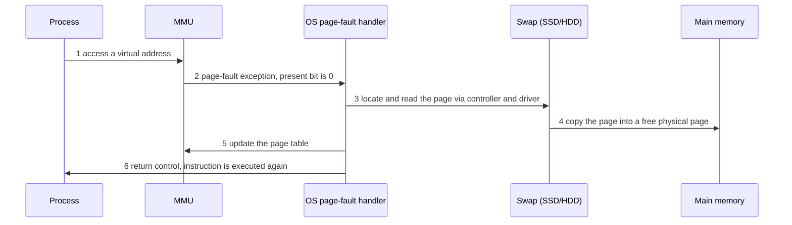

# Memory Management, Real/Protected Mode, Virtual Memory & Page Replacement

> [!Note] 💡 Notation Conventions
> - **MMU** = Memory Management Unit; **PTBR/PTLR** = Page-Table Base/Length Register; **OPT, LRU, LFU, FIFO, TTL** = page replacement strategies (see §10); **MB/GB** use powers of two ($1\,\text{MB} = 2^{20}$ B).
> - A **frame** (physical page slot) holds one page. Replacement tables list the frames as rows ("Page 1", "Page 2", ...) as on the slides, and the **request string** is the sequence of requested virtual pages.
> - **Hit** = requested page is in memory; **Miss** = it is not. **Hit rate** $= \dfrac{\#\text{hits}}{\#\text{requests}}$, **miss rate** $= \dfrac{\#\text{misses}}{\#\text{requests}} = 1 - \text{hit rate}$.
> - Address formats: virtual (logical) address $=$ page number $\|$ offset. Physical address $=$ physical page address $\|$ offset (concatenation).
> - "$\Rightarrow$ slide set $k$" marks a topic treated in slide set $k$.
> - **Segmentation** is **struck through** on the slides (learning objectives and slide 22). It is treated as **not required**. The *real-mode* segment:offset addressing of §6 is still covered.
> - This slide set contains no theorems or proofs. **Exercise sheet 5 was not provided**, so the examples are taken from the slides or constructed from them.

---

## 1. Learning Objectives

> [!Property] ⚙️ What You Must Know
> After slide set 5 you should know or understand:
> **1.** fundamental concepts of **memory management**: **static/dynamic partitioning** and **buddy memory allocation**;
> **2.** how operating systems **access (address) the memory**: **real mode** and **protected mode**;
> **3.** the components and concepts of **virtual memory**: the **Memory Management Unit (MMU)** and **paged memory management (paging)** (segmented memory management is struck through);
> **4.** the possible results of a memory request: **hit** and **miss**;
> **5.** the functioning and characteristics of common **replacement strategies**.
>
> Exercise sheet 5 repeats the contents relevant for these objectives.

---

## 2. Memory Management and Static Partitioning

> [!Definition] 📖 Memory Management
> **Memory management** is an essential OS function: it **allocates portions of memory to programs at their request** and **frees** memory portions that are no longer needed. Three concepts exist: **static partitioning**, **dynamic partitioning** and **buddy memory allocation**. (These concepts are "already somewhat older".)

> [!Definition] 📖 Static Partitioning
> The main memory is split into **partitions of equal size** or of **different sizes**.
> **Drawbacks:**
> **1.** **Internal fragmentation** occurs in any case $\Rightarrow$ inefficient. Different partition sizes **moderate** the problem but do not solve it.
> **2.** The **number of partitions limits the number of possible processes**.
> **Challenge:** a process needs **more memory than a partition**. Then the process must be built so that **only a part of its program code is in main memory**. When modules are loaded, an **overlay** occurs $\Rightarrow$ modules and data may be **overwritten**.
> **Example system:** IBM OS/360 **MFT** (1960s) implemented static partitioning.

> [!Property] ⚙️ Equal-Sized Partitions
> It does **not matter which free partition** is allocated to a process. If **no partition is free**, a process in main memory must be **replaced**. Which process is replaced depends on the **scheduling method** ($\Rightarrow$ slide set 8).
> Figure: OS $8$ MB and seven partitions of $8$ MB.

> [!Property] ⚙️ Partitions of Different Sizes
> Processes should get the partition that **fits as precisely as possible** (objective: little internal fragmentation). Two ways to allocate partitions:
> **1.** **A separate process queue for each partition.** Drawback: some partitions **may never be used**.
> **2.** **A single queue for all partitions.** Allocation can be done **flexibly** and changes in process requirements can be reacted to **quickly**.
> Figure: OS $8$ MB and partitions of $4, 4, 8, 8, 16, 16$ MB.

## 📘 Examples & Applications

### Example 2.1: Internal fragmentation with equal partitions (constructed)

**Using:** static partitioning, internal fragmentation

> [!Example] 📘 Three processes in $8$ MB partitions
> **Given:** processes of $5$, $8$ and $3$ MB, each in its own $8$ MB partition.
> **Step 1.** Wasted memory per partition: $8 - 5 = 3$ MB, $8 - 8 = 0$ MB, $8 - 3 = 5$ MB.
> **Step 2.** Total internal fragmentation: $3 + 0 + 5 = 8$ MB of $24$ MB, i.e. $\dfrac{8}{24} = 33.3\%$.
> **Step 3.** A $12$ MB process does **not fit** at all $\Rightarrow$ it needs overlays. With $7$ partitions, at most $7$ processes can be resident, however small they are.

### Example 2.2: Different partition sizes (constructed from the figure)

**Using:** static partitioning with different sizes, process queues

> [!Example] 📘 Partitions $4, 4, 8, 8, 16, 16$ MB
> **Step 1.** A $3$ MB process goes to a $4$ MB partition (waste $1$ MB). A $14$ MB process goes to a $16$ MB partition (waste $2$ MB).
> **Step 2.** With **one queue per partition**, a $14$ MB process waits in the $16$ MB queue even if smaller partitions are free, and a partition with an empty queue **stays unused**.
> **Step 3.** With **a single queue**, the OS can put any waiting process into any free partition large enough.

---

## 3. Dynamic Partitioning

> [!Definition] 📖 Dynamic Partitioning
> Each process gets a **gapless main memory partition of exactly the required size**.
> **Drawback:** **external fragmentation** occurs in any case $\Rightarrow$ inefficient.
> **Possible solution:** **defragmentation**. **Requirement:** relocation of memory blocks must be supported, and references in processes **must not become invalid** by relocating partitions.
> **Example system:** IBM OS/360 **MVT** (1960s) implemented dynamic partitioning.

> [!Property] ⚙️ Example Sequence (Slide 7, $128$ MB)
> OS $16$ MB. **Process A** ($22$ MB), **B** ($18$ MB), **C** ($24$ MB), **D** ($36$ MB) start one after the other, leaving $12$ MB free. Then **C terminates and E** ($20$ MB) starts in C's hole (leaving $4$ MB), **B terminates and F** ($12$ MB) starts in B's hole (leaving $6$ MB), **A terminates and G** ($18$ MB) starts in A's hole (leaving $4$ MB).

| Step | Memory layout (MB, from address $0$) |
|---|---|
| Initial | OS 16 / free 112 |
| A started | OS 16 / A 22 / free 90 |
| B started | OS 16 / A 22 / B 18 / free 72 |
| C started | OS 16 / A 22 / B 18 / C 24 / free 48 |
| D started | OS 16 / A 22 / B 18 / C 24 / D 36 / free 12 |
| C ends, E starts | OS 16 / A 22 / B 18 / E 20 / free 4 / D 36 / free 12 |
| B ends, F starts | OS 16 / A 22 / F 12 / free 6 / E 20 / free 4 / D 36 / free 12 |
| A ends, G starts | OS 16 / G 18 / free 4 / F 12 / free 6 / E 20 / free 4 / D 36 / free 12 |

> [!Missing] Figure: Slide 7, the memory layouts above drawn as stacked bars for the eight steps.

## 📘 Examples & Applications

### Example 3.1: External fragmentation in the slide example

**Using:** dynamic partitioning, external fragmentation

> [!Example] 📘 Can a $20$ MB process start in the last state?
> **Step 1.** Free holes in the last layout: $4$, $6$, $4$ and $12$ MB.
> **Step 2.** Total free memory: $4 + 6 + 4 + 12 = 26$ MB $\geq 20$ MB.
> **Step 3.** The largest single hole is only $12$ MB $< 20$ MB $\Rightarrow$ the process **cannot be placed**. This is **external fragmentation**.
> **Step 4.** Check: $16 + 18 + 4 + 12 + 6 + 20 + 4 + 36 + 12 = 128$ MB.
> **Step 5.** **Defragmentation** (moving blocks together) would create one hole of $26$ MB, but it needs relocation support.

---

## 4. Fit Strategies for Dynamic Partitioning

> [!Definition] 📖 First Fit
> Searches for a free block **starting from the beginning of the address space**. **Quick method.**

> [!Definition] 📖 Next Fit
> Searches for a free block **starting from the latest allocation**. **Quickly fragments the large free area at the end of the address space.**

> [!Definition] 📖 Best Fit
> Searches for the **free block that fits best**. **Produces many mini-fragments and is slow.**

> [!Property] ⚙️ Slide Example: a Process Needs $14$ MB
> The figure marks the free blocks large enough for $14$ MB: a $22$ MB block (found by First Fit), a $16$ MB block (found by Best Fit) and a $48$ MB block at the end (found by Next Fit, starting after the last assigned $12$ MB partition).

| Strategy | Chosen free block | Remainder after allocating $14$ MB |
|---|:-:|:-:|
| First Fit | $22$ MB (first from the start) | $8$ MB |
| Best Fit | $16$ MB (smallest sufficient) | $2$ MB ("mini-fragment") |
| Next Fit | $48$ MB (first after the last allocation) | $34$ MB |

> [!Warning] ⚠️ Possible Gap
> The complete memory layout of the slide-8 figure (all occupied and free blocks and their order) is only in the figure. The three free blocks above and their remainders are read from it. The other blocks of the figure are not needed for the choice.

## 📘 Examples & Applications

### Example 4.1: Fit strategies on the slide example

**Using:** First Fit, Next Fit, Best Fit

> [!Example] 📘 Request $14$ MB
> **First Fit:** scanning from the start, the first block that fits is the $22$ MB block $\Rightarrow$ $14$ MB allocated, $22 - 14 = 8$ MB remain.
> **Best Fit:** among all sufficient blocks the one with the least waste is $16$ MB $\Rightarrow$ $16 - 14 = 2$ MB remain, a useless **mini-fragment**. It also needs a scan of **all** free blocks, hence slow.
> **Next Fit:** starting after the last allocation, the first sufficient block is the $48$ MB block $\Rightarrow$ $48 - 14 = 34$ MB remain. Repeated allocations at the end of the memory fragment its big free area.

---

## 5. Buddy Memory Allocation (Donald Knuth)

> [!Definition] 📖 Buddy Memory Allocation
> **Initially a single block covers the entire memory.**
> **Allocation:** the request is **rounded up to the next higher power of two** and a matching free block is searched. If no block of that size exists, a block of **double size** is searched and **split into two halves (buddies)**. The first block is allocated. If no block of double size exists, a block of **four times** the size is searched, and so on.
> **Freeing:** it is checked whether **two halves of the same size can be recombined** to a larger block. **Only previously made subdivisions are reversed.**
> **Drawback:** **internal and external fragmentation**.

> [!Property] ⚙️ Buddy Allocation in Practice
> The **Linux kernel implements a variant of buddy allocation for page allocation**. The OS maintains **a list of free blocks for each possible block size**.

> [!Property] ⚙️ Slide Example ($1024$ KB)
> Requests: A $100$ KB, B $240$ KB, C $60$ KB, D $251$ KB. Then free B, free A, E $75$ KB, free C, free E, free D.

| Event | Request rounded to | Resulting layout (KB, address ranges) |
|---|:-:|---|
| Initial | | one free block $1024$ |
| A $=100$ | $128$ | split $1024 \to 512+512$, $512 \to 256+256$, $256 \to 128+128$. A at $[0,128)$, free $128$ at $[128,256)$, free $256$ at $[256,512)$, free $512$ at $[512,1024)$ |
| B $=240$ | $256$ | B at $[256,512)$ |
| C $=60$ | $64$ | split $128 \to 64+64$. C at $[128,192)$, free $64$ at $[192,256)$ |
| D $=251$ | $256$ | split $512 \to 256+256$. D at $[512,768)$, free $256$ at $[768,1024)$ |
| Free B | | block $[256,512)$ freed. Its buddy $[0,256)$ is not free $\Rightarrow$ no merge |
| Free A | | block $[0,128)$ freed. Its buddy $[128,256)$ is not completely free $\Rightarrow$ no merge |
| E $=75$ | $128$ | E at $[0,128)$ |
| Free C | | $[128,192)$ freed. Buddy $[192,256)$ is free $\Rightarrow$ merge to $128$ at $[128,256)$ |
| Free E | | $[0,128)$ freed. Buddy $[128,256)$ free $\Rightarrow$ merge to $256$. Buddy $[256,512)$ free $\Rightarrow$ merge to $512$ at $[0,512)$. Buddy $[512,1024)$ not free (D) $\Rightarrow$ stop |
| Free D | | $[512,768)$ freed. Buddy $[768,1024)$ free $\Rightarrow$ merge to $512$. Buddy $[0,512)$ free $\Rightarrow$ merge to $1024$ |



### 5.1 Linux Memory Fragmentation: `/proc/buddyinfo`

> [!Definition] 📖 Zones and Columns of `/proc/buddyinfo`
> **DMA** row: the first **16 MB** of the system (the address bus of the Intel 80286 has $2^{24}$ lines' worth of addresses, i.e. $16$ MB maximum).
> **DMA32** row: all memory $> 16$ MB and $< 4$ GB (address bus of Intel 80386, 80486, Pentium I/II/III/IV, ... is $2^{32} \Rightarrow$ $4$ GB).
> **Normal** row: all memory $> 4$ GB (address bus of modern systems is usually $36$, $44$ or $48$ bits).
> **Columns:** column $i$ ($i = 1, \dots, 11$) is the number of **free chunks ("buddies")** of size $2^{\,i-1} \cdot \text{PAGESIZE}$. With $\text{PAGESIZE} = 4096$ B $= 4$ kB: column $1 \Rightarrow 4$ kB, column $2 \Rightarrow 8$ kB, column $3 \Rightarrow 16$ kB, ..., column $11 \Rightarrow 2^{10} \cdot 4\,\text{kB} = 4096$ kB $= 4$ MB. The page size is shown with `getconf PAGESIZE`.

```text
$ cat /proc/buddyinfo
Node 0, zone      DMA      1      1      1      0      2      1      1      0      1      1      3
Node 0, zone    DMA32    208    124   1646    566    347    116    139    115     17      4    212
Node 0, zone   Normal     43     62    747    433    273    300    254    190     20      8    287
```

## 📘 Examples & Applications

### Example 5.1: Buddy allocation walk-through of the slide

**Using:** buddy allocation, rounding to powers of two, splitting, merging

> [!Example] 📘 Request sizes, internal fragmentation and final merge
> **Step 1 (rounding).** $100 \to 128$, $240 \to 256$, $60 \to 64$, $251 \to 256$, $75 \to 128$ KB.
> **Step 2 (internal fragmentation).** A: $128 - 100 = 28$ KB, B: $256 - 240 = 16$ KB, C: $64 - 60 = 4$ KB, D: $256 - 251 = 5$ KB, E: $128 - 75 = 53$ KB.
> **Step 3 (why "Free B" cannot merge).** The buddy of $[256,512)$ is $[0,256)$, which still contains A and C, so it is not free as a whole.
> **Step 4 (final state).** After all blocks are freed, merging cascades up: $128+128 \to 256 \to 512$, and with the other $512$ to $1024$, i.e. **the single initial block is restored**. Only previously made subdivisions are reversed.

### Example 5.2: Request of $33$ KB with buddies (constructed)

**Using:** buddy allocation

> [!Example] 📘 From a free $256$ KB block
> **Step 1.** Round $33 \to 64$ KB.
> **Step 2.** No free $64$ KB block exists. Take the $256$ KB block and split: $256 \to 128+128$, then $128 \to 64+64$.
> **Step 3.** The first $64$ KB block is allocated. Free blocks left: one $64$, one $128$.
> **Step 4.** Internal fragmentation: $64 - 33 = 31$ KB.

### Example 5.3: Reading `/proc/buddyinfo` (computed from the slide output)

**Using:** buddyinfo, page size, chunk sizes

> [!Example] 📘 How much memory is free in the DMA zone?
> **Step 1.** Column $i$ counts chunks of $4 \cdot 2^{\,i-1}$ kB. Row DMA: $1, 1, 1, 0, 2, 1, 1, 0, 1, 1, 3$.
> **Step 2.** Free memory in kB: $1\cdot4 + 1\cdot8 + 1\cdot16 + 0\cdot32 + 2\cdot64 + 1\cdot128 + 1\cdot256 + 0\cdot512 + 1\cdot1024 + 1\cdot2048 + 3\cdot4096$.
> **Step 3.** $= 4 + 8 + 16 + 0 + 128 + 128 + 256 + 0 + 1024 + 2048 + 12\,288 = 15\,900$ kB.
> **Step 4.** $\dfrac{15\,900}{1024} = 15.53$ MB of the $16$ MB zone are free. The largest chunk class ($4$ MB) holds $3$ chunks, so large contiguous allocations are still possible.

### Example 5.4: Which zone? (constructed)

**Using:** DMA, DMA32, Normal zones

> [!Example] 📘 Classify addresses
> **Step 1.** A page at physical address $8$ MB lies in the first $16$ MB $\Rightarrow$ **DMA**.
> **Step 2.** A page at $2$ GB: $> 16$ MB and $< 4$ GB $\Rightarrow$ **DMA32**.
> **Step 3.** A page at $6$ GB: $> 4$ GB $\Rightarrow$ **Normal**.

---

## 6. Real Mode

> [!Definition] 📖 Direct Memory Access by Processes (Real Mode)
> The most obvious idea is **direct memory access by the processes**, the **real mode (real address mode)** of **x86-compatible CPUs**. There is **no memory protection**: each process can access the **entire addressable memory**. This is **unacceptable for multitasking operating systems**.

> [!Property] ⚙️ Address Capacity by Architecture
> **16-bit:** $2^{16} = 65\,536$ bytes. **32-bit:** $2^{32} = 4\,294\,967\,296$ bytes $= 4$ GB. **64-bit:** $2^{64} = 18\,446\,744\,073\,709\,551\,616$ bytes $= 16$ Exabyte (binary).

> [!Definition] 📖 Real Mode Properties
> **At most $1$ MB** of main memory can be addressed (maximum of the **Intel 8086**, whose address bus has only **20 lines**: $2^{20}$ bytes $\approx 1$ MB).
> Only the first **640 kB (lower memory)** can be used by the OS (MS-DOS) and applications. The remaining **384 kB (upper memory)** contains the **BIOS of the graphics card**, the **memory window to the graphics card memory** and the **BIOS ROM of the motherboard**.
> The term "real mode" was introduced with the **Intel 80286**. In real mode a CPU accesses main memory **like an 8086**. **Each x86-compatible CPU starts in real mode.**

> [!Property] ⚙️ Real Mode and the Firmware
> **BIOS system:** after the BIOS has done the system initialization (memory controller configuration, PCI bus configuration, graphics card initialization, ...), **real mode is started**. The **boot loader or the OS must switch to protected mode (paging)**.
> **UEFI system:** the firmware does all these initialization steps **and switches into protected mode (paging)**.

> [!Definition] 📖 Real Mode Addressing: Segment and Offset
> Main memory is split into **segments of equal size** ($64$ kB, 16-bit addresses). Addressing uses a **segment** and an **offset**, two **16-bit values** stored in the **segment register** and the **offset register**.
> The **segment register** value **multiplied by $16$** gives the **base address of the segment**. The **offset register** holds a value between $0$ and $2^{16}-1 = 65\,535$, the **distance in bytes from the segment base**.

$$\text{physical address} = 16 \cdot \text{segment} + \text{offset}$$

> [!Property] ⚙️ Segment Registers
> **8086:** **CS** (Code Segment: program code), **DS** (Data Segment: global data of the current program), **SS** (Stack Segment: stack for the local data), **ES** (Extra Segment: further data). The figure also shows the pointer registers **IP** (instruction pointer), **SI** (source index), **DI** (destination index) and **SP** (stack pointer).
> **Since the 80386:** two additional segment registers **FS** and **GS**.
> **Real-mode segmentation organizes addresses but provides no memory protection.**

> [!Property] ⚙️ Real Mode in MS-DOS and Windows
> Real mode is the **default mode of MS-DOS** and compatible systems (PC-DOS, DR-DOS, FreeDOS). Memory map from the figure:

| Address range | Area |
|---|---|
| $0$ to $640$ kB | **Conventional memory**: DOS operating system at the bottom, applications above |
| $640$ to $768$ kB | Video (VGA) memory (part of the **upper memory area**) |
| $768$ kB to $1024$ kB | ROM memory (VGA + system BIOS) (part of the **upper memory area**) |
| $1024$ to $1088$ kB | **High Memory Area** |
| above | **Extended Memory Area** |

> [!Property] ⚙️ Real Mode in Microsoft Windows
> Newer operating systems use real mode **only during start** and then switch to **protected mode**. **Windows 2.0** runs **only in real mode**. **Windows 2.1 and 3.0** can run in real **or** protected mode. **Windows 3.1 and later** run **only in protected mode**.

> [!Warning] ⚠️ Possible Gap
> The text says real mode addresses **at most $1$ MB** (20 address lines). The MS-DOS memory figure, however, shows a **High Memory Area ($1024$ to $1088$ kB)** and an **Extended Memory Area** above $1$ MB, which are reached by CPUs after the 8086 and with special tools (e.g. HIMEM, XMS in the screenshot). The slides do not explain how this fits with the $1$ MB limit.

> [!Missing] Figure: Slides 13 to 18, direct memory access of Processes A, B, C to pages (Process A pages 0, 1; B pages 3, 4, 5; C pages 7, 8, 9), the segment/offset register diagram ($16 \cdot \text{segment} + \text{offset}$), the segment registers CS/DS/ES/SS vs. memory, a MS-DOS 6.22 `mem` screenshot, and the Windows 3.0 about boxes in real mode and standard mode.

## 📘 Examples & Applications

### Example 6.1: Real mode physical addresses (constructed)

**Using:** segment/offset addressing, $16 \cdot \text{segment} + \text{offset}$

> [!Example] 📘 Compute and classify addresses
> **(a) Segment $2000$, offset $100$:** $16 \cdot 2000 + 100 = 32\,100$. This lies in conventional memory ($< 640$ kB $= 655\,360$ B).
> **(b) Segment $40\,960$, offset $0$:** $16 \cdot 40\,960 = 655\,360$ B $= 640$ kB. This is the **start of the upper memory area** (video memory).
> **(c) Largest possible values:** $16 \cdot 65\,535 + 65\,535 = 1\,114\,095$ B $\approx 1088$ kB, which is the top of the **High Memory Area** in the MS-DOS figure (more than the $1$ MB of $2^{20}$ B).
> **(d) Different pairs, same address:** segment $1000$, offset $16$ and segment $1001$, offset $0$: $16\,016 = 16\,016$. Real mode addresses are **not unique**.

### Example 6.2: Why is real mode unacceptable for multitasking? (constructed)

**Using:** real mode, no memory protection

> [!Example] 📘 Two processes
> **Step 1.** Process A and B run at the same time in real mode, each can use the whole $1$ MB.
> **Step 2.** A buggy pointer in A may overwrite B's data or the OS itself.
> **Step 3.** No hardware checks the access $\Rightarrow$ no **protection**. In addition, processes use physical addresses, so they cannot be relocated.

### Example 6.3: Address capacity (from slide 12)

**Using:** address length, $2^n$

> [!Example] 📘 Capacity by bit width
> **Step 1.** $n = 16$: $2^{16} = 65\,536$ addressable bytes.
> **Step 2.** $n = 32$: $2^{32} = 4\,294\,967\,296$ bytes $= 4$ GB.
> **Step 3.** $n = 64$: $2^{64} = 18\,446\,744\,073\,709\,551\,616$ bytes $= 16$ Exabyte.

---

## 7. Memory Management Demands and Protected Mode

> [!Definition] 📖 Memory Management Demands
> **Relocation:** when a process is replaced from main memory, it is unknown at which address it will be inserted again $\Rightarrow$ processes **must not refer to physical memory addresses**.
> **Protection:** memory areas must be protected against **accidental or unauthorized access** by other processes $\Rightarrow$ access attempts must be **verified (by the CPU)**.
> **Shared use:** despite memory protection, processes must be able to **collaborate via shared memory** ($\Rightarrow$ slide set 9).
> **Increased capacity:** $1$ MB is not enough, and it should be possible to **use more memory than physically exists**: if main memory is full, parts of the data can be **swapped**.
> **Solution:** **protected mode** and **virtual memory**.

> [!Definition] 📖 Protected Mode
> An operating mode of x86-compatible CPUs, **introduced with the Intel 80286**. It increases the addressable memory: **16-bit protected mode (80286)** $\Rightarrow$ $16$ MB, **32-bit protected mode (80386)** $\Rightarrow$ $4$ GB. For later processors the amount depends on the **number of lines of the address bus**.
> It implements the **virtual memory** concept: processes do **not** use physical addresses (that would cause problems in multitasking systems). Instead, **each process has a separate address space**, independent of the storage technology and expansion capabilities, consisting of **logical addresses numbered from $0$ upwards**.

> [!Definition] 📖 Virtual Memory
> **Address spaces** can be created or erased as necessary and are **protected**: **no process can access the address space of another process without prior agreement**. The virtual memory is **mapped** to physical memory.
> **Benefits:** main memory is **utilized better**, processes need **not be in one piece** in main memory, so **fragmentation is not a problem**. More memory can be addressed and used than is physically present, and **swapping is transparent** for users and processes.

> [!Property] ⚙️ Methods in Protected Mode
> The CPU supports two methods, both implementation variants of virtual memory: **segmentation** (since the 80286, struck through on the slides) and **paging** (since the 80386).

> [!Missing] Figure: Slides 21 and 22, virtual address spaces of Processes A to D mapped to scattered pages of main memory. Process A pages A1 to A3, B pages B1 to B3, C pages C1 to C3 mapped either to main memory or to SSD/HDD swap space ("load/swap").

## 📘 Examples & Applications

### Example 7.1: Matching demands to solutions (constructed)

**Using:** memory management demands, virtual memory

> [!Example] 📘 Which demand does each mechanism satisfy?
> **Step 1.** Separate address space per process $\Rightarrow$ **protection** (no access to other processes without agreement).
> **Step 2.** Logical addresses from $0$ upwards, mapped by the OS $\Rightarrow$ **relocation** (the process never sees the physical address).
> **Step 3.** Moving pages to SSD/HDD $\Rightarrow$ **increased capacity**.
> **Step 4.** Agreed shared pages $\Rightarrow$ **shared use** ($\Rightarrow$ slide set 9).

### Example 7.2: Real mode vs. protected mode

**Using:** real mode, protected mode

> [!Example] 📘 Comparison
> | Aspect | Real mode | Protected mode |
> |---|---|---|
> | Introduced / origin | 8086 behavior, term from 80286 | 80286 |
> | Max. memory | $1$ MB ($2^{20}$) | 16-bit: $16$ MB, 32-bit: $4$ GB, later: depends on address bus |
> | Addresses used by processes | physical addresses | virtual (logical) addresses |
> | Memory protection | **none** | **yes** |
> | Swapping / more memory than RAM | no | yes (virtual memory) |
> | Users | MS-DOS, Windows 2.0, early boot phase | modern OS (paging) |

---

## 8. Paging

> [!Definition] 📖 Paging (Paged Memory Management)
> **Virtual pages** of processes are mapped to **physical pages** in main memory. **All pages have the same length.**
> **Default page sizes:** **4 kB** (x86-32, x86-64, ARM, RISC, MIPS), **8 kB** (Alpha, UltraSPARC), **16 kB** (Apple silicon). All architectures support bigger pages, but this is not easy to set and only useful in rare scenarios.
> **Benefits:** **external fragmentation is irrelevant**, **internal fragmentation can only occur in partially used pages**.
> The OS maintains **one page table per process** storing the locations of the process's pages. Processes only work with **virtual memory addresses** consisting of **two parts**: the **more significant part is the page number**, the **lower significant part is the offset** (address inside a page). The length of virtual addresses is architecture dependent (depends on the address bus lines): **16, 32 or 64 bits**.

> [!Property] ⚙️ Allocation of Process Pages to Free Physical Pages
> Processes **need not be located contiguously** in main memory $\Rightarrow$ **no external fragmentation**.

| Event | Physical pages 1 to 12 |
|---|---|
| Load pages of A | A1, A2, A3, -, -, -, -, -, -, -, -, - |
| Load pages of B | A1, A2, A3, B1, B2, -, -, -, -, -, -, - |
| Load pages of C | A1, A2, A3, B1, B2, C1, C2, C3, -, -, -, - |
| Free pages of B | A1, A2, A3, -, -, C1, C2, C3, -, -, -, - |
| Load pages of D (5 pages) | A1, A2, A3, **D1, D2**, C1, C2, C3, **D3, D4, D5**, - |

> [!Warning] ⚠️ Possible Gap
> The slide shows the process pages being placed into free frames but not the page tables. In the last row, D occupies two non-adjacent groups of frames (4 to 5 and 9 to 11), which is exactly what paging allows.

### 8.1 Address Translation by the MMU

> [!Definition] 📖 Memory Management Unit (MMU)
> **Virtual addresses are translated by the CPU, using the MMU and the page table, into physical addresses.** If the page is **not present** in main memory, the **MMU raises a page-fault exception**. If the data is on the SSD/HDD, the **OS must copy it into main memory**. If main memory has **no free capacity**, the OS must **relocate (swap) data from main memory to the SSD/HDD**.

### 8.2 Page Table: Size and Structure

> [!Property] ⚙️ Page Length and Page Table Size
> **Short pages:** less capacity loss from internal fragmentation, but a **bigger page table**. **Long pages:** a **shorter page table**, but **more** internal fragmentation. **Page tables are stored in main memory.**

$$\text{max. page table size} = \frac{\text{virtual address space}}{\text{page size}} \cdot \text{size of each page table entry}$$

> [!Property] ⚙️ Page Table Size for a 32-bit OS
> $\dfrac{4\,\text{GB}}{4\,\text{kB}} \cdot 4\,\text{B} = \dfrac{2^{32}}{2^{12}} \cdot 2^2\,\text{B} = 2^{22}\,\text{B} = 4\,\text{MB}$. **Each process** in a multitasking OS needs a page table. In 64-bit OS the tables can be much larger, but since everyday processes do not need several GB, the management overhead on modern computers is low.

> [!Definition] 📖 Page Table Entry
> Each entry contains among others:
> **Present bit (P):** is the page stored in main memory?
> **Dirty bit (D, modified bit):** has the page been modified?
> **Reference bit (R):** has the page been referenced (even by **read** operations)? Relevant for the replacement strategy (see Clock, §10).
> **Further control bits:** **read/write bit** (user-mode processes have only read or also write access), **user/supervisor bit** (are user-mode processes allowed to access the page), **write-through bit** (modifications immediately passed down, or when the page is removed, i.e. **write-through** vs. **write-back**), **cache-disable bit** (the page may be loaded into the cache or not).
> **Physical page address:** concatenated with the offset of the virtual address.
> Layout: `P | D | R | further control bits | physical page address`. A virtual (logical) address has the layout `page number | offset`.

### 8.3 Address Translation Examples

> [!Property] ⚙️ Single-Level Paging (16-Bit Example, Slide 28)
> Virtual 16-bit address: **6-bit page number** + **10-bit offset**. The page number selects a page table row. The row's **physical page address** is concatenated with the offset to give the **physical 16-bit address**.
> Registers that let the MMU find the table: **Page-Table Base Register (PTBR)** (address where the page table of the current process starts) and **Page-Table Length Register (PTLR)** (length of that page table).
> **Single-level paging is sufficient in 16-bit architectures.** For **$\geq 32$ bit** architectures operating systems implement **multi-level paging**.

> [!Property] ⚙️ Two-Level Paging (32-Bit Example, Slide 29)
> Virtual 32-bit address: **10 bits page table directory index**, **10 bits page table index**, **12 bits offset**. The PTBR points to the **page table directory (first layer)** of $1024$ 32-bit entries. The selected entry gives a **page table (second layer)** of $1024$ 32-bit entries. Its entry holds the **physical page address**, which is concatenated with the $12$-bit offset.
> In the figure: directory entry $1020$ $\to$ second-layer table entry $136$ $\to$ physical page.

> [!Definition] 📖 Why Multi-Level Paging?
> Multi-level paging **reduces main memory usage**. The MMU scans the pages of the different levels **step by step**, and individual pages of the different levels can be **moved to swap storage** to free main memory.

| Architecture | Page table levels | Virtual address length | Partitioning (page-table indices + offset) |
|---|:-:|:-:|---|
| IA32 (x86-32) | 2 | 32 bit | $10+10+12$ |
| IA32 with PAE | 3 | 32 bit | $2+9+9+12$ |
| PPC64 | 3 | 41 bit | $10+10+9+12$ |
| AMD64 (x86-64) | 4 | 48 bit | $9+9+9+9+12$ |
| Intel Ice Lake Xeon Scalable | 5 | 57 bit | $9+9+9+9+9+12$ |

> [!Note] 💡 PAE
> The last number is the **offset length in bits**, the others are the **page table index lengths**. **PAE (Physical Address Extension)**, a paging extension of the Pentium Pro, lets the OS address **more than $4$ GB RAM**, but the memory usable **per process** is still limited to $4$ GB.



## 📘 Examples & Applications

### Example 8.1: Single-level translation (slide 28, step by step)

**Using:** 16-bit paging, page table, concatenation

> [!Example] 📘 Translate the virtual address `0001011101110101`
> **Step 1 (split).** 6-bit page number: `000101`. 10-bit offset: `1101110101`.
> **Step 2 (lookup).** The page table row `000101` holds the physical page address `111010` (rows of the figure: `000000` $\to$ `011101`, `000001` $\to$ `011011`, `000010` $\to$ `001011`, `000101` $\to$ `111010`, `000110` $\to$ `100101`).
> **Step 3 (concatenate).** Physical address $=$ `111010` $\|$ `1101110101` $=$ `1110101101110101`.
> **Step 4 (check).** Page size $= 2^{10}$ B $= 1$ kB, so the physical page `111010` $= 58$ starts at byte $58 \cdot 1024 = 59\,392$. The offset `1101110101` $= 885$, hence the physical address $= 59\,392 + 885 = 60\,277$.

### Example 8.2: Page table sizes (constructed from the formula)

**Using:** page table size formula, multi-level paging

> [!Example] 📘 Compare single-level tables
> **(a) 32-bit, 4 kB pages, 4 B entries (slide):** $2^{32}/2^{12} = 2^{20}$ entries, $2^{20} \cdot 4 = 2^{22}$ B $= 4$ MB per process.
> **(b) 32-bit, 8 kB pages, 4 B entries:** $2^{32}/2^{13} = 2^{19}$ entries, $2^{19} \cdot 4 = 2^{21}$ B $= 2$ MB. Longer pages halve the table, but increase internal fragmentation.
> **(c) 48-bit, 4 kB pages, 8 B entries (assumed entry size):** $2^{48}/2^{12} = 2^{36}$ entries, $2^{36} \cdot 8 = 2^{39}$ B $= 512$ GB. A single-level table is absurd $\Rightarrow$ **multi-level paging** (4 levels for AMD64).
> **(d) Two-level 32-bit:** one second-level table has $2^{10}$ entries $\cdot$ $4$ B $= 4$ kB $=$ one page. Only the second-level tables that a process uses must be in main memory, and the others may be swapped out.

### Example 8.3: Two-level translation (constructed)

**Using:** two-level paging, address layout

> [!Example] 📘 Virtual address from directory index $1020$, table index $136$, offset $100$
> **Step 1 (build the address).** $1020 \cdot 2^{22} + 136 \cdot 2^{12} + 100$.
> $1020 \cdot 4\,194\,304 = 4\,278\,190\,080$, $136 \cdot 4096 = 557\,056$.
> Sum: $4\,278\,190\,080 + 557\,056 + 100 = 4\,278\,747\,236$ (less than $2^{32} = 4\,294\,967\,296$).
> **Step 2 (decompose).** Directory index $= \left\lfloor \dfrac{4\,278\,747\,236}{2^{22}} \right\rfloor = 1020$. Remainder $557\,156$. Table index $= \left\lfloor \dfrac{557\,156}{4096} \right\rfloor = 136$. Offset $= 557\,156 - 557\,056 = 100$.
> **Step 3 (walk).** PTBR $\to$ directory entry $1020$ $\to$ page table $\to$ entry $136$ $\to$ physical page address, concatenated with offset $100$.
> **Step 4.** That is $2$ page-table lookups in memory plus the final data access.

### Example 8.4: Page table entry bits (constructed)

**Using:** page table entry

> [!Example] 📘 Which bit is relevant?
> **Step 1.** A page was swapped to the SSD $\Rightarrow$ **present bit** $= 0$.
> **Step 2.** A page was written since it was loaded $\Rightarrow$ **dirty bit** $= 1$ (it must be written back before replacement).
> **Step 3.** A page was only read $\Rightarrow$ **reference bit** $= 1$, dirty bit $= 0$ (reads also set the reference bit).
> **Step 4.** A user process writes to a read-only page $\Rightarrow$ the **read/write bit** forbids it $\Rightarrow$ **access violation** (see §9).

---

## 9. Page Fault and Access Violation

> [!Definition] 📖 Page Fault Exception
> A process tries **(1)** to request a page that is **not in physical main memory**. The **present bit** of the page table entry shows this. The **MMU triggers a page-fault exception (2)**. The CPU **switches to kernel mode** and executes the kernel's **page-fault handler**. The OS then:
> **(3)** **allocates the page** on the swap memory (SSD/HDD) by using the **controller and the device driver**,
> **(4)** **copies the page into a free page of main memory**,
> **(5)** **updates the page table**,
> **(6)** **returns control to the process**, which **executes again the instruction that caused the page fault**.



> [!Definition] 📖 Access Violation / General Protection Fault
> Also called **segmentation fault** or **segmentation violation**, but it is **a paging issue that has nothing to do with segmentation**. A process tries to access a virtual memory address **it is not allowed to access**.
> **Result:** legacy Windows systems **crash (blue screen)**. **Linux returns the signal `SIGSEGV`.**
> **Example:** a process tries to **write to a read-only page**.

> [!Property] ⚙️ Summary: Real Mode and Protected Mode
> **Real mode:** operating mode of x86-compatible CPUs, the CPU accesses main memory like an Intel 8086, **no memory protection**, each process can access the entire main memory. **Protected mode:** modern x86 operating systems run in protected mode and implement **paging**.

## 📘 Examples & Applications

### Example 9.1: Page fault or access violation? (constructed)

**Using:** page fault, access violation, present bit, read/write bit

> [!Example] 📘 Classify the events
> **Step 1.** A process reads a valid address whose page is currently **swapped out** (present bit $0$) $\Rightarrow$ **page fault**. The OS loads the page, updates the table and **repeats the instruction**. The process continues without noticing.
> **Step 2.** A process writes to a **read-only** page $\Rightarrow$ **access violation**. The OS does not load anything. On Linux the process gets `SIGSEGV`, on legacy Windows a blue screen.
> **Step 3.** A process follows a pointer to an address outside its address space $\Rightarrow$ **access violation** (not allowed).
> **Step 4.** The difference: a page fault is a **legal** access that needs OS help. An access violation is an **illegal** access.

### Example 9.2: Order of the page-fault handling steps

**Using:** page fault handling

> [!Example] 📘 Arrange: update page table, MMU raises exception, copy page into main memory, process retries, locate page on swap, process requests page
> **Answer:** (1) process requests page, (2) MMU raises exception, (3) locate and read the page on the swap, (4) copy the page into main memory, (5) update the page table, (6) process retries the instruction.

---

## 10. Hit/Miss Rate and Page Replacement Strategies

> [!Definition] 📖 Hit Rate and Miss Rate
> An efficient memory management method for main memory and cache **keeps frequently requested pages** in memory and **identifies pages unlikely to be requested soon** and replaces them when capacity is needed. A request to a computer memory has two possible results: **hit** (requested data is available) or **miss** (requested data is missing).
> **Hit rate** $=$ requests with result hit divided by the total number of requests (between $0$ and $1$, greater is better).
> **Miss rate** $=$ requests with result miss divided by the total number of requests $=1-\text{hit rate}$.

> [!Property] ⚙️ Replacement Strategies
> It makes sense to keep **frequently requested pages** in main memory. Strategies: **OPT** (optimal), **LRU** (least recently used), **LFU** (least frequently used), **FIFO** (first in first out), **Clock / Second Chance**, **TTL** (time to live), **Random**.
> The **requests** are requests for pages of the virtual address space of a process. If the requested page is not in the cache, it is read from main memory or the swap.

> [!Property] ⚙️ The Reference String of All Slide Examples
> **Requests:** `1 2 3 4 1 2 5 1 2 3 4 5` (12 requests) with **3 frames** (and $4$ frames for Belady's anomaly). Yellow cells on the slides mark misses, the tables below mark them with M.

### 10.1 OPT (Optimal Strategy)

> [!Definition] 📖 OPT
> Replaces the page that is **not requested for the longest time in the future**. **Impossible to implement**, because nobody can predict the future, so the OS must use the past. OPT is used to **evaluate the efficiency of other strategies**. If there are not enough future requests to decide, **FIFO applies**.

| Request | 1 | 2 | 3 | 4 | 1 | 2 | 5 | 1 | 2 | 3 | 4 | 5 |
|---|:-:|:-:|:-:|:-:|:-:|:-:|:-:|:-:|:-:|:-:|:-:|:-:|
| Page 1 | 1 | 1 | 1 | 1 | 1 | 1 | 1 | 1 | 1 | **3** | 3 | 3 |
| Page 2 | | 2 | 2 | 2 | 2 | 2 | 2 | 2 | 2 | 2 | **4** | 4 |
| Page 3 | | | 3 | **4** | 4 | 4 | **5** | 5 | 5 | 5 | 5 | 5 |
| Result | M | M | M | M | H | H | M | H | H | M | M | H |

**Total: 7 misses** (bold = replaced or newly loaded page).

### 10.2 LRU (Least Recently Used)

> [!Definition] 📖 LRU
> Replaces the page that was **not requested for the longest time**. All pages are referenced in a **queue**. A page that is **loaded or referenced moves to the front** of the queue. On a miss with no free capacity, the **page at the end of the queue is replaced**.
> **Drawback:** **ignores the number of requests**.

| Request | 1 | 2 | 3 | 4 | 1 | 2 | 5 | 1 | 2 | 3 | 4 | 5 |
|---|:-:|:-:|:-:|:-:|:-:|:-:|:-:|:-:|:-:|:-:|:-:|:-:|
| Page 1 | 1 | 1 | 1 | **4** | 4 | 4 | **5** | 5 | 5 | **3** | 3 | 3 |
| Page 2 | | 2 | 2 | 2 | **1** | 1 | 1 | 1 | 1 | 1 | **4** | 4 |
| Page 3 | | | 3 | 3 | 3 | **2** | 2 | 2 | 2 | 2 | 2 | **5** |
| Result | M | M | M | M | M | M | M | H | H | M | M | M |

**Total: 10 misses.**

### 10.3 LFU (Least Frequently Used)

> [!Definition] 📖 LFU
> Replaces the page that was **requested least often**. The page table holds a **reference counter** per page in memory with the number of requests. On a miss with no free capacity, the page with the **lowest counter** is replaced. **If the counter gives no decision, FIFO applies.**
> **Benefit:** takes into account the **number of requests**. **Drawback:** pages requested often **in the past** may **block the memory**.

| Request | 1 | 2 | 3 | 4 | 1 | 2 | 5 | 1 | 2 | 3 | 4 | 5 |
|---|:-:|:-:|:-:|:-:|:-:|:-:|:-:|:-:|:-:|:-:|:-:|:-:|
| Page 1 | 1 | 1 | 1 | **4** | 4 | 4 | **5** | 5 | 5 | **3** | **4** | **5** |
| Page 2 | | 2 | 2 | 2 | **1** | 1 | 1 | 1 | 1 | 1 | 1 | 1 |
| Page 3 | | | 3 | 3 | 3 | **2** | 2 | 2 | 2 | 2 | 2 | 2 |
| Result | M | M | M | M | M | M | M | H | H | M | M | M |

**Total: 10 misses.** After requests $8$ and $9$ the counters of pages $1$ and $2$ are $2$, so page $1$ and $2$ stay while the newer pages $5$, $3$, $4$ keep replacing each other in frame $1$ (the drawback of "blocked memory").

### 10.4 FIFO and Belady's Anomaly

> [!Definition] 📖 FIFO
> Replaces the page that has been **in memory for the longest time**. A common assumption is that **more memory gives fewer or at worst equally many misses**. **Laszlo Belady showed in 1969** that for certain request patterns **FIFO causes more misses with a larger memory** ($\Rightarrow$ **Belady's anomaly**). Until then FIFO was considered a good replacement strategy.

| Request | 1 | 2 | 3 | 4 | 1 | 2 | 5 | 1 | 2 | 3 | 4 | 5 |
|---|:-:|:-:|:-:|:-:|:-:|:-:|:-:|:-:|:-:|:-:|:-:|:-:|
| **3 frames** | | | | | | | | | | | | |
| Page 1 | 1 | 1 | 1 | **4** | 4 | 4 | **5** | 5 | 5 | 5 | 5 | 5 |
| Page 2 | | 2 | 2 | 2 | **1** | 1 | 1 | 1 | 1 | **3** | 3 | 3 |
| Page 3 | | | 3 | 3 | 3 | **2** | 2 | 2 | 2 | 2 | **4** | 4 |
| Result | M | M | M | M | M | M | M | H | H | M | M | H |
| **4 frames** | | | | | | | | | | | | |
| Page 1 | 1 | 1 | 1 | 1 | 1 | 1 | **5** | 5 | 5 | 5 | **4** | 4 |
| Page 2 | | 2 | 2 | 2 | 2 | 2 | 2 | **1** | 1 | 1 | 1 | **5** |
| Page 3 | | | 3 | 3 | 3 | 3 | 3 | 3 | **2** | 2 | 2 | 2 |
| Page 4 | | | | 4 | 4 | 4 | 4 | 4 | 4 | **3** | 3 | 3 |
| Result | M | M | M | M | H | H | M | M | M | M | M | M |

**3 frames: 9 misses. 4 frames: 10 misses $\Rightarrow$ more memory, more misses (Belady's anomaly).**

### 10.5 Clock / Second Chance

> [!Definition] 📖 Clock / Second Chance
> Uses the **reference bit** of the page table. A page that is **loaded** gets reference bit **$0$**. A page that is **requested** gets reference bit **$1$**. A **pointer** indicates the last requested page. On a **miss**, the memory is scanned from the pointer for the **first page whose reference bit is $0$** and that page is replaced. Every page **examined during the scan** whose bit is $1$ gets its bit **set to $0$** (its "second chance").
> **Used by:** Linux, BSD-UNIX, VAX/VMS (originally from Digital Equipment Corporation), **Windows NT 4.0 on uniprocessor systems** and modern Windows (or variants).

> [!Note] 💡 Scan Start
> The slide figure shows that the scan on a miss starts at the **page after the pointer** (the cyclic next frame), not at the pointer page itself. This reproduces the final frames $4, 5, 2$ of the slide.

Frames after each request. Entry `page(bit)`, `*` = pointer.

| Request | Frame 1 | Frame 2 | Frame 3 | Result |
|:-:|:-:|:-:|:-:|:-:|
| 1 | 1(0)* | | | M |
| 2 | 1(0) | 2(0)* | | M |
| 3 | 1(0) | 2(0) | 3(0)* | M |
| 4 | 4(0)* | 2(0) | 3(0) | M |
| 1 | 4(0) | 1(0)* | 3(0) | M |
| 2 | 4(0) | 1(0) | 2(0)* | M |
| 5 | 5(0)* | 1(0) | 2(0) | M |
| 1 | 5(0) | 1(1)* | 2(0) | H |
| 2 | 5(0) | 1(1) | 2(1)* | H |
| 3 | 3(0)* | 1(1) | 2(1) | M |
| 4 | 4(0)* | 1(0) | 2(0) | M |
| 5 | 4(0) | 5(0)* | 2(0) | M |

**Total: 10 misses.** At request $4$ (second to last) the scan from frame $2$ clears bits of frames $2$ and $3$ (second chance), then replaces frame $1$.

### 10.6 TTL and Random

> [!Definition] 📖 TTL (Time To Live)
> Each page gets a **time-to-live value** when it is stored in memory. If the **TTL has exceeded**, the page can be replaced. **Not used in operating systems**, but useful for **caching web pages** (Internet content). (Source: Gopalan et al., *Caching with expiration times*, 2002.)

> [!Definition] 📖 Random
> **Random pages are replaced.** **Benefit:** a **simple and resource-saving** strategy, because **no information about the requests needs to be stored**.
> **Used (or was used) in practice:** the OS **IBM OS/390** and **Windows NT 4.0 on SMP systems**, and the cache of the **Intel i860 RISC CPU**.

## 📘 Examples & Applications

### Example 10.1: Hit rates of the slide strategies

**Using:** hit rate, miss rate, OPT, LRU, LFU, FIFO, Clock

> [!Example] 📘 Compute from the totals ($12$ requests, $3$ frames)
> **OPT:** $7$ misses $\Rightarrow$ miss rate $\dfrac{7}{12} = 0.583$, hit rate $\dfrac{5}{12} = 0.417$.
> **FIFO:** $9$ misses $\Rightarrow$ miss rate $0.75$, hit rate $\dfrac{3}{12} = 0.25$.
> **LRU, LFU, Clock:** $10$ misses each $\Rightarrow$ miss rate $\dfrac{10}{12} = 0.833$, hit rate $\dfrac{2}{12} = 0.167$.
> **Check:** miss rate $+$ hit rate $= 1$.
> **Observation:** OPT is never worse than any other strategy. On this particular request string FIFO happens to beat LRU, LFU and Clock, which does not make FIFO a better strategy in general (Belady's anomaly).

### Example 10.2: Belady's anomaly (slide 40)

**Using:** FIFO, hit/miss, Belady's anomaly

> [!Example] 📘 Count the misses
> **Step 1.** FIFO with $3$ frames: $9$ misses (M at requests $1, 2, 3, 4, 1, 2, 5, 3, 4$).
> **Step 2.** FIFO with $4$ frames: $10$ misses (M at requests $1, 2, 3, 4, 5, 1, 2, 3, 4, 5$, hits only at requests $5$ and $6$).
> **Step 3.** $10 > 9$: although memory grew by one frame, the miss count rose. This is **Belady's anomaly**.

### Example 10.3: A different request string (constructed)

**Using:** FIFO, LRU, OPT, hit rate

> [!Example] 📘 Request string `2 3 2 1 5 2 4 5 3 2 5 2`, $3$ frames
> **FIFO (eviction order by arrival):**
> | Req | 2 | 3 | 2 | 1 | 5 | 2 | 4 | 5 | 3 | 2 | 5 | 2 |
> |---|:-:|:-:|:-:|:-:|:-:|:-:|:-:|:-:|:-:|:-:|:-:|:-:|
> | Frames | 2 | 2,3 | 2,3 | 2,3,1 | 5,3,1 | 5,2,1 | 5,2,4 | 5,2,4 | 3,2,4 | 3,2,4 | 3,5,4 | 3,5,2 |
> | Result | M | M | H | M | M | M | M | H | M | H | M | M |
> **FIFO: 9 misses**, hit rate $\dfrac{3}{12} = 0.25$.
>
> **LRU:** the frames after each request are $\{2\}$, $\{2,3\}$, $\{2,3\}$, $\{2,3,1\}$, then request $5$ evicts the least recently used page $3$ $\to$ $\{2,1,5\}$, $2$ hits, $4$ evicts $1$ $\to$ $\{2,5,4\}$, $5$ hits, $3$ evicts $2$ $\to$ $\{3,5,4\}$, $2$ evicts $4$ $\to$ $\{3,5,2\}$, $5$ and $2$ hit. Misses at requests $1, 2, 4, 5, 7, 9, 10$: **7 misses**, hit rate $\dfrac{5}{12} = 0.417$.
>
> **OPT:** $\{2\}$, $\{2,3\}$, $2$ hit, $\{2,3,1\}$, request $5$ evicts $1$ (never used again) $\to$ $\{2,3,5\}$, $2$ hits, $4$ evicts $2$ (next use is latest) $\to$ $\{4,3,5\}$, $5$ and $3$ hit, $2$ evicts $4$ or $3$ (both never used again, FIFO picks the older page $3$) $\to$ $\{4,2,5\}$, $5$ and $2$ hit. Misses at requests $1, 2, 4, 5, 7, 10$: **6 misses**, hit rate $\dfrac{6}{12} = 0.5$.
>
> **Order:** OPT $(6) \leq$ LRU $(7) \leq$ FIFO $(9)$, as expected since OPT is the lower bound.

---

## 11. Combined Exam-Style Problem

## 📘 Examples & Applications

### Example 11.1: From a virtual address to a page fault

**Using:** two-level paging, page table size, page fault, access violation, buddy allocation, replacement strategies

> [!Example] 📘 Problem and full solution
> **Problem.** A 32-bit OS uses two-level paging with $4$ kB pages (partitioning $10+10+12$) and $4$ B page table entries.
> **(a)** How large is a single-level page table, and how many entries does a second-level table have?
> **(b)** Compute the virtual address with directory index $3$, table index $5$, offset $7$.
> **(c)** The page for this address has present bit $0$. Describe what happens.
> **(d)** A process writes to a read-only page. What happens, and how does this differ from (c)?
> **(e)** The kernel needs a $70$ KB block and uses buddy allocation. What block is allocated, and how large is the internal fragmentation?
> **(f)** With $3$ frames and the request string `2 3 2 1 5 2 4 5 3 2 5 2`, give the number of misses for FIFO and LRU.
>
> **Solution (a).**
> **Step 1.** Single level: $\dfrac{2^{32}}{2^{12}} \cdot 4\,\text{B} = 2^{20} \cdot 2^2 = 2^{22}$ B $= 4$ MB.
> **Step 2.** A second-level table has $2^{10} = 1024$ entries (each $4$ B, so $4$ kB, exactly one page).
>
> **Solution (b).**
> **Step 1.** $3 \cdot 2^{22} + 5 \cdot 2^{12} + 7 = 12\,582\,912 + 20\,480 + 7$.
> **Step 2.** $= 12\,603\,399$.
>
> **Solution (c).**
> **Step 1.** The MMU finds present bit $0$ and raises a **page-fault exception**.
> **Step 2.** The CPU switches to **kernel mode** and runs the **page-fault handler**.
> **Step 3.** The OS locates the page on the swap (SSD/HDD) via controller and driver, copies it into a free physical page (swapping another page out if memory is full), updates the page table and returns control.
> **Step 4.** The process executes the same instruction again and now succeeds.
>
> **Solution (d).**
> **Step 1.** The read/write bit forbids the write $\Rightarrow$ **access violation** (general protection fault, "segmentation fault").
> **Step 2.** Linux sends `SIGSEGV` to the process, legacy Windows crashes with a blue screen.
> **Step 3.** Difference: in (c) the access is **legal** and the OS repairs it, in (d) the access is **illegal** and the process is not allowed to continue.
>
> **Solution (e).**
> **Step 1.** Round $70$ up to the next power of two: $128$ KB.
> **Step 2.** Internal fragmentation $= 128 - 70 = 58$ KB. A free $256$ KB block (if no $128$ KB exists) would be split into two $128$ KB buddies.
>
> **Solution (f).**
> **Step 1.** FIFO: $9$ misses (see Example 10.3).
> **Step 2.** LRU: $7$ misses.
> **Step 3.** OPT would give $6$ misses.

---

## 🗂️ Summary

**Memory management (partitioning)**
- **Static partitioning:** equal or different partition sizes, **internal fragmentation** always, number of partitions limits the number of processes. Too-large process $\Rightarrow$ **overlays** (modules and data may be overwritten). IBM OS/360 MFT. Different sizes: one queue per partition (some may never be used) vs. a single queue (flexible).
- **Dynamic partitioning:** exact-size gapless partitions, **external fragmentation**, solution **defragmentation** (needs relocation, references must stay valid). IBM OS/360 MVT. **First Fit** (from start, quick), **Next Fit** (from last allocation, fragments the end), **Best Fit** (best-fitting block, slow, many mini-fragments).
- **Buddy allocation (Knuth):** one block initially, request rounded **up to a power of two**, free blocks split into **buddies**, freed buddies recombine (only previous splits are reversed). Internal and external fragmentation. Linux uses a variant for page allocation, `/proc/buddyinfo`: column $i$ = free chunks of $2^{i-1} \cdot 4$ kB, zones DMA ($16$ MB), DMA32 ($< 4$ GB), Normal ($> 4$ GB).

**Real mode and protected mode**
- **Real mode:** direct access to physical memory, **no protection**, at most $1$ MB (8086, $20$ address lines), $640$ kB conventional + $384$ kB upper memory. Address $= 16 \cdot \text{segment} + \text{offset}$, segments $64$ kB. Registers CS, DS, SS, ES (+ FS, GS since 80386), no protection. Every x86 CPU starts in real mode. MS-DOS and Windows 2.0 use it. BIOS systems: boot loader/OS must switch to protected mode, UEFI switches itself.
- **Demands:** relocation, protection, shared use, increased capacity $\Rightarrow$ **protected mode + virtual memory**.
- **Protected mode** (80286): 16-bit PM $\Rightarrow$ $16$ MB, 32-bit PM (80386) $\Rightarrow$ $4$ GB. Each process has its own protected **virtual address space** (logical addresses from $0$), mapped to physical memory, transparent swapping, no external fragmentation problem. Segmentation (struck through) and **paging** (since 80386).

**Paging**
- Fixed-size pages: $4$ kB (x86, ARM, RISC, MIPS), $8$ kB (Alpha, UltraSPARC), $16$ kB (Apple silicon). No external fragmentation, internal only in partially used pages. One **page table per process**.
- Virtual address $=$ page number $\|$ offset. The **MMU** translates with the page table (PTBR, PTLR). Page table size $= \dfrac{\text{virtual address space}}{\text{page size}} \cdot \text{entry size}$ ($4$ MB for 32-bit, $4$ kB pages, $4$ B entries). Short pages: bigger table, less internal fragmentation. Long pages: opposite.
- **Entry:** P (present), D (dirty), R (reference), read/write, user/supervisor, write-through, cache-disable, physical page address.
- **Multi-level paging** saves memory (IA32 $10+10+12$, PAE $2+9+9+12$, PPC64 $10+10+9+12$, AMD64 $9+9+9+9+12$, Ice Lake Xeon $9\times5+12$). Single level suffices for 16 bit.
- **Page fault:** present bit $0$ $\to$ MMU exception $\to$ kernel handler loads the page from swap, copies it to a free page, updates the page table, process repeats the instruction. **Access violation** (segmentation fault, `SIGSEGV`, blue screen): illegal access, e.g. writing a read-only page, a paging issue.

**Replacement strategies**
- **Hit rate** $=$ hits $/$ requests, **miss rate** $= 1-$ hit rate. Example string `1 2 3 4 1 2 5 1 2 3 4 5`, $3$ frames: **OPT 7**, **LRU 10**, **LFU 10**, **FIFO 9**, **Clock 10** misses.
- **OPT:** replace the page not needed for the longest time in the future (impossible, benchmark). **LRU:** least recently used (queue), ignores the number of requests. **LFU:** reference counter, old frequently used pages block memory. **FIFO:** oldest page, **Belady's anomaly** (FIFO: $3$ frames $9$ misses, $4$ frames $10$ misses). **Clock/Second Chance:** reference bit (loaded $0$, requested $1$), pointer scan, bits $1 \to 0$, replace first $0$ (Linux, BSD, VAX/VMS, Windows NT 4.0 uni, modern Windows). **TTL:** web caches. **Random:** simple (IBM OS/390, Windows NT 4.0 SMP, Intel i860 cache).
- Tie-break for OPT and LFU: FIFO.
