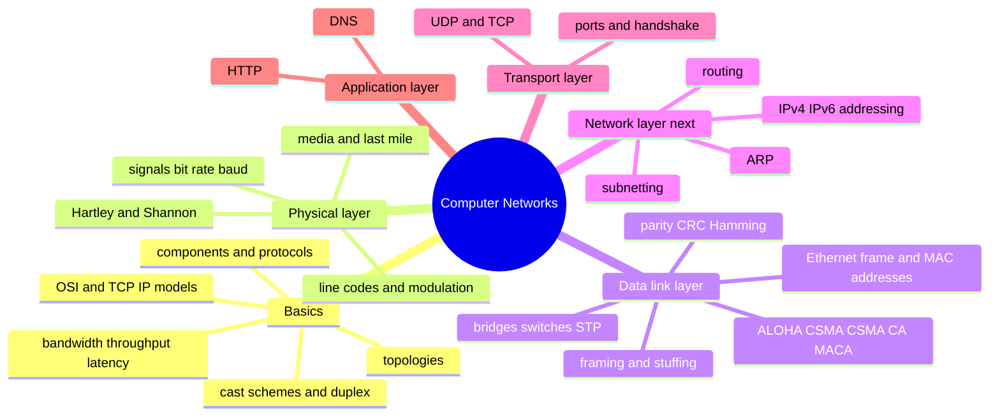

# 🌐 Computer Networks — Study Plan (target 1.0)

> [!abstract] Exam facts
> - **Written exam, 90 min** (module handbook). Allowed aids and exam date: **not announced yet** → ask Prof. Hahm or tutor Petrozziello in your next exercise session (and ask for sample questions).
> - What the exam checks (script 01 "About"): **explain** main concepts **in your own words**, **select** a suitable solution for a problem, **analyze** a given solution and **detect problems**, **explain** your answers. → understanding beats memorizing; your ✍️ cards and explain-aloud sessions matter most.
> - Exercises are not mandatory, but per the script *"the vast majority of those who regularly and actively participate in the exercises pass the exam."* VGU groups: **Mon 10:00–11:30** or **Tue 16:00–17:30**, room 1-237. Lecture: **Tue 14:15–15:45**, 4-Audimax.
> - Still to come (module handbook): network layer (IPv4/IPv6, ARP, routing), transport (TCP, UDP), application (DNS, HTTP), network management.
> - Links: [course page](https://teaching.dahahm.de/teaching/compnet_ws26.html) (scripts, sheets, **Glossary**) · books: Tanenbaum/Feamster/Wetherall *Computer Networks* 6e, Kurose/Ross *Computer Networking* 8e (free via the library) · many sheet tasks come from Jörg Roth, *Prüfungstrainer Rechnernetze* (German, exam-style tasks) · back to [[00 Start Here]] · [[Master Calendar]]

## 🗺️ Course mind map

## 📍 Topic tracker
Note: your note numbers differ from the script numbers (script 01 is only "About").

| Script | Topic | Lecture | Note | Deck | Sheet | Conf. | Status |
|---|---|---|---|---|---|---|---|
| [02](file:///C:/Users/hongp/OneDrive/Desktop/WS2627/CompNet/Lect/compnet-ws26-02.pdf) | Basics | 13 Oct | [[01-Basics]] | [[CN-01 Basics]] | [sheet 1](file:///C:/Users/hongp/OneDrive/Desktop/WS2627/CompNet/Ex/compnet-ws26-exercise-sheet-01.pdf) | | ☐ |
| [03](file:///C:/Users/hongp/OneDrive/Desktop/WS2627/CompNet/Lect/compnet-ws26-03.pdf) | Physical layer | 27 Oct | [[02-Physical-Layer]] | [[CN-02 Physical Layer]] | [sheet 2](file:///C:/Users/hongp/OneDrive/Desktop/WS2627/CompNet/Ex/compnet-ws26-exercise-sheet-02.pdf) | | ☐ |
| [04](file:///C:/Users/hongp/OneDrive/Desktop/WS2627/CompNet/Lect/compnet-ws26-04.pdf) | Data link: framing, switching | 10 Nov | [[03-Data-Link-Framing-Switching]] | [[CN-03 Framing and Switching]] | [sheet 3](file:///C:/Users/hongp/OneDrive/Desktop/WS2627/CompNet/Ex/compnet-ws26-exercise-sheet-03.pdf) | | ☐ |
| [05](file:///C:/Users/hongp/OneDrive/Desktop/WS2627/CompNet/Lect/compnet-ws26-05.pdf) | Data link: MAC, error control | 24 Nov | [[04-Data-Link-MAC-Error-Control]] | [[CN-04 MAC and Error Control]] | sheet 3 (MAC) + next sheet | | ☐ |
| 06+ | Network layer | Dec | *make lean note* | *make deck* | next sheets | | ☐ |
| … | Transport layer | Jan | *make lean note* | *make deck* | | | ☐ |
| … | Application layer | Jan | *make lean note* | *make deck* | | | ☐ |

Linux basics: [sheet 0](file:///C:/Users/hongp/OneDrive/Desktop/WS2627/CompNet/Ex/compnet-ws26-exercise-sheet-00.pdf) · official solutions in the exercise-session slides: [session 02 → sheet 1](file:///C:/Users/hongp/OneDrive/Desktop/WS2627/CompNet/compnet-ws26-exercise-02.pdf) · [session 04 → sheet 2](file:///C:/Users/hongp/OneDrive/Desktop/WS2627/CompNet/compnet-ws26-exercise-04.pdf) · [script 01](file:///C:/Users/hongp/OneDrive/Desktop/WS2627/CompNet/Lect/compnet-ws26-01.pdf) = course info and exam goals.
For every new script use [[AI Prompts v2#Prompt A — Recall layer for a new lecture|Prompt A]] → lean note + deck (like [[04-Data-Link-MAC-Error-Control]]).

## ❓ Pre-questions — answer *before* the lecture
**Network layer:** What can a router do that a switch can't? · How many hosts fit into a /26 network? · Why is ARP needed? · Why IPv6? · What is longest-prefix matching?
**Transport layer:** TCP vs. UDP — when which? · Draw the TCP three-way handshake. · What are ports for? · Flow control vs. congestion control?
**Application layer:** Step by step: what happens in a DNS lookup of `www.example.com`? · What happens between typing a URL and seeing the page?

## 🟦 Phase 1 — Study & consolidate (26 Nov – 20 Dec)
**Week 26–29 Nov**
- [ ] Fill ✍️ in [[CN-01 Basics]] → start daily reviews
- [ ] Redo sheet 1 closed-book: Prussian semaphore, transfer time, storing vs. transmitting data

**Week 30 Nov – 6 Dec**
- [ ] Tue 1 Dec: pre-questions → lecture → 48-hour loop (lean note + deck)
- [ ] Fill ✍️ in [[CN-02 Physical Layer]]
- [ ] Redo sheet 2 closed-book: layers, bit vs. symbol rate, line codes, 33.6k modem (Shannon)

**Week 7–13 Dec**
- [ ] Tue 8 Dec lecture → 48-hour loop
- [ ] Fill ✍️ in [[CN-03 Framing and Switching]] + [[CN-04 MAC and Error Control]]
- [ ] Redo sheet 3 closed-book: byte/bit stuffing, bridges, STP, MAC

**Week 14–20 Dec**
- [ ] Tue 15 Dec lecture → 48-hour loop
- [ ] Course mind map from memory → compare → confidence ratings
- [ ] Write 1–3 sentence answers to **all self-check questions** of scripts 02–05 without notes (they are at the end of each script and in the lean notes)
- [ ] ✅ Checkpoint: all decks active, 0 overdue

## 🟨 Phase 2 — Revise & close gaps (21 Dec – 24 Jan)
There are no public past exams → you build mocks. **Mock recipe (90 min):** 4 explain questions (self-check style) · 3 calculations (from sheets) · 1 "analyze this solution" (e.g. *"a colleague builds a switched network with redundant links and no STP — what happens?"*) · 1 "choose a solution" (e.g. *"MAC protocol for a busy WLAN?"*). Mark with your notes, log errors.
- [ ] **21–27 Dec:** 🧪 Diagnostic mock 0 (60 min) → top-5 weaknesses
- [ ] **28 Dec – 3 Jan:** fix the top-5 · **Glossary pass 1** (course page → Glossary: can you define each term in one sentence?)
- [ ] **4–10 Jan:** Tue 5 Jan lecture → loop · calculation drill: data rate, latency, Shannon/Hartley, CRC, Hamming distance (+ subnetting once taught)
- [ ] **11–17 Jan:** Tue 12 Jan lecture → loop · **mock 1** (90 min)
- [ ] **18–24 Jan:** Tue 19 Jan lecture → loop · explain-aloud: one chapter per day with [[AI Prompts v2#Prompt B — Examiner quiz|Prompt B]]

## 🟥 Phase 3 — Exam mode (E = exam day)
- [ ] **25–31 Jan:** Tue 26 Jan last lecture → loop · **mock 2**
- [ ] **E−14 … E−8:** per chapter, write one page **from memory** (Feynman), then compare with the lean note · calculation drill 2 · sheet speed-runs
- [ ] **E−7 … E−3:** **mock 3** · **Glossary pass 2** · cards: due only
- [ ] **E−2 … E−1:** Error Log + weakest cards · sleep · nothing new

## ⭐ Gold examples — master these closed-book
1. **Prussian semaphore**: data rate and end-to-end latency → [[01-Basics|CN-01]] §6 · sheet 1 ex. 1
2. **Transfer time** / storing vs. transmitting data → CN-01 §6 · sheet 1 ex. 3–4 · exercise session 02
3. **33.6k modem**: bits per symbol, required SNR, signal power → [[02-Physical-Layer|CN-02]] §2 · sheet 2 ex. 4 · official solution: [session 04](file:///C:/Users/hongp/OneDrive/Desktop/WS2627/CompNet/compnet-ws26-exercise-04.pdf), PDF p. 31–38
4. **Draw NRZ and Manchester** for a bit string, find the problem of NRZ → CN-02 §4 · sheet 2 ex. 3 · official answers: session 04, p. 23–30
5. **Byte stuffing** (BISYNC) and **bit stuffing** (HDLC) → [[03-Data-Link-Framing-Switching|CN-03]] gold 1–2 · sheet 3 ex. 1–2
6. **Switch loop + STP root election** → CN-03 gold 3–4 · sheet 3 ex. 4–5
7. **CRC** computation and check → [[04-Data-Link-MAC-Error-Control|CN-04]] gold 1
8. **Hamming distance**: detect/correct k errors → CN-04 gold 2
9. **CSMA/CA vs. MACA** timeline, hidden terminal → CN-04 gold 3

## 🧮 Formulas you must be able to use without thinking
r_b = r_s · log₂ V · Hartley R = 2H log₂ V · Shannon R = H log₂(1 + S/N) · S/N = 10^(dB/10) · t_lat = t_prop + t_trans + t_wait · t_prop = d / (c · v_f) · t_trans = size / R · bits on the line = R · t_prop · interframe gap = 96 bit times · detect k errors: d = k + 1 · correct k errors: d = 2k + 1
