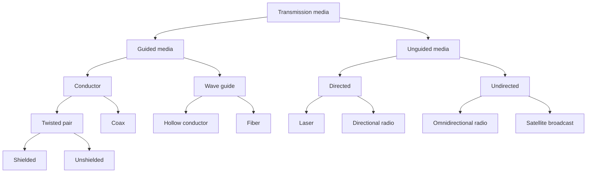
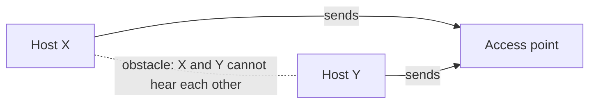
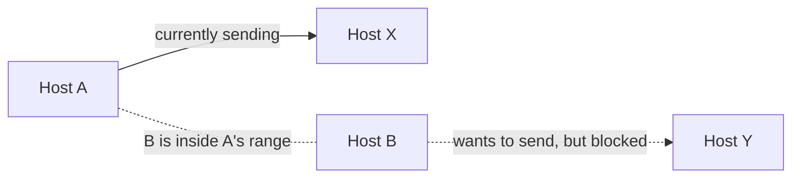
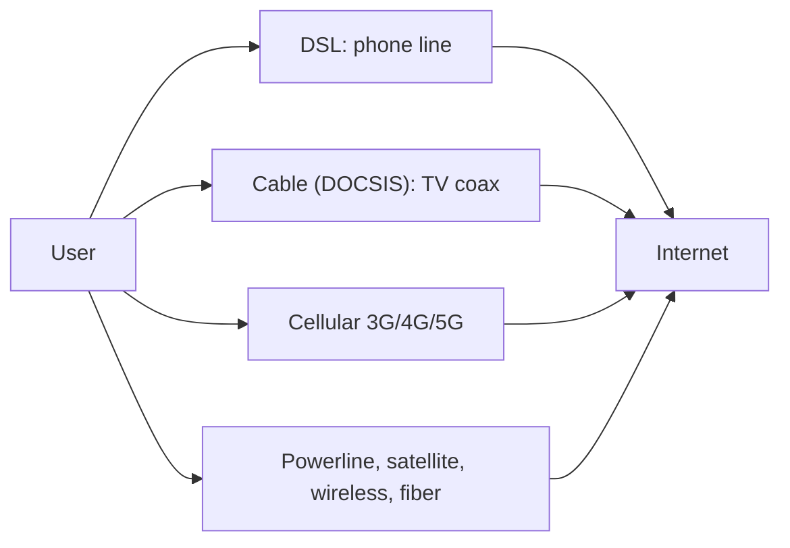
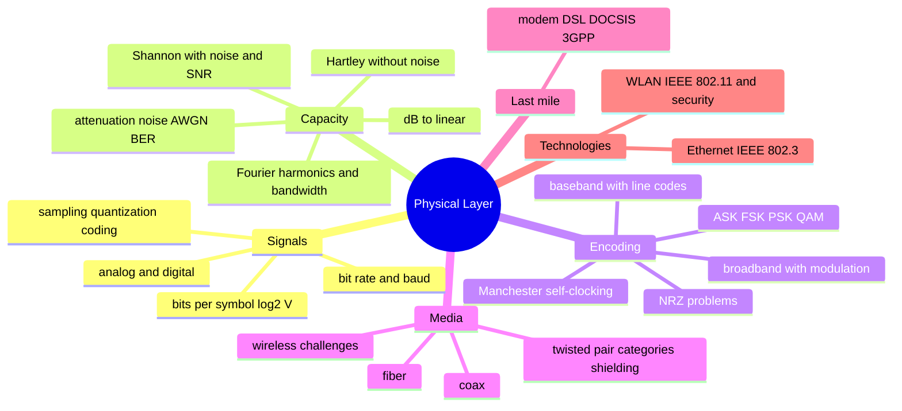

# Computer Networks: Physical Layer

> [!tip] 🧠 Study from the [[#🧠 Recall Layer|Recall Layer]] at the end of this note — mind map · deck [[CN-02 Physical Layer]] · gold examples · exam lens. This note is now your reference: search it, don't re-read it.

> [!Note] 💡 Notation Conventions
> **1.** Signal: $s(t) = A\sin(2\pi f t + \phi)$, with $A$ = amplitude (slides also write $S(t)$), $f$ = frequency in Hz, $T = 1/f$ = period in s, $\phi$ = phase (rad or degrees).
> **2.** $V$ = number of different symbol values (the slides use $n$ on the symbol-rate slide and $V$ in Hartley's law; standardized to $V$).
> **3.** $r_s$ = symbol rate in baud (symbols/s), $r_b$ = bit rate in bit/s.
> **4.** $H$ = channel bandwidth in **Hz**. $R$ = data rate in **bit/s** (as in the Basics note). $R_{max}$ = maximum data rate.
> **5.** $S/N$ = signal-to-noise ratio as a **linear power ratio**. $\text{SNR}_{dB} = 10\log_{10}(S/N)$ is the same ratio in decibel.
> **6.** $L$ = message size (bit), $d$ = distance, $c = 299\,792\,458$ m/s, $v_f$ = velocity factor, $t_{prop} = d/(c\,v_f)$, $t_{trans} = L/R$.
> **7.** "PSK" means **Phase Shift Keying** (modulation). The slides also use "PSK" in the WLAN-security section for the shared-password mode. In this note that mode is written **WPA-PSK**.
> **8.** Units: $\text{k}=10^3$, $\text{M}=10^6$, $\text{G}=10^9$ (decimal), $1\,\text{B} = 8$ bit.

> [!Warning] ⚠️ Possible Gap: two meanings of "bandwidth"
> The slides use "bandwidth" for the **bit rate** (bit/s, Basics note) and for the **frequency range** of a channel (Hz, this note). They are linked by Hartley's law and the Shannon-Hartley theorem (§2). The two meanings are kept apart with the symbols $R$ and $H$.

---

## 0. Scope of the Physical Layer

> [!Definition] 📖 Physical layer (recap)
> The physical layer transmits the ones and zeros: it provides the physical connection to the network and converts data into signals. Its specifications comprise:
> **1.** the **data encoding** on the transmission medium,
> **2.** the **directional dependence** of data transmission (simplex, half-duplex, full-duplex),
> **3.** the **mechanical and electronic aspects** (e.g., access-point plug design, pin usage).

## 📘 Examples & Applications

> [!Example] 📘 Example 0.1: Which aspect is meant?
> **Using:** physical layer scope
>
> **1.** Manchester vs. NRZ: data encoding.
> **2.** Two walkie-talkies cannot talk at the same time: directional dependence (half-duplex).
> **3.** Which pins of an 8P8C (RJ45) plug carry which wire pair: mechanical and electronic aspect.

---

## 1. Fundamentals of Data Signals

### 1.1 Signals

> [!Definition] 📖 Signal
> A **signal** is the physical representation of data: a chronological sequence of physical values measured on the medium.
> **1.** *Analog signal:* a sequence of **continuous** values.
> **2.** *Digital signal:* a sequence of **discrete** values.
>
> A **transmission channel** consists of **access points** and the **physical medium** that carries the signal. Data is converted into a signal before it is sent over the channel.
> The transmitting **Network Interface Controller (NIC)** acts as **Co**der and **Dec**oder, hence **CODEC**.

> [!Property] ⚙️ Telephone example
> A voice is an *analog acoustic signal*. The microphone converts it into an *analog electrical signal* on the cable. The speaker at the other end converts it back into an *analog acoustic signal*.

### 1.2 Periodic signals

> [!Definition] 📖 Periodic signal and its parameters
> Periodic signals are the simplest signals. Parameters:
> **1.** period $T$ (duration of one oscillation),
> **2.** frequency $f = 1/T$,
> **3.** amplitude $A$ (slides: $S(t)$),
> **4.** phase $\phi$.
>
> Electromagnetic signal: *$s(t) = A\sin(2\pi f t + \phi)$*.
> Standard periodic waveforms: sine (period $2\pi$), square wave, triangle wave, sawtooth wave.

> [!Missing] Figure: plots of sine, square, triangle and sawtooth waves; one period marked on a sine wave (V over t).

### 1.3 Continuous vs. discrete, sampling, quantization, coding

> [!Definition] 📖 Continuous vs. discrete signals
> | | **Time continuous** | **Time discrete** |
> |---|---|---|
> | **Value continuous** | Analog signal | Sampling with interval $T$ (values at $T, 2T, 3T, \dots, nT$) |
> | **Value discrete** | Quantization | **Digital signal** |

> [!Definition] 📖 Quantization, sampling, coding
> To transmit data over a medium it must be converted and measured:
> **1.** **Quantization (conversion):** networks deal with digital data (discrete values), physical media are analog by nature (continuous values). The analog signal range is divided into **quantization intervals**. Conversion in both directions is needed.
> **2.** **Sampling (measurement):** networks deal with discrete time, physical media have a continuously varying state (continuous time). The medium is measured **periodically**.
> **3.** **Coding:** each quantization interval is assigned a **binary code**.


> [!Property] ⚙️ Bits per sample (derived)
> With $N$ quantization intervals, a code word needs $\lceil \log_2 N\rceil$ bit.

### 1.4 Symbol rate, bit rate, line code

> [!Definition] 📖 Symbols and symbol values
> The number $V$ of discrete values a signal can take is named:
> **1.** $V=2$: binary, **2.** $V=3$: ternary, **3.** $V=4$: quaternary, **4.** $V=8$: octonary, **5.** $V=10$: denary.

> [!Definition] 📖 Bit rate and symbol rate
> **1.** *Bit rate* $r_b$: number of transferred bits per time unit, in **bit/s** (bps).
> **2.** *Symbol rate* $r_s$: number of transferred symbols per time unit, in **baud**.
> **3.** The ratio between bit rate and symbol rate depends on the **line encoding scheme**.
> **4.** *Efficiency* (bits/symbol): $\dfrac{r_b}{r_s}$ expressed in %, the ratio of bit rate to baud rate.

> [!Property] ⚙️ Bits per symbol (derived)
> With $V$ equally usable symbol values, a symbol carries $\log_2 V$ bit, so $r_b = r_s\log_2 V$. For $V=4$: $2$ bit per symbol, so $r_b = 2r_s$. For $V=3$: $\log_2 3\approx 1.585$ bit.

> [!Definition] 📖 Line code
> The line code specifies in computer networks the maximum number of signals that can be transmitted via the transmission medium. The line code of a network technology is specified by the **layer protocol** used.

> [!Property] ⚙️ Two line codes compared (slide figure, 1 s window)
> | Code | Symbol rate | Bit rate | Efficiency |
> |---|---|---|---|
> | NRZ | 10 baud | 10 bit/s | $10/10 = 100\,\%$ |
> | Manchester | 20 baud | 10 bit/s | $10/20 = 50\,\%$ |

## 📘 Examples & Applications

> [!Example] 📘 Example 1.1: Signal parameters
> **Using:** period, frequency, phase
>
> A carrier has $f = 2\ \text{kHz}$.
> $$T = \frac{1}{f} = \frac{1}{2000\ \text{Hz}} = 0.5\ \text{ms}$$
> In $1$ s there are $2000$ periods. A phase of $\phi = \pi$ (180°) gives
> $$s(t) = A\sin(2\pi f t + \pi) = -A\sin(2\pi f t)$$
> i.e., the inverted wave.

> [!Example] 📘 Example 1.2: Quantize and code three samples (constructed)
> **Using:** sampling, quantization, coding, bits per sample
>
> Analog range $-1\ \text{V}\dots+1\ \text{V}$, $N=8$ equal intervals.
> **Step 1:** bits per code word: $\lceil\log_2 8\rceil = 3$.
> **Step 2:** interval width $=\dfrac{2\ \text{V}}{8} = 0.25\ \text{V}$. Interval $k$ is $[-1+0.25k,\ -1+0.25(k+1))$ for $k=0,\dots,7$.
> **Step 3:** sample $0.37\ \text{V}$: $k = \lfloor (0.37+1)/0.25\rfloor = \lfloor 5.48\rfloor = 5 \Rightarrow 101$.
> Sample $-0.80\ \text{V}$: $k=\lfloor 0.2/0.25\rfloor = 0 \Rightarrow 000$.
> Sample $0.90\ \text{V}$: $k=\lfloor 1.9/0.25\rfloor = 7 \Rightarrow 111$.
> **Step 4:** at $1000$ samples/s the bit rate is $1000\cdot 3 = 3000\ \text{bit/s}$.

> [!Example] 📘 Example 1.3: Slide figure with sampled values
> **Using:** sampling, quantization
>
> The slide samples a sine-like analog signal and quantizes it to the digital values
> $$18,\ 51,\ 76,\ 89,\ 88,\ 73,\ 46,\ 12,\ -23,\ -55,\ -78,\ -89,\ -86,\ -70,\ -42,\ -7,\ 28$$
> Each value is the quantized level of one periodic measurement (time axis discrete, value axis discrete). Values from $-89$ to $89$ need at least $179$ distinct intervals, i.e., $\lceil\log_2 179\rceil = 8$ bit (derived).

> [!Example] 📘 Example 1.4: Quaternary symbol rate (slide figure)
> **Using:** symbol values, symbol rate, bit rate
>
> Mapping: $00\to-2$, $01\to-1$, $10\to+1$, $11\to+2$. The slide transmits 13 symbols (time $1\dots13$):
> $$01,\ 10,\ 11,\ 00,\ 01,\ 01,\ 10,\ 00,\ 00,\ 00,\ 01,\ 00,\ 00$$
> **Step 1:** bits $=13\cdot\log_2 4 = 13\cdot 2 = 26$ bit.
> **Step 2:** hypothetical symbol duration $1\ \text{ms}$: $r_s = 1000$ baud.
> $$r_b = r_s\log_2 V = 1000\cdot 2 = 2000\ \text{bit/s}$$
> A binary code on the same medium at $1000$ baud would give only $1000$ bit/s.

> [!Example] 📘 Example 1.5: NRZ vs. Manchester efficiency
> **Using:** bit rate, symbol rate, efficiency
>
> A link carries $10\ \text{Mbit/s}$.
> **NRZ:** $1$ signal element per bit, so $r_s = 10$ Mbaud and efficiency $=\dfrac{10}{10}=100\,\%$.
> **Manchester:** $2$ signal elements per bit (the level changes within every bit cell), so $r_s = 20$ Mbaud and efficiency $=\dfrac{10}{20}=50\,\%$.
> Manchester needs twice the symbol rate for the same bit rate.

---

## 2. Channel Capacity and Transmission Impairments

### 2.1 Hartley's law

> [!Theorem] 📌 Hartley's law (1924)
> $$R_{max}[\text{bit/s}] = 2\cdot H\cdot\log_2 V$$
> with $V$ the number of different symbol values and $H$ the channel bandwidth in Hz.
> It gives the maximum data rate for a **finite-bandwidth, noiseless** channel. Given an unlimited number of symbol levels, an unlimited data rate could be achieved. Using symbols with several values increases the data rate.

> [!Note] 💡 Reading Hartley's law (derived)
> $2H$ is the maximum symbol rate in baud and $\log_2 V$ the bits per symbol, so $R_{max} = r_{s,max}\log_2 V$ (see §1.4).

### 2.2 Ideal vs. real transmission, attenuation

> [!Definition] 📖 Real transmission
> Shannon: "The fundamental problem of communication consists in reproducing on one side exactly or approximated a message selected on the other side." An ideal rectangular bit signal becomes a distorted signal on a real channel (the slide's "actual transmission" figure shows a superposition of several oscillations).

> [!Definition] 📖 Attenuation
> Attenuation is the weakening of the signal amplitude.
> **1.** It grows with distance on **all** transmission media.
> **2.** If the amplitude drops below a certain value, the data signal can no longer be clearly interpreted.
> **3.** Hence attenuation limits the **maximum bridgeable distance** of every medium.
> **4.** The **higher the frequency**, the **higher the attenuation**.

### 2.3 Noise and distortion

> [!Definition] 📖 Noise sources and distortions
> **Typical noise sources:** thermal noise (also *Nyquist noise*), intermodulation noise, crosstalk, impulse noise.
> **Other distortions:** echoes, extreme low frequency (ELF, e.g., AC), delay distortion.
> Plus attenuation, refraction and reflection.

> [!Definition] 📖 AWGN (Gaussian channel)
> The typical noise model is **AWGN**: **A**dditive, **W**hite, **G**aussian noise. A channel with this noise is also called a **Gaussian channel**.

> [!Warning] ⚠️ Possible Gap
> The slides only **list** the noise types (thermal, intermodulation, impulse) and distortions (echo, ELF, delay distortion) and end the list with "…". Only crosstalk is explained later (mutual interference of parallel lines, §6). I give no further definitions.

> [!Property] ⚙️ Effects of noise
> **1.** Noise degrades the quality of an **analog** signal.
> **2.** Noise causes **bit errors** for **digital** signals.
> **3.** The signal amplitude can be boosted, but this **increases energy consumption** and may cause **interference in a shared medium** (e.g., wireless).

### 2.4 Bit error rate

> [!Definition] 📖 Bit error rate (BER)
> $$\text{BER} = \frac{\text{number of erroneous bits}}{\text{number of transmitted bits}}$$
> Typical values:
> 
> | Link type | BER |
> |---|---|
> | POTS (Plain Old Telephone System) | $2\cdot10^{-4}$ |
> | Radio link | $10^{-3}\dots10^{-4}$ |
> | Ethernet | $10^{-9}\dots10^{-10}$ |
> | Fiber | $10^{-10}\dots10^{-12}$ |

### 2.5 Shannon-Hartley theorem

> [!Theorem] 📌 Shannon-Hartley theorem
> On a **noisy** channel any achievable rate depends on the **signal-to-noise ratio (SNR)**:
> $$R_{max}[\text{bit/s}] = H\cdot\log_2\!\left(1+\frac{S}{N}\right)$$
> with $S$ = signal strength, $N$ = noise level, $H$ = bandwidth in Hz.
> SNR in decibel: $$\text{SNR}_{dB} = 10\cdot\log_{10}\!\left(\frac{S}{N}\right)$$
> The theorem is the basis of **information theory**.

> [!Property] ⚙️ Using the formula (derived)
> **1.** The formula needs the **linear** ratio: $\dfrac{S}{N} = 10^{\text{SNR}_{dB}/10}$.
> **2.** Hartley (noiseless) and Shannon-Hartley (noisy) limits together: the symbol levels usable on a noisy channel satisfy $2H\log_2 V \le H\log_2(1+S/N)$, i.e.
> $$V \le \sqrt{1+\frac{S}{N}}$$
> **3.** Unlike in Hartley's law, more symbol levels do **not** give unlimited rate on a noisy channel.

## 📘 Examples & Applications

> [!Example] 📘 Example 2.1: Hartley's law
> **Using:** Hartley's law
>
> Noiseless channel, $H = 3000\ \text{Hz}$.
> $$V=2:\ R_{max}=2\cdot3000\cdot\log_2 2 = 6000\ \text{bit/s}$$
> $$V=4:\ R_{max}=2\cdot3000\cdot 2 = 12\,000\ \text{bit/s}$$
> $$V=8:\ R_{max}=2\cdot3000\cdot 3 = 18\,000\ \text{bit/s}$$
> $$V=16:\ R_{max}=2\cdot3000\cdot 4 = 24\,000\ \text{bit/s}$$
> Doubling $V$ adds only $2H = 6000$ bit/s (logarithmic growth).

> [!Example] 📘 Example 2.2: Decibel conversion
> **Using:** SNR in dB
>
> $$\frac{S}{N}=100:\ 10\log_{10}100 = 20\ \text{dB}, \qquad \frac{S}{N}=1000:\ 30\ \text{dB}, \qquad \frac{S}{N}=1:\ 0\ \text{dB}$$
> $$\frac{S}{N}=400:\ 10\log_{10}400 \approx 26.02\ \text{dB}, \qquad \frac{S}{N}=2:\ \approx 3.01\ \text{dB}$$
> Reverse: $\text{SNR}_{dB}=26\Rightarrow S/N = 10^{2.6}\approx 398.1$.

> [!Example] 📘 Example 2.3: Shannon-Hartley on a telephone-like channel
> **Using:** Shannon-Hartley, dB conversion
>
> $H = 3000\ \text{Hz}$, $\text{SNR}_{dB}=30$.
> **Step 1:** $S/N = 10^{30/10} = 1000$.
> **Step 2:**
> $$R_{max} = 3000\cdot\log_2(1+1000) = 3000\cdot\log_2 1001 \approx 3000\cdot 9.967 \approx 29\,902\ \text{bit/s}$$
> **Step 3:** at $0$ dB ($S/N=1$): $R_{max}=H\log_2 2 = H = 3000$ bit/s.

> [!Example] 📘 Example 2.4: Exam-style, how many symbol levels, how long a transfer? (Hartley + Shannon-Hartley)
> **Using:** Hartley, Shannon-Hartley, dB, bit rate, symbol rate, $t_{trans}$
>
> Channel $H = 4\ \text{kHz}$, $\text{SNR}_{dB}=20$. A $1\ \text{MB}$ file ($8\cdot10^{6}$ bit) is to be sent.
> **Step 1:** $S/N=10^{20/10}=100$.
> **Step 2 (noise limit):**
> $$R_{max} = 4000\cdot\log_2(101) \approx 4000\cdot 6.658 \approx 26\,633\ \text{bit/s}$$
> **Step 3 (levels):** $V\le\sqrt{1+S/N}=\sqrt{101}\approx 10.05$. Check powers of two with Hartley:
> $$V=8:\ 2\cdot4000\cdot 3 = 24\,000\ \text{bit/s}\le 26\,633\ \checkmark$$
> $$V=16:\ 2\cdot4000\cdot 4 = 32\,000\ \text{bit/s} > 26\,633\ \times$$
> So $V=8$ (3 bit per symbol) is the largest power of two that is usable.
> **Step 4:** symbol rate $r_s=2H=8000$ baud, bit rate $r_b = 8000\cdot 3 = 24\,000$ bit/s, which is $\dfrac{24\,000}{26\,633}\approx 90.1\,\%$ of the Shannon limit.
> **Step 5:**
> $$t_{trans}=\frac{L}{R}=\frac{8\cdot10^{6}}{24\,000}\approx 333.3\ \text{s}$$

> [!Example] 📘 Example 2.5: Bit error rate
> **Using:** BER
>
> **1.** $42$ erroneous bits in $2\cdot10^{8}$ transmitted bits: $\text{BER}=\dfrac{42}{2\cdot10^{8}} = 2.1\cdot10^{-7}$.
> **2.** Expected errors when sending $1\ \text{GB} = 8\cdot10^{9}$ bit (errors $=\text{BER}\cdot$ bits):
> $$\text{POTS}:\ 2\cdot10^{-4}\cdot 8\cdot10^{9} = 1.6\cdot10^{6}$$
> $$\text{Radio}:\ 10^{-3}\dots10^{-4}\Rightarrow 8\cdot10^{6}\dots 8\cdot10^{5}$$
> $$\text{Ethernet}:\ 10^{-9}\dots10^{-10}\Rightarrow 8\dots0.8$$
> $$\text{Fiber}:\ 10^{-10}\dots10^{-12}\Rightarrow 0.8\dots0.008$$
> The error rates differ by many orders of magnitude between the media.

> [!Example] 📘 Example 2.6: Attenuation demonstration ("speak quietly, without mic")
> **Using:** attenuation, frequency dependence
>
> Quiet speech without a microphone is understandable near the speaker but not at the back of the room: the amplitude has dropped below the level at which it can be interpreted, so the **distance is limited by attenuation**. Because higher frequencies are attenuated more, the harmonics of a square wave fade faster than its fundamental, and the signal looks rounder with distance (see §3).

---

## 3. Fourier Series and Bandwidth

> [!Definition] 📖 Fourier series (square wave)
> According to the Fourier series, a square-wave signal is the sum of a set of oscillating functions: a **fundamental frequency** and its **harmonics**.
> **1.** Harmonics are **integer multiples** of the fundamental frequency, referred to as harmonics of the **3rd, 5th, 7th, ... order** (odd orders).
> **2.** The more harmonics are included, the more the sum resembles a square wave.
>
> Named after Jean-Baptiste Joseph Fourier (1768-1830).

> [!Property] ⚙️ Fourier series and bandwidth
> **1.** To transmit a square wave clearly, at least the **fundamental frequency, the 3rd and the 5th harmonic** must be transmitted. They keep the rectangular shape and prevent a rounded look.
> **2.** In practice the harmonics are **more attenuated** than the fundamental.
> **3.** The **bandwidth** (from the viewpoint of the medium) is the range of frequencies that can be transmitted via the medium **without interference**.

> [!Missing] Figure: Fourier synthesis of a square wave. Four rows. Column 1: the oscillation added in that row. Column 2: all oscillations recognized so far. Column 3: their accumulation (sum), increasingly rectangular. Column 4: amplitude spectrum, normalized to the fundamental, with lines at the fundamental, 3rd, 5th and the next odd harmonic, decreasing in height.
> Also missing: simulation plots of the Python code below (1 Hz, 3rd, 5th and 33rd harmonic).

### Additive signals: code from the slides

```python
import numpy as np
import matplotlib.pyplot as plt

def sine(n, color='cyan'):
    w = 2 * np.pi
    x = np.linspace(0, w, 2000)
    y = np.sin((n * 2 + 1) * w * x) / (n * 2 + 1)   # (2n+1)-th harmonic, amplitude 1/(2n+1)
    plt.plot(x, y, color)

def harmonics(i, color='cyan', N=2000):
    w = 2 * np.pi
    x = np.linspace(0, w, N)
    harmonics = [np.sin((n * 2 + 1) * w * x) / (n * 2 + 1) for n in range(i)]
    plt.plot(x, sum(harmonics), color)           # sum of the first i odd harmonics

fig = plt.figure(1)
plt.subplot(221); harmonics(1,  'red')           # fundamental only
plt.subplot(222); harmonics(2,  'red')           # + 3rd harmonic
plt.subplot(223); harmonics(3,  'red')           # + 5th harmonic
plt.subplot(224); harmonics(17, 'red')           # up to 33rd harmonic
fig.tight_layout(); plt.show()
```

> [!Note] 💡 What the code computes (derived by reading the code)
> $$\text{harmonics}(i)(x) = \sum_{n=0}^{i-1}\frac{\sin\big((2n+1)\,2\pi x\big)}{2n+1}$$
> **1.** The terms have orders $1,3,5,\dots,2i-1$ and amplitudes $1, \tfrac13, \tfrac15,\dots$, matching the decreasing spectrum lines in the figure.
> **2.** $i=1$: fundamental. $i=2$: up to the 3rd. $i=3$: up to the 5th. $i=17$: up to order $2\cdot17-1=33$.
> **3.** The plotted sum is unscaled (no overall amplitude factor).

> [!Warning] ⚠️ Possible Gap
> The slide has code only, no explanation. The code is shown as given. In `sine(n)` the first assignment `y = np.sin(x)` is overwritten. The slide titles "33th" and "5th" overlap in the rendered figure. The first subplot's title says "1 Hz", which holds because $x$ is treated as time in seconds.

## 📘 Examples & Applications

> [!Example] 📘 Example 3.1: Bandwidth needed for an NRZ square wave (exam-style, derived)
> **Using:** Fourier series, bandwidth, NRZ, bit rate
>
> NRZ at $10\ \text{Mbit/s}$, worst-case pattern $0101\ldots$ (alternating, the fastest-changing square wave).
> **Step 1:** bit duration $=\dfrac{1}{10^{7}}=100\ \text{ns}$.
> **Step 2:** one period of the alternating pattern spans $2$ bits: $T=200\ \text{ns}$.
> $$f_1=\frac{1}{T}=5\ \text{MHz}$$
> **Step 3:** required harmonics (slide rule): $3f_1 = 15\ \text{MHz}$, $5f_1 = 25\ \text{MHz}$.
> **Step 4:** to keep the signal rectangular the channel must pass about $0\dots25\ \text{MHz}$.
> A channel passing only up to $5$ MHz delivers essentially a sine. Up to $15$ MHz it delivers a rounded square wave. Because harmonics are attenuated more than the fundamental, the signal becomes more rounded with distance.

> [!Example] 📘 Example 3.2: Reading the Fourier figure
> **Using:** fundamental, harmonics, amplitude spectrum
>
> Row 1 shows only the fundamental (one spectrum line). Row 2 adds the 3rd harmonic (two lines, accumulated curve has a flat top with ripples). Row 3 adds the 5th, row 4 adds the next odd harmonic. With each row the accumulated signal approaches a square wave and the ripple narrows, while the added oscillations become faster and smaller.

---

## 4. Data Encoding (Line Encoding)

### 4.1 Baseband and broadband

> [!Warning] ⚠️ Possible Gap: reconstructed definitions
> The slides' "In Baseband" and "In Broadband" lines are cut off after the heading. The definitions below are reconstructed **only** from the bullets that follow on the slides and are not literal quotes.

> [!Definition] 📖 Baseband (reconstructed)
> **1.** A **data encoding** specifies which symbols represent a $0$ and a $1$.
> **2.** The data is transmitted **as is** over the medium.
> **3.** Typically used in LANs and inside a computer.
> **4.** Requires **higher frequencies** in order to modulate a square-wave signal.

> [!Definition] 📖 Broadband (reconstructed)
> **1.** A **modulation** is used to transmit the data over a **carrier analog signal**.
> **2.** With different carrier signals (frequencies) **several transmissions** can happen simultaneously.
> **3.** Mainly used in optical networks, radio communication and cable distribution systems.
> **4.** Preferable over **longer distances**.

### 4.2 Requirements for encodings

> [!Definition] 📖 Encoding requirements
> An encoding must be:
> **1.** **robust:** tolerate as much distortion as possible,
> **2.** **efficient:** achieve the highest possible data rate (the more states a symbol has, the higher the data rate),
> **3.** **synchronized:** the receiver stays in sync. Synchronization is achieved by an explicit **clock signal**, by synchronizing on certain points (e.g., start of a character), or by a **self-synchronizing signal**.
>
> There are many ways to encode binary data on a line, and different technologies use different encodings.

### 4.3 NRZ

> [!Definition] 📖 Non-Return-to-Zero (NRZ)
> **1.** Logical $0$ is encoded with physical **signal level 1** (low, e.g., $-5\ \text{V}$).
> **2.** Logical $1$ is encoded with physical **signal level 2** (high, e.g., $+5\ \text{V}$).
> **3.** Used by the serial **CAN** (Controller Area Network) bus, developed by Bosch in the 1980s for control devices in cars.
> **4.** Advantage: very simple and efficient.
> **5.** Disadvantage: during a long series of $0$s or $1$s the physical level **does not change**. This causes two problems: **baseline wander** and **clock recovery**.

> [!Warning] ⚠️ Possible Gap
> The slides name *baseline wander* and *clock recovery* but do not explain them. Only the cause (no level change during long runs of equal bits) is given. Clock recovery clearly concerns the synchronization requirement above. For baseline wander I give no definition.

### 4.4 Manchester code

> [!Definition] 📖 Manchester code
> **1.** Uses $2$ signal levels.
> **2.** A logical $1$ is a **rising edge** (level 1 to level 2).
> **3.** A logical $0$ is a **falling edge** (level 2 to level 1).
> **4.** If two **identical bits** follow each other, the level changes at the end of the bit cell back to the initial level.
> **5.** *Bit cell* = time period reserved for one bit.
> **6.** Used by **10 Mbit/s Ethernet** (10BASE2, 10BASE-T).

> [!Property] ⚙️ Manchester vs. NRZ (derived from the definitions)
> **1.** Manchester has a level change in **every bit cell**, so the receiver can recover the clock from the signal (self-synchronizing).
> **2.** The price is $2$ signal elements per bit (efficiency $50\,\%$, §1.4).

## 📘 Examples & Applications

> [!Example] 📘 Example 4.1: NRZ and Manchester encoding of a bit string
> **Using:** NRZ, Manchester code, bit cell
>
> Bits: $1\ 0\ 1\ 1\ 0\ 0$. Level 1 $=L$, level 2 $=H$.
> **NRZ:** $1\to H$, $0\to L$:
> $$H\ \ L\ \ H\ \ H\ \ L\ \ L$$
> **Manchester:** each bit cell has two halves. $1=(L,H)$ (rising), $0=(H,L)$ (falling):
> $$\underbrace{L\,H}_{1}\ \underbrace{H\,L}_{0}\ \underbrace{L\,H}_{1}\ \underbrace{L\,H}_{1}\ \underbrace{H\,L}_{0}\ \underbrace{H\,L}_{0}$$
> At the boundaries between the identical bit pairs ($1,1$ and $0,0$) the level jumps back (H to L, then L to H), exactly as rule 4 states.

> [!Example] 📘 Example 4.2: Why NRZ has clock-recovery problems
> **Using:** NRZ, Manchester, synchronization
>
> Send $1\,1\,1\,1\,1\,1\,1\,1$.
> **NRZ:** level $H$ for $8$ bit cells without any change. The receiver cannot tell where one bit ends, so it may lose or gain bits (clock recovery), and a constant level also causes baseline wander.
> **Manchester:** $8$ rising edges, one per cell, so the clock is always visible.

> [!Example] 📘 Example 4.3: Exam-style, 10 Mbit/s Ethernet link with Manchester code (derived)
> **Using:** Manchester, symbol rate, Fourier/bandwidth, BER
>
> **Step 1 (symbol rate):** $2$ signal elements per bit, so $r_s = 2\cdot10\ \text{Mbit/s}=20\ \text{Mbaud}$ and efficiency $50\,\%$.
> **Step 2 (fundamental frequency, bit time $100$ ns):**
> **Identical bits** ($1\,1\,1\dots$): level toggles every half bit, so $T=100\ \text{ns}$ and $f_1=10\ \text{MHz}$.
> **Alternating bits** ($1\,0\,1\,0\dots$): levels $L H H L L H H L\dots$, so $T=200\ \text{ns}$ and $f_1 = 5\ \text{MHz}$.
> **Step 3 (bandwidth rule):** the highest fundamental is $10$ MHz, so a clean waveform needs up to $5\cdot10 = 50\ \text{MHz}$. NRZ at the same bit rate needs only about $25$ MHz (Example 3.1). Manchester needs about twice the bandwidth.
> **Step 4 (BER $10^{-9}$):** one erroneous bit per $10^{9}$ bits on average. At $10^{7}$ bit/s:
> $$\frac{10^{9}\ \text{bit}}{10^{7}\ \text{bit/s}} = 100\ \text{s}\ \text{between errors}$$

---

## 5. Modulation

> [!Definition] 📖 Principle of modulation
> Electromagnetic signal $s(t)=A\sin(2\pi f t+\phi)$ with amplitude $A$, frequency $f$, period $T = 1/f$ and phase $\phi$.
> **1.** The data is modulated into a **carrier frequency**: the unmodulated (data) signal is multiplied with a carrier sine, resulting in the modulated signal.
> **2.** **Modem** = **Mo**dulation-**Dem**odulation process.

> [!Definition] 📖 Discrete modulation types
> | Type | What carries the data | Properties |
> |---|---|---|
> | **ASK**, Amplitude Shift Keying | amplitude $A$ | technically easy to realize, does not need much bandwidth, **not very robust** against distortion, often used in **optical transmission** (low noise) |
> | **FSK**, Frequency Shift Keying | frequency $f$ | **waste** of frequencies, needs a lot of bandwidth, initial principle for data transmission on phone lines |
> | **PSK**, Phase Shift Keying | phase $\phi$ (e.g., 180° phase shift) | **complex demodulation**, **robust** against distortion, "best generic solution" |

> [!Note] 💡 Mapping parameter to type
> The slides repeat the same formula $s(t)=A\sin(2\pi f t+\phi)$ for all three types. The quantity that is switched is $A$ (ASK), $f$ (FSK) or $\phi$ (PSK). This follows from the names and figures.

> [!Missing] Figure: (a) binary signal $0\,1\,0\,1\,1\,0\,0\,1\,0\,0\,1\,0\,0$; (b) amplitude modulation, (c) frequency modulation, (d) phase modulation of that signal, with phase changes marked. The slide labels the panels only (a) to (d). The assignment follows the "Overview" list order.

## 📘 Examples & Applications

> [!Example] 📘 Example 5.1: Modulating the same bits three ways (constructed)
> **Using:** ASK, FSK, PSK, period
>
> Bits $1\,0\,1\,1\,0$, carrier $f=1\ \text{kHz}$ ($T=1$ ms), bit duration $5$ ms (5 periods per bit).
> **ASK:** $1\to$ amplitude $A$, $0\to$ small (or zero) amplitude, same $f$.
> **FSK:** $1\to f_1=2\ \text{kHz}$, $0\to f_0=1\ \text{kHz}$, same $A$ (hypothetical values). $10$ vs. $5$ periods per bit cell.
> **PSK:** $1\to\phi=0$, $0\to\phi=\pi$:
> $$s_1(t)=A\sin(2\pi ft),\qquad s_0(t)=A\sin(2\pi ft+\pi)=-A\sin(2\pi ft)$$
> At every bit change the carrier jumps (the "phase changes" in the figure).

> [!Example] 📘 Example 5.2: Choose a modulation
> **Using:** ASK, FSK, PSK properties
>
> **1.** Optical link with little noise, cheap hardware wanted: **ASK**.
> **2.** Noisy channel, robustness more important than demodulator complexity: **PSK**.
> **3.** Phone-line data transmission as used initially: **FSK**.

---

## 6. Transmission Media

### 6.1 Classification



### 6.2 Coaxial cable

> [!Definition] 📖 Coaxial cable (coax)
> A bipolar cable with a **concentric (coaxial)** structure. From the inside out:
> **1.** *Inner conductor* (core, copper): carries the electrical signals.
> **2.** *Insulator* (PE).
> **3.** *Outer conductor* (shield, aluminium): kept at **ground potential**, completely surrounds the inner conductor.
> **4.** *Plastic jacket* (PVC).
>
> The shielding by the grounded outer conductor **reduces electromagnetic interference**.

### 6.3 Twisted-pair cable

> [!Definition] 📖 Twisted pair (TP)
> **1.** The wires are **pairwise twisted**.
> **2.** Twisted pairs are better protected against alternating magnetic fields and electrostatic interference from outside than parallel signal wires.
> **3.** All Ethernet variants on twisted pair use plugs and jacks of standard **8P8C**, usually called **RJ45** (Registered Jack).

> [!Property] ⚙️ RJ45 pin assignment (from the figure)
> | Pair | Pins |
> |---|---|
> | Pair 1 | 4, 5 |
> | Pair 2 | 3, 6 |
> | Pair 3 | 1, 2 |
> | Pair 4 | 7, 8 |

> [!Definition] 📖 Shielding of twisted-pair cables
> **1.** TP cables are often equipped with a **metal shield** against electromagnetic interference.
> **2.** The **pairs** or the **entire cable** can be shielded (braided or foil).
> **3.** Shielding can only be used if **both sides of the cable have the same ground potential**.
> **4.** Slide examples: **UTP** (no shield), **FUTP = FTP** (foil shield), **SFTP**. The SFTP structure figure shows jacket, shield-braid, shield-foil, twisted pairs and a drain wire.

> [!Warning] ⚠️ Possible Gap
> The slides do not expand the abbreviations U, F, S, TP. The shield types above are read from the cable photos and the SFTP cross-section labels.

> [!Definition] 📖 Categories of twisted-pair cables
> The performance of a connection is determined by the component of the **lowest category**.
> 
> | Category | Use / property |
> |---|---|
> | 1, 2, 3, 4 | only used for telephone cables today |
> | 5, 5e | common in most current LANs (1-2 twists per cm) |
> | 6, 6A | compatible with up to **10 Gbps over 100 m** (Cat 6: 2 or more twists per cm) |
> | 7, 7A | no benefits over Cat 6A |
> | 8 | designed for data centers, up to about **30 m** |

> [!Property] ⚙️ What distinguishes the categories
> **1.** **Number of twists** per cm: more twists means **less interference (noise)**.
> **2.** **Thickness of the cladding**: thicker means **less crosstalk**.
> **3.** **Crosstalk** is the mutual interference of parallel lines.

> [!Warning] ⚠️ Possible Gap
> The slide says the categories differ in the "thickness of the **jacket**" and later in the thickness of the "**cladding**". I treat both as the same property (thickness of the cable's insulating layer) as written.

### 6.4 Fiber-optic cable

> [!Definition] 📖 Fiber-optic cable (optical fiber)
> **1.** Transfers data using **light**.
> **2.** Light source: normal **LED** or **laser LED**.
> **3.** Wavelengths: $850$, $1300$ or $1550$ nm.
> **4.** Propagation speed of light in glass: about $200\,000$ km/s.

> [!Property] ⚙️ Fiber compared to coax and twisted pair
> **Advantages:**
> **1.** High data rates over large distances.
> **2.** No electromagnetic emission.
> **3.** Insensitive to electromagnetic influences.
>
> **Drawbacks:**
> **1.** Higher cost for cabling and active components (LEDs).
> **2.** Existing twisted-pair infrastructure cannot be used.
>
> Fiber is used **only when copper cables cannot provide enough bandwidth**.

## 📘 Examples & Applications

> [!Example] 📘 Example 6.1: Exercise 2, transmission media
> **Using:** classification of media, wireless transmission
>
> **1. Which transmission media are used for computer networks?**
> **Guided:** copper cable (twisted pair, coaxial cable, signals as electrical impulses), fiber-optic cable (light impulses).
> **Wireless:** directed (radio, infrared, laser) and undirected (mostly radio: WLAN, cellular, terrestrial and satellite broadcasting; sonar).
> **2. Medium of cellular networks such as LTE:** **radio**, i.e., electromagnetic waves in the radio frequency spectrum. The data is modulated onto the wave. It is **unguided, undirected** transmission between base station and clients.

> [!Example] 📘 Example 6.2: Propagation delay per medium (links to the Basics note)
> **Using:** velocity factor, $t_{prop}$, fiber, TP, coax
>
> Length $1\ \text{km}$, $t_{prop}=\dfrac{d}{c\,v_f}$, $c=299\,792\,458$ m/s.
> $$\text{Twisted pair}\ (0.6):\ \frac{1000}{0.6\cdot 299\,792\,458}\approx 5.56\ \mu\text{s}$$
> $$\text{Fiber}\ (0.67):\ \frac{1000}{0.67\cdot 299\,792\,458}\approx 4.98\ \mu\text{s}$$
> $$\text{Coax}\ (0.77):\ \frac{1000}{0.77\cdot 299\,792\,458}\approx 4.33\ \mu\text{s}$$
> For fiber, $0.67\,c\approx 2.01\cdot10^{8}$ m/s agrees with the stated $200\,000$ km/s.

> [!Example] 📘 Example 6.3: Selecting a cable (exam-style)
> **Using:** categories, shielding, fiber properties
>
> **1.** A Cat 6A link with one Cat 5e patch cord: performance is limited by the **lowest category**, i.e., Cat 5e.
> **2.** A 10 Gbps run of $90$ m: Cat 6/6A is compatible (up to $100$ m).
> **3.** A 25 m server link in a data center: Cat 8 (up to about $30$ m).
> **4.** Shielding is only usable if both cable ends share the **same ground potential**.
> **5.** Very long link in an electromagnetically noisy hall: **fiber** (no emission, insensitive to interference, high rate over distance), accepting higher cost.

---

## 7. Unguided Transmission Media (Wireless)

> [!Definition] 📖 Wireless communication
> **1.** The medium is an **electromagnetic wave**.
> **2.** Data is **modulated**.
> **3.** The **range** depends on signal power and environment.
> **4.** Can be **directed or undirected**.
> **5.** Examples: cellular network (base station and clients, e.g., LTE), WLAN (access point and clients), satellite network. Each has a *radio transmission range* (broadcast domain).

> [!Property] ⚙️ Shared medium
> **Frequencies cannot be used arbitrarily but must be allocated** (the slide shows the US frequency allocation chart).

> [!Missing] Figure: US frequency allocations of the radio spectrum. Figure: cellular network, WLAN and satellite network with transmission ranges.

### 7.1 The five challenges

> [!Definition] 📖 Challenges of wireless networks
> **1.** **Fading over distance:** electromagnetic waves are gradually weakened by physical barriers (e.g., walls) and in free space. The slide distinguishes three concentric ranges around a sender: **transmission (broadcast) range** (innermost), **carrier sense (detection) range**, and **interference range** (outermost).
> **2.** **Exposed terminal problem:** a node is prevented from sending to other nodes because it lies within the transmission range of a neighboring transmitter.
> **3.** **Hidden terminal problem:** terminals that communicate with the same device (e.g., an access point) do **not recognize each other** and therefore interfere with each other.
> **4.** **Multipath propagation:** waves are reflected and take paths of different lengths from sender to destination. The result is a signal hard to interpret because reflections influence subsequent transmissions. If objects move between sender and receiver, the paths change.
> **5.** **External interference:** e.g., WLAN and Bluetooth operate in the same spectrum. Electromagnetic noise from motors or microwave ovens also interferes.





> [!Note] 💡 Reading the exposed-terminal figure
> Hosts X, A, B, Y lie in a row. A currently sends to X. B is inside the transmission range of A and therefore holds back its wish to send to Y, although Y is outside that range (interpretation of the figure).

## 📘 Examples & Applications

> [!Example] 📘 Example 7.1: Name the challenge
> **Using:** the five wireless challenges
>
> **1.** WLAN speed drops behind two thick walls: **fading** (attenuation by barriers).
> **2.** Two laptops on opposite sides of a large obstacle both send to the same access point and their frames collide: **hidden terminal**.
> **3.** Host B does not send to Y because it hears A sending to X, although Y would not be disturbed: **exposed terminal**.
> **4.** A reflected copy of a transmission arrives later and disturbs the next symbol: **multipath propagation**.
> **5.** The WLAN stutters while a microwave oven runs: **external interference**.
> **6.** The whole spectrum is already licensed to other services: **shared medium / frequency allocation**.

> [!Example] 📘 Example 7.2: Link between hidden terminals and medium access (derived)
> **Using:** hidden terminal, cellular topology (Basics note)
>
> In a cell, only one node may send at a time, so a medium-access method such as CSMA/CA is needed (Basics, §7). In the hidden-terminal case X cannot sense Y's transmission, so each assumes the medium is free and both send, and their frames collide at the access point.

---

## 8. The Last Mile

> [!Definition] 📖 Bridging the last mile
> Question: how can a plethora of users be connected to the Internet cost-efficiently?
> **Most common solutions:**
> **1.** **DSL:** access through phone lines.
> **2.** **Cable:** access through the television broadcast system.
> **3.** **3G/4G:** access through deployed cellular networks.
>
> **Other solutions:** **Powerline** (AC infrastructure), **Satellite** (e.g., television satellites), **Wireless** (e.g., WiMAX, directed WIFI), **Fiber** (requires infrastructure expansion).



> [!Definition] 📖 Classical modem
> **1.** A modem **modulates/demodulates** digital data over an **analog medium**.
> **2.** The telephone system transmits data the same way as audio signals (phone calls).
> **3.** The modem takes care of the signaling information.
> **4.** High error rate. Speed up to **56 kbit/s**.

> [!Definition] 📖 Digital Subscriber Line (DSL)
> **1.** Uses the whole spectrum of the **copper cable**.
> **2.** Modulation with **DMT** (Discrete Multi-tone Modulation) or **CAP** (Carrierless Amplitude Phase Modulation).
> **3.** Data rate depends on the **distance to the switching center** and the **cable quality**.
> **4.** **VDSL2** (Very high bit rate DSL 2, ITU G.993.2, 2006): up to **100 Mbit/s at 500 m** (frequencies up to 30 MHz).
> **5.** Devices: DSL modem (customer side) and **DSLAM** (DSL Access Multiplexer).

> [!Definition] 📖 DOCSIS (Data Over Cable Service Interface Specification)
> **1.** Reuses the **cable television infrastructure** (coaxial cables).
> **2.** Devices: **cable modem** (customer side) and **CMTS** (Cable Modem Termination System).
> **3.** Channels from the low-end radio spectrum ($6$-$8$ MHz).
> **4.** Downstream up to **160 Mbit/s**, upstream up to **20 Mbit/s**. Modern **hybrid fiber/coaxial (HFC)** architectures allow higher rates.
> **5.** **Shared medium.** Ratified as an **ITU-T recommendation**.

> [!Warning] ⚠️ Possible Gap
> Both slides say "downstream modulation via the (DSL/cable) modem, upstream modulation via DSLAM/CMTS". Downstream/upstream normally describe traffic **directions**, and the modem sits at the customer, so the slide wording looks like it mixes direction with device. I keep the source wording and do not resolve it.

> [!Definition] 📖 3GPP standards
> Standardization body: **3GPP** (3rd Generation Partnership Project).
> 
> | Standard | Peak rate |
> |---|---|
> | GPRS (General Packet Radio Service) | up to 114 kbit/s |
> | UMTS (Universal Mobile Telecommunications System) | up to 42 Mbit/s |
> | LTE (Long Term Evolution) | up to 168 Mbit/s |
> | 5G | up to 10 Gbit/s, focus on IoT and M2M (machine-to-machine) applications |

## 📘 Examples & Applications

> [!Example] 📘 Example 8.1: Download time of a 50 MB file at peak rates
> **Using:** last-mile data rates, $t_{trans}=L/R$
>
> $L=50\ \text{MB}=4\cdot10^{8}$ bit.
> $$\text{56 kbit/s modem}:\ \frac{4\cdot10^{8}}{5.6\cdot10^{4}}\approx 7143\ \text{s}\approx 1\ \text{h}\ 59\ \text{min}$$
> $$\text{GPRS (114 kbit/s)}:\ \frac{4\cdot10^{8}}{1.14\cdot10^{5}}\approx 3509\ \text{s}\approx 58.5\ \text{min}$$
> $$\text{VDSL2 (100 Mbit/s)}:\ \frac{4\cdot10^{8}}{10^{8}} = 4\ \text{s}$$
> $$\text{DOCSIS down (160 Mbit/s)}:\ \frac{4\cdot10^{8}}{1.6\cdot10^{8}} = 2.5\ \text{s}$$
> $$\text{LTE (168 Mbit/s)}:\ \frac{4\cdot10^{8}}{1.68\cdot10^{8}}\approx 2.38\ \text{s}$$
> These are peak (upper-bound) rates. VDSL2's $100$ Mbit/s needs a short copper line ($500$ m), and DOCSIS is a shared medium, so real throughput is lower.

> [!Example] 📘 Example 8.2: Pick the last-mile technology
> **Using:** last-mile options
>
> **1.** House with telephone line and no cable TV: **DSL** (rate depends on distance to the switching center).
> **2.** House with cable TV coax: **DOCSIS** (shared with neighbors).
> **3.** Mobile user: **LTE / 5G** (3GPP).
> **4.** Maximum capacity and willingness to build infrastructure: **fiber**.

---

## 9. Technologies: IEEE 802, Ethernet, WLAN

### 9.1 Standardization

> [!Definition] 📖 IEEE SA and IEEE 802
> **1.** The **IEEE Standards Association (IEEE SA)** is a subdivision of the IEEE in charge of specifying engineering standards. It is a neutral community, neither legally authorized by nor governed by any national government.
> **2.** **IEEE 802** is a family of standards for **PANs, LANs and MANs**.
> **3.** Important working groups: **802.1** Higher Layer LAN Protocols, **802.3** Ethernet, **802.11** WLAN, **802.15** WPAN (Wireless PAN).

### 9.2 Ethernet (IEEE 802.3)

> [!Definition] 📖 Ethernet
> **1.** The Ethernet specifications comprise the **physical layer** as well as services from the **data link layer**.
> **2.** Working principle (Metcalfe's drawing, June 1976, National Computer Conference): a shared coaxial "ether" with a **tap**, **transceiver**, **interface cable** and **interface controller** per **station**, and a **terminator** at the cable end.
> **3.** Evolution:
> 
> | Year | Step |
> |---|---|
> | from 1973 | development at Xerox PARC by Robert Metcalfe and others: 2.94 Mbit/s over coaxial cable |
> | 1983 | draft of **10BASE5** ("thick Ethernet"), standard in 1985: IEEE 802.3, 10 Mbit/s |
> | 1988 | AT&T StarLAN 10, basis of **10BASE-T** (twisted pair) |
> | since 1990 | most frequently used wired LAN technology |
> | today | more than 1 Tbit/s possible, over twisted pair, coaxial, fiber, ... |

### 9.3 WLAN (IEEE 802.11)

> [!Definition] 📖 WLAN
> **1.** The most frequently used wireless LAN technology. **Wi-Fi is a marketing brand.**
> **2.** Current specifications allow up to $7$ Gbit/s.
> **3.** Communication models: **infrastructure mode** (clients connect to an **access point, AP**) and **ad-hoc mode** (clients can form a mesh network).
> **4.** 1985: US FCC released ISM bands (industrial, scientific, medical), including **2.4 GHz**. 1997: first standard 802.11. 1999: 802.11b with up to 11 Mbit/s. Amendments like 802.11a and 802.11n use the **5 GHz** spectrum.

> [!Property] ⚙️ Data rates (slide table; 802.11ac corrected)
> | Standard | Max. (gross) | Realistic (net) | Net/gross (derived) |
> |---|---|---|---|
> | 802.11 | 2 Mbit/s | 1 Mbit/s | $50\,\%$ |
> | 802.11a | 54 Mbit/s | 20-22 Mbit/s | $37$-$41\,\%$ |
> | 802.11b | 11 Mbit/s | 5-6 Mbit/s | $45$-$55\,\%$ |
> | 802.11g | 54 Mbit/s | 20-22 Mbit/s | $37$-$41\,\%$ |
> | 802.11n | 600 Mbit/s | 200-250 Mbit/s | $33$-$42\,\%$ |
> | 802.11ac | 1733 Mbit/s | 800-850 Mbit/s | $46$-$49\,\%$ |

> [!Warning] ⚠️ Possible Gap
> **1.** The slide prints the 802.11ac gross rate as "1.733 Mbps" (decimal point as thousands separator). Since the net rate is $800$-$850$ Mbit/s, I corrected it to **1733 Mbit/s**.
> **2.** "Current specifications allow up to 7 Gbit/s" does not name the standard.
> **3.** The slides do not state which of 802.11a/b/g/n/ac use 2.4 GHz, except that a and n use 5 GHz.

> [!Definition] 📖 802.11b channels
> **1.** 802.11b uses **Direct Sequence Spread Spectrum (DSSS)** with **22 MHz wide channels** and **5 MHz channel spacing**.
> **2.** Hence only **3** (EU and US) or **4** (Japan) channels exist whose signals (in theory) do not overlap: channels **1, 6, 11** and **14** (only Japan).
> **3.** Good channel assignment is crucial in dense networks (hotels, conference centers, apartment buildings).

> [!Definition] 📖 WLAN security
> **1.** **WEP** (Wired Equivalent Privacy): static keys of **40 bit or 104 bit**. It can be **cracked in reasonable time** because of predictable protocol headers.
> **2.** **WPA** 1/2/3 (Wi-Fi Protected Access): original WPA is based on **RC4**, **WPA2 uses AES** (Advanced Encryption Standard).
> **3.** WPA2 with a sufficiently long password is still considered **secure**, WPA1 is not.
> **4.** Instead of WPA-PSK, a **RADIUS authentication server** (WPA-Enterprise) or **Wi-Fi Protected Setup (WPS)** can be used for key distribution.

> [!Warning] ⚠️ Possible Gap
> The slides do not describe WPA3 beyond naming it, and do not expand "PSK" there (it is the shared-password mode). They do not explain why WPS or RADIUS are alternatives beyond "key distribution".

## 📘 Examples & Applications

> [!Example] 📘 Example 9.1: WLAN transfer time at net rates
> **Using:** gross vs. net data rate, $t_{trans}=L/R$
>
> File of $100\ \text{MB}=8\cdot10^{8}$ bit.
> $$\text{802.11g (20-22 Mbit/s net)}:\ \frac{8\cdot10^{8}}{22\cdot10^{6}}\approx 36.4\ \text{s}\ \dots\ \frac{8\cdot10^{8}}{20\cdot10^{6}} = 40\ \text{s}$$
> $$\text{802.11n (200-250 Mbit/s net)}:\ 3.2\ \text{s}\ \dots\ 4\ \text{s}$$
> $$\text{802.11ac (800-850 Mbit/s net)}:\ \approx 0.94\ \text{s}\ \dots\ 1.0\ \text{s}$$
> Computing with the **gross** rate instead (54 Mbit/s for g) would give $14.8$ s and be too optimistic: net is only about $37$-$41\,\%$ of gross.

> [!Example] 📘 Example 9.2: Non-overlapping 802.11b channels (exam-style, derived)
> **Using:** 22 MHz channel width, 5 MHz spacing
>
> **Step 1:** channels are $5$ MHz apart. Two channels do not overlap if their centers are at least $22$ MHz apart. Channel numbers differ by $k$, so the distance is $5k$ MHz:
> $$5k\ge 22\Rightarrow k\ge 4.4\Rightarrow k\ge5$$
> **Step 2:** starting at channel 1: $1,\ 6,\ 11$ (distance $25$ MHz each).
> **Step 3 (check with the figure's center frequency $2.412$ GHz for channel 1, i.e., $f_c = 2.412+0.005\,(n-1)$ GHz):**
> $$\text{Ch 1}:\ 2.412\ \text{GHz}\to [2.401,\ 2.423]$$
> $$\text{Ch 6}:\ 2.437\ \text{GHz}\to [2.426,\ 2.448]$$
> $$\text{Ch 11}:\ 2.462\ \text{GHz}\to [2.451,\ 2.473]$$
> The intervals are disjoint ($2.423<2.426$ and $2.448<2.451$).
> **Step 4:** channel 3 ($2.422$ GHz, $[2.411, 2.433]$) overlaps channel 1, so neighboring channels are not usable together.

> [!Example] 📘 Example 9.3: Choosing a WLAN security mode
> **Using:** WEP, WPA, WPA2
>
> **1.** Old device that only supports WEP: its static $40$/$104$-bit key can be cracked in reasonable time (predictable headers), so it should not be relied on.
> **2.** Home network: WPA2 (AES) with a sufficiently long password is still considered secure. WPA1 is not.
> **3.** Company network with many users: WPA-Enterprise with a RADIUS authentication server instead of one shared password.

---

## 🗂️ Summary

**Signals and conversion**
- A signal is the physical representation of data: analog (continuous values) or digital (discrete values). The NIC acts as CODEC.
- Periodic signal: $T=1/f$, amplitude $A$, phase $\phi$. $s(t)=A\sin(2\pi f t+\phi)$.
- Sampling = periodic measurement (discrete time). Quantization = discrete value intervals. Coding = interval to binary code ($N$ intervals need $\lceil\log_2N\rceil$ bit, derived).
- Symbol rate in baud, bit rate in bit/s. $V$ values per symbol: binary 2, ternary 3, quaternary 4, octonary 8, denary 10. $r_b=r_s\log_2V$ (derived). Efficiency $=r_b/r_s$ (NRZ $100\,\%$, Manchester $50\,\%$).

**Capacity and impairments**
- Hartley (noiseless): $R_{max}=2H\log_2V$. Shannon-Hartley (noisy): $R_{max}=H\log_2(1+S/N)$, $\text{SNR}_{dB}=10\log_{10}(S/N)$, $S/N=10^{\text{SNR}_{dB}/10}$.
- Noisy channel: $V\le\sqrt{1+S/N}$ (derived).
- Attenuation grows with distance and frequency and limits the bridgeable distance.
- Noise: thermal, intermodulation, crosstalk, impulse. Other distortions: echoes, ELF, delay distortion. Model: AWGN (Gaussian channel). Boosting the amplitude costs energy and causes interference.
- $\text{BER}=\dfrac{\text{erroneous bits}}{\text{transmitted bits}}$. POTS $2\cdot10^{-4}$, radio $10^{-3}$-$10^{-4}$, Ethernet $10^{-9}$-$10^{-10}$, fiber $10^{-10}$-$10^{-12}$.

**Fourier and bandwidth**
- A square wave = fundamental + odd harmonics (3rd, 5th, ...). At least fundamental + 3rd + 5th are needed for a rectangular shape. Harmonics are attenuated more than the fundamental. Bandwidth = frequency range passed without interference.

**Encoding**
- Baseband: data as is (after line encoding), LANs, needs high frequencies. Broadband: modulated onto carriers, several simultaneous transmissions, longer distances (definitions reconstructed).
- Encodings must be robust, efficient, synchronized (clock signal, sync points, self-synchronizing).
- NRZ: $0\to$ level 1, $1\to$ level 2. Simple, but long equal runs cause baseline wander and clock-recovery problems (CAN).
- Manchester: $1$ = rising edge, $0$ = falling edge, level change between identical bits. Self-synchronizing, 50 % efficiency, used by 10 Mbit/s Ethernet.

**Modulation**
- Modem = modulation/demodulation. ASK (amplitude: easy, little bandwidth, not robust, optical), FSK (frequency: needs much bandwidth, phone lines), PSK (phase: complex demodulation, robust, best generic solution).

**Media**
- Guided: coax (core, insulator, grounded shield, jacket), twisted pair (pairwise twisted, RJ45/8P8C, shielding only with equal ground potential: UTP, FTP, SFTP), fiber (light, LED/laser, 850/1300/1550 nm, about $200\,000$ km/s).
- Categories: 1-4 telephone, 5/5e common LAN, 6/6A 10 Gbps up to 100 m, 7/7A no benefit over 6A, 8 data centers about 30 m. The lowest category limits performance. More twists means less noise, thicker cladding means less crosstalk.
- Fiber: high rate over distance, no emission, immune to interference, but costly and incompatible with TP infrastructure.
- Wireless: electromagnetic wave, modulated, directed or undirected, range depends on power and environment, shared medium with frequency allocation.
- Challenges: fading, exposed terminal, hidden terminal, multipath propagation, external interference.

**Last mile**
- Common: DSL (phone line, DMT/CAP, VDSL2 up to 100 Mbit/s at 500 m), cable/DOCSIS (TV coax, shared, up to 160/20 Mbit/s), 3G/4G (3GPP: GPRS 114 kbit/s, UMTS 42 Mbit/s, LTE 168 Mbit/s, 5G 10 Gbit/s). Others: powerline, satellite, wireless, fiber. Classical modem: up to 56 kbit/s, high error rate.

**Technologies**
- IEEE SA is neutral. 802.1, 802.3 (Ethernet), 802.11 (WLAN), 802.15 (WPAN). Ethernet spans the physical layer and data-link services (2.94 Mbit/s coax at the start, 10BASE5 in 1983/85, 10BASE-T, more than 1 Tbit/s today).
- WLAN (Wi-Fi is a brand): infrastructure vs. ad-hoc mode. Rates: 802.11 2, a/g 54, b 11, n 600, ac 1733 Mbit/s gross, net about $35$-$55\,\%$ of gross. 802.11b: DSSS, 22 MHz channels with 5 MHz spacing, non-overlapping channels 1, 6, 11 (+14 in Japan).
- Security: WEP (static keys, crackable), WPA (RC4), WPA2 (AES, secure with a long password), WPA-Enterprise with RADIUS or WPS for key distribution.

**Self-check (from the lecture)**
- How can data be transmitted over different transmission media?
- What are common transmission media and their most important properties?
- Which challenges arise particularly in wireless networks?
- How can existing infrastructure be used to bridge the last mile?
- Which common technologies are used on the physical layer?

---

## 🧠 Recall Layer

> [!tip] Study from here (added 2026-11-25)
> **1.** Draw the mind map from memory, then compare. **2.** Review the deck [[CN-02 Physical Layer]] daily (write the ✍️ answers first). **3.** Solve the gold examples closed-book with a calculator. The text above is your reference: search it, don't re-read it. Plan: [[00 CompNet Plan]]

### 🗺️ Mind map


### ⭐ Gold examples (closed-book, then check)
1. **33.6k modem**: bits per symbol, required SNR on a 3.1 kHz line, signal power for 0.1 kW noise → §2 · sheet 2 ex. 4 · official solution: [exercise session 4](file:///C:/Users/hongp/OneDrive/Desktop/WS2627/CompNet/compnet-ws26-exercise-04.pdf), PDF p. 31–38
2. **Hartley vs. Shannon** for the same channel — which limit applies when? → §2
3. **Draw NRZ and Manchester** for a given bit string and point out the NRZ problem → §4 · sheet 2 ex. 3 · official answers: session 4, p. 23–30
4. **Bit rate vs. symbol rate** questions (equal? smaller?) → §1 · sheet 2 ex. 2 · official answers: session 4, p. 15–22
5. **Bits per sample** for N quantization levels → §1

### 🎯 Exam lens
- Sheet 2 shows the style: a capacity calculation (bits per symbol, SNR in dB, signal power — ex. 4) next to "explain why" questions (why line codes, the two NRZ problems, why modulation instead of a line code, wireless challenges — ex. 3–5).

### 🔗 Connections
- → [[03-Data-Link-Framing-Switching|CN-03]]: line code violations mark frame borders; Ethernet spans L1 and L2.
- → [[04-Data-Link-MAC-Error-Control|CN-04]]: noise causes bit errors → BER → error detection.
- → [[P1 Probability]] (Statistics): AWGN is *Gaussian* noise — the normal distribution in action.
- → [[03_Computer_Architecture_IO_Storage|OS-03]]: buses also transmit data in parallel; networks transmit serially.
