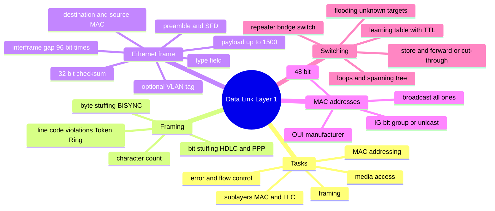

# Data Link Layer — Framing and Switching

> [!tip] Lean recall note (script 04)
> This is a thin study layer, not a full transcript. Mind map → core sheet → gold examples → cards [[CN-03 Framing and Switching]]. Full details: [script 04](file:///C:/Users/hongp/OneDrive/Desktop/WS2627/CompNet/Lect/compnet-ws26-04.pdf) (24 pages) · plan: [[00 CompNet Plan]].

## 🗺️ Mind map

## 📋 Core sheet

**Frame borders — 4 methods**
| Method | Idea | Weakness |
|---|---|---|
| Character count | header holds payload length (DDCMP) | corrupted count → frame end lost |
| Byte stuffing | control chars SYN SOH STX ETX DLE; payload ETX → `DLE ETX`, payload DLE → `DLE DLE` (BISYNC) | tied to a character code |
| Bit stuffing | flag `01111110`; sender inserts `0` after five `1`s, receiver removes it (HDLC, PPP) | — any encoding works |
| Line code violation | illegal signal marks the border (Token Ring, Differential Manchester) | needs a suitable line code |

**Ethernet (IEEE 802.3) frame:** preamble 7 B `10101010` · SFD 1 B `10101011` · dst MAC 6 B · src MAC 6 B · [VLAN tag 4 B: 12-bit VLAN ID, 3-bit priority] · type (`0x0800` IPv4, `0x86DD` IPv6, `0x0806` ARP) · payload ≤ 1500 B (MTU) + pad · checksum 32 bit.
Size 72–1526 B incl. preamble/SFD (1530 with VLAN). Minimum size exists for **collision detection**. Interframe gap = 96 bit times (9.6 µs / 0.96 µs / 96 ns at 10 M / 100 M / 1 G); a reduced gap gives more throughput, but the receiver may miss frame borders. Preamble bytes = `0x55` (LSb first), SFD = `0xD5`.

**MAC address:** 48 bit, e.g. `00-16-41-52-DF-D7`; first 24 bit = OUI (manufacturer) → 2^24 addresses per OUI; I/G bit = LSB of the first byte (1 = multicast/broadcast); broadcast `FF-FF-FF-FF-FF-FF`; changeable → MAC filters are weak (spoofing). Linux: `ip link`, `ip neigh`, `ip link set dev <if> address <MAC>`. Numbering spaces: EUI-48 (Ethernet, WLAN, Bluetooth), EUI-64 (FireWire, 6LoWPAN, Zigbee).

**Devices:** repeater (L1, extends a network) · bridge (L2, connects networks, ≥ 2 ports) · switch (bridge with > 2 ports). Bridges/switches check each frame's checksum and work transparently. Learning: store *source* MAC + port, entries expire (TTL), unknown destination → flood on all other ports.
**Forwarding:** store-and-forward (whole frame, check) · cut-through (after dst address) · fragment-free (after 64 B) · adaptive (cut-through until error threshold).

**Loops → Spanning Tree Protocol (IEEE 802.1D, Radia Perlman):** bridges exchange BPDUs (bridge IDs + path costs, broadcast to neighbour bridges inside Ethernet frames); bridge ID (8 B) = priority (2 B, 0–65,535, default 32,768) + MAC (6 B) of the port with the lowest port ID; **root bridge** = lowest priority, tie → lowest MAC; **designated bridge** per network = lowest path cost to the root (path cost = sum of the costs of the networks on the way); unneeded ports are blocked → cycle-free tree; recomputed if a bridge fails. (Cisco: 4-bit priority in steps of 4,096 + 12-bit VLAN ID → one tree per VLAN.)

## ⭐ Gold examples (solve before reading the solution)

> [!example]- 1 · Byte stuffing (sheet 3, frame 3): `16 16 01 99 98 97 96 95 02 10 03 10 10 10 03 03 92 55`
> `16 16` SYN SYN · `01` SOH · `99 98 97 96 95` header · `02` STX → payload starts.
> `10 03` = DLE ETX → escaped data byte `03` · `10 10` = DLE DLE → data byte `10` · `10 03` → data byte `03` · `03` = real ETX → payload ends · `92 55` = checksum.
> Payload on the wire: `10 03 10 10 10 03` → original data: `03 10 03`.

> [!example]- 2 · Bit stuffing (sheet 3, sequence 1)
> Input: `01111110 10100111 11111000 11110010 10011111 10111111 11100101`
> Rule: after every 5th consecutive `1` insert a `0` (the run counter continues across byte borders!).
> Output: `011111010 10100111 110111000 11110010 100111110 101111101 11100101` → 4 stuffed zeros (in bytes 1, 3, 5, 6). Note byte 3: the run started in byte 2 (`…111` + `11`).

> [!example]- 3 · Why a loop of 3 switches collapses the network
> Empty tables, A sends to B. Switch 1 learns A, doesn't know B → floods to its other ports. Switches 2 and 3 learn A and flood too. The copies come back to switch 1 (2 copies) → it floods each again and updates its entry for A twice (the table flips; the order is unpredictable). Ethernet has no TTL/hop limit, so the copies keep circulating until the switches learn where B is — and every new frame from A adds 2 more → the network floods and collapses. Fix: STP blocks ports so only one path per destination remains.

> [!example]- 4 · Root bridge election
> B1: priority 32,768, MAC …01 · B2: priority 4,096, MAC …09 · B3: priority 4,096, MAC …02.
> Lowest priority: B2 and B3 tie at 4,096 → lower MAC wins → **B3 is root**. Each network's designated bridge is then the one with the lowest path cost to B3.

## 🔗 Connections
- ↔ [[02-Physical-Layer]] — line codes (Differential Manchester) make "line code violations" possible; Ethernet spans L1 and L2.
- ↔ [[04-Data-Link-MAC-Error-Control]] — the frame's checksum is a CRC; the minimum frame size exists because of CSMA/CD.
- ↔ [[01-Basics]] — L2 data unit = frame, addressing = MAC, devices = bridge/switch; star topology = switches.

## ❓ Self-check (from the script summary)
- What are the data link layer's tasks and sublayers?
- What mechanisms mark frame boundaries?
- What does a frame contain?
- What are the properties of MAC addresses, and what do they look like in IEEE 802 networks?
- How do switching and forwarding work?
- What causes loops at the data link layer, and how are they handled?
