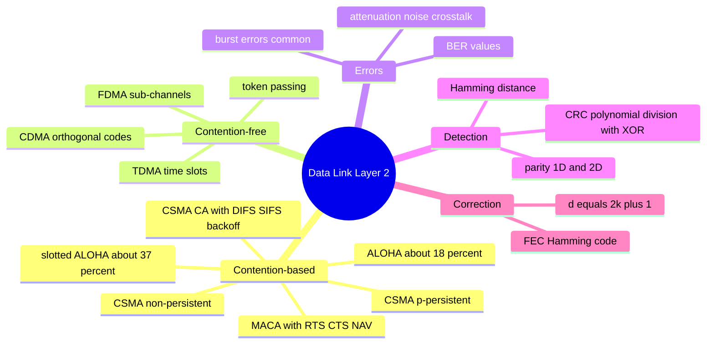

# Data Link Layer — Medium Access Control and Error Control

> [!tip] Lean recall note (script 05, lecture 24 Nov 2026)
> Thin study layer: mind map → core sheet → gold examples → cards [[CN-04 MAC and Error Control]]. Full slides: `WS2627/CompNet/Lect/compnet-ws26-05.pdf`.

## 🗺️ Mind map

## 📋 Core sheet

**Contention-based vs. contention-free**
| | Contention-based | Contention-free |
|---|---|---|
| Access | stations compete | allocated in advance |
| Collisions | possible, must be handled | avoided completely |
| Behavior | non-deterministic | deterministic |
| Good for | low–medium, bursty load | high load, fairness guarantees |
| Examples | ALOHA, CSMA, CSMA/CA, MACA | token passing, TDMA, FDMA, CDMA |

**ALOHA:** send any time, no fairness, peak ≈ 18 % · **Slotted ALOHA:** fixed slots (common clock), only complete collisions, peak ≈ 37 %, more delay (first GSM).
**CSMA** (listen before talk): *p-persistent* — busy: keep listening; idle: send with probability p, else wait one slot · *non-persistent* — busy: wait a random time; idle: send at once. Lower p → better throughput at high load, higher latency.
**CSMA/CA (WLAN):** collisions can't be detected (can't send and listen; hidden terminals) → avoid them: medium idle for **DIFS ≈ 50 µs** → random **backoff** (contention window × slot time; counter pauses while busy) → send → receiver waits **SIFS ≈ 10 µs** → **ACK**; no ACK → retransmit.
**MACA:** after DIFS: **RTS** → (SIFS) **CTS** with the reservation time → (SIFS) data → (SIFS) ACK. Everyone who hears RTS or CTS sets its **NAV** (expected busy time, counts down to 0). Collisions only on RTS/CTS. + fewer collisions, less energy − delay and overhead.

**Error control**
- Causes: attenuation, noise, crosstalk, short disturbances → **burst errors** are more common than single-bit errors.
- BER: POTS 2·10⁻⁴ · radio 10⁻³–10⁻⁴ · Ethernet 10⁻⁹–10⁻¹⁰ · fiber 10⁻¹⁰–10⁻¹².
- Codeword: n = m + r bits. **Hamming distance d** = minimum distance between valid codewords. Detect k errors: d = k + 1. Correct k errors: d = 2k + 1.
- 1-D parity (7 data bits + 1): d = 2 → detects single-bit errors. 2-D parity: detects all 1-, 2-, 3-bit and most 4-bit errors.
- **CRC:** generator of degree k (= bits − 1) → append k zeros → divide via XOR from the left (always start at the first common 1) → remainder, padded to k bits = checksum → append. Receiver: remainder 0 = no error detected. CRC cannot detect all errors. CRC-32 → Ethernet; CRC-16-CCITT → HDLC; CRC-5 → USB.
- **FEC** (Hamming code): more redundancy, but no retransmissions → worth it on error-prone (wireless) links.

## ⭐ Gold examples (solve before reading the solution)

> [!example]- 1 · CRC: payload `10101`, generator x⁵ + x² + 1 = `100101`
> Degree 5 → append 5 zeros: `1010100000`.
> `101010` ⊕ `100101` = `001111` → bring down → `111100` ⊕ `100101` = `011001` → bring down → `110010` ⊕ `100101` = `010111` → bring down → `101110` ⊕ `100101` = `001011`.
> Remainder `1011` → pad to 5 bits → `01011`. Transmitted frame: `10101` `01011` = `1010101011`.
> Receiver check: `1010101011` ÷ `100101` → remainder `0` ✓. With a flipped bit (`1110101011`) the remainder is ≠ 0 → error detected.

> [!example]- 2 · Hamming distance reasoning
> Valid codewords `0000000000`, `0000011111`, `1111100000`, `1111111111` → d = 5 → detect up to 4 errors, correct up to 2.
> Received `0000000111`: closest codeword is `0000011111` (distance 2) → corrected. But if `0000000000` was hit by 3 errors and became `0000000111`, "correction" picks the wrong word → more than 2 errors break correction.

> [!example]- 3 · CSMA/CA vs. MACA timeline
> CSMA/CA: `DIFS → backoff → DATA → SIFS → ACK`.
> MACA: `DIFS → RTS → SIFS → CTS → SIFS → DATA → SIFS → ACK`; hidden station Y hears only the CTS from the access point → sets its NAV → stays silent.

> [!example]- 4 · Cross-course: probability of an error-free frame (→ Statistics)
> With independent bit errors, P(no error in n bits) = (1 − BER)ⁿ. Ethernet BER 10⁻¹⁰, frame of 12,000 bits → (1 − 10⁻¹⁰)^12000 ≈ 1 − 1.2·10⁻⁶. Radio BER 10⁻³ → ≈ e⁻¹² ≈ 6·10⁻⁶ → almost every frame is broken → that is why wireless uses FEC and ACKs.

## 🔗 Connections
- ↔ [[03-Data-Link-Framing-Switching]] — the Ethernet checksum (32 bit) is the CRC-32; minimum frame size comes from collision detection.
- ↔ [[04_HDD_SSD_RAID]] (OS) — RAID 2 uses a Hamming code; RAID parity = XOR like parity bits.
- ↔ [[P1 Probability]] (Statistics) — BER, error-free frames and ALOHA throughput are probability calculations.

## ❓ Self-check (from the script summary)
- Why is a media access control mechanism important?
- What is the difference between contention-based and contention-free media access?
- Which performance can ALOHA, different CSMA variants and contention-free MAC protocols achieve?
- Which requirements need to be fulfilled to allow error detection and correction?
- What is a CRC checksum and how does it work?
