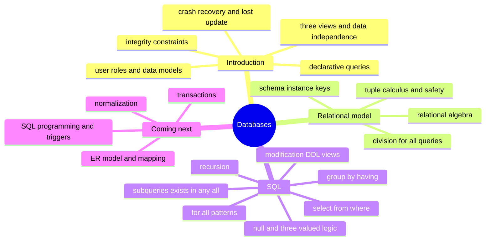

# 🗄️ Databases — Study Plan (target 1.0)

> [!abstract] Exam facts
> - **Written exam, 120 min** (module handbook B.Sc. Informatik). Allowed aids, exam date and old exams: **not announced** → ask Prof. Klingemann after a lecture (also: *"Are there sample exam questions?"*).
> - Two lectures per week (Mondays 11:45, room 4-8, + second slot). The slides are **cumulative**: always study from the newest file ("Relational Model", "SQL 1 - N").
> - Taught so far: introduction · relational model · relational algebra · tuple calculus · SQL 1–8. **Still to come** (module handbook): ER modelling + mapping to relations · normalization · SQL programming (functions, procedures, triggers) · transactions · user administration.
> - Practice tool: **HSQLDB** (`WS2627/Databases/runHSQLDB.sh`, [hsqldb.org](https://hsqldb.org)). The exam is on **paper** → always write first, run second.
> - Back to [[00 Start Here]] · [[Master Calendar]]

## 🗺️ Course mind map

## 📍 Topic tracker
| Lectures | Topic | Note | Deck | Sheets | Conf. | Status |
|---|---|---|---|---|---|---|
| 1–2 | Introduction | (slides only) | [[DB-1 Relational Model]] §Introduction | [sheet 1](file:///C:/Users/hongp/OneDrive/Desktop/WS2627/Databases/Ex/db2627_sheet01.pdf) | | ☐ |
| 2–6 | Relational model, algebra, tuple calculus | [[1.Relations]] (+ recall layer, tuple calculus gap filled) | [[DB-1 Relational Model]] | [sheet 2](file:///C:/Users/hongp/OneDrive/Desktop/WS2627/Databases/Ex/db2627_sheet02.pdf) · [sheet 3](file:///C:/Users/hongp/OneDrive/Desktop/WS2627/Databases/Ex/db2627_sheet03.pdf) · [sheet 4](file:///C:/Users/hongp/OneDrive/Desktop/WS2627/Databases/Ex/db2627_sheet04.pdf) | | ☐ |
| 7–14 | SQL 1–8 | [[2.SQL]] | [[DB-2 SQL]] | [sheet 4](file:///C:/Users/hongp/OneDrive/Desktop/WS2627/Databases/Ex/db2627_sheet04.pdf) · [sheet 5](file:///C:/Users/hongp/OneDrive/Desktop/WS2627/Databases/Ex/db2627_sheet05.pdf) · [sheet 6](file:///C:/Users/hongp/OneDrive/Desktop/WS2627/Databases/Ex/db2627_sheet06.pdf) · [sheet 7](file:///C:/Users/hongp/OneDrive/Desktop/WS2627/Databases/Ex/db2627_sheet07.pdf) | | ☐ |
| 15+ | ER modelling, normalization, transactions … | *make lean notes* | *make decks* | coming | | ☐ |

For every new topic: [[AI Prompts v2#Prompt A — Recall layer for a new lecture|Prompt A]] on the newest slides → lean note + deck. Because DB slides grow lecture by lecture, update the deck **once per week** (after the second lecture).

## ❓ Pre-questions — answer *before* the new topics start
**ER model:** Entity vs. relationship vs. attribute? · What do 1:1, 1:n, n:m mean, and how does each become tables? · What is a weak entity?
**Normalization:** What is a functional dependency? · Why is a table with redundancy bad (update/insert/delete anomalies)? · 2NF vs. 3NF vs. BCNF in one sentence each?
**Transactions:** What do the letters of ACID mean? · Why does the lost update from lecture 1 happen, and how could a DBMS prevent it?

## 🟦 Phase 1 — Study & consolidate (26 Nov – 20 Dec)
**Week 26–29 Nov**
- [ ] Fill ✍️ in [[DB-1 Relational Model]] (incl. introduction) → start daily reviews
- [ ] Redo sheet 1 + sheet 2 on paper (RA evaluation on the small relations)

**Week 30 Nov – 6 Dec**
- [ ] Both lectures → update deck/lean note
- [ ] Redo sheet 3 (RA) on paper · sheet 4: RA + tuple calculus + first SQL — **paper first, then HSQLDB**
- [ ] Fill the first 4 ✍️ in [[DB-2 SQL]]

**Week 7–13 Dec**
- [ ] Both lectures → update
- [ ] Redo sheets 5 + 6 (paper → HSQLDB), compare every query with your first attempt
- [ ] Fill the remaining ✍️ in [[DB-2 SQL]]

**Week 14–20 Dec**
- [ ] Both lectures → update
- [ ] Redo sheet 7: `all`, recursion, query equivalence
- [ ] Course mind map from memory → confidence ratings
- [ ] ✅ Checkpoint: all decks active, 0 overdue

## 🟨 Phase 2 — Revise & close gaps (21 Dec – 24 Jan)
**Mock recipe (120 min, paper):** evaluate 2 RA expressions on given relations (15') · 3 RA queries (20') · 2 tuple-calculus queries (15') · 6 SQL queries incl. one "for all", one GROUP BY/HAVING, one `all`/`exists`, one recursion (45') · 1 equivalence/NULL reasoning question (10') · new topics: ER → tables, normalization, transactions (15').
- [ ] **21–27 Dec:** 🧪 **SQL marathon**: 15 queries from sheets 4–7 on paper in 60 min → run all in HSQLDB → [[Error Log]] · **three-languages drill**: 5 queries each in RA, tuple calculus and SQL
- [ ] **28 Dec – 3 Jan:** fix the top-5 weaknesses · make sure every trap in [[2.SQL#⚠️ Traps that cost points|the traps list]] is a card you know
- [ ] **4–10 Jan:** lectures → loop · weekly mixed set: 1 RA evaluation + 2 SQL + 1 tuple calculus + 1 new-topic task
- [ ] **11–17 Jan:** lectures → loop · ER modelling / normalization practice (new sheets)
- [ ] **18–24 Jan:** lectures → loop · **mock 1** (120 min)

## 🟥 Phase 3 — Exam mode (E = exam day)
- [ ] **25–31 Jan:** last lectures → loop · ask for an old exam / sample questions · **mock 2**
- [ ] **E−14 … E−8:** daily: 10 SQL queries on paper in 25 min + 1 RA/TC task + 1 new-topic task
- [ ] **E−7 … E−3:** **mock 3** and **mock 4** (120 min each) · re-read the traps list
- [ ] **E−2 … E−1:** Error Log + weakest cards · sleep · nothing new

## ⭐ Gold examples — master these closed-book
1. **Evaluate RA expressions** on the small relations R, S, T of sheets 2–3 (projection removes duplicates!)
2. **Division** — "students who attend all lectures": RA formula → tuple calculus with ∀ → SQL double `not exists` → SQL counting · [[2.SQL]] gold 1 · [[DB-1 Relational Model]]
3. **GROUP BY / HAVING ranking** (professors by average grade, passed exams only) → [[2.SQL]] gold 2
4. **Query equivalence with `all`, `max` and empty relations** → [[2.SQL]] gold 3 (method: test empty, one tuple, ties)
5. **Median via correlated counting** → [[2.SQL]] gold 4
6. **Recursion** ("lecture-connected") → [[2.SQL]] gold 5
7. **Tuple calculus with nested ∃** (students of Prof. Schmitt) → slides, [[DB-1 Relational Model]] ✍️

## 🧠 How to practise SQL so it sticks
1. Read the task, write the query **on paper** (as in the exam).
2. Predict the result on a tiny instance (3–4 tuples per table).
3. Run it in HSQLDB with your own test data — include an **empty table**, a **NULL** and a **tie**.
4. Wrong? Log *why* in the [[Error Log]] (wrong pattern / NULL / grouping / duplicates), not just the fixed query.
