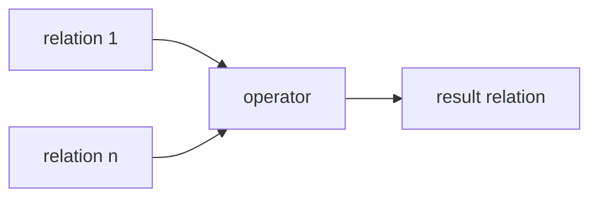
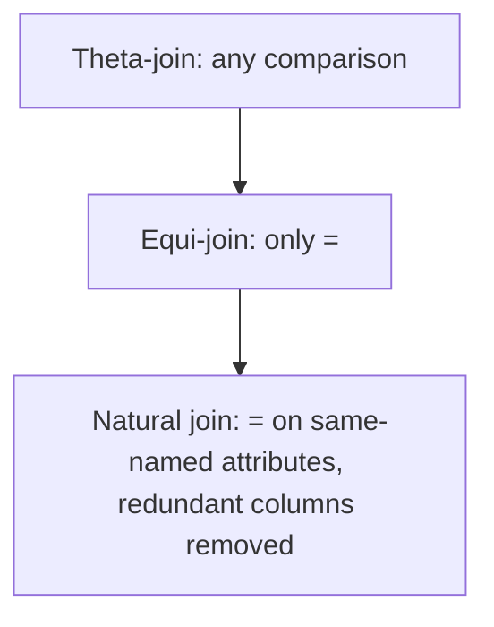
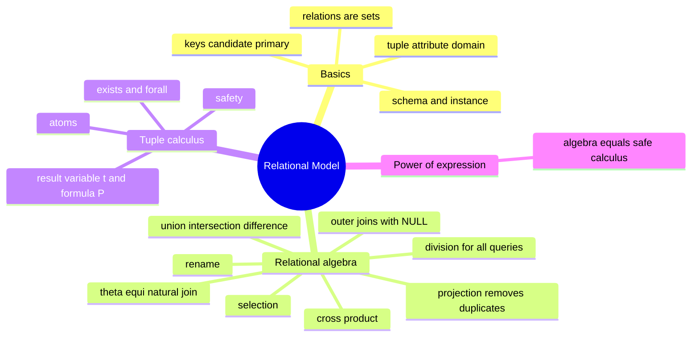

---
# The Relational Model

> [!tip] 🧠 Study from the [[#🧠 Recall Layer|Recall Layer]] at the end of this note — mind map · deck [[DB-1 Relational Model]] · gold examples · exam lens. This note is now your reference: search it, don't re-read it.

> [!Note] 💡 Notation Conventions
> **1.** $R, R_1, R_2$ denote relations; $A_i$ denotes an attribute; $D_i$ denotes a domain (the set of allowed values of an attribute).
> **2.** $\mathrm{sch}(R)$ denotes the schema of $R$. The slides also write this as $\mathfrak{R}$ (e.g. $\mathfrak{R}_1$); here it is always written $\mathrm{sch}(R)$.
> **3.** $\pi$ = projection, $\sigma$ = selection, $\rho$ = rename, $\bowtie$ = join, $\times$ = cross product, $\cup, \cap, \setminus$ = union, intersection, difference, $\div$ = division.
> **4.** Outer joins are written in words (left / right / full outer join) and with the symbols ⟕ (left), ⟖ (right), ⟗ (full) in running text.
> **5.** Logical operators in predicates: $\wedge$ (AND), $\vee$ (OR), $\neg$ (NOT).
> **6.** Renaming is written $\rho_{New \leftarrow Old}(R)$.

---

## 1. Basic Definitions

> [!Definition] 📖 Relational database, relation, schema, instance
> A **relational database** is a set of **relations**. A relation $R$ has two parts:
> **1.** **Schema:** defines the structure of the relation: the name of the relation and the names and data types of its columns.
> **2.** **Instance:** the current content of the relation: a table with rows and columns.

> [!Definition] 📖 Tuple and attribute
> Each **row** of the table is called a **tuple**; each **column** is called an **attribute**.

> [!Definition] 📖 Domain
> Each attribute has an associated **domain** (a type that defines the allowed values).

> [!Definition] 📖 Formal definition of a relation
> A relation (the instance) is a **subset of the Cartesian product of the domains**:
> $$R \subseteq D_1 \times D_2 \times \dots \times D_n$$
> Notation: $dom(Attribute) = Type$, e.g. $dom(MatrNr) = \text{integer}$. The schema of a relation $R$ is denoted $\mathrm{sch}(R)$ (or $\mathfrak{R}$). A schema is the set of attributes with name and type.

> [!Definition] 📖 Cardinality
> The size of a relation (its number of tuples) is called the **cardinality** of the relation.

> [!Definition] 📖 Key, candidate key, primary key
> **1.** A **key** is a *minimal* set of attributes whose values uniquely identify a tuple.
> **2.** There can be several keys; they are also called **candidate keys**.
> **3.** One of the candidate keys is selected and called the **primary key**.
> The primary key is underlined in a schema definition.

> [!Property] ⚙️ Relations are sets
> The relational model is **set-oriented**: a relation is a *set* of tuples, so it contains no duplicates (see projection).

## 📘 Examples & Applications (Basic Definitions)

### Example 1.1: The relation Student

**Using:** relation, instance, tuple, attribute, domain, formal definition, primary key

We store the relevant data of a student in the relation $Student$. Each row is a tuple, each column an attribute:

| MatrNr | Name | Birthday |
|---|---|---|
| 1 | Becker, Hans | 1990-10-12 |
| 2 | Graf, Anne | 1992-07-30 |
| 3 | Schulze, Iris | 1991-03-24 |

**Step 1:** the attributes are $MatrNr$, $Name$, $Birthday$, with domains
$$D_{MatrNr} = \text{integer}, \quad D_{Name} = \text{string}, \quad D_{Birthday} = \text{date}$$
**Step 2:** the complete schema in pseudo-code: `Student(MatrNr: integer, Name: string, Birthday: date)`.
**Step 3:** formally, the instance is a subset of the product of the domains:
$$Student \subseteq D_{MatrNr} \times D_{Name} \times D_{Birthday} = \text{integer} \times \text{string} \times \text{date}$$
**Step 4:** $dom(MatrNr) = \text{integer}$.
**Step 5:** the primary key is $MatrNr$, written underlined: $Student(\underline{MatrNr}, Name, Birthday)$.
**Step 6:** the cardinality of this instance is $3$.

---

## 2. SQL: Schema Definition and Inserting Data

> [!Definition] 📖 DDL and `create table`
> By means of the **DDL (Data Definition Language)** we define the schema of a database. The DDL is also used to define **integrity constraints**. The `create table` statement defines relations:
> ```
> create table <name of the relation> (
>   <column name> <data type> [<constraints>]
>   ...
> )
> ```

> [!Definition] 📖 Inserting a single tuple
> ```
> insert into <Relation>
> values ( <list of values> )
> ```

## 📘 Examples & Applications (SQL)

### Example 2.1: Professor

**Using:** `create table`, `insert into`

**Step 1:** define the relation:

```sql
create table Professor (
  PersNr  integer,
  Name    varchar(80),
  RoomNr  integer
)
```

**Step 2:** insert a single tuple:

```sql
insert into Professor
values (123456, 'Schmidt', 012)
```

---

## 3. Query Languages

> [!Note] 💡 Algebra vs. calculus
> So far we have only considered storing data. To extract information we need a query language. Two formal languages are studied:
> **1.** **Relational calculus:** *declarative* (describes the desired result tuples via conditions, not the way to produce them); based on first-order predicate logic; forms the basis for SQL. Two variants: **relational tuple calculus** and **relational domain calculus**.
> **2.** **Relational algebra:** *imperative* (operators describe how to compute the result); also used at the physical level inside the DBMS to create query plans (internally the DBMS does not operate declaratively). The algebra is covered first.

> [!Warning] ⚠️ Possible Gap
> The source file ends at the introduction of the relational calculus. Tuple and domain calculus themselves are not covered.

---

## 4. Relational Algebra

> [!Property] ⚙️ Closure
> All operators of the relational algebra are **closed**: each operator takes one or more relations as input and creates a relation as output. Hence operators can be nested arbitrarily.



---

## 4.1 Projection

> [!Definition] 📖 Projection $\pi$
> $$\pi_{A_1,\dots,A_n}(R)$$
> Creates a relation that consists only of the attributes (columns) $A_1,\dots,A_n$ of $R$.

> [!Property] ⚙️ Duplicate elimination
> Because a relation is a set, **duplicates are eliminated** by projection.

> [!Warning] ⚠️ Relational algebra vs. SQL
> Relational algebra works on *sets*. SQL works on *bags* (which can contain duplicates) and therefore does **not** eliminate duplicates.

## 📘 Examples & Applications (Projection)

### Example 4.1: Projection on Name and on Birthday

**Using:** projection $\pi$, duplicate elimination, set semantics

Let $Student$ be:

| MatrNr | Name | Birthday |
|---|---|---|
| 1 | Becker, Hans | 1990-10-12 |
| 2 | Graf, Anne | 1992-07-30 |
| 3 | Schulze, Iris | 1991-03-24 |
| 4 | Petersen, Bernd | 1992-07-30 |

**Query a:** list the names: $\pi_{Name}(Student)$

**Step 1:** keep only the column $Name$: Becker, Hans; Graf, Anne; Schulze, Iris; Petersen, Bernd.
**Step 2:** all four values are different, so nothing is eliminated.

| Name |
|---|
| Becker, Hans |
| Graf, Anne |
| Schulze, Iris |
| Petersen, Bernd |

**Query b:** list the birthdays: $\pi_{Birthday}(Student)$

**Step 1:** keep only the column $Birthday$: 1990-10-12, 1992-07-30, 1991-03-24, 1992-07-30.
**Step 2:** 1992-07-30 occurs twice. A relation is a set, so it appears once.

| Birthday |
|---|
| 1990-10-12 |
| 1992-07-30 |
| 1991-03-24 |

---

## 4.2 Selection

> [!Definition] 📖 Selection $\sigma$
> $$\sigma_p(R)$$
> Selects all tuples of $R$ that fulfil the predicate (condition) $p$. Predicates are formed with the comparison operators $\neq, =, <, \leq, >, \geq$ and can be combined with the logical operators $\wedge$ (AND), $\vee$ (OR), $\neg$ (NEGATION).

## 📘 Examples & Applications (Selection)

### Example 4.2: Selection with a combined predicate

**Using:** selection $\sigma$, comparison operators, logical operators

**Query:** list all students with a $MatrNr$ less than or equal to 3 who were born after 1.1.1991:
$$\sigma_{MatrNr \leq 3 \,\wedge\, Birthday > 1991\text{-}01\text{-}01}(Student)$$

**Step 1:** evaluate the predicate on each tuple of the 4-tuple Student table from Example 4.1:

| Tuple | $MatrNr \leq 3$ | $Birthday > 1991\text{-}01\text{-}01$ | Selected? |
|---|---|---|---|
| (1, Becker, 1990-10-12) | true | false | no |
| (2, Graf, 1992-07-30) | true | true | yes |
| (3, Schulze, 1991-03-24) | true | true | yes |
| (4, Petersen, 1992-07-30) | false | true | no |

**Step 2:** the result consists of the selected tuples:

| MatrNr | Name | Birthday |
|---|---|---|
| 2 | Graf, Anne | 1992-07-30 |
| 3 | Schulze, Iris | 1991-03-24 |

---

## 4.3 Cross Product

> [!Definition] 📖 Cross (Cartesian) product $\times$
> $$R_1 \times R_2$$
> Combines every tuple of $R_1$ with every tuple of $R_2$. It is used to combine information from several relations.

> [!Property] ⚙️ Cardinality of a cross product
> $|R_1 \times R_2| = |R_1| \cdot |R_2|$. Many of the resulting combinations do not make sense.

## 📘 Examples & Applications (Cross Product)

### Example 4.3: Lecture × Professor

**Using:** cross product, cardinality

Relations (further columns are shown as "…" in the source):

| Nr | … | ProfPersNr |
|---|---|---|
| 1 | … | 1 |
| 2 | … | 1 |
| 3 | … | 2 |
| 4 | … | 2 |

*(Lecture)*

| PersNr | Name | … |
|---|---|---|
| 1 | Schmitt | … |
| 2 | Maier | … |

*(Professor)*

**Query:** combine all Lectures with all Professors: $Lecture \times Professor$.

**Step 1:** $|Lecture| = 4$ and $|Professor| = 2$, so the result has $4 \cdot 2 = 8$ tuples.
**Step 2:** pair every lecture with every professor:

| Nr  | …   | ProfPersNr | PersNr | Name    | …   |
| --- | --- | ---------- | ------ | ------- | --- |
| 1   | …   | 1          | 1      | Schmitt | …   |
| 1   | …   | 1          | 2      | Maier   | …   |
| 2   | …   | 1          | 1      | Schmitt | …   |
| 2   | …   | 1          | 2      | Maier   | …   |
| 3   | …   | 2          | 1      | Schmitt | …   |
| 3   | …   | 2          | 2      | Maier   | …   |
| 4   | …   | 2          | 1      | Schmitt | …   |
| 4   | …   | 2          | 2      | Maier   | …   |

Many of these combinations do not make sense (e.g. lecture 1 with professor 2, although its $ProfPersNr$ is 1).

---

## 4.4 Joins

> [!Definition] 📖 Join $\bowtie$
> Useless combinations produced by a cross product are removed by a subsequent selection. Because this is a frequent combination, a special operator exists, the **join**:
> $$R_1 \bowtie_{R_1.A_i = R_2.A_j} R_2 \;=\; \sigma_{R_1.A_i = R_2.A_j}(R_1 \times R_2)$$
> $R_1.A_i$ denotes attribute $A_i$ of relation $R_1$. Joins can be implemented **more efficiently** than cross products.

## 📘 Examples & Applications (Join)

### Example 4.4: From cross product to join

**Using:** cross product, selection, equi-join

We continue with $Lecture$ and $Professor$ from Example 4.3.

**Step 1:** remove the useless combinations with a selection:
$$\sigma_{ProfPersNr = PersNr}(Lecture \times Professor)$$
**Step 2:** this is exactly the join. The query "list all Lectures together with the responsible Professors" becomes
$$Lecture \bowtie_{ProfPersNr = PersNr} Professor$$
**Step 3:** of the 8 tuples of the cross product only those with $ProfPersNr = PersNr$ remain:

| Nr | … | ProfPersNr | PersNr | Name | … |
|---|---|---|---|---|---|
| 1 | … | 1 | 1 | Schmitt | … |
| 2 | … | 1 | 1 | Schmitt | … |
| 3 | … | 2 | 2 | Maier | … |
| 4 | … | 2 | 2 | Maier | … |

---

> [!Definition] 📖 Join types by predicate
> **1.** **Theta-join ($\theta$-join):** the most general form; the predicate can consist of arbitrary comparisons: $\neq, =, <, \leq, >, \geq$.
> **2.** **Equi-join:** the predicate only tests for equality ($=$).
> **3.** **Natural join:** a particular equi-join: exactly the attributes with the **same name** are tested for equality, and the resulting redundant columns are removed by a projection. The join predicate is implicit; the symbol has no subscript: $R_1 \bowtie R_2$.



> [!Definition] 📖 Rename $\rho$
> To avoid **name collisions** (attributes from different relations with the same name), attributes are renamed:
> $$\rho_{NewName \leftarrow OldName,\dots}(R)$$

## 📘 Examples & Applications (Rename and Natural Join)

### Example 4.5: Renaming to avoid name collisions

**Using:** equi-join, rename $\rho$, name collisions

Schemas: $Assistant(PersNr, Name, Area, Boss)$ and $Professor(PersNr, Name, RoomNr)$.

**Step 1:** the join $Assistant \bowtie_{Boss = PersNr} Professor$ is ambiguous: $PersNr$ and $Name$ occur in both relations.
**Step 2:** rename the colliding attributes with $\rho$:
$$\rho_{APersNr \leftarrow PersNr,\; AName \leftarrow Name}(Assistant) \;\bowtie_{Boss = PPersNr}\; \rho_{PPersNr \leftarrow PersNr,\; PName \leftarrow Name}(Professor)$$
**Step 3:** the result schema is $(APersNr, AName, Area, Boss, PPersNr, PName, RoomNr)$, with all attribute names unambiguous.

### Example 4.6: Natural join

**Using:** natural join, rename $\rho$, implicit join predicate

**Query:** list all Lectures together with the responsible Professors (relations from Example 4.3).

**Step 1:** $Lecture$ has the attribute $ProfPersNr$ and $Professor$ has $PersNr$. A natural join needs equal attribute names, so rename first:
$$\rho_{PersNr \leftarrow ProfPersNr}(Lecture) \bowtie Professor$$
**Step 2:** the join predicate is implicit: equality on the only shared attribute $PersNr$.
**Step 3:** the redundant column is removed by the projection that is part of the natural join:

| Nr | … | PersNr | Name | … |
|---|---|---|---|---|
| 1 | … | 1 | Schmitt | … |
| 2 | … | 1 | Schmitt | … |
| 3 | … | 2 | Maier | … |
| 4 | … | 2 | Maier | … |

---

> [!Property] ⚙️ Commutativity and associativity
> An expression can contain more than one join. The order in which the joins are evaluated does not influence the result: joins are **commutative and associative**.

## 📘 Examples & Applications (Joining Several Relations)

### Example 4.7: Student, attends, Lecture

**Using:** natural join, associativity of joins

| MatrNr | Name | … |
|---|---|---|
| 1 | Becker, Hans | … |
| 2 | Graf, Anne | … |
| 3 | Schulze, Iris | … |

*(Student)*

| LectNr | Title | … |
|---|---|---|
| 1 | Databases | … |
| 2 | Networks | … |

*(Lecture)*

| MatrNr | LectNr |
|---|---|
| 1 | 1 |
| 1 | 2 |
| 2 | 2 |
| 3 | 1 |

*(attends)*

**Query:** combine all students with the lectures they attend:
$$Student \bowtie attends \bowtie Lecture$$

**Step 1:** $Student \bowtie attends$ joins on the shared attribute $MatrNr$, giving $(MatrNr, Name, LectNr)$: (1, Becker, 1), (1, Becker, 2), (2, Graf, 2), (3, Schulze, 1).
**Step 2:** joining with $Lecture$ on the shared attribute $LectNr$ gives:

| MatrNr | Name | LectNr | Title |
|---|---|---|---|
| 1 | Becker, Hans | 1 | Databases |
| 1 | Becker, Hans | 2 | Networks |
| 2 | Graf, Anne | 2 | Networks |
| 3 | Schulze, Iris | 1 | Databases |

**Step 3:** joins are associative and commutative, so the evaluation order does not matter.

---

## 4.5 Outer Joins

> [!Definition] 📖 Outer join
> In an ordinary (inner) join, a tuple without a matching tuple in the other relation has no trace in the result. An **outer join** adds exactly these *dangling* tuples to the result of the inner join and pads the columns they do not possess with **NULL** values.
> **1.** **Left outer join** (⟕): only adds dangling tuples from the **left** relation.
> **2.** **Right outer join** (⟖): only adds dangling tuples from the **right** relation.
> **3.** **Full outer join** (⟗): adds dangling tuples from **both** relations.

## 📘 Examples & Applications (Outer Joins)

### Example 4.8: Left, right and full outer join

**Using:** inner join, left/right/full outer join, NULL padding

| A | B | C |
|---|---|---|
| $a_1$ | $b_1$ | $c_1$ |
| $a_2$ | $b_2$ | $c_2$ |

*(L)*

| C | D | E |
|---|---|---|
| $c_1$ | $d_1$ | $e_1$ |
| $c_3$ | $d_2$ | $e_2$ |

*(R)*

**Step 1:** inner join on $C$: only $c_1$ occurs in both relations, giving $(a_1, b_1, c_1, d_1, e_1)$.
**Step 2:** dangling tuples: $(a_2, b_2, c_2)$ from $L$ and $(c_3, d_2, e_2)$ from $R$ have no partner.
**Step 3:** results, with columns $A, B, C, D, E$ and "–" meaning NULL:

**Full outer join** (L ⟗ R):

| A | B | C | D | E |
|---|---|---|---|---|
| $a_1$ | $b_1$ | $c_1$ | $d_1$ | $e_1$ |
| $a_2$ | $b_2$ | $c_2$ | – | – |
| – | – | $c_3$ | $d_2$ | $e_2$ |

**Left outer join** (L ⟕ R):

| A | B | C | D | E |
|---|---|---|---|---|
| $a_1$ | $b_1$ | $c_1$ | $d_1$ | $e_1$ |
| $a_2$ | $b_2$ | $c_2$ | – | – |

**Right outer join** (L ⟖ R):

| A | B | C | D | E |
|---|---|---|---|---|
| $a_1$ | $b_1$ | $c_1$ | $d_1$ | $e_1$ |
| – | – | $c_3$ | $d_2$ | $e_2$ |

---

## 4.6 Set Operations

> [!Definition] 📖 Union, intersection, difference
> The common set operations $\cup$ (union), $\cap$ (intersection) and $\setminus$ (difference) can be applied to relations.
> **Prerequisite:** both relations have the same schema structure: **1.** the same number of attributes and **2.** corresponding attributes have the same types.

## 📘 Examples & Applications (Set Operations)

### Example 4.9: Prof1 and Prof2

**Using:** union compatibility, union, intersection, difference

| PersNr | Name |
|---|---|
| 1 | Schmitt |
| 2 | Maier |

*(Prof1)*

| PersNr | Name |
|---|---|
| 1 | Schmitt |
| 3 | Stein |

*(Prof2)*

**Step 1:** both relations have the schema $(PersNr, Name)$, so they are union compatible.
**Step 2:** $Prof_1 \cup Prof_2 = \{(1,\text{Schmitt}),\ (2,\text{Maier}),\ (3,\text{Stein})\}$. Schmitt appears once because of set semantics.
**Step 3:** $Prof_1 \cap Prof_2 = \{(1,\text{Schmitt})\}$: the professors in both relations.
**Step 4:** $Prof_1 \setminus Prof_2 = \{(2,\text{Maier})\}$: the professors in the first but not in the second relation.

---

## 4.7 Relational Division

> [!Definition] 📖 Division $\div$
> Used for queries that imply an **"all" statement**. For each relation $R_i$, $\mathrm{sch}(R_i)$ denotes its schema (the set of attributes with name and type). Then:
> $$R_1 \div R_2 = \pi_{\mathrm{sch}(R_1)\setminus \mathrm{sch}(R_2)}(R_1) \;\setminus\; \pi_{\mathrm{sch}(R_1)\setminus \mathrm{sch}(R_2)}\Big(\big(\pi_{\mathrm{sch}(R_1)\setminus \mathrm{sch}(R_2)}(R_1) \times R_2\big) \setminus R_1\Big)$$
> **Prerequisite:** $\mathrm{sch}(R_2) \subset \mathrm{sch}(R_1)$.

> [!Definition] 📖 Division, element-wise formulation
> $t \in R_1 \div R_2$ iff for **each** $v \in R_2$ there **exists** a $u \in R_1$ such that:
> **1.** $u.\mathrm{sch}(R_2) = v.\mathrm{sch}(R_2)$
> **2.** $u.(\mathrm{sch}(R_1)\setminus \mathrm{sch}(R_2)) = t$

> [!Note] 💡 Meaning of the dot "."
> For a tuple $u$ and a set of attributes $X$, $u.X$ is the **restriction of $u$ to the attributes in $X$** (the sub-tuple containing only the values of $X$). Condition 1: $u$ agrees with $v$ on the attributes of $R_2$. Condition 2: on the remaining attributes $u$ equals $t$.

> [!Note] 💡 Intuition
> A tuple $t$ is in the result iff it appears in $R_1$ combined with **every** tuple of $R_2$. The formula computes all candidates $t$ and removes those for which some combination $(t, v)$ is missing from $R_1$.

## 📘 Examples & Applications (Division)

### Example 4.10: Students attending all lectures

**Using:** division, projection, cross product, set difference

**Query:** list all $MatrNr$ of students who attend **all** existing lectures. The result depends on the content of the relation containing the lectures.

| MatrNr | LectNr |
|---|---|
| 1 | 1 |
| 1 | 2 |
| 2 | 1 |
| 2 | 3 |
| 3 | 1 |
| 3 | 2 |
| 3 | 3 |

*(attends)*

Divisors (each with schema $(LectNr)$): $Lect_1 = \{1,2\}$, $Lect_2 = \{1,3\}$, $Lect_3 = \{1,2,3\}$.

**Setup:** $\mathrm{sch}(attends)\setminus\mathrm{sch}(Lect_i) = \{MatrNr\}$, and the prerequisite $\{LectNr\} \subset \{MatrNr, LectNr\}$ holds. Let $C = \pi_{MatrNr}(attends) = \{1,2,3\}$ (the candidates).

**(a) $attends \div Lect_1$**
**Step 1:** $C \times Lect_1$ has $3 \cdot 2 = 6$ tuples: $(1,1),(1,2),(2,1),(2,2),(3,1),(3,2)$.
**Step 2:** subtract $attends$: only $(2,2)$ is not in $attends$.
**Step 3:** $\pi_{MatrNr}$ of the missing pairs $= \{2\}$.
**Step 4:** $C \setminus \{2\} = \{1,3\}$.
Result: $\{1, 3\}$.

**(b) $attends \div Lect_2$**
**Step 1:** $C \times Lect_2 = \{(1,1),(1,3),(2,1),(2,3),(3,1),(3,3)\}$.
**Step 2:** subtract $attends$: only $(1,3)$ is missing.
**Step 3:** $C \setminus \{1\} = \{2,3\}$.
Result: $\{2, 3\}$.

**(c) $attends \div Lect_3$**
**Step 1:** $C \times Lect_3$ has $3 \cdot 3 = 9$ tuples.
**Step 2:** subtract $attends$: the missing pairs are $(1,3)$ and $(2,2)$.
**Step 3:** $\pi_{MatrNr}$ of the missing pairs $= \{1,2\}$.
**Step 4:** $C \setminus \{1,2\} = \{3\}$.
Result: $\{3\}$.

**Check with the element-wise definition for (c):** for $t = 3$ and each $v \in Lect_3$, $attends$ contains a $u$ with $u.LectNr = v.LectNr$ and $u.MatrNr = 3$. For $t = 1$ no $u$ exists for $v = 3$, and for $t = 2$ none exists for $v = 2$.

---

## 🗂️ Summary

- **Relation:** a set of tuples, $R \subseteq D_1 \times \dots \times D_n$. Schema = structure (name, attribute names and types); instance = current content. Row = tuple, column = attribute, cardinality = number of tuples.
- **Notation:** $dom(Attribute) = Type$; $\mathrm{sch}(R)$ (or $\mathfrak{R}$) is the schema of $R$.
- **Key:** minimal attribute set identifying a tuple; candidate keys, one chosen as primary key (underlined).
- **SQL:** DDL (`create table <name> (<column> <type> [<constraints>] ...)`) defines the schema and integrity constraints; `insert into <Relation> values (...)` inserts a tuple. SQL works on bags, relational algebra on sets.
- **Query languages:** calculus = declarative (basis of SQL; tuple and domain variants); algebra = imperative (used for query plans).
- **Closure:** every algebra operator takes relations as input and produces a relation.
- **Projection** $\pi_{A_1,\dots,A_n}(R)$: keeps the listed columns and eliminates duplicates.
- **Selection** $\sigma_p(R)$: keeps tuples satisfying $p$; predicates use $\neq,=,<,\leq,>,\geq$ combined with $\wedge,\vee,\neg$.
- **Cross product** $R_1 \times R_2$: all combinations, $|R_1|\cdot|R_2|$ tuples.
- **Join:** $R_1 \bowtie_{R_1.A_i = R_2.A_j} R_2 = \sigma_{R_1.A_i = R_2.A_j}(R_1 \times R_2)$; more efficient than a cross product; commutative and associative.
- **Join types:** theta (any comparison) $\supset$ equi ($=$) $\supset$ natural (same-named attributes, redundant columns removed, implicit predicate).
- **Rename:** $\rho_{New \leftarrow Old}(R)$ avoids name collisions and enables natural joins.
- **Outer joins:** add dangling tuples with NULL padding: left (left dangling), right (right dangling), full (both).
- **Set operations** $\cup,\cap,\setminus$: require the same number of attributes and the same types of corresponding attributes.
- **Division:** $R_1 \div R_2 = \pi_X(R_1) \setminus \pi_X\big((\pi_X(R_1) \times R_2) \setminus R_1\big)$ with $X = \mathrm{sch}(R_1)\setminus\mathrm{sch}(R_2)$; requires $\mathrm{sch}(R_2) \subset \mathrm{sch}(R_1)$; used for "all" queries.
- **Dot notation:** $u.X$ is the restriction of tuple $u$ to the attributes in $X$.
- **Division results:** $attends \div Lect_1 = \{1,3\}$, $attends \div Lect_2 = \{2,3\}$, $attends \div Lect_3 = \{3\}$.

---

## 🧠 Recall Layer

> [!tip] Study from here (added 2026-11-25)
> **1.** Draw the mind map from memory, then compare. **2.** Review the deck [[DB-1 Relational Model]] daily (write the ✍️ answers on paper first). **3.** Solve the gold examples closed-book. The text above is your reference: search it, don't re-read it. Plan: [[00 DB Plan]] · SQL: [[2.SQL]]

### 🗺️ Mind map


### 🧩 Gap fill — tuple calculus (your note above stops before it)
- Query: **{ t | P(t) }** — t tuple variable, P formula. Atoms: `s ∈ R` · `s.A θ t.B` · `s.A θ c`. Formulas: atoms combined with ¬ ∧ ∨ ⇒ and ∃t ∈ R(…), ∀t ∈ R(…).
- Free vs. bound variables: the result variable t must be free.
- Rewrite rules: ∀t ∈ R (P) ≡ ¬∃t ∈ R (¬P) · P ⇒ Q ≡ ¬P ∨ Q · De Morgan.
- **Safety:** the result must lie within the domain of the formula (its constants + attribute values of the relations used); { n | ¬(n ∈ Professor) } is unsafe.
- **Power:** relational algebra = safe tuple calculus = safe domain calculus.

> [!example]- Slide example: students attending at least one lecture of Prof. Schmitt (solve first!)
> { s | s ∈ Student ∧ ∃a ∈ attends ( s.MatrNr = a.MatrNr ∧ ∃g ∈ gives ( a.LectNr = g.LectNr ∧ ∃p ∈ Professor ( p.ProfID = g.ProfID ∧ p.PName = 'Schmitt' ))) }

### ⭐ Gold examples (closed-book, then check)
1. **Evaluate RA expressions** on the small relations of sheets 2–3 (remember: projection removes duplicates) → §4
2. **Division** "students who attend all lectures" in RA → tuple calculus → SQL → §4.7 · [[2.SQL]] gold 1
3. **Natural join vs. θ-join** on the same relations — which columns appear? → §4.4
4. **Outer join** result with NULL padding → §4.5
5. **Union-compatibility**: which set operations are allowed on given schemas? → §4.6

### 🎯 Exam lens
- No old exams are public, so the sheets show the style: evaluate an RA expression on small relations (sheets 2–3), then write queries in RA, tuple calculus and SQL (sheet 4). Practise at least one "for all" (division) query in all three.

### 🔗 Connections
- → [[2.SQL]]: every RA operator has an SQL twin; division ↔ double NOT EXISTS ↔ ∀ in tuple calculus.
- → [[P2 Descriptive Statistics]]: contingency tables = GROUP BY with counts.
- → OS slide set 9: the "lost update" from the DB introduction is the same race condition as in process synchronization.
