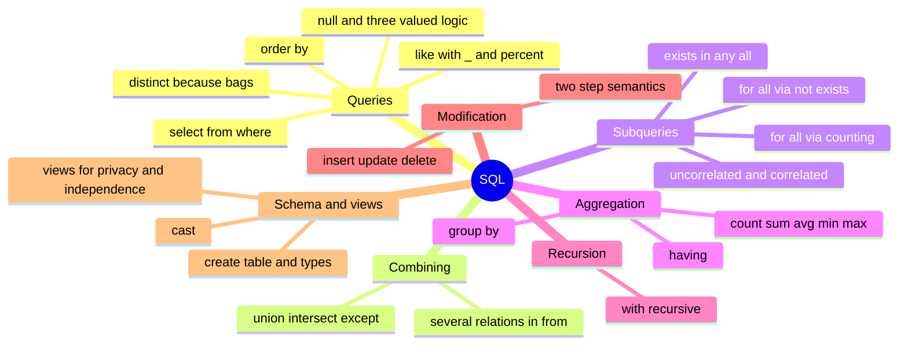

# SQL — Lean Recall Note

> [!tip] Lean recall note (lectures 7–14, slides "SQL 1 - 8")
> Thin study layer: mind map → core sheet → gold examples → traps → cards [[DB-2 SQL]]. Full slides: `WS2627/Databases/Lect/db2627_sql18.pdf` (always use the newest cumulative "SQL 1 - N" file). Schema used everywhere: Student(MatrNr, SName, Birthday, Semester) · Lecture(LectNr, Title, Credits) · Professor(ProfID, PName, RoomNr) · attends(MatrNr, LectNr) · gives(ProfID, LectNr) · Examination(ProfID, LectNr, MatrNr, Grade).

## 🗺️ Mind map


## 📋 Core sheet

**Logical evaluation order:** `FROM` (cross product) → `WHERE` (tuples) → `GROUP BY` → `HAVING` (groups) → `SELECT` (projection, aggregates) → `ORDER BY`.

**Three-valued logic (NULL)** — WHERE keeps only *true*:
| | AND u | OR u | NOT |
|---|---|---|---|
| t | u | t | NOT t = f |
| f | f | u | NOT f = t |
| u | u | u | NOT u = u |
Arithmetic with NULL → NULL · test only with `IS [NOT] NULL` · `count(*)` counts all rows, `count(A)` skips NULLs.

**Subquery operators** (all negatable with `not`)
| Operator | True iff … |
|---|---|
| `exists (R)` | R is not empty |
| `s in (R)` | s equals some tuple of R |
| `s θ any (R)` | comparison holds for at least one tuple (false if R empty) |
| `s θ all (R)` | comparison holds for all tuples (**true if R empty**) — *not* a universal quantifier |
Every `in` can be rewritten with a correlated `exists`.

**"For all" (division) in SQL** — SQL has no ∀:
1. ∀x P(x) ≡ ¬∃x ¬P(x) → **double `not exists`**
2. **counting**: `group by … having count(*) = (select count(*) from …)`

**Recursion:** `with recursive tmp(cols) as (base query union recursive query using tmp) select … from tmp` — `union` (not `union all`) stops at a fixpoint.
**Modification:** `insert into R values (…)` · `update R set … where …` · `delete from R where …` (no WHERE = everything!). Two steps: first determine the tuples, then change them → order-independent.
**DDL:** `create table R (col type [constraints], …)`; types `char(n)`, `varchar(n)`, `numeric(p,s)`, `integer`, `real`, `date ('2010-05-20')`, `blob`, `clob`. Use `cast(x as real)` against integer division.
**Views:** `create view V [(names)] as query` — structure queries, privacy (e.g. ExamView without grades), data independence; modifications often impossible.

## ⭐ Gold examples (write on paper first, then run in HSQLDB)

> [!example]- 1 · Students who attend ALL lectures (sheet 4/5 classic) — both patterns
> ```sql
> -- (a) double negation: there is no lecture the student does not attend
> select s.SName
> from Student s
> where not exists (select * from Lecture l
>                   where not exists (select * from attends a
>                                     where a.LectNr = l.LectNr
>                                       and a.MatrNr = s.MatrNr));
>
> -- (b) counting (assumes attends has no duplicate pairs)
> select s.SName
> from Student s, attends a
> where s.MatrNr = a.MatrNr
> group by s.MatrNr, s.SName
> having count(*) = (select count(*) from Lecture);
> ```
> Variant "all lectures with 4 credits": add `l.Credits = 4 and` in the middle subquery of (a); in (b) join Lecture, filter `Credits = 4` in WHERE and in the count subquery.

> [!example]- 2 · Professor ranking by average grade of passed exams (sheet 5 d+e)
> ```sql
> select p.PName, avg(e.Grade) as avgGrade
> from Professor p, Examination e
> where p.ProfID = e.ProfID
>   and e.Grade < 5            -- (e): only passed exams, filtered BEFORE grouping
> group by p.ProfID, p.PName
> order by avgGrade asc;
> ```

> [!example]- 3 · Equivalence of Q1, Q2, Q3 (sheet 7, exercise 2)
> Q1 `B >= all (select B from T)` · Q2 `B > all (… where T2.A <> T1.A)` · Q3 `select max(B) from T`.
> - Q1 vs Q3: **T empty** → Q1 returns no tuple, Q3 returns one tuple (NULL) → not equivalent.
> - Q1 vs Q2: **tie at the maximum**, e.g. T = {(1,5), (2,5)} → Q1 = {5}, Q2 = ∅ (5 > all {5} is false) → not equivalent.
> - Q2 vs Q3: the same tie instance → Q2 = ∅, Q3 = {5} → not equivalent.
> So no pair is equivalent. Method: always test **empty relation**, **one tuple**, **ties**.

> [!example]- 4 · The median-age student (sheet 6 g)
> ```sql
> select s.SName
> from Student s
> where (select count(*) from Student s2 where s2.Birthday < s.Birthday)
>     = (select count(*) from Student s3 where s3.Birthday > s.Birthday);
> ```

> [!example]- 5 · "Lecture-connected" to Smith — recursion (sheet 7 c)
> ```sql
> with recursive connected(MatrNr) as (
>   select a2.MatrNr                       -- base: shares a lecture with Smith
>   from Student s, attends a1, attends a2
>   where s.SName = 'Smith'
>     and s.MatrNr = a1.MatrNr and a1.LectNr = a2.LectNr
>   union                                  -- step: shares a lecture with someone already connected
>   select a2.MatrNr
>   from connected c, attends a1, attends a2
>   where c.MatrNr = a1.MatrNr and a1.LectNr = a2.LectNr
> )
> select distinct s.SName
> from connected c, Student s
> where c.MatrNr = s.MatrNr;
> ```
> Edge case to mention in the exam: by the definition (n ≥ 1), Smith is connected to himself.

## ⚠️ Traps that cost points
1. `= NULL` is never true → `IS NULL`.
2. `x NOT IN (subquery)` returns **nothing** if the subquery contains a NULL (x ≠ NULL is unknown).
3. `> all (empty)` is true, `> any (empty)` is false.
4. Aggregates are not allowed in WHERE → HAVING or a subquery.
5. Every non-aggregated SELECT attribute must be in GROUP BY.
6. `max()`/`min()` of an empty table → one row with NULL; `count(*)` → 0.
7. Forgetting the join condition → cross product.
8. DISTINCT: needed when the projection can repeat values (no key in the SELECT list).
9. Integer division → `cast(… as real)`.
10. Strings and dates in single quotes: `'Maier'`, `'2009-12-24'`.

## 🔗 Connections
- ↔ [[1.Relations]] — every SQL query has a relational-algebra twin; division ↔ double NOT EXISTS ↔ ∀ in tuple calculus.
- ↔ [[P2 Descriptive Statistics]] — GROUP BY + count ≈ frequency tables; `dplyr::group_by + summarise` is the same idea in R.
- ↔ OS slide set 9 (coming) — the "lost update" from the DB introduction is the same race condition as in process synchronization.
