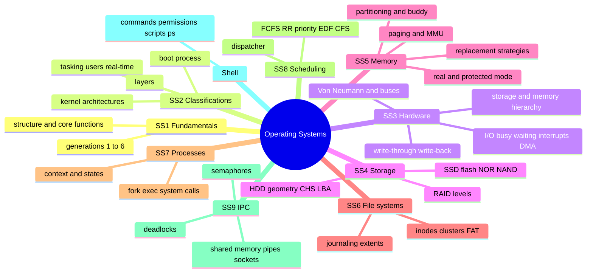

# 🖥️ Operating Systems — Study Plan (target 1.0)

> [!abstract] Exam facts (from the course page, the FAQ and the WS24/25 exam)
> - **Written, 90 min, 90 points.** WS24/25 scale: **1.0 = 85.5–90** · 1.3 = 81–85 · 1.7 = 76.5–80.5 · 2.0 = 72–76 · pass = 45. → For 1.0 you may lose at most **4.5 points**.
> - **Aids:** calculator + **one self-handwritten DIN-A4 sheet, one side only**, original (no copies, no print, no tablet).
> - **Scope:** slide sets **1–9** and exercise sheets **1–9** — the FAQ says the exam includes tasks from *each* exercise sheet covered. Slide set 10 (virtualization) is **not** in the exam. The shell practicals of the sheets **are** relevant.
> - **Date:** February 2027, TBA (WS24/25 exam was on 17 Feb 2025). **Exchange students register at the Prüfungsamt in person**, not online.
> - Prof. Baun's own advice (FAQ): prepare your A4 sheet carefully, then solve the exercise sheets and some old exams with it at the end of the lecture period — if that works, you are well prepared.
> - Links: [course page](https://www.christianbaun.de/BTS2627/index_en.html) (slides + **screencast for every slide set**) · [FAQ](https://www.christianbaun.de/BTS2627/opsys_faq_en.html) · back to [[00 Start Here]] · [[Master Calendar]]

> [!info] What the exam really looks like (WS24/25, 11 tasks)
> Basics 6 · kernel architectures 6 · firmware/boot 10 · boot, processes, scheduling 10 · architecture and I/O 16 · storage 7 · file systems 9 · extents 6 · **deadlock detection with matrices** 5 · **semaphores** 7 · `ps` output 8.
> → About **75 % is "name / describe / explain"** = pure recall → your flashcards are the main weapon. The rest is procedures (matrices, semaphores, calculations) → practised on paper.

## 🗺️ Course mind map

## 📍 Topic tracker
Fill **Confidence** (1 = lost … 5 = could teach it) every Sunday.

| SS | Topic | Lecture | Note | Deck | Sheet | Weight | Conf. | Status |
|---|---|---|---|---|---|---|---|---|
| 1 | Fundamentals, generations | 15 Oct | [[01_OS_Fundamentals_and_Generations]] | [[OS-01 Fundamentals]] | [sheet 1](file:///C:/Users/hongp/OneDrive/Desktop/WS2627/OpSys/Ex/bts_WS2627_exercise_sheet_01.pdf) | ★★ | | ☐ |
| 2 | Classifications, kernels, boot | 22+29 Oct | [[02_OS_Classifications_Kernels_Layers_Booting]] | [[OS-02 Classifications and Boot]] | [sheet 2](file:///C:/Users/hongp/OneDrive/Desktop/WS2627/OpSys/Ex/bts_WS2627_exercise_sheet_02.pdf) | ★★★ | | ☐ |
| 3 | Architecture, I/O, storage | 29 Oct + 5 Nov | [[03_Computer_Architecture_IO_Storage]] | [[OS-03 Architecture and Storage]] | [sheet 3](file:///C:/Users/hongp/OneDrive/Desktop/WS2627/OpSys/Ex/bts_WS2627_exercise_sheet_03.pdf) | ★★★ | | ☐ |
| 4 | HDD, SSD, RAID | 5+12 Nov | [[04_HDD_SSD_RAID]] | [[OS-04 HDD SSD RAID]] | [sheet 4](file:///C:/Users/hongp/OneDrive/Desktop/WS2627/OpSys/Ex/bts_WS2627_exercise_sheet_04.pdf) | ★★★ | | ☐ |
| 5 | Memory management | 12+19 Nov | [[05_Memory_Management_Paging_Replacement]] | [[OS-05 Memory Management]] | [sheet 5](file:///C:/Users/hongp/OneDrive/Desktop/WS2627/OpSys/Ex/bts_WS2627_exercise_sheet_05.pdf) | ★★★ | | ☐ |
| 6 | File systems | 26 Nov → | *make lean note* | *make deck* | [sheet 6](file:///C:/Users/hongp/OneDrive/Desktop/WS2627/OpSys/Ex/bts_WS2627_exercise_sheet_06.pdf) | ★★★ | | ☐ |
| 7 | Processes, system calls | ~Dec | *make lean note* | *make deck* | [sheet 7](file:///C:/Users/hongp/OneDrive/Desktop/WS2627/OpSys/Ex/bts_WS2627_exercise_sheet_07.pdf) | ★★★ | | ☐ |
| 8 | Scheduling | ~Dec | *make lean note* | *make deck* | [sheet 8](file:///C:/Users/hongp/OneDrive/Desktop/WS2627/OpSys/Ex/bts_WS2627_exercise_sheet_08.pdf) | ★★ | | ☐ |
| 9 | IPC, synchronization, deadlocks | ~Dec/Jan | *make lean note* | *make deck* | [sheet 9](file:///C:/Users/hongp/OneDrive/Desktop/WS2627/OpSys/Ex/bts_WS2627_exercise_sheet_09.pdf) | ★★★ | | ☐ |
| 10 | Virtualization | Jan | — not in exam — | — | — | ✗ | | — |

Solutions: `WS2627/OpSys/Ex/Solution/` ([sheet 5 solution](file:///C:/Users/hongp/OneDrive/Desktop/WS2627/OpSys/Ex/Solution/bts_WS2627_exercise_sheet_05_solution.pdf) etc.). Slides (all in `WS2627/OpSys/Slides/`): [SS6](file:///C:/Users/hongp/OneDrive/Desktop/WS2627/OpSys/Slides/bts_WS2627_slideset_06_en.pdf) · [SS7](file:///C:/Users/hongp/OneDrive/Desktop/WS2627/OpSys/Slides/bts_WS2627_slideset_07_en.pdf) · [SS8](file:///C:/Users/hongp/OneDrive/Desktop/WS2627/OpSys/Slides/bts_WS2627_slideset_08_en.pdf) · [SS9](file:///C:/Users/hongp/OneDrive/Desktop/WS2627/OpSys/Slides/bts_WS2627_slideset_09_en.pdf) · [SS10](file:///C:/Users/hongp/OneDrive/Desktop/WS2627/OpSys/Slides/bts_WS2627_slideset_10_en.pdf) (SS10 not examined).
For slide sets 6–9 use the **new workflow**: lean note + deck via [[AI Prompts v2#Prompt A — Recall layer for a new lecture|Prompt A]] — not a 9,000-word note.

## ❓ Pre-questions — answer *before* the lecture (wrong answers are fine)
**SS6 File systems (26 Nov):** What does an inode store, and what does it *not* store? · What is a cluster, and why do big clusters waste space? · What problem does journaling solve, and what does copy-on-write (COW) do instead? · What is an extent, and why is it better than addressing every cluster? · Why does a file system get fragmented, and what does defragmentation fix?
**SS7 Processes:** What belongs to a process context (3 kinds)? · Which process states exist and which transitions? · What do `fork()` and `exec()` do? · What is a zombie process? · Why do we need system calls and user/kernel mode?
**SS8 Scheduling:** Dispatcher vs. scheduler? · One drawback of preemptive and of non-preemptive scheduling? · For 3 processes, compute the average waiting time with FCFS and with Round Robin. · Why did Baun remove SJF/SRTF from the course?
**SS9 IPC:** What is a race condition / critical section? · What do P and V on a semaphore do? · Producer/consumer with a buffer of N: which semaphores, which initial values? · The 4 conditions for a deadlock? · How do you detect a deadlock with the matrices E, A, C, R?

## 🟦 Phase 1 — Study & consolidate (26 Nov – 20 Dec)
**Week 26–29 Nov**
- [ ] Thu 26 Nov: pre-questions SS6 → lecture → blank-page mind map of SS6 the same day
- [ ] Fill all ✍️ in [[OS-01 Fundamentals]] and [[OS-02 Classifications and Boot]] → start daily reviews
- [ ] Redo sheets 1 + 2 closed-book (45 min), check with the solutions → [[Error Log]]

**Week 30 Nov – 6 Dec**
- [ ] Fill ✍️ in [[OS-03 Architecture and Storage]] + [[OS-04 HDD SSD RAID]]
- [ ] Redo sheet 3 and sheet 4 closed-book (bus widths, punch card, CHS, access time, RAID)
- [ ] Thu 3 Dec lecture → 48-hour loop → lean note + deck for SS6
- [ ] Sheet 6 (file systems) closed-book as soon as SS6 is finished

**Week 7–13 Dec**
- [ ] Fill ✍️ in [[OS-05 Memory Management]]
- [ ] Redo sheet 5 in two sessions: (a) partitioning, buddy, real mode · (b) paging, page faults, replacement
- [ ] Thu 10 Dec lecture → 48-hour loop
- [ ] Sheet 7 closed-book (system calls, processes, `ps`, shell)

**Week 14–20 Dec**
- [ ] Thu 17 Dec lecture → 48-hour loop
- [ ] Sheet 8 (scheduling) closed-book
- [ ] Draw the course mind map from memory → compare with the one above → set confidence ratings
- [ ] ✅ Checkpoint: every slide set so far has a deck, 0 overdue cards

## 🟨 Phase 2 — Revise & close gaps (21 Dec – 24 Jan)
**How to run a past-exam session:** 90 min timer · only calculator + your A4 draft · mark strictly with the sample solution · every lost point → [[Error Log]] with its cause (didn't know / incomplete / misread / calculation) · max 3 new cards per exam · write the score in the table below.

- [ ] **21–27 Dec:** 🧪 Diagnostic: past exam **WS24/25** → score → top-5 weaknesses · write **A4 sheet v1**
- [ ] **28 Dec – 3 Jan:** fix the top-5 (one per session) · past exam **WS23/24** · pre-questions SS9
- [ ] **4–10 Jan:** Thu 7 Jan lecture → loop · past exam **WS22/23** · mixed calculation set: buddy + LRU/FIFO + RAID + CHS + real mode (60 min)
- [ ] **11–17 Jan:** Thu 14 Jan lecture → loop · **sheet 9** closed-book (semaphores, producer/consumer, deadlock matrices) · past exam **WS21/22**
- [ ] **18–24 Jan:** Thu 21 Jan lecture (SS10: skim only, not examined) · past exam **WS20/21** · **A4 sheet v2** rewritten from scratch

## 🟥 Phase 3 — Exam mode (E = exam day)
- [ ] **25–31 Jan:** Thu 28 Jan last lecture · past exam **WS19/20** · speed-run sheets 1–4 (answers only, 15 min each)
- [ ] **E−14 … E−8:** past exams **SS19**, **WS16/17**, **SS16** (every 2nd day, timed, with the final A4) · fix errors the same day · speed-run sheets 5–9
- [ ] **E−7 … E−3:** past exam **WS14/15** + redo your worst exam · write the **final A4 original** · cards: due only
- [ ] **E−2 … E−1:** Error Log + weakest cards + read the A4 · sleep 8 h · nothing new
- [ ] **E−0:** calculator, A4 original (one side!), ID, pens (not red), phone off

## 📝 Past exams (English, with sample solutions)
| Exam | Solution | Planned | Score /90 |
|---|---|---|---|
| [WS24/25](https://www.christianbaun.de/BTS2425/Skript/BTS_Exam_en_WS2425.pdf) | [solution](https://www.christianbaun.de/BTS2425/Skript/BTS_Exam_en_solution_WS2425.pdf) | 21–27 Dec (diagnostic) | |
| [WS23/24](https://www.christianbaun.de/BTS2324/Skript/BTS_Exam_en_WS2324.pdf) | [solution](https://www.christianbaun.de/BTS2324/Skript/BTS_Exam_en_solution_WS2324.pdf) | 28 Dec – 3 Jan | |
| [WS22/23](https://www.christianbaun.de/BTS2223/Skript/BTS_Exam_en_WS2223.pdf) | [solution](https://www.christianbaun.de/BTS2223/Skript/BTS_Exam_en_solution_WS2223.pdf) | 4–10 Jan | |
| [WS21/22](https://www.christianbaun.de/BTS2122/Skript/BTS_Exam_en_WS2122.pdf) | [solution](https://www.christianbaun.de/BTS2122/Skript/BTS_Exam_en_solution_WS2122.pdf) | 11–17 Jan | |
| [WS20/21](https://www.christianbaun.de/BTS2021/Skript/BTS_Exam_en_WS2021.pdf) | [solution](https://www.christianbaun.de/BTS2021/Skript/BTS_Exam_en_solution_WS2021.pdf) | 18–24 Jan | |
| [WS19/20](https://www.christianbaun.de/BTS1920/Skript/BTS_Exam_en_WS1920.pdf) | [solution](https://www.christianbaun.de/BTS1920/Skript/BTS_Exam_en_solution_WS1920.pdf) | 25–31 Jan | |
| [SS19](https://www.christianbaun.de/BTS19/Skript/BTS_Exam_en_SS2019.pdf) | [solution](https://www.christianbaun.de/BTS19/Skript/BTS_Exam_en_solution_SS2019.pdf) | E−14 | |
| [WS16/17](https://www.christianbaun.de/BTS16/Skript/BTS_Exam_en_WS1617.pdf) | [solution](https://www.christianbaun.de/BTS16/Skript/BTS_Exam_en_solution_WS1617.pdf) | E−12 | |
| [SS16](https://www.christianbaun.de/BTS16/Skript/BTS_Exam_en_SS2016.pdf) | [solution](https://www.christianbaun.de/BTS16/Skript/BTS_Exam_en_solution_SS2016.pdf) | E−10 | |
| [WS14/15](https://www.christianbaun.de/BTS14/Skript/BTS_Exam_en_WS1415.pdf) | [solution](https://www.christianbaun.de/BTS14/Skript/BTS_Exam_en_solution_WS1415.pdf) | E−7 | |
Target trend: ≥ 75 by mid-January → ≥ 86 in the last three exams. Older exams may contain topics no longer in the course — skip those tasks, don't panic.

## ⭐ Gold examples — master these closed-book
1. **Buddy allocation trace** with internal fragmentation → [[05_Memory_Management_Paging_Replacement|OS-05]] §5 · sheet 5 ex. 2–3
2. **Page replacement table** FIFO / LRU / OPT + Belady → OS-05 §10 · sheet 5 ex. 6
3. **Two-level paging address** (10/10/12 split) and page-table size → OS-05 §8
4. **Real mode** segment × 16 + offset → OS-05 §6
5. **RAID** net capacity / failures tolerated for n drives + XOR recovery → [[04_HDD_SSD_RAID|OS-04]] §12–13
6. **CHS capacity** and **access time** = seek + 30,000/RPM → OS-04 §4–5
7. **Bus widths:** address lines for X GB, bytes per transfer → [[03_Computer_Architecture_IO_Storage|OS-03]] §3, §12
8. **Write-back vs. write-through trace** with dirty bits → OS-03 §8
9. **chmod** octal ↔ symbolic, `ls -l` reading → [[02_OS_Classifications_Kernels_Layers_Booting|OS-02]] §11
10. **Boot sequence ordering** + initramfs/getty → OS-02 §9
11. *(coming)* **Deadlock detection with matrices**, **semaphore producer/consumer**, **scheduling waiting times**, **`ps -eFw` columns** → sheets 7–9 + past exams

## ✍️ Your A4 sheet (one side) — what earns its place
Only things that are **slow or risky to reconstruct** under time pressure — *not* definitions (those come from your cards):
- CHS formula and 7.844 GB · 30,000/RPM · RAID table (min drives, net capacity, failures, read/write)
- 2ⁿ table (2¹⁰…2⁴⁰) · real mode formula · page-table size formula · 10/10/12 split
- buddy steps · fit strategies · replacement one-liners · Belady
- scheduling formulas (waiting/turnaround) · deadlock-detection steps · producer/consumer semaphore template
- chmod table · `ps` columns · file-system terms you mix up
Version it: v1 (27 Dec) → v2 (24 Jan) → final original (E−5). Writing it is half the learning.
