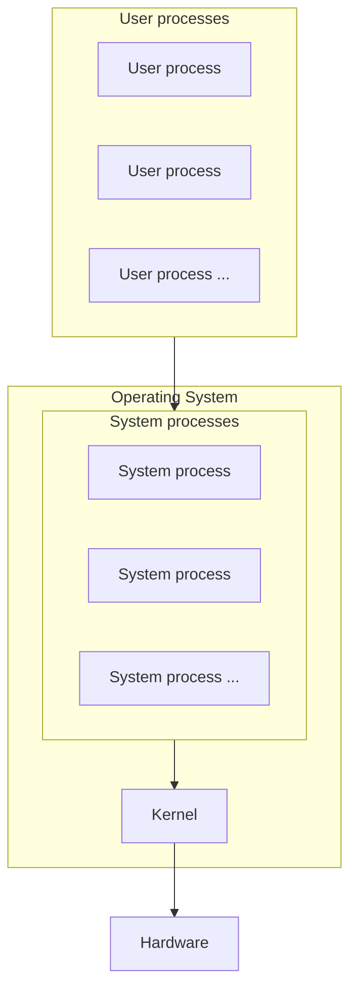
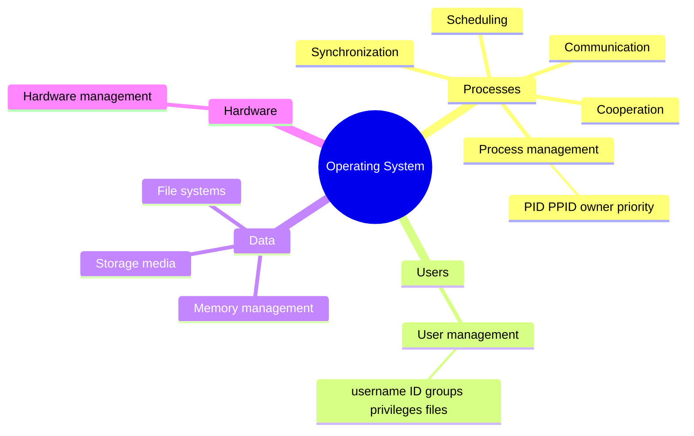
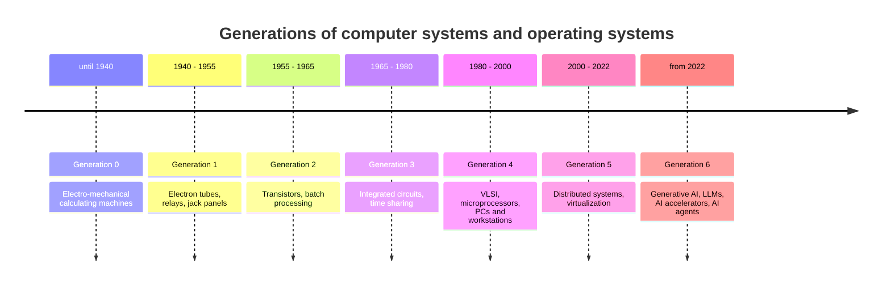
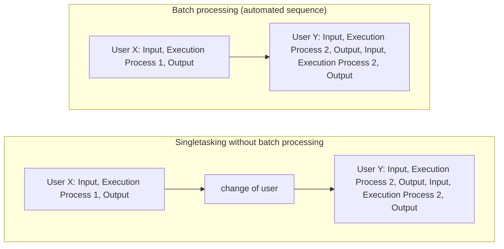
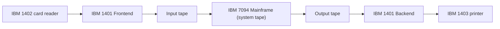
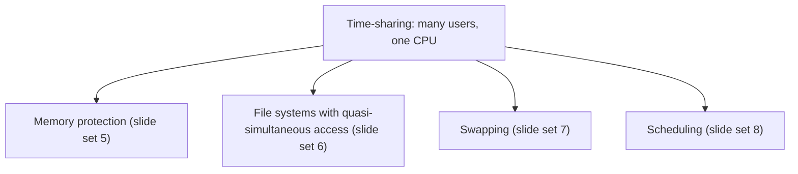
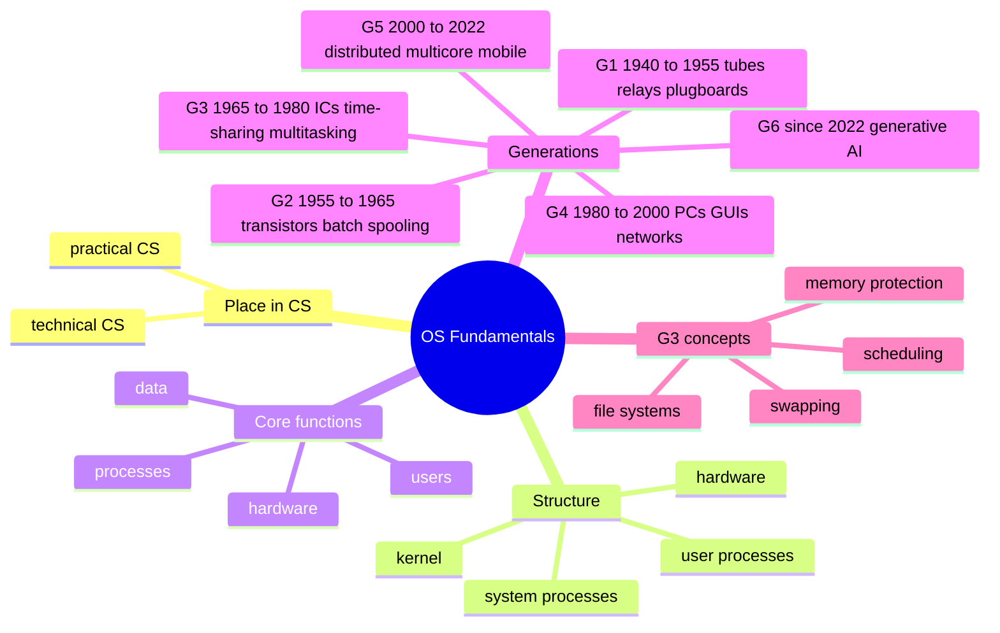

# Operating Systems Fundamentals & Generations of Computer Systems

> [!tip] 🧠 Study from the [[#🧠 Recall Layer|Recall Layer]] at the end of this note — mind map · deck [[OS-01 Fundamentals]] · gold examples · exam lens. This note is now your reference: search it, don't re-read it.

> [!Note] 💡 Notation Conventions
> - **OS** = operating system; **CPU** = central processing unit; **I/O** = input/output; **HW/SW** = hardware/software.
> - **Generation $g$** with $g \in \{0,1,\dots,6\}$ = the numbered era of computer systems used on the slides.
> - "$\Rightarrow$ slide set $k$" marks a topic that the lecture treats later in slide set $k$. It is only named here, not explained.
> - **Job** = a program (with its input data) handed to the computer for execution. The slides use "programs (jobs)" interchangeably.
> - Generation periods follow the overview table on slide 9. Deviations inside the slides are flagged with `> [!Warning] ⚠️ Possible Gap`.
> - For the numerical examples only (not defined on the slides), CPU utilization is $U = \dfrac{t_{\text{CPU}}}{t_{\text{total}}}$, where $t_{\text{CPU}}$ is the time the CPU spends computing and $t_{\text{total}}$ is the total elapsed time. Times are in minutes.
> - This slide set contains no theorems or proofs.

---

## 1. Organizational Information & Course Objectives

> [!Note] 💡 Course Organization
> - **Lecturer:** Prof. Dr. Christian Baun, Frankfurt University of Applied Sciences (FRA-UAS; 1971–2014: *Fachhochschule Frankfurt am Main*), Faculty of Computer Science and Engineering.
> - **Contact:** christianbaun@fb2.fra-uas.de. Report problems **early**.
> - **Homepage:** http://www.christianbaun.de. Check regularly. **No password** is required.
> - The homepage contains lecture notes, slides (English and German), exercise sheets (English and German), sample solutions, and old exams with sample solutions.
> - **English and German slides have identical content, but use the English slides for exam preparation** to learn the technical terms.
> - **Literature:** two books are based on these slide sets. One is bilingual (English/German two-column layout). Both can be downloaded free via the FRA-UAS library intranet.

> [!Missing] Figure: Slide 3, cover images of the two books based on the slide sets.

> [!Property] ⚙️ Learning Objectives of Slide Set 1
> After this slide set you should know or understand:
> **1.** to which branches of computer science operating systems belong;
> **2.** how hardware evolution influenced OS evolution: **batch processing**, **singletasking**, **multitasking**, **time-sharing**;
> **3.** the core functionalities of operating systems: memory management, file systems, system calls (managing access operations to the hardware), process management, interprocess communication, synchronization of processes.
>
> Exercise sheet 1 repeats exactly the content relevant for these objectives.

> [!Property] ⚙️ Course Goals (End of Semester)
> **1.** Know and understand the functioning of the core functionalities of operating systems.
> **2.** Understand the functioning of the most important hardware components.
> **3.** Have basic skills in working with **Linux**.
> **4.** Have basic skills in **shell scripting**.

## 📘 Examples & Applications

### Example 1.1: Exam preparation logistics

**Using:** course organization, learning objectives

> [!Example] 📘 Which material, and what is examinable?
> **Step 1.** Language: the exam terms are English $\Rightarrow$ study from the **English** slides, although the German slides have identical content.
> **Step 2.** Self-testing: exercise sheet 1 repeats the content of slide set 1 that matches the learning objectives $\Rightarrow$ the sheet shows the expected exam depth.
> **Step 3.** Practice: old exams and sample solutions are on the homepage, with no password.

---

## 2. Operating Systems in Computer Science

> [!Property] ⚙️ Placement of Operating Systems
> Operating systems belong to **practical computer science** *and* **technical computer science**.

| Branch | Topics shown on slide 6 |
|---|---|
| **Practical CS** | Programming (SW engineering, modelling), Distributed Systems, Databases, Compiler Construction, **Operating Systems** |
| **Technical CS** | Robotics, Sensor Technology, Real-Time Systems, Computer Architecture, Hardware Design, Computer Networks, Embedded Systems, **Operating Systems** |
| **Theoretical CS** | Formal Languages, Computability Theory, Logic, Automata Theory |
| **Mathematics** | Analysis, Algebra, Stochastics, Optimization |
| **Minor subjects** | Electrical Engineering, Business Administration/Economics, Medicine |

> [!Missing] Figure: Slide 5/6, area map of computer science. "Operating Systems" is circled on the border between the practical and technical branches. The table above recreates only the grouping, not the exact positions. Slide 5 shows the same map without the circle and asks "Where would you place the operating systems?".

## 📘 Examples & Applications

### Example 2.1: Placing OS in computer science (slide 5 question)

**Using:** placement of operating systems

> [!Example] 📘 Where would you place the operating systems?
> **Step 1.** OS interact with hardware $\Rightarrow$ related to technical CS (computer architecture, embedded and real-time systems).
> **Step 2.** OS are software that is built and engineered $\Rightarrow$ related to practical CS (programming, distributed systems).
> **Answer:** at the intersection of **practical** and **technical** computer science.

---

## 3. Basic Structure of an Operating System

> [!Definition] 📖 User Process
> A **user process** processes the *users' jobs*.

> [!Definition] 📖 System Process
> A **system process** provides *services of the operating system*.

> [!Definition] 📖 Kernel (Operating System Core)
> The **kernel** contains all components of the operating system that are **not** implemented as system processes. Kernels are treated in detail in slide set 2.

> [!Definition] 📖 System Software
> System software controls the operation of a computer, assists users and their applications in making use of the hardware, and controls the use and allocation of the available hardware resources. **Operating systems are part of the system software.**



> [!Property] ⚙️ Layering Implication
> The layers from top to bottom are user processes, system processes, kernel, hardware. The **operating system** consists of system processes and the kernel. User processes sit *above* the OS, and hardware is accessed through the kernel.

## 📘 Examples & Applications

### Example 3.1: Exercise Sheet 1, Exercise 1.1 (OS structure)

**Using:** user process, kernel, basic structure

> [!Example] 📘 Fill in the components marked by the arrows
> The exercise diagram shows the OS structure with two unnamed components:
> **Arrow 1** points to the boxes at the top, *above* the Operating System box $\Rightarrow$ **User processes**.
> **Arrow 2** points to the wide box at the bottom *inside* the Operating System box, directly above the hardware and below the system processes $\Rightarrow$ **Kernel**.
> The official solution confirms this: the top boxes are labelled "User process" and the inner wide box "Kernel".

> [!Missing] Figure: Exercise sheet 1, page 1, blank OS-structure diagram (arrows 1 and 2). It is recreated by the Mermaid diagram above, which carries the answers.

### Example 3.2: Classifying components (constructed)

**Using:** user process, system process, kernel

> [!Example] 📘 Classify by the definitions
> **Step 1.** A program that processes a user's job (e.g. a text editor) $\Rightarrow$ **user process**.
> **Step 2.** A component providing an OS service as a separate process (e.g. a print-spooling process, see §7) $\Rightarrow$ **system process**.
> **Step 3.** An OS component *not* implemented as a process $\Rightarrow$ part of the **kernel**.

---

## 4. Core Functionalities of Operating Systems

> [!Property] ⚙️ Core Functionality Groups (Slide 7)
> Operating systems manage four areas:
> **1. Processes:** process management (attributes such as PID, PPID, owner, priority), **scheduling**, **synchronization**, **communication**, **cooperation**.
> **2. Users:** user management (username, ID, groups, privileges, files).
> **3. Data:** **file systems** on storage media, **memory management** (main memory, RAM).
> **4. Hardware:** hardware management (e.g. I/O devices, CPU, RAM).



> [!Property] ⚙️ Learning-Objective View
> The learning objectives name the core functionalities as: memory management, file systems, system calls (managing access operations to the hardware), process management, interprocess communication, synchronization of processes.

## 📘 Examples & Applications

### Example 4.1: Mapping items to functionalities (constructed from slide 7)

**Using:** core functionality groups

> [!Example] 📘 Which functionality does each item belong to?
> **Step 1.** *PID, PPID, owner, priority* are attributes of processes $\Rightarrow$ **process management**.
> **Step 2.** *Username, ID, groups, privileges* $\Rightarrow$ **user management**.
> **Step 3.** *Data on a hard disk organized in files* $\Rightarrow$ **file systems / storage media**.
> **Step 4.** *Deciding which running program gets the CPU* $\Rightarrow$ **scheduling** (a part of process management).
> **Step 5.** *Controlling the keyboard, disks, CPU and RAM* $\Rightarrow$ **hardware management**.

---

## 5. Generations of Computer Systems and Operating Systems

> [!Definition] 📖 Generation of Computer Systems and OS
> A **generation** is a period of computer-system history characterized by a dominant technological progress. The slides answer three questions: *Which OS exist? Since when do OS exist? How did hardware evolution influence OS evolution?*

| Generation $g$ | Time period | Technological progress |
|:-:|:-:|---|
| 0 | until 1940 | (Electro-)mechanical calculating machines |
| 1 | 1940 – 1955 | Electron tubes, relays, jack panels |
| 2 | 1955 – 1965 | Transistors, batch processing |
| 3 | 1965 – 1980 | Integrated circuits, time sharing |
| 4 | 1980 – 2000 | Very large-scale integration, microprocessors, PCs/workstations |
| 5 | 2000 – 2022 | Distributed systems, "the network is the computer", virtualization |
| 6 | 2022 – ? | Generative AI, large language models, AI accelerators, AI agents |



> [!Note] 💡 Quote (Popular Mechanics, 1949)
> "In the future, computers may weigh no more than 1.5 tonnes." It illustrates how much hardware has shrunk since generation 1.

> [!Warning] ⚠️ Possible Gap: inconsistent period of generation 3
> Slide 9 gives generation 3 as **1965–1980**, but slide 19 is titled "3rd Generation (**1960**–1980)". The note uses slide 9 (the overview table), and the slide-19 content (early 1960s integrated circuits) is kept under generation 3. Check which dates your lecturer expects.

## 📘 Examples & Applications

### Example 5.1: Assigning technologies to generations

**Using:** generation table

> [!Example] 📘 Which generation is characterized by the technology?
> **Step 1.** Relays, electron tubes, jack panels $\Rightarrow$ $g = 1$.
> **Step 2.** Transistors, batch processing $\Rightarrow$ $g = 2$.
> **Step 3.** Integrated circuits, time sharing $\Rightarrow$ $g = 3$.
> **Step 4.** VLSI, microprocessors, PCs/workstations $\Rightarrow$ $g = 4$.
> **Step 5.** Virtualization, "the network is the computer" $\Rightarrow$ $g = 5$.
> **Step 6.** Generative AI, LLMs, AI agents $\Rightarrow$ $g = 6$.

---

## 6. 1st Generation (1940 – 1955)

> [!Definition] 📖 Requirements of a Universal Computer
> A universal computer must satisfy:
> **1.** **Stored program**,
> **2.** **Conditional jump** (GOTO),
> **3.** **Separation of memory and CPU**.

> [!Property] ⚙️ Characteristics of Generation 1
> - Built during WW2 (key names: **Konrad Zuse**, **John von Neumann**).
> - Machines with partly more than $10{,}000$ tubes or relays, which were **slow and error-prone**.
> - **No operating systems and no programming languages.**
> - Programs were implemented as **circuits in patch bays**.
> - The user/programmer launches **one** program, which **accesses the hardware directly**.

| Computer | Development | Storage/CPU separated | Conditional jumps | Programming | Internal encoding | Number representation | Technology |
|---|---|:-:|:-:|:-:|:-:|:-:|---|
| Z1 | 1936–1938 | yes | no | SW | binary | floating point | mechanical |
| Z3 | 1938–1941 | yes | no | SW | binary | floating point | electromechanical (relays) |
| ABC | 1938–1942 | yes | no | HW | binary | fixed-point | electronic |
| Harvard Mark 1 | 1939–1944 | no | no | SW | decimal | fixed-point | electronic |
| ENIAC | 1943–1945 | no | partially | HW | decimal | fixed-point | electronic |
| Manchester | 1946–1948 | yes | yes | SW | binary | fixed-point | electronic |
| EDSAC | 1946–1949 | yes | yes | SW | binary | fixed-point | electronic |

> [!Note] 💡 Two Landmark Machines
> - **Zuse Z3 (1941):** the world's first working programmable, digital computer (relay technology), implementing the binary system.
> - **ENIAC** (*Electronic Numerical Integrator and Computer*, 1944): the first electronic general-purpose computer (electron tubes).

> [!Missing] Figure: Slide 11, photo of the Zuse Z3. Slide 12, photo of ENIAC (US Army, public domain).

> [!Warning] ⚠️ Possible Gap
> The table has no column for **stored program**, the first requirement of a universal computer. Whether each machine satisfies requirement 1 cannot be read from the slides.

## 📘 Examples & Applications

### Example 6.1: Reading the table of 1st-generation systems

**Using:** requirements of a universal computer, table of 1st-generation systems

> [!Example] 📘 Questions answered from the table
> **(a) "Computers that operate according to the decimal system?" (slide 11 question)**
> **Step 1.** Filter the column *Internal encoding* for "decimal".
> **Answer:** **Harvard Mark 1** and **ENIAC**. All other listed machines are binary.
>
> **(b) Which machines satisfy both table-visible requirements (storage/CPU separated *and* conditional jumps)?**
> **Step 1.** Filter *Storage/CPU separated* = yes: Z1, Z3, ABC, Manchester, EDSAC.
> **Step 2.** Filter *Conditional jumps* = yes among these: Manchester, EDSAC.
> **Answer:** **Manchester** and **EDSAC**, i.e. $\{Z1, Z3, ABC, Manchester, EDSAC\} \cap \{Manchester, EDSAC\} = \{Manchester, EDSAC\}$. The stored-program requirement cannot be checked (see Warning above).
>
> **(c) Which machines are programmed in hardware?**
> **Answer:** **ABC** and **ENIAC** (HW). All others are programmed in software (SW).

### Example 6.2: Why did generation 1 have no OS?

**Using:** characteristics of generation 1

> [!Example] 📘 Reasoning
> **Step 1.** Programs are circuits in patch bays $\Rightarrow$ there is no program text to manage.
> **Step 2.** One program runs at a time and accesses the hardware directly $\Rightarrow$ nothing to schedule and no service layer.
> **Answer:** neither an OS nor programming languages exist in this generation.

---

## 7. 2nd Generation (1955 – 1965): Batch Processing

### 7.1 Hardware and Manual Operation

> [!Property] ⚙️ Developments of Generation 2
> - **Early 1950s:** **punch cards** replace the patch bays.
> - **Mid-1950s:** **transistors** are introduced $\Rightarrow$ computer systems become more reliable.
> - Later, for efficiency, programs were collected, stored on **magnetic tape**, and then processed in the machine room.

> [!Property] ⚙️ Manual Workflow (Before Batch Operation)
> **1.** The programmer writes a FORTRAN or COBOL program on form sheets.
> **2.** Coders punch the program onto punch cards and hand them to the **operator** (administrator).
> **3.** The operator coordinates the order (schedule) of programs (jobs), loads the cards into the computer, loads the compiler from magnetic tape, and hands over the printed result.
>
> $\Rightarrow$ **Inefficient method.**

### 7.2 Batch Processing

> [!Definition] 📖 Batch Processing
> **Batch processing** is the automatic, sequential execution of jobs without user interaction. **Objective:** maximize CPU utilization. **Precondition:** each program must be provided **completely, with all input data,** *before* its execution may begin. All OS of generation 2 were batch-processing operating systems.

> [!Property] ⚙️ Properties of Batch Processing
> **1.** **Acceleration via automation:** jobs follow each other without manual changes.
> **2.** **Well suited for routine tasks.**
> **3.** **Non-interactive:** a started process runs without any user interaction until it terminates or an error occurs.
> **4.** **Drawback:** the CPU is still not utilized optimally, because it is **idle during I/O operations**.
> **5.** **Early batch OS implement only singletasking:** only one program runs at a time, and a second one can start only after the first has finished ($\Rightarrow$ slide set 2).



> [!Warning] ⚠️ Possible Gap
> In the slide-15 figure, User Y's two executions are both labelled "Execution Process 2". This is probably two runs or a labelling slip, and the slide does not say. Also, the figure shows no timings, so the speed-up in the batch case is qualitative only (the gap "change of user" disappears).

> [!Note] 💡 Batch Processing Today
> - Today's systems still process program sequences automatically (non-interactive **batch files** and **shell scripts**).
> - **Compute-intensive programs in distributed systems** are usually non-interactive batch programs $\Rightarrow$ distributed computing and *number crunching*. Batch processing is **not obsolete**.

### 7.3 Spooling and Frontend/Backend Computers

> [!Definition] 📖 Spooling
> **Spooling** removes I/O workload from the CPU by using additional hardware. I/O is carried out **concurrently** with the processing of other jobs.

> [!Property] ⚙️ Frontend/Backend Computers
> - **Frontend/backend computers** free the mainframe from slow I/O.
> - Data can be read from tape **much faster** than from punch cards, and stored on tape **much faster** than printed out.
> - The **frontend** reads punch cards and stores their data on tape. The **mainframe** executes the programs. The **backend** reads the output tapes and prints the results.



> [!Note] 💡 Spooling Today
> - Modern computers contain, besides the CPU, specific **I/O processors with DMA** (*Direct Memory Access*). These write data directly into main memory and fetch results from there.
> - **Spooling is still used**, e.g. spooling processes for printing.

### 7.4 Punch Cards

> [!Property] ⚙️ Punch Card Facts
> - A card usually represents **one line of text with 80 characters** (or a corresponding amount of binary data). The standard line size of $\leq 80$ characters in e-mails and text files dates back to the punch card.
> - **12 hole positions** per character column.
> - **Digits:** a **single** hole in the corresponding row. **Letters and special characters:** **multiple** holes in the column.

> [!Missing] Figure: Slide 18, photo of a punch card.

> [!Note] 💡 Operating Systems of Generation 2
> Atlas Supervisor, GM-NAA I/O, UMES, SHARE, IBSYS.

## 📘 Examples & Applications

### Example 7.1: Exercise Sheet 1, Exercise 2 (Batch processing)

**Using:** batch processing, spooling, non-interactive mode, batch processing today

> [!Example] 📘 Exercise 2.1 to 2.7 with solutions
> **2.1 Objective of batch processing:** **maximize CPU utilization**.
> **2.2 Why is there an acceleration effect for multiple tasks?** Because of the **automation**: no time is wasted when changing users, since jobs follow each other automatically (slide 15; official solution).
> **2.3 Preconditions:** each program must be provided **completely, with all its input data,** before its execution may begin.
> **2.4 Well suited for:** **routine tasks** (and compute-intensive, non-interactive programs).
> **2.5 Batch processing is always:** $\boxtimes$ **non-interactive** (not interactive).
> **2.6 Application still popular today:** non-interactive **batch files / shell scripts** (also number crunching in distributed systems).
> **2.7 Spooling:** removing I/O workload from the CPU by using additional hardware, so that I/O runs **concurrently** with the processing of other jobs. Today still used for **print spooling**.

### Example 7.2: Punch cards (constructed)

**Using:** punch cards, 80-character line size

> [!Example] 📘 How many cards for a program?
> **Given:** a program of $n = 240$ lines, each of at most $80$ characters.
> **Step 1.** One card holds one line $\Rightarrow$ number of cards $= n = 240$.
> **Step 2.** Maximum characters $= 240 \cdot 80 = 19\,200$.
> **Step 3.** Encoding: the digit "7" needs one hole (row 7) in its column. A letter needs several holes in its column.

### Example 7.3: CPU utilization with and without spooling (constructed, exam-style)

**Using:** batch processing, CPU idle during I/O, spooling, frontend/backend computers

> [!Example] 📘 Three identical jobs
> **Assumptions (not from the slides):** three jobs $J_1, J_2, J_3$. Each needs $4$ min input, $6$ min computation on the CPU, $2$ min output. Tape transfer between frontend and mainframe is negligible. With spooling, I/O is fully overlapped with other jobs' computation.
>
> **(a) Batch processing, CPU idles during I/O.**
> **Step 1.** Time per job: $t_{\text{job}} = 4 + 6 + 2 = 12$ min.
> **Step 2.** Total: $t_{\text{total}} = 3 \cdot 12 = 36$ min.
> **Step 3.** CPU busy time: $t_{\text{CPU}} = 3 \cdot 6 = 18$ min.
> **Step 4.** $U_a = \dfrac{18}{36} = \dfrac{1}{2} = 50\%$.
>
> **(b) With spooling (frontend reads input, backend prints).**
> **Step 1.** $J_1$ input must finish first: $0 \to 4$. During $J_1$'s compute phase the frontend reads inputs of $J_2$ ($4\to8$) and $J_3$ ($8\to12$).
> **Step 2.** CPU runs $J_1$ at $4 \to 10$, $J_2$ at $10 \to 16$ (its input was ready at $8$), $J_3$ at $16 \to 22$ (its input was ready at $12$).
> **Step 3.** Outputs of $J_1$ and $J_2$ overlap with later computations. Only the output of $J_3$ remains: $22 \to 24$.
> **Step 4.** $t_{\text{total}} = 4 + 3\cdot 6 + 2 = 24$ min.
> **Step 5.** $U_b = \dfrac{18}{24} = \dfrac{3}{4} = 75\%$.
>
> **(c) Speed-up.** $\dfrac{36}{24} = 1.5$.
>
> **(d) Conclusion.** Spooling raises CPU utilization from $50\%$ to $75\%$ because I/O is carried out concurrently with the processing of other jobs, which is the definition of spooling.

---

## 8. 3rd Generation (1965 – 1980): Multitasking and Time-Sharing

### 8.1 Hardware and Software Developments

> [!Property] ⚙️ Developments of Generation 3
> - **Early 1960s:** integrated circuits $\Rightarrow$ more powerful, smaller, cheaper computers.
> - **1960s:** batch systems are improved to execute **multiple jobs during the same period** $\Rightarrow$ **multitasking**. First simple **memory management** (fixed partitions) $\Rightarrow$ slide set 5.
> - **Early 1970s:** microprocessors, e.g. **Intel 4004 (1971)**.
> - **1970s:** **time-sharing** (interactive mode): one central unit, multiple terminals. Each user gets a **user process** when logging in.
> - **Mid-to-late 1970s:** home computers/PCs. **Apple II (1977)**: early commercially successful home computer. **IBM PC (1981)**: top-selling computer architecture (Intel 80x86).

> [!Warning] ⚠️ Possible Gap
> The IBM PC (1981) is listed under generation 3, although both date ranges end in 1980 (slides 9 and 19). It is treated here as a slide remark about the PC trend, not a generation boundary.

| Computer | Development | Special features |
|---|:-:|---|
| CDC 6600 | 1964 | First supercomputer |
| IBM System/360 | 1964 | 8-bit character size, flexible architecture |
| PDP-8 | 1965 | First commercial minicomputer from DEC |
| ILLIAC IV | 1969 | First multiprocessor computer |
| CRAY 1 | 1976 | Supercomputer |

> [!Note] 💡 Networking and OS of Generation 3
> - Networks: first decentralized computer network (**ARPANET**), terminals connected to mainframes via serial lines (e.g. IBM Systems Network Architecture), proprietary interconnects (e.g. DECnet).
> - Operating systems: BESYS, CTSS, OS/360, CP/CMS, Multics, Unics (later Unix), DEC DOS-11, DEC RT-11, Version 6/7 Unix, Digital Research CP/M, Cray Operating System, DEC VMS.

### 8.2 Time-Sharing

> [!Definition] 📖 Time-Sharing
> **Time-sharing**: multiple users work with a **single** computer **simultaneously and competitively** by **sharing the available CPU time**. **Objective:** *fair distribution of the computing time.*

> [!Property] ⚙️ Properties of Time-Sharing
> **1.** Computing time is distributed via **time slices**. The distribution can follow different strategies.
> **2.** Multiple users work **interactively and simultaneously** via terminals $\Rightarrow$ **multi-user operation** ($\Rightarrow$ slide set 2).
> **3.** The programs of the individual users are **independent** of each other.

> [!Definition] 📖 Multitasking (Quasi-Parallel Execution)
> The **quasi-parallel program or process execution** is called **multitasking** ($\Rightarrow$ slide set 2). **Objective:** *minimizing the response time.*

### 8.3 New Concepts Required by Time-Sharing

> [!Definition] 📖 Memory Protection
> The memory is **split**, and running programs are **separated from each other**. A bug or crash of a single program therefore does **not** affect the stability of other programs or of the total system. ($\Rightarrow$ slide set 5)

> [!Definition] 📖 File Systems (Concurrent Access)
> File systems allow **quasi-simultaneous file access**. ($\Rightarrow$ slide set 6)

> [!Definition] 📖 Swapping
> **Swapping** is storing data to, and removing data from, main memory from/into **background memory** (HDDs/SSDs). ($\Rightarrow$ slide set 7)

> [!Definition] 📖 Scheduling
> **Scheduling** is the automatic creation of an **execution plan (schedule)** that is used to allocate **time-limited resources** to users or their processes. ($\Rightarrow$ slide set 8)



## 📘 Examples & Applications

### Example 8.1: Exercise Sheet 1, Exercise 3 (Time-sharing)

**Using:** time-sharing, multitasking, scheduling, swapping, memory protection

> [!Example] 📘 Exercise 3.1 to 3.8 with solutions
> **3.1 Objective of time-sharing:** **fair distribution of the computing time** among the users.
> **3.2 How is computing time distributed?** Via **time slices**, according to different possible strategies.
> **3.3 Name of the quasi-parallel execution:** **multitasking.**
> **3.4 Objective of quasi-parallel execution:** **minimizing the response time.**
> **3.5 Scheduling:** automatic creation of an execution plan (schedule) that allocates time-limited resources to users or their processes.
> **3.6 Swapping:** storing data to and removing data from main memory from/into background memory (HDDs/SSDs).
> **3.7 How memory protection works:** the memory is split, and the running programs are separated from each other.
> **3.8 Purpose of memory protection:** a bug or crash of one program does **not** affect the stability of other programs or the total system.

### Example 8.2: Batch processing versus time-sharing (constructed)

**Using:** batch processing, time-sharing, multitasking, objectives

> [!Example] 📘 Comparison
> | Aspect | Batch processing (2nd gen.) | Time-sharing (3rd gen.) |
> |---|---|---|
> | Interaction | non-interactive | interactive via terminals |
> | Objective | maximize CPU utilization | fair distribution of CPU time (quasi-parallel execution: minimize response time) |
> | Users | one job after another | multiple users simultaneously |
> | Needed concepts | complete input before start | memory protection, file systems, swapping, scheduling |

### Example 8.3: Identifying the new concept (constructed)

**Using:** memory protection, swapping, scheduling

> [!Example] 📘 Which concept solves which problem?
> **Step 1.** *One user's program crashes and the other users' programs keep running* $\Rightarrow$ **memory protection**.
> **Step 2.** *Choosing which user's process receives the next time slice* $\Rightarrow$ **scheduling**.
> **Step 3.** *Data is moved from RAM to the HDD/SSD to make room* $\Rightarrow$ **swapping**.
> **Step 4.** *Two users read and write files at nearly the same time* $\Rightarrow$ **file systems with quasi-simultaneous access**.

---

## 9. 4th, 5th and 6th Generation

> [!Property] ⚙️ 4th Generation (1980 – 2000)
> - Highly integrated circuits with **exponentially growing integration density**: CPUs more powerful and cheaper, main memory capacity rises.
> - High computing power at every workplace: **workstations** become standard in the professional sector, and home computers and PCs become popular.
> - **Main objective of OS:** *intuitive user interfaces* for users who do not want to know anything about the underlying hardware.
> - **Networks with open standards** become popular: Ethernet, Token Ring, WLAN ($\Rightarrow$ computer networks course).
> - OS: QDOS, Xenix, MS-DOS, PC-DOS, QNX, GNU project, SunOS, MacOS 1–9, AmigaOS, Atari TOS, Windows, IBM AIX, GEOS, SGI IRIX, MINIX, OS/2, FreeBSD, NeXTSTEP, SCO UNIX, Linux, BeOS.

> [!Property] ⚙️ 5th Generation (2000 – 2022)
> - *The network is the computer.* **Distributed systems:** cluster, cloud, grid, P2P computing.
> - **Multicore processors** and parallel applications.
> - **Virtualization:** VMware, XEN, KVM, Docker, ...
> - **Free/open-source software:** Linux (Android), BSD, ...
> - Mobile systems ("communication everywhere"). New ways of working: e-Science, e-Learning, e-Business.
> - **Web services** (REST, SOAP, JSON). Resources are requested and rented **on demand**.
> - Personal computing vs. "parental computing" (e.g. iOS).
> - OS: Windows XP–11, Windows Server 2003–2022, Mac OS X/macOS, Android, iOS/iPadOS, Chrome OS, modern Linux distributions, Haiku, Google Fuchsia.

> [!Property] ⚙️ 6th Generation (2022 – ?)
> - Public release of **ChatGPT (2022)** made generative AI directly accessible to the general public $\Rightarrow$ fundamental transformation of many fields of computer science.
> - Keywords: Artificial Intelligence; extra compute resources (**GPUs, TPUs, NPUs**); very large distributed systems for training models; **natural language as a new user interface**.
> - New requirements for **scheduling, memory management, energy efficiency, security and privacy**.
> - Possible later generation: **quantum computers** (maybe 7th generation).

## 📘 Examples & Applications

### Example 9.1: Generation of a keyword or system (constructed)

**Using:** generations 3 to 6

> [!Example] 📘 Assign the generation
> **Step 1.** *Multics, CTSS, OS/360* $\Rightarrow$ $g = 3$ (time-sharing era).
> **Step 2.** *MS-DOS, MINIX, Windows (early), Ethernet* $\Rightarrow$ $g = 4$ (PCs, workstations, open network standards).
> **Step 3.** *Docker, KVM, Android, cloud/grid/P2P computing* $\Rightarrow$ $g = 5$.
> **Step 4.** *GPUs/TPUs/NPUs for model training, natural language as user interface* $\Rightarrow$ $g = 6$.
> **Step 5.** *Atlas Supervisor, IBSYS* $\Rightarrow$ $g = 2$ (batch).

### Example 9.2: Changing OS objective across generations

**Using:** objectives of OS per generation

> [!Example] 📘 Trace the objective
> $g=2$: *maximize CPU utilization* $\rightarrow$ $g=3$: *fair distribution of computing time / minimize response time* $\rightarrow$ $g=4$: *intuitive user interfaces* $\rightarrow$ $g=5$: *on-demand, distributed, virtualized resources* $\rightarrow$ $g=6$: *new requirements for scheduling, memory management, energy efficiency, security, privacy*.

---

## 10. Working in a UNIX Shell (Exercise Sheet 1 Practicals)

> [!Note] 💡 Shell Requirements (Exercise Sheet 1)
> - Practical exercises need a **UNIX shell**. Widely used: **bash** (Bourne-Again SHell), **fish** (Friendly Interactive SHell), **ksh** (KornShell), **csh** (C Shell), **tcsh**, **zsh** (Z Shell).
> - **macOS Terminal** is sufficient. Mac OS X 10.3 to 10.14 uses **bash** by default, newer versions use **zsh**.
> - **Windows Command Prompt and PowerShell are not sufficient.** Installing bash or another shell on Windows 10/11 is trivial.
> - Recommended: install **Linux** in a container or virtual machine (easy distributions: Debian, Ubuntu, Manjaro, Mint, Pop!_OS, Elementary OS, Fedora).
> - On Windows, the **Windows Subsystem for Linux (WSL)** is often best. If WSL fails, use **VirtualBox** (also for macOS). On macOS, **UTM** is a free alternative.

> [!Note] 💡 Source of the Solutions
> The slides do not introduce shell commands. The solutions below are those of the **official solution of exercise sheet 1**.

## 📘 Examples & Applications

### Example 10.1: Exercise Sheet 1, Exercise 4 (Files and directories)

**Using:** UNIX shell, files and directories

> [!Example] 📘 Exercise 4.1 to 4.10 with official solutions
> **Task descriptions** (from the sheet): create `BTS`, create `File1.txt` without an editor, check its size, set its modification time to your birth date, create a multi-line `File2.txt` without an editor, print its first line, append `File2.txt` to `File1.txt`, create `BTS_new_semester`, copy both files into it, erase `BTS`.

```bash
# 4.1  Create directory BTS in the home directory
mkdir ~/BTS

# 4.2  Go to BTS and create an empty file with a command (no editor)
cd ~/BTS && touch File1.txt

# 4.3  Check the file size (human-readable; 0 bytes here)
ls -lh File1.txt

# 4.4  Set the modification time to your birth date
touch -t XXXXYYZZAABB File1.txt
#   XXXX year, YY month, ZZ day of month, AA hour, BB minute
#   e.g. 14 March 1995, 00:00:  touch -t 199503140000 File1.txt

# 4.5  Create File2.txt with a multi-line text, no editor
echo -e "Line1\nLine2" > File2.txt

# 4.6  Print the first line of File2.txt
head -n 1 File2.txt

# 4.7  Append the content of File2.txt to File1.txt
cat File2.txt >> File1.txt

# 4.8  Create BTS_new_semester in the home directory
mkdir ~/BTS_new_semester

# 4.9  Copy both files from BTS into BTS_new_semester
cp ~/BTS/* ~/BTS_new_semester

# 4.10 Erase the directory BTS
rm -rf ~/BTS
```

> [!Note] 💡 Why `rm -rf` in 4.10?
> `BTS` still contains files, so removing it needs the recursive option `-r`. `-f` (force) suppresses prompts and errors. `rmdir` works only on empty directories. `rm -rf` is dangerous, so double-check the path before running it.

---

## 11. Combined Exam-Style Problem

## 📘 Examples & Applications

### Example 11.1: From punch cards to time-sharing

**Using:** generations, batch processing, spooling, singletasking, multitasking, time-sharing, memory protection, OS structure

> [!Example] 📘 Problem and full solution
> **Problem.** A computing centre runs in 1962 a batch system (singletasking) and in 1975 a time-sharing system.
> **(a)** Name the generation of each system and its characteristic technology.
> **(b)** In the 1962 system, jobs need $3$ min input, $5$ min computation, $1$ min output each; four jobs are queued. Compute total time and CPU utilization (i) without spooling, (ii) with ideal spooling.
> **(c)** Which new concepts did the 1975 system need that the 1962 system did not?
> **(d)** Why is the 1975 kernel not the whole OS?
>
> **Solution (a).**
> **Step 1.** 1962 lies in $1955$–$1965$ $\Rightarrow$ $g = 2$: transistors, batch processing.
> **Step 2.** 1975 lies in $1965$–$1980$ $\Rightarrow$ $g = 3$: integrated circuits, time-sharing (one central unit, multiple terminals).
>
> **Solution (b).** Let $n = 4$ jobs, with $t_{\text{in}} = 3$, $t_{\text{c}} = 5$, $t_{\text{out}} = 1$.
> **(i) Without spooling:**
> **Step 1.** $t_{\text{job}} = 3 + 5 + 1 = 9$ min.
> **Step 2.** $t_{\text{total}} = 4 \cdot 9 = 36$ min.
> **Step 3.** $t_{\text{CPU}} = 4 \cdot 5 = 20$ min.
> **Step 4.** $U = \dfrac{20}{36} = \dfrac{5}{9} \approx 55.6\%$.
>
> **(ii) With ideal spooling.** Since $t_{\text{in}} = 3 \le t_{\text{c}} = 5$, the CPU never waits for input after the first job:
> **Step 1.** Total $= t_{\text{in}} + n \cdot t_{\text{c}} + t_{\text{out}} = 3 + 4\cdot 5 + 1 = 24$ min.
> **Step 2.** $U = \dfrac{20}{24} = \dfrac{5}{6} \approx 83.3\%$.
> **Step 3.** Speed-up $= \dfrac{36}{24} = 1.5$.
>
> **Solution (c).** Time-sharing needs **memory protection** (a crash of one user program must not affect others), **file systems** with quasi-simultaneous access, **swapping** between main memory and background memory, and **scheduling** to distribute CPU time via time slices.
>
> **Solution (d).** The OS consists of the **kernel** *and* the **system processes**. The kernel contains only the components *not* implemented as system processes. User processes (the users' jobs) are not part of the OS at all.

---

## 🗂️ Summary

**Course and scope**
- Use the **English slides** for exams. Homepage: lecture notes, slides, exercise sheets, sample solutions and old exams, no password. Report problems early.
- Goals: understand OS core functionalities and key hardware, basic **Linux** and **shell scripting** skills.
- OS belong to **practical** and **technical** computer science.

**Structure and functionality**
- Layers: user processes $\rightarrow$ system processes $\rightarrow$ kernel $\rightarrow$ hardware. **User processes** process users' jobs. **System processes** provide OS services. The **kernel** holds everything not implemented as a system process. OS are part of the **system software**.
- Core functionalities: memory management, file systems, system calls, process management (PID, PPID, owner, priority, scheduling), IPC, synchronization, user management, hardware management.

**Generations**
- $g=0$ until 1940: mechanical machines. $g=1$ 1940–1955: tubes/relays, patch bays, **no OS**. $g=2$ 1955–1965: transistors, batch. $g=3$ 1965–1980: ICs, time-sharing. $g=4$ 1980–2000: VLSI, PCs, intuitive UIs. $g=5$ 2000–2022: distributed systems, virtualization. $g=6$ 2022–: generative AI, GPUs/TPUs/NPUs.
- Universal computer: **stored program**, **conditional jump**, **separation of memory and CPU**.
- 1st-gen. table: decimal machines are **Harvard Mark 1 and ENIAC**. Only **Manchester and EDSAC** have storage/CPU separation *and* conditional jumps. HW-programmed: **ABC, ENIAC**. Z3 (1941): first working programmable digital computer (relays, binary). ENIAC: first electronic general-purpose computer (tubes).

**Batch processing (2nd gen.)**
- Objective: **maximize CPU utilization**. Precondition: **complete program and all input data before start**. **Non-interactive**, well suited for **routine tasks**. Acceleration via automation. Drawback: **CPU idle during I/O**. Early systems are **singletasking**.
- **Spooling:** I/O offloaded to extra hardware and run concurrently with other jobs. Frontend (card $\rightarrow$ tape), mainframe (execution), backend (tape $\rightarrow$ printer). Today: **DMA** I/O processors and **print spooling**.
- Still used: batch files, shell scripts, distributed number crunching.
- **Punch card:** 80 characters, 12 hole positions. Digits use one hole, letters and special characters several. This is the origin of the $\leq 80$ character line size.
- Utilization (examples only): $U = t_{\text{CPU}}/t_{\text{total}}$.

**Time-sharing (3rd gen.)**
- Many users, one computer, **interactive** via terminals ($\Rightarrow$ multi-user). Objective: **fair distribution of CPU time** via **time slices**. Quasi-parallel execution $=$ **multitasking**, with the objective **minimize response time**.
- New concepts: **memory protection** (split memory, separate programs, a crash does not affect others), **file systems** (quasi-simultaneous access), **swapping** (main memory $\leftrightarrow$ HDD/SSD), **scheduling** (automatic execution plan for time-limited resources).
- Later slide sets: memory protection $\Rightarrow$ 5, file systems $\Rightarrow$ 6, swapping $\Rightarrow$ 7, scheduling $\Rightarrow$ 8.

**Exercise sheet 1**
- Ex. 1: component 1 $=$ **user processes**, component 2 $=$ **kernel**.
- Ex. 2: batch processing answers (7.1). Ex. 3: time-sharing answers (8.1).
- Ex. 4 (official solution): `mkdir`, `touch`, `ls -lh`, `touch -t YYYYMMDDhhmm`, `echo -e ... >`, `head -n 1`, `cat >>`, `cp ~/BTS/*`, `rm -rf`.

---

## 🧠 Recall Layer

> [!tip] Study from here (added 2026-11-25)
> **1.** Draw the mind map from memory, then compare. **2.** Review the deck [[OS-01 Fundamentals]] daily (write the ✍️ answers first). **3.** Solve the gold examples closed-book. The text above is your reference: search it, don't re-read it. Plan: [[00 OpSys Plan]]

### 🗺️ Mind map


### ⭐ Gold examples (closed-book, then check)
1. Reproduce the **batch processing vs. time-sharing** comparison table → §8
2. **How many punch cards** for a program of n lines → §7
3. **Three identical jobs**: total time with and without overlapping I/O → §7
4. **Which concept solves which problem** (memory protection, swapping, scheduling, file systems) → §8
5. The **combined exam-style problem** → §11

### 🎯 Exam lens
- WS24/25 task 1 (6 points): *describe memory protection* + name a singletasking, multitasking, single-user, multi-user and real-time OS → this note + [[02_OS_Classifications_Kernels_Layers_Booting|OS-02]].
- Sheet 1 also has shell practicals (§10) — they count for the exam.

### 🔗 Connections
- → [[02_OS_Classifications_Kernels_Layers_Booting|OS-02]]: multitasking and multi-user build on the generation-3 ideas.
- → [[05_Memory_Management_Paging_Replacement|OS-05]]: memory protection and swapping become protected mode, paging and virtual memory.
- → slide sets 6 (file systems) and 8 (scheduling) pick up the other generation-3 concepts.
