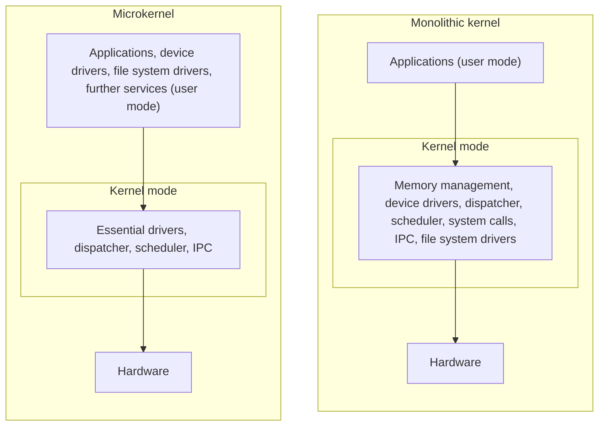
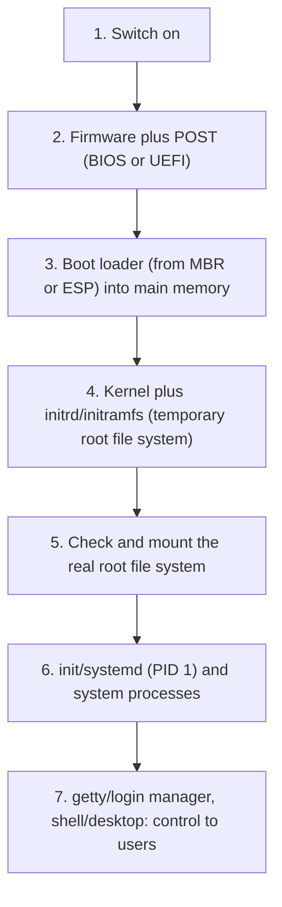
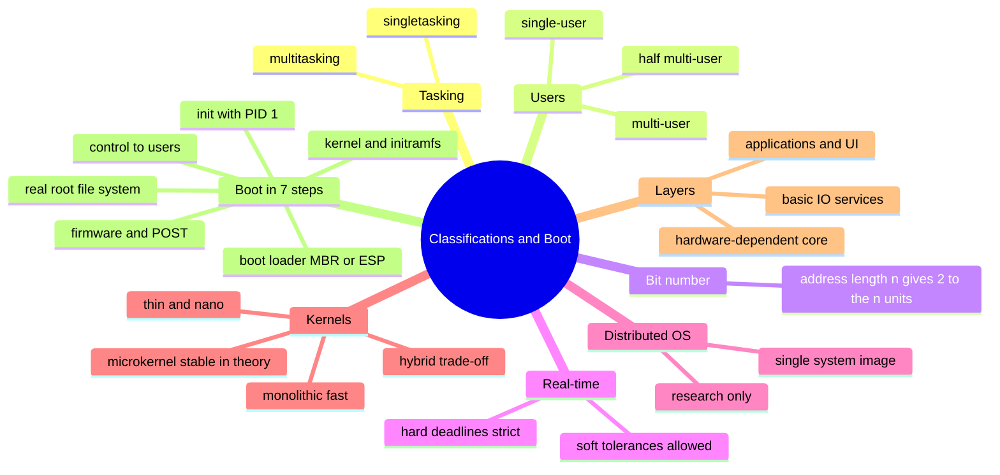

# OS Classifications, Kernel Architectures, Layers & Booting

> [!tip] 🧠 Study from the [[#🧠 Recall Layer|Recall Layer]] at the end of this note — mind map · deck [[OS-02 Classifications and Boot]] · gold examples · exam lens. This note is now your reference: search it, don't re-read it.

> [!Note] 💡 Notation Conventions
> - **OS** = operating system; **CPU** = central processing unit; **I/O** = input/output; **RT** = real-time; **SSI** = Single System Image; **POST** = power-on self-test.
> - "$\Rightarrow$ slide set $k$" marks a topic treated later in slide set $k$. It is only named here, not explained.
> - An **$n$ bit OS** addresses $2^n$ **memory units**. The slides do not say how large one unit is.
> - **Task = process = (from the user's view) job.** The slides treat these terms as equivalent, so this note uses **process** throughout.
> - **Permission digits:** $r = 4$, $w = 2$, $x = 1$, none $= 0$. A permission triple is written $rwx$ and its octal digit is the sum of the values.
> - **Layer numbering:** the layered diagram on slide 28 and the course map on slide 29 number the inner layers differently. This note uses the slide-28 numbering and flags the difference in §8.
> - The Linux/UNIX commands in §10 and the Ex. 3 and Ex. 4 solutions follow the **official solution of exercise sheet 2**. Only the exact mode of `/etc/shadow` in §11 is not given there (the official solution just repeats the tutorial).
> - This slide set contains no theorems or proofs.

---

## 1. Learning Objectives

> [!Property] ⚙️ What You Must Know
> After slide set 2 you should know or understand:
> **1.** the difference between **singletasking** and **multitasking**;
> **2.** the difference between **single-user** and **multi-user**;
> **3.** the reason for the **memory address length** ($n$ bit OS);
> **4.** what **real-time** operating systems are;
> **5.** what **distributed** operating systems are;
> **6.** the **kernel architectures**: monolithic kernel, microkernel, hybrid kernel;
> **7.** the **structure (layers)** of operating systems;
> **8.** the steps of the **boot process** (bootstrap).
>
> Exercise sheet 2 repeats the content relevant for these objectives. Operating systems can be classified by different criteria, and the most important ones are discussed in this slide set.

---

## 2. Singletasking and Multitasking

> [!Definition] 📖 Singletasking
> **Singletasking:** at any given moment only **one** program is executed. Multiple started programs are executed **one after the other**.

> [!Definition] 📖 Multitasking
> **Multitasking:** multiple programs can be executed **at the same time**, either with multiple CPUs/cores (truly parallel) or **quasi-parallel** (interleaved on one core).

> [!Property] ⚙️ Multitasking on One Core
> - From the user's perspective the processes appear to run in parallel.
> - On a single CPU core **without Simultaneous Multithreading** ("Hyper-Threading"), only **one** process executes at any instant. Processes are activated **alternately at short intervals**.
> - The simplified figure assumes a single thread per process, equal time slices, and **ignores context-switch overhead**.

| Time slot | $t_1$ | $t_2$ | $t_3$ | $t_4$ | $t_5$ | $t_6$ |
|---|:-:|:-:|:-:|:-:|:-:|:-:|
| Single core, running process | $P_1$ | $P_2$ | $P_3$ | $P_1$ | $P_2$ | $P_3$ |

> [!Missing] Figure: Slide 3, "Multitasking" time diagram of Processes 1 to 3. First plot: continuous lines for all three processes (parallel view). Second plot: a single CPU core where the three processes alternate in short slices. The table above recreates the second plot.

> [!Property] ⚙️ Why Multitasking?
> **1.** Processes often **wait for external events**: user input, I/O of peripheral devices, a message from another program, an incoming e-mail, a database operation, data being written to the HDD.
> **2.** Waiting processes can be placed in the **background**, so other processes are executed **sooner**.
> **3.** **Drawback:** switching from one process to another causes **overhead**.
> **4.** The overhead is rather **small compared with the speed-up**.

## 📘 Examples & Applications

### Example 2.1: Singletasking versus multitasking schedule

**Using:** singletasking, multitasking, quasi-parallel execution

> [!Example] 📘 Three processes on one core
> **Given:** processes $P_1, P_2, P_3$ with $2$ time slices of work each, one core, equal slices, no switching overhead.
> **Step 1 (singletasking).** $P_1P_1\,P_2P_2\,P_3P_3$. One process after the other, and $P_3$ starts only after $P_2$ has finished. Total $= 6$ slices.
> **Step 2 (multitasking, quasi-parallel).** $P_1P_2P_3P_1P_2P_3$. All three make progress early. Total is still $6$ slices (overhead ignored).
> **Step 3.** The benefit appears when a process waits for an external event, e.g. $P_1$ waits for I/O after its first slice. Its waiting time can be used by $P_2$ and $P_3$ instead of leaving the CPU idle.

---

## 3. Single-User and Multi-User

> [!Definition] 📖 Single-User Operating System
> The computer can be used by **only one user at any point in time**.

> [!Definition] 📖 Multi-User Operating System
> **Multiple users work simultaneously** with the computer:
> **1.** Users share the system resources (as fairly as possible).
> **2.** Users must be **identified** (via passwords).
> **3.** Access to data and processes of other users must be **prevented**.

> [!Definition] 📖 Half Multi-User Operating System
> **Desktop/workstation versions of Windows NT/XP/Vista/7/8/10/11** are only *half* multi-user: different users can work with the system only **one after the other**, but the data and processes of different users are **protected from each other**.

| | **Single-User** | **Multi-User** |
|---|---|---|
| **Singletasking** | CP/M 2.2, MS-DOS, PC-DOS, DR-DOS, GEOS, Palm OS, FreeDOS | **impossible** |
| **Multitasking** | OS/2, Windows 3x/95/98, BeOS, MacOS 8x/9x, AmigaOS, Risc OS, ArcaOS, eComStation, KolibriOS, MenuetOS, Plan 9, Haiku, FreeRTOS, iOS (iPhone), iPadOS (normal mode) | Linux/UNIX, Minix, MacOS X, server editions of the Windows NT family, OpenVMS, Android, ChromeOS, FreeBSD, NetBSD, DragonFly, OpenIndiana, Solaris, ReactOS, iPadOS (with Shared iPad) |

> [!Property] ⚙️ Implication
> A **multi-user, singletasking** OS is **impossible** (see table). Multi-user operation requires multitasking.

## 📘 Examples & Applications

### Example 3.1: Classifying operating systems

**Using:** singletasking, multitasking, single-user, multi-user, half multi-user

> [!Example] 📘 Place each OS in the 2x2 table
> **Step 1.** *MS-DOS*: one program at a time, one user $\Rightarrow$ **singletasking, single-user**.
> **Step 2.** *Windows 95*: several programs, one user $\Rightarrow$ **multitasking, single-user**.
> **Step 3.** *Linux*: several programs, several simultaneous users $\Rightarrow$ **multitasking, multi-user**.
> **Step 4.** *Windows 10 desktop*: users one after the other, but with protected data and processes $\Rightarrow$ **half multi-user**.

### Example 3.2: Exercise Sheet 2, Exercise 1.1 to 1.6 (classifications)

**Using:** singletasking, multitasking, single-user, multi-user, half multi-user

> [!Example] 📘 Solutions (official)
> **1.1 Only one program at a time:** **singletasking**.
> **1.2 Singletasking OS:** **MS-DOS**, **Palm OS**.
> **1.3 Multitasking OS:** Linux/UNIX, MacOS X, server editions of the Windows NT family, MacOS 8x/9x, AmigaOS, Risc OS, OS/2, Windows 3x/95/98, BeOS.
> **1.4 Single-user OS:** **MS-DOS**, **Palm OS**.
> **1.5 Multi-user OS:** **Linux/UNIX**, **MacOS X**, server editions of the Windows NT family.
> **1.6 Half multi-user:** different users can work with the system **only one after the other**, but the data and processes of the different users are **protected from each other**.

---

## 4. 8/16/32/64 Bit Operating Systems

> [!Definition] 📖 Bit Number of an OS
> The **bit number** $n$ is the **memory address length** with which the OS works internally. An $n$ bit OS can address $2^n$ memory units. The number of addressable units is limited by the **address space**, which is limited by the **address bus** ($\Rightarrow$ slide set 3).

| Bit number $n$ |           Addressable units $2^n$           | Examples                                                                                  |
| :------------: | :-----------------------------------------: | ----------------------------------------------------------------------------------------- |
|       8        |                 $2^8 = 256$                 | GEOS, Atari DOS, Contiki                                                                  |
|       16       |             $2^{16} = 65\,536$              | MS-DOS, Windows 3.x, OS/2 1.x                                                             |
|       32       |         $2^{32} = 4\,294\,967\,296$         | Windows 95/98/NT/Vista/7/8/10, OS/2 2/3/4, eComStation, Linux, BeOS, MacOS X (until 10.7) |
|       64       | $2^{64} = 18\,446\,744\,073\,709\,551\,616$ | Linux (64 bit), Windows 7/8/10/11 (64 bit), MacOS X (64 bit)                              |

> [!Note] 💡 Quote (Bill Gates, 1989)
> "We will never make a 32-bit operating system." It is a reminder that predictions in this field can be wrong.

## 📘 Examples & Applications

### Example 4.1: Exercise Sheet 2, Exercise 1.7 (difference between $n$ bit systems)

**Using:** bit number, address space

> [!Example] 📘 Difference between 8, 16, 32 and 64 bit operating systems
> **Step 1.** The bit number is the internal memory address length.
> **Step 2.** The addressable number of memory units is $2^n$, limited by the address space, which is limited by the address bus.
> **Step 3.** Hence $2^8 < 2^{16} < 2^{32} < 2^{64}$. For example, going from $16$ to $32$ bit multiplies the number of addressable units by $\dfrac{2^{32}}{2^{16}} = 2^{16} = 65\,536$.

---

## 5. Real-Time Operating Systems

> [!Definition] 📖 Real-Time Operating System
> A **real-time (RT) OS** is a **multitasking** OS with **additional real-time functions** for compliance with time conditions. Essential criteria: **response time** and **meeting deadlines**. Different **priorities** are taken into account so that important processes finish within certain time limits.

> [!Definition] 📖 Hard Real-Time OS
> **Deadlines must be strictly met.** Delays cannot be accepted under any circumstances. They lead to **disastrous consequences and high cost**, and results are **useless if they arrive too late**.
> **Applications:** welding robot, reactor control, anti-lock braking system (ABS), aircraft flight control, monitoring systems of an intensive care unit.

> [!Definition] 📖 Soft Real-Time OS
> **Certain tolerances are allowed.** Delays cause **acceptable costs**.
> **Applications:** telephone system, parking ticket vending machine, ticket machine, multimedia applications (audio/video on demand).

> [!Property] ⚙️ Properties and Application Areas
> **1.** Modern **desktop** OS can guarantee **soft** real-time behavior for high-priority processes. **Hard** real-time behavior **cannot** be guaranteed there, because of unpredictable time behavior due to swapping, hardware interrupts, etc.
> **2.** Typical areas: **embedded systems and IoT devices**, **industrial monitoring systems**, **robots**.
> **3.** Examples: QNX, VxWorks, LynxOS, RTLinux, FreeRTOS, Zephyr, Apache NuttX, RTEMS (Real-Time Operating System for Multiprocessor Systems), Symbian (outdated), Windows CE (outdated).

> [!Missing] Figure: Slide 11, industrial robots (BMW Werk Leipzig). Slide 12, QNX demo disc screenshot (decorative).

## 📘 Examples & Applications

### Example 5.1: Exercise Sheet 2, Exercise 1.8 to 1.10 (real-time systems)

**Using:** real-time OS, hard and soft real-time, application areas

> [!Example] 📘 Solutions
> **1.8 Two essential criteria:** **response time** (short latency) and **meeting deadlines**.
> **1.9 Two types:** **hard** real-time and **soft** real-time operating systems.
> **1.10 Four application areas, assigned to a category:**
> **Step 1.** Anti-lock braking system (ABS) $\Rightarrow$ **hard** (delay can be disastrous).
> **Step 2.** Reactor control $\Rightarrow$ **hard**.
> **Step 3.** Telephone system $\Rightarrow$ **soft** (tolerances allowed).
> **Step 4.** Audio/video on demand $\Rightarrow$ **soft**.
> (Alternatives from the slides: welding robot, aircraft flight control, ICU monitoring $\Rightarrow$ hard. Parking ticket vending machine, ticket machine $\Rightarrow$ soft.)

---

## 6. Distributed Operating Systems

> [!Definition] 📖 Distributed Operating System / Single System Image (SSI)
> A **distributed OS** controls processes on **multiple computers of a cluster**. The individual computers remain **transparently hidden** from users and applications, so the system **appears as one single large computer**. This is the **Single System Image (SSI)** principle.

> [!Property] ⚙️ Research Systems (Slides 13 to 15)
> **Amoeba:** mid-1980s to mid-1990s, Andrew S. Tanenbaum (Free University of Amsterdam). The programming language **Python** was developed for Amoeba.
> **Inferno:** based on the UNIX OS *Plan 9* (Bell Laboratories). Applications are written in **Limbo** (similar to Java, producing bytecode executed by a virtual machine). Minimal hardware requirement: only **1 MB** of main memory.
> **Rainbow:** Universität Ulm. A **common memory** gives a uniform address space in which all cluster computers store and access objects. It is transparent on which computer an object physically is. Remote objects are transmitted and deployed locally **automatically**.
> **Sprite:** UC Berkeley (1984 to 1994). Connects workstations so that they appear as a **single time-shared system**. The parallel version of make, **pmake**, was developed for Sprite.

> [!Property] ⚙️ Situation Today
> **1.** The principle of distributed OS is "dead". The concept **did not gain acceptance**. These systems **never left the research stage**, and established OS were **never replaced**.
> **2.** Some technologies developed for them are still relevant today.
> **3.** For cluster applications, **libraries for hardware-independent message passing** exist (communication based on message exchange): **MPI** (Message Passing Interface, the standard solution) and **PVM** (Parallel Virtual Machine).

> [!Warning] ⚠️ Possible Gap
> The slide line on **PVM** is cut off ("$\Rightarrow$ d..."), so its status (possibly "deprecated") cannot be read from the slide.

## 📘 Examples & Applications

### Example 6.1: Exercise Sheet 2, Exercise 1.24 (Single System Image)

**Using:** distributed OS, SSI

> [!Example] 📘 Describe what Single System Image means
> **Step 1.** A cluster consists of several computers, each with its own hardware.
> **Step 2.** The distributed OS hides the individual computers transparently from users and applications.
> **Step 3.** The cluster therefore appears as **one single large computer**, which is the SSI principle.
> **Step 4 (official wording).** Users and their applications do not know that the services they use run on multiple computers.

---

## 7. Kernel Architectures

> [!Definition] 📖 Kernel, Kernel Mode, User Mode
> The **kernel** contains the essential functions of the OS and is the **interface to the hardware**. Different kernel architectures differ in **which functions are inside the kernel** and which are outside as **services (servers)**.
> **Kernel mode:** functions in the kernel have **full hardware access**.
> **User mode:** functions outside the kernel can only access their **virtual memory** ($\Rightarrow$ slide set 5).

### 7.1 Monolithic Kernel

> [!Definition] 📖 Monolithic Kernel
> A **monolithic kernel** contains functions for **memory management, process management, interprocess communication, hardware management (drivers), and file systems**, all in kernel mode.

> [!Property] ⚙️ Advantages and Drawbacks
> **Advantages:** **fewer context switches** than microkernels $\Rightarrow$ **better performance**. Grown stability (microkernels are usually not more stable).
> **Drawbacks:** a crashed kernel component **cannot be restarted separately** and may crash the whole system. **Kernel extensions** cause high development effort, since the **complete kernel must be recompiled** for each compilation of an extension.
> **Examples:** Linux, BSD, MS-DOS, FreeDOS, Windows 95/98/ME, MacOS (until 8.6), OS/2.

> [!Note] 💡 Why Linux Is Monolithic
> Linux drivers can be outsourced into **modules**, but the modules run in **kernel mode**, not user mode. Therefore, the Linux kernel is monolithic.

### 7.2 Microkernel

> [!Definition] 📖 Microkernel
> The **microkernel** contains only: essential functions for **memory and process management**, functions for **process synchronization and interprocess communication**, and **essential drivers** (e.g. for system start). **Device drivers, file systems and services (servers)** are outside the kernel and run like user applications in **user mode**.

> [!Property] ⚙️ Advantages and Drawbacks
> **Advantages:** components can be **exchanged easily**. **Best stability and security in theory**, because fewer functions run in kernel mode.
> **Drawbacks:** **slower** because of more context switches. Developing a new (micro)kernel is a **complex task**.
> **Examples:** AmigaOS, MorphOS, Tru64, QNX Neutrino, Symbian OS, GNU HURD.
> The success of microkernel systems forecast in the early 1990s **did not happen**.

### 7.3 Hybrid Kernel (Macrokernel)

> [!Definition] 📖 Hybrid Kernel / Macrokernel
> A **hybrid kernel** is a **trade-off** between monolithic kernel and microkernel. It contains some components **for performance reasons that are never located inside microkernels**. **It is not specified** which additional components are inside.

> [!Property] ⚙️ Advantages and Drawbacks
> **Advantages:** **better performance than microkernels** (fewer context switches). **Stability theoretically better than monolithic** kernels.
> **Drawback (example Windows NT 4):** its kernel contains the **Graphics Device Interface**. This gives increased performance, but **buggy graphics drivers cause frequent crashes**.
> **Examples:** Windows NT family since NT 3.1, ReactOS, MacOS X, BeOS, ZETA, Haiku, Plan 9, DragonFly BSD.

### 7.4 Kernel Architectures of Real-Time Systems

> [!Definition] 📖 Thin Kernel
> A **thin kernel** (similar to a microkernel): the **OS kernel itself runs as a process with the lowest priority in the background**. The **RT kernel does the scheduling** and is an abstraction interface between the hardware and the Linux kernel. Real-time processes get the **highest priority**, which gives **minimum reaction time (latency)**.

> [!Definition] 📖 Nano Kernel
> A **nano kernel** (also similar to a microkernel): besides the RT kernel, **several kernels of other operating systems** may run. It is similar to a **Type-1 hypervisor** ($\Rightarrow$ slide set 10).

> [!Note] 💡 Pico, Femto, Atto Kernel
> These are **marketing buzz-words** to emphasize the smallness of RT kernels.

> [!Missing] Figure: Slide 21, thin kernel. Real-time tasks in user space and the OS (non-real-time tasks) run above a thin RT kernel on the hardware. Nano kernel: the same with an RT kernel next to the OS kernel, both on a nano kernel above the hardware.

### 7.5 Kernel Stories

> [!Note] 💡 Torvalds vs. Tanenbaum (1992)
> - 26 Aug 1991: Linus Torvalds announces the Linux project in the newsgroup `comp.os.minix`. 17 Sep 1991: first internal release (0.01). 5 Oct 1991: first official release (0.02).
> - 29 Jan 1992: Andrew S. Tanenbaum posts "LINUX is obsolete". His arguments: Linux's monolithic kernel is a **step backwards**, and Linux is **not portable** because it is optimized for the 80386 CPU, which would soon be replaced by RISC CPUs.
> - An intense discussion followed on monolithic kernels, microkernels, portability and free software. **The future cannot be predicted.**

> [!Note] 💡 GNU HURD, a "Sad Kernel Story"
> 1984: Richard Stallman founds the GNU Project to develop a free Unix OS, **GNU HURD**. It consists of **GNU Mach (the microkernel)**, file systems, protocols and servers in user mode, and GNU software (Emacs, GCC, GDB, Bash). The GNU software has been almost complete since the early 1990s and not all servers are complete. The **most challenging component to implement is the microkernel**.

> [!Note] 💡 kHTTPd, an "Extreme Kernel Story"
> 1999: Arjan van de Ven wrote **kHTTPd**, a web server running **in the Linux 2.4 kernel**. **Advantage:** faster delivery of **static** pages, since less switching between user and kernel mode is needed. **Drawback:** a **security risk**. A complex program like a web server should not run in kernel mode, because bugs could crash the system or let an attacker take over the system. The Linux kernel $\geq$ 2.6 does not contain kHTTPd.

## 📘 Examples & Applications

### Example 7.1: Exercise Sheet 2, Exercise 1.11 to 1.22 (kernel architectures)

**Using:** all kernel architectures, advantages and drawbacks

> [!Example] 📘 Solutions
> **1.11 Thin kernel:** a thin RT kernel sits between hardware and the OS. The OS kernel runs as a lowest-priority background process, the RT kernel schedules, and real-time processes get the highest priority.
> **1.12 Nano kernel:** like a thin kernel, but additionally several kernels of other operating systems can run besides the RT kernel (similar to a Type-1 hypervisor).
> **1.13 Monolithic kernel:** memory management, process management, IPC, hardware management (drivers) and file systems are all inside the kernel, in kernel mode. Outside the kernel are the user processes.
> **1.14 Microkernel:** the kernel has only essential memory and process management, synchronization/IPC and essential drivers. Device drivers, file systems and services run outside in user mode.
> **1.15 Hybrid kernel:** a compromise between monolithic kernel and microkernel. It contains additional components inside the kernel for performance reasons, and what exactly is unspecified.
> **1.16 GNU HURD:** $\boxtimes$ **microkernel** (GNU Mach).
> **1.17 Linux:** $\boxtimes$ **monolithic kernel**.
> **1.18 MacOS X:** $\boxtimes$ **hybrid kernel**. The XNU kernel is called a hybrid kernel on slide 39.
> **1.19 Windows NT4/Vista/XP/7/8/10:** $\boxtimes$ **hybrid kernel**.
> **1.20 Monolithic:** advantage: fewer context switches, so better performance. Drawback: a crashed component cannot be restarted separately and may crash the system.
> **1.21 Microkernel:** advantage: components are easily exchanged, with best stability and security in theory. Drawback: slower because of more context switches.
> **1.22 Hybrid:** advantages: better performance than microkernels (fewer context switches), and stability theoretically better than monolithic kernels. Drawback (official): development of a new (hybrid) kernel is a complex task. Slide example: the Windows NT 4 kernel contains the Graphics Device Interface, so buggy graphics drivers cause frequent crashes.

### Example 7.2: Exercise Sheet 2, Exercise 1.23 (moving daemons into kernel mode)

**Using:** kernel mode, user mode, kHTTPd, advantages and drawbacks

> [!Example] 📘 Your colleague proposes moving the web, e-mail, SSH and FTP servers into kernel mode
> **Step 1 (benefit).** Less switching between user mode and kernel mode is required $\Rightarrow$ faster service (the kHTTPd argument).
> **Step 2 (drawback).** Complex software in kernel mode is a **security risk**. A bug in a server can **crash the whole system** or let an attacker take over control, and kernel-mode code has full hardware access.
> **Step 3 (judgement).** The benefit applies mainly to simple static workloads, so the idea is **not recommended**. The Linux kernel $\geq$ 2.6 dropped kHTTPd for this reason.

---

## 8. Structure (Layers) of Operating Systems

> [!Definition] 📖 Layered OS Structure
> An OS can be structured **logically via layers**. The layers **surround each other** and contain **more abstract functions from the inside out**. Each layer is like an **abstract machine**. Layers communicate with **neighboring** layers via **well-defined interfaces**, can **call functions of the next inner layer** and **provide functions to the next outer layer**. All functions (services) offered by a layer, together with the rules to observe, are called a **protocol**.

> [!Property] ⚙️ Minimum of 3 Layers
> **1.** **Innermost:** the **hardware-dependent** parts of the OS. This allows (theoretically!) easy porting to other computer architectures.
> **2.** **Central:** basic **I/O services** (libraries and interfaces) for devices and data.
> **3.** **Outermost:** the **applications and user interface**.
> Usually, OS are drawn with **more than 3** logical layers.

| Layer (slide 28) | Content | Interface to the next inner layer |
|:-:|---|---|
| Hardware | the machine | |
| 1 | Kernel (hardware-dependent part) | **A** Hardware interface |
| 2 | Kernel (hardware-independent part) | **B** Kernel-internal hardware-independent interface |
| 3 | Standard library (**glibc**) | **C** System call interface |
| 4 | Shell (**bash**), applications | **D** Standard library interface (interface to glibc) |
| 5 | User | **E** User interface |

> [!Missing] Figure: Slide 28, "Layers of Linux/UNIX" as concentric circles (hardware in the center, layers 1 to 5 outward, interfaces A to E between them). Recreated as the table above.

> [!Note] 💡 Concept Is Not Strictly Followed
> In practice user applications can call wrapper functions of the standard library **glibc** *or* directly call the **system calls** ($\Rightarrow$ slide set 7).

> [!Property] ⚙️ Where the Course Covers Each Layer (Slide 29)
> Layer 0 Hardware $\Rightarrow$ slide sets 3+4. Layer 1 Kernel architecture $\Rightarrow$ slide set 2. Layer 2 Kernel functions $\Rightarrow$ slide sets 5+6+7+8+9. Layer 3 Standard library $\Rightarrow$ slide sets 7+9. Layer 4 Shell $\Rightarrow$ exercise sheets and examples. Layer 5 User $\Rightarrow$ you.

> [!Warning] ⚠️ Possible Gap
> Slide 28 splits the kernel into layers 1 (hardware-dependent) and 2 (hardware-independent), with hardware as the center. Slide 29 numbers hardware as layer 0, **kernel architecture as layer 1** and **kernel functions as layer 2**. Layers 3 to 5 agree on both slides. Both numberings appear in the source, so check which one your lecturer expects.

## 📘 Examples & Applications

### Example 8.1: Tracing a call through the layers (constructed)

**Using:** layers, interfaces, system calls, glibc

> [!Example] 📘 A user runs a command that reads a file
> **Step 1.** The user (layer 5) types a command via the **user interface E** into the shell (layer 4).
> **Step 2.** The program calls a wrapper function of **glibc** (layer 3) through interface D.
> **Step 3.** glibc invokes the **system call interface C** into the kernel (layers 2 and 1).
> **Step 4.** The hardware-dependent kernel part talks to the hardware through the **hardware interface A**.
> **Step 5.** In practice a program may skip layer 3 and use system calls directly (see the Note above).

### Example 8.2: Why a minimum of three layers?

**Using:** minimum layer structure, portability

> [!Example] 📘 Role of the innermost layer
> **Step 1.** Only the innermost layer depends on the hardware.
> **Step 2.** To port the OS to a new computer architecture, (theoretically) only this layer needs to be replaced.
> **Step 3.** The outer layers use the interface of the layer beneath them and stay unchanged.

---

## 9. Booting the Operating System

> [!Definition] 📖 Boot Process (Bootstrapping)
> The **boot process** (**bootstrapping**) is the process of starting a computer and its OS: from initializing the hardware components to passing control to the OS and its users or their processes, and providing a user interface.

> [!Property] ⚙️ The 7 Steps (Linux/UNIX)
> **1.** Switch on the computer.
> **2.** Start the **firmware** and perform a **self-test**.
> **3.** Start the **boot loader**.
> **4.** Start the **kernel** and the **temporary root file system**.
> **5.** **Mount** the real root file system.
> **6.** Start **init/systemd** and the system processes.
> **7.** **Pass control to the users**.
>
> The slides describe primarily Linux on **BIOS- or UEFI-based PCs**. Other platforms (e.g. Apple silicon) use different firmware and boot stages.

### 9.1 Steps 1 and 2: Power-On and Firmware

> [!Property] ⚙️ Step 1: Switch On
> - **Older computers (up to the 2000s):** the mainboard is powered up and the processor starts the **Von Neumann fetch-decode-execute cycle** ($\Rightarrow$ slide set 3).
> - **Newer computers:** an **autonomous subsystem** usually runs continuously, e.g. **Intel Management Engine** (since 2008) or **AMD Platform Security Processor** (since 2013). These are independent microcontrollers on the mainboard or in the chipset (or special CPU cores with their own OS). They usually run whenever a charged battery or permanent power source is present.
> - They allow **monitoring and waking over the network (Wake-on-LAN)** and **remote administration (remote management)**.

> [!Definition] 📖 Firmware, BIOS, UEFI, POST
> The **firmware** is started when the computer is switched on. **BIOS** (Basic Input/Output System) is the firmware of x86-compatible computers from the early 1980s to the late 2000s. **UEFI** (Unified Extensible Firmware Interface) is the firmware of newer computers. The firmware performs the **POST** (power-on self-test): CPU, cache and main memory are checked, and the presence of graphics output hardware, I/O devices and storage drives is also checked. Status and error messages appear on the monitor or as **beeps**. **POST cards** can monitor the self-test.

> [!Missing] Figure: Slides 33 to 34, BIOS screenshot (Thinkpad X240), UEFI screenshot (ASUS Z87-C), and POST cards for PCI, PCIe and LPC.

### 9.2 Step 3: Boot Loader

> [!Definition] 📖 Boot Loader
> The **boot loader** is a **program that loads the operating system**. The firmware searches for the first **boot device** (SSD, hard disk, USB stick, or a **network resource via PXE**, the Preboot Execution Environment), according to the user-defined or default **boot order**. The firmware loads the boot loader from the boot device **into main memory** and starts it.

> [!Property] ⚙️ Location of the Boot Loader
> **Classic PC partition table:** the boot loader is stored in the **512 byte master boot record (MBR)**.
> **GUID partition table (GPT):** the boot loader is stored in the **ESP (EFI System Partition)**.
> The MBR is not visible as a partition, while the ESP is.

> [!Property] ⚙️ Boot Loader Examples and Features
> **Examples:** GRUB, Windows Boot Manager, Clover. Modern boot loaders can boot operating systems **with different parameters or in a protected mode**, and let the user **select one of several installed operating systems**. **GRUB** even provides a command-line interpreter, the **GRUB shell**, to inspect and repair its configuration and control the boot process manually.

### 9.3 Steps 4 to 7: Kernel, Root File System, init, Users

> [!Definition] 📖 initrd / initramfs (Temporary Root File System)
> After the user or boot loader selects a kernel, the kernel is **unpacked and written into main memory**. Next, the boot loader loads the **initial RAM disk (initrd)** or **initial RAM file system (initramfs)** into main memory. This is a **temporary root file system** that implements a minimal Linux environment. Its primary purpose is to **give the kernel more device drivers, file system drivers and programs to mount the real root file system**.
> In Linux/UNIX the root file system (root directory) is identified by `/`.
> **File names:** Linux kernel `vmlinuz-<version>-<architecture>` in `/boot`, initrd `initrd.img-<version>-<architecture>` in `/boot`. Windows NT family: `Ntoskrnl.exe` in `\Windows\System32`.

> [!Property] ⚙️ Step 5: Mount the Real Root File System
> **1.** From within the temporary root file system, the kernel accesses the drive (SSD/HDD) with the real root file system.
> **2.** It **validates consistency** and **corrects errors**, typically with userspace tools (e2fsck, xfs_repair, btrfs check), and can **replay committed journal transactions**.
> **3.** It **mounts** the real root file system, **replacing** the temporary one, and then mounts further file systems (e.g. `/home`).

> [!Property] ⚙️ Step 6: init / systemd
> **1.** The kernel starts **init** as the **first user-mode process, with process ID 1 (PID 1)**. All other user-mode processes descend from init ($\Rightarrow$ slide set 7).
> **2.** Numerous **system processes and services** (cron daemon, SSH server, web server, ...) are started automatically.
> **3.** Until the late 2000s: **System V-style init (sysvinit)**. Since the early 2010s: most distributions use **systemd**.
> **4.** Advantages of systemd: **faster boot** by starting services in parallel, an integrated logging system **journald**, and **automatic restart** of failed services.

> [!Property] ⚙️ Step 7: Pass Control to the Users
> **1.** The kernel passes control to the user and user-mode processes, but **continues to run in main memory in kernel mode** to manage hardware resources and system calls ($\Rightarrow$ slide sets 5 and 7).
> **2.** **getty** processes are started. They provide a **text-based login** through **(virtual) consoles**, with a separate instance per virtual console **TTY1 to TTY6**. Typical Linux systems have six virtual consoles, reachable with **Ctrl+Alt+F1 to F6**. "TTY" stands for *teletypewriter*.
> **3.** After successful login, a **shell** (bash, fish, ksh, csh, tcsh, zsh) is started.
> **4.** A **graphical login manager** (GDM, LightDM, XDM) typically runs on **TTY7** (Ctrl+Alt+F7). After login, the **desktop environment** (XFCE, GNOME, KDE, Window Maker, Enlightenment) is loaded.

### 9.4 Booting macOS

> [!Property] ⚙️ macOS Boot
> **Intel Macs (since 2006):** the EFI/UEFI firmware loads the bootloader **boot.efi**, which loads the **XNU** ("X is Not Unix") **hybrid kernel**. Intel Macs with an **Apple T2 Security Chip (2017 to 2023)** verify the UEFI firmware before the Intel CPU executes it.
> **Apple silicon:** an Apple-specific boot chain instead of BIOS/UEFI: Boot ROM $\rightarrow$ Low-Level Bootloader (LLB) $\rightarrow$ iBoot $\rightarrow$ XNU kernel. **iBoot** loads the kernel and required boot components. **LLB** loads and verifies the essential system firmware and the local security policy before iBoot starts.
> **Both:** XNU starts **launchd (PID 1)**, which manages system services. The system then presents the graphical login and starts the user session.

## 📘 Examples & Applications

### Example 9.1: Exercise Sheet 2, Exercise 2 (Starting the OS)

**Using:** boot process, firmware, boot loader, initrd, getty

> [!Example] 📘 Solutions
> **2.1 Autonomous subsystem (Intel ME, AMD PSP).** Advantage: they allow the computer to be **monitored and woken up over the network (Wake-on-LAN)** and enable **remote administration (remote management)**. Drawback: they are **not fully documented** (quasi-secret), **always run when sufficient energy is available**, and can **access all hardware resources** (main memory, I/O interfaces, bus systems, network interfaces). It is an **uncontrollable computer within the computer** with an unclear range of functions, and therefore a major **security risk**.
> **2.2 Purpose of the firmware:** it starts on power-on, runs the **POST** (checks CPU, cache, main memory, graphics, I/O devices and drives), finds the **boot device** and **starts the boot loader**.
> **2.3 Classic firmware (early 1980s to late 2000s):** **BIOS**.
> **2.4 Modern firmware:** **UEFI**.
> **2.5 Boot loader:** a program that **loads the operating system kernel into main memory** when the OS is started. It also loads the **initial RAM disk (initrd) or initial RAM file system (initramfs)**.
> **2.6 Where it is stored:** with a classic PC partition table in the **512 byte MBR at the very beginning of the drive**. With a GUID partition table (GPT) in the **EFI System Partition (ESP)**.
> **2.7 Why initrd/initramfs:** it is a temporary root file system in main memory with a minimal Linux environment. It provides the kernel with **additional device drivers, file system drivers and programs** needed to **mount the real root file system**.
> **2.8 getty:** provides a **text-based login** for users via a (virtual) console. After a successful login, a shell is started.
> **2.9 How many getty processes:** **six**, one per virtual console TTY1 to TTY6 (on typical Linux systems).

### Example 9.2: Ordering the boot steps (constructed)

**Using:** the 7 boot steps

> [!Example] 📘 Put the events in order
> **Given (scrambled):** (a) kernel starts `init` with PID 1, (b) firmware runs POST, (c) real root file system is mounted, (d) GRUB is loaded into main memory, (e) `getty` instances start on TTY1 to TTY6, (f) initramfs is loaded, (g) power on.
> **Step 1.** Power on $\Rightarrow$ (g). **Step 2.** POST $\Rightarrow$ (b). **Step 3.** Boot loader $\Rightarrow$ (d). **Step 4.** Kernel and initramfs $\Rightarrow$ (f). **Step 5.** Mount the real root $\Rightarrow$ (c). **Step 6.** `init`/systemd $\Rightarrow$ (a). **Step 7.** getty $\Rightarrow$ (e).
> **Answer:** g, b, d, f, c, a, e.

---

## 10. Basic Linux/UNIX Commands (Exercise Sheet 2, Exercise 3)

> [!Note] 💡 Source of the Solutions
> The slides do not introduce these commands. The answers are those of the **official solution of exercise sheet 2**. Only `init`/PID 1, `getty`, `ps` and `bash` appear in the slides.

## 📘 Examples & Applications

### Example 10.1: Command table

**Using:** UNIX shell commands (files, users, groups, processes)

> [!Example] 📘 Which command is used to ...
> | # | Task | Command |
> |:-:|---|---|
> | 1 | check the man pages | `man` |
> | 2 | print the present working directory | `pwd` |
> | 3 | create a new directory | `mkdir` |
> | 4 | navigate to a directory | `cd` |
> | 5 | print the content of a directory | `ls` |
> | 6 | create an empty file | `touch` |
> | 7 | try to determine the content (type) of a file | `file` |
> | 8 | concatenate files / print a file | `cat` |
> | 9 | print lines from the end of a file | `tail` |
> | 10 | print lines from the beginning of a file | `head` |
> | 11 | copy files or directories | `cp` |
> | 12 | move files or directories | `mv` |
> | 13 | delete files or directories | `rm` |
> | 14 | delete an empty directory | `rmdir` |
> | 15 | place a string in the shell | `echo` |
> | 16 | modify permissions | `chmod` |
> | 17 | change a user's password | `passwd` |
> | 18 | terminate a session and specify the return value | `exit` |
> | 19 | reboot the system | `reboot` (alternatively `shutdown`) |
> | 20 | shut the system down | `halt` (alternatively `shutdown`) |
> | 21 | create a new user | `adduser` (alternatively `useradd`) |
> | 22 | delete a user | `deluser` (alternatively `userdel`) |
> | 23 | modify a user | `usermod` |
> | 24 | print group memberships of a user | `groups` |
> | 25 | create a new group | `groupadd` |
> | 26 | delete a group | `groupdel` |
> | 27 | change a group | `groupmod` |
> | 28 | change the owner of a file/directory | `chown` |
> | 29 | change the group of a file/directory | `chgrp` |
> | 30 | create a link | `ln` |
> | 31 | search a file for lines with a pattern | `grep` |
> | 32 | print the list of running processes | `ps` |
> | 33 | bring a background process into the foreground | `fg` |
> | 34 | bring a process into the background | `bg` |
> | 35 | kill (terminate) a process | `kill` |
> | 36 | kill a group of processes | `killall` |
> | 37 | specify the priority of a new process | `nice` |
> | 38 | modify the priority of an existing process | `renice` |
> | 39 | print the process tree | `pstree` |

---

## 11. Permissions / Access Rights (Exercise Sheet 2, Exercise 4)

> [!Definition] 📖 Permission Bits and Their Values
> Each file or directory has permissions for three classes: **User** (owner), **Group**, and **Other**. Each class has up to three permissions: **r** (read) $=4$, **w** (write) $=2$, **x** (execute) $=1$, **-** (none) $=0$. The octal digit of one class is the **sum** of the granted values, so a full mode has three digits (User, Group, Other).

> [!Definition] 📖 Reading `ls -l` / `ls -al` Output
> Columns: **Type**, **User**, **Group**, **Other** permissions, number of **Links**, **Owner**, **Group**, **Size**, **Date**, **Hour**, **Name**. Type `d` = directory, `-` = regular file.
> Example: `drwxrwxr-x 3 bnc bnc 4096 Feb 25 09:49 directory` has `rwx` for User and Group and `r-x` for Other. `-rwxr--r-- 12 bnc bnc 4096 Feb 16 05:02 file` has `rwx` for User and `r--` for Group and Other.

| Symbolic | Value | Meaning |
|:-:|:-:|---|
| `---` | 0 | none |
| `--x` | 1 | execute |
| `-w-` | 2 | write only (rarely used) |
| `-wx` | 3 | write and execute (rare) |
| `r--` | 4 | read only |
| `r-x` | 5 | read and execute |
| `rw-` | 6 | read and write |
| `rwx` | 7 | read, write, execute |

| Mode | Octal | Meaning |
|---|:-:|---|
| `-rw-------` | 600 | User read & write |
| `-rw-r--r--` | 644 | User read & write; Group and Other read |
| `-rw-rw-rw-` | 666 | Everyone read & write (dangerous?) |
| `-rwx------` | 700 | User read, write, execute |
| `-rwxr-xr-x` | 755 | User all; Other read & execute (typical for web pages or 644) |
| `-rwxrwxrwx` | 777 | Everyone full access |
| `-rwx--x--x` | 711 | User all; Group and Other execute |
| `drwx------` | 700 | Only the user has access. **Directories require execute permission to be accessed** |
| `drwxr-xr-x` | 755 | User full access; everyone else can see the directory |
| `drwx--x--x` | 711 | Everyone can list files, but Group and Other need to know a filename |

> [!Property] ⚙️ `chmod` Forms
> **Octal form:** `chmod 644 file` sets all three classes at once. **Symbolic form:** `chmod u+w file` adds write for the user, `chmod u-r file` removes read for the user (`u` user, `-` removes, `+` adds). The **owner can always change the permissions** of the file, even without write permission on it.

> [!Note] 💡 Command Prompt Convention in the Sheet
> `$` = run as a **general user**. `#` = run as **root** (with `sudo`). Tab completion saves time.

## 📘 Examples & Applications

### Example 11.1: Decoding and encoding modes

**Using:** permission values, octal and symbolic modes

> [!Example] 📘 Conversions
> **(a) Octal $\rightarrow$ symbolic: $640$.**
> **Step 1.** $6 = 4 + 2 \Rightarrow rw-$. **Step 2.** $4 \Rightarrow r--$. **Step 3.** $0 \Rightarrow ---$.
> **Answer:** `-rw-r-----`.
> **(b) Symbolic $\rightarrow$ octal: `-rwxr-x--x`.**
> **Step 1.** $rwx = 4+2+1 = 7$. **Step 2.** $r\text{-}x = 4+0+1 = 5$. **Step 3.** $\text{-}\text{-}x = 0+0+1 = 1$.
> **Answer:** $751$.
> **(c) Reading a listing: `drwxrwxr-x`.** $d$ = directory. User: $rwx = 7$. Group: $rwx = 7$. Other: $r\text{-}x = 5$. Mode $= 775$. Everyone can enter and list it, and only User and Group can create or delete files in it.

### Example 11.2: Exercise Sheet 2, Exercise 4 (tutorial walk-through)

**Using:** `chmod` (octal and symbolic), permission values, `sudo`

> [!Example] 📘 Part 1: changing file permissions on `working.txt`
> **Step 1.** `echo "test file" > working.txt` creates the file (the default mode depends on the system).
> **Step 2.** `chmod 444 working.txt`: $4 = r\text{-}\text{-}$ for all classes $\Rightarrow$ `-r--r--r--`. `ls -lah working.txt` shows this.
> **Step 3.** The owner can still change the permissions: `chmod 644 working.txt` gives `-rw-r--r--`. Equivalent: `chmod u+w working.txt` from `444` gives $4+2 = 6$ for the user, i.e. `644`.
> **Step 4.** `chmod u-r working.txt` removes the user's read bit. Equivalent octal from `644`: user $= 6 - 4 = 2$, giving `244`. The tutorial uses `chmod 344`, i.e. user $= 3 = -wx$, group $= 4 = r\text{-}\text{-}$, other $= 4 = r\text{-}\text{-}$.
> **Step 5.** `cat working.txt` now fails with a *permission denied* error, since the owner has no read permission.
> **Step 6 (restore read access).** The user needs $r = 4$, so use `chmod u+r working.txt` or `chmod 644 working.txt` (user $= 4 + 2 = 6$).
>
> **Part 2: program execution, privileges and sudo**
> **Step 7.** As a general user, `ls /etc/shadow` shows that the file exists, but `less /etc/shadow` fails.
> **Step 8 (figure out the permissions).** Run `ls -l /etc/shadow`. A general user (class Other) lacks the $r$ permission, which is why reading fails. The official solution does not give the exact mode. On many Linux systems it is owned by root and not readable by Other.
> **Step 9.** `sudo less /etc/shadow` works because `sudo` runs the command with root privileges, and root may read the file. Details: `man sudo`.

---

## 12. Combined Exam-Style Problem

## 📘 Examples & Applications

### Example 12.1: Choosing and analysing a system

**Using:** hard and soft real-time, kernel architectures, bit number, layers, boot process, permissions

> [!Example] 📘 Problem and full solution
> **Problem.** An engineering team designs (i) an airbag controller and (ii) a video-on-demand server.
> **(a)** Classify each as hard or soft real-time, and justify.
> **(b)** A colleague wants to put the video server's web daemon into the kernel. Name one benefit and one risk, and state which kernel types suit the airbag controller.
> **(c)** The server uses a $32$ bit OS. How many memory units can it address, and what is the factor to a $64$ bit OS?
> **(d)** The boot loader of the server runs from a GPT disk. Where is it stored, and what is started right after the root file system is mounted?
> **(e)** A log file has mode `-rw-r-----`. Give the octal mode, and say what Other can do.
>
> **Solution (a).**
> **Step 1.** Airbag: a delay is disastrous, and results are useless if late $\Rightarrow$ **hard real-time**.
> **Step 2.** Video on demand: some tolerance for delays $\Rightarrow$ **soft real-time**.
>
> **Solution (b).**
> **Step 1.** Benefit: fewer user/kernel mode switches, so faster (kHTTPd argument). Risk: a bug could crash the system or give an attacker full control. Not recommended.
> **Step 2.** For the airbag controller, RT kernels apply: a **thin kernel** (RT kernel schedules, real-time processes have highest priority) or a **nano kernel** (when several OS kernels must coexist).
>
> **Solution (c).**
> **Step 1.** $2^{32} = 4\,294\,967\,296$ memory units.
> **Step 2.** Factor to $64$ bit: $\dfrac{2^{64}}{2^{32}} = 2^{32} = 4\,294\,967\,296$.
>
> **Solution (d).**
> **Step 1.** With GPT, the boot loader is stored in the **EFI System Partition (ESP)**.
> **Step 2.** After step 5 (mount root), the kernel starts **init/systemd** as the first user-mode process with **PID 1**.
>
> **Solution (e).**
> **Step 1.** User $= rw = 4+2 = 6$. Group $= r = 4$. Other $= 0$. Mode: $640$.
> **Step 2.** Other has **no permissions**, so it can neither read nor write the file.

---

## 🗂️ Summary

**Classifications**
- **Singletasking:** one program at a time, one after the other. **Multitasking:** several programs at the same time (multiple cores) or **quasi-parallel** (alternating at short intervals). Switching has overhead, which is small compared with the speed-up.
- Task = process = (user view) job.
- **Single-user** vs **multi-user** (users identified, resources shared fairly, access to others' data prevented). **Multi-user singletasking is impossible.** **Half multi-user:** desktop Windows NT family, users one after the other with protected data and processes.
- $n$ bit OS addresses $2^n$ memory units, limited by the address space, which is limited by the address bus ($\Rightarrow$ slide set 3).
- **Real-time OS:** multitasking plus time conditions. Criteria: **response time**, **deadlines**. **Hard** (disastrous if late: ABS, reactor control, flight control, ICU, welding robot) vs **soft** (tolerances: telephone, ticket machines, audio/video on demand). Desktop OS only guarantee soft real-time.
- **Distributed OS:** cluster appears as one computer (**SSI**). Examples: Amoeba, Inferno, Rainbow, Sprite. Never left research. Today **message passing** with **MPI** (standard) and PVM.

**Kernels**
- **Kernel mode** = full hardware access. **User mode** = access only to virtual memory.
- **Monolithic** (all functions in the kernel; Linux, BSD, MS-DOS): fast, but one crashed component can crash the system, and kernel extensions require recompiling the kernel.
- **Microkernel** (only essentials; drivers, file systems and servers in user mode; GNU HURD, QNX Neutrino): exchangeable components, best stability and security in theory, but slower with more context switches and a complex kernel development.
- **Hybrid / macrokernel** (Windows NT family, macOS X/XNU, ReactOS, BeOS, Haiku): better performance than microkernels, in theory more stable than monolithic kernels. Example drawback: GDI in Windows NT 4 kernel, so buggy graphics drivers cause crashes.
- **RT kernels:** **thin** (OS kernel as lowest-priority background process, RT kernel schedules), **nano** (several OS kernels besides the RT kernel, like a Type-1 hypervisor), pico/femto/atto = marketing words.
- Stories: Torvalds vs Tanenbaum (1992), GNU HURD (microkernel hardest part), kHTTPd (faster static pages, but security risk).

**Layers**
- Minimum **3 layers**: hardware-dependent innermost, I/O services central, applications and user interface outermost. Each layer is an abstract machine. Communication via well-defined interfaces, and the functions plus rules of a layer are its **protocol**.
- Linux/UNIX: hardware, kernel (HW-dependent, HW-independent), glibc, shell/applications, user. Interfaces A to E. Applications may call glibc or system calls directly.

**Boot process (7 steps)**
- **1** switch on (autonomous subsystems such as Intel ME and AMD PSP: remote monitoring, Wake-on-LAN, remote management). **2** firmware (**BIOS** early 1980s to late 2000s, **UEFI** newer) plus **POST**. **3** boot loader (stored in the **512 byte MBR** or the **ESP** with GPT; GRUB, Windows Boot Manager, Clover; PXE for network boot). **4** kernel plus **initrd/initramfs** (temporary root with drivers to mount the real root). **5** check and mount the real root file system. **6** **init/systemd (PID 1)** plus system processes. **7** control to users: **getty** on TTY1 to TTY6, shell, graphical login manager on TTY7.
- macOS: Intel = EFI $\rightarrow$ boot.efi $\rightarrow$ XNU. Apple silicon = Boot ROM $\rightarrow$ LLB $\rightarrow$ iBoot $\rightarrow$ XNU. Both: launchd (PID 1).

**Permissions**
- $r=4$, $w=2$, $x=1$. Mode = three digits (User, Group, Other). Examples: $644$, $755$, $700$, $600$, $711$. **Directories need $x$** to be accessed. `chmod` uses octal or symbolic (`u+w`, `u-r`) form, and the owner can always change permissions. `sudo` runs a command as root (e.g. to read `/etc/shadow`).

**Exercise sheet 2**
- Ex. 1: classification answers (§2 to §8), Ex. 2: boot answers (§9), Ex. 3: command table (§10, official solution), Ex. 4: permissions walk-through (§11).

---

## 🧠 Recall Layer

> [!tip] Study from here (added 2026-11-25)
> **1.** Draw the mind map from memory, then compare. **2.** Review the deck [[OS-02 Classifications and Boot]] daily (write the ✍️ answers first). **3.** Solve the gold examples closed-book. The text above is your reference: search it, don't re-read it. Plan: [[00 OpSys Plan]]

### 🗺️ Mind map

### ⭐ Gold examples (closed-book, then check)
1. Fill the **2×2 table** singletasking/multitasking × single-user/multi-user with example OS → §3
2. **Classify kernels** (HURD, Linux, macOS X, Windows NT) + one pro/con of microkernels + the **kHTTPd** argument → §7
3. **Order the boot events** and explain initramfs, PID 1 and getty → §9
4. **chmod** octal ↔ symbolic and reading `ls -l` → §11
5. The **airbag vs. video-on-demand** combined problem (hard vs. soft real-time) → §12

### 🎯 Exam lens
- WS24/25: task 1 "name a singletasking / multitasking / single-user / multi-user / real-time OS" (5 of its 6 points) + task 2 kernel architectures (6) + task 3 firmware and boot process (10, of which 4 for Intel ME / AMD PSP) + parts of task 4 (initrd/initramfs, getty) → about **25 of 90 points** came from this slide set.

### 🔗 Connections
- → [[03_Computer_Architecture_IO_Storage|OS-03]]: the address bus width limits the bit number of an OS.
- → [[01_OS_Fundamentals_and_Generations|OS-01]]: multitasking/time-sharing come from generation 3.
- → slide set 7 (processes): init/systemd as PID 1, fork, process trees, `ps`.
