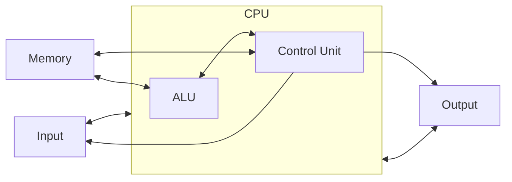
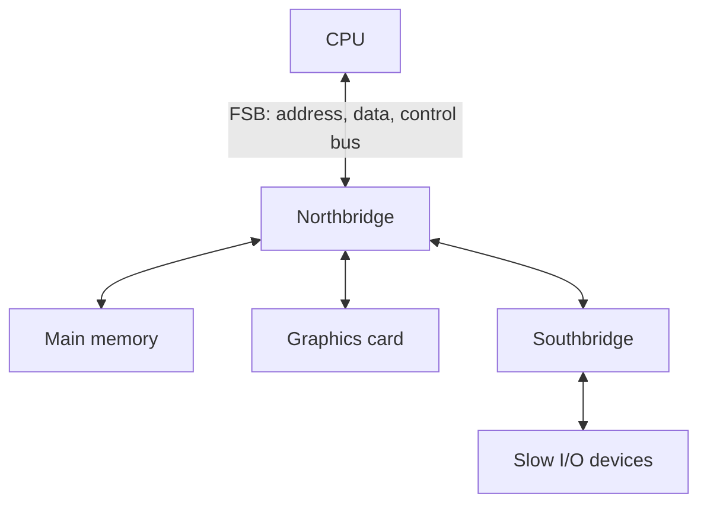
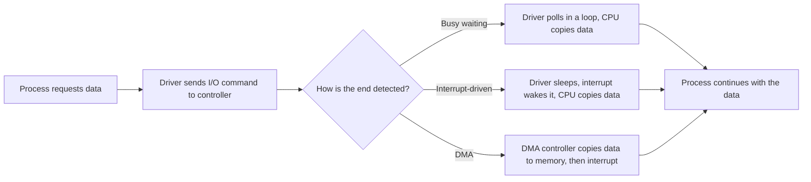
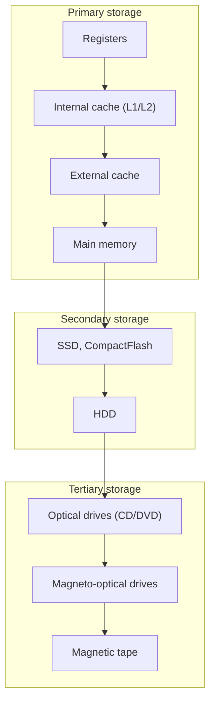
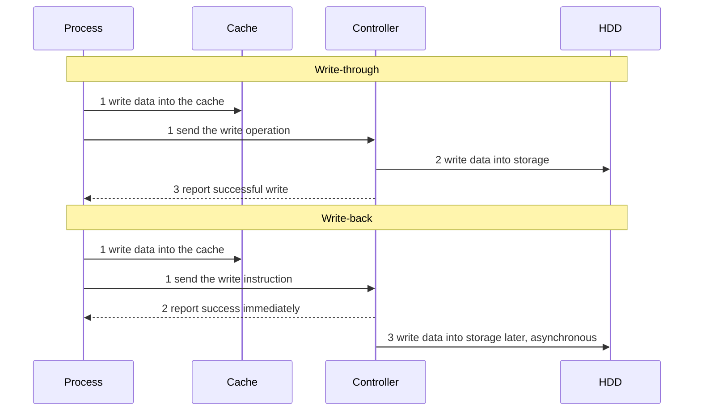
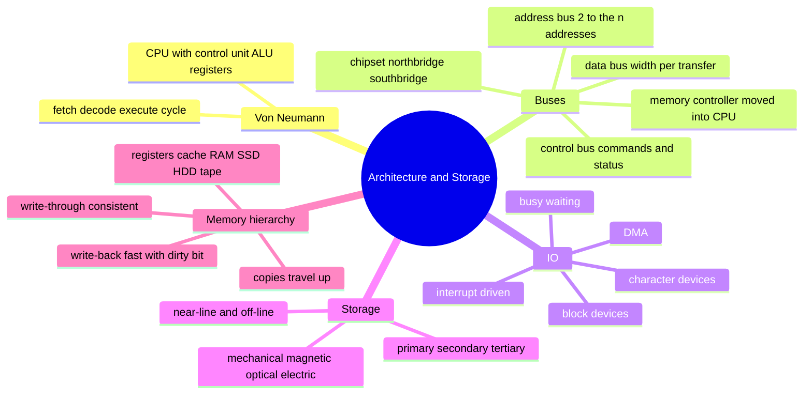

# Computer Architecture, I/O Devices & Computer Data Storage

> [!tip] 🧠 Study from the [[#🧠 Recall Layer|Recall Layer]] at the end of this note — mind map · deck [[OS-03 Architecture and Storage]] · gold examples · exam lens. This note is now your reference: search it, don't re-read it.

> [!Note] 💡 Notation Conventions
> - **CPU** = central processing unit; **ALU** = arithmetic logic unit; **CU** = control unit; **I/O** = input/output; **PIO** = Programmed I/O; **DMA** = Direct Memory Access; **FSB** = Front Side Bus; **PCH** = Platform Controller Hub; **SoC** = system-on-a-chip; **SRAM/DRAM** = static/dynamic random-access memory; **ROM** = read-only memory.
> - **Bus width:** a data bus with $w$ lines transfers $w$ bits per clock cycle. An address bus with $n$ lines can address at most $2^n$ memory units. The slides assume **byte addressing**, i.e. one unit is one byte.
> - **Units:** the slides use $\text{kB}, \text{MB}, \text{GB}, \text{TB}$ with powers of two ($1\,\text{MB} = 2^{20}$ bytes). The slide writes $2^{16} = 65\,\text{kB}$, which is $65\,536$ bytes.
> - "$\Rightarrow$ slide set $k$" marks a topic treated later in slide set $k$. It is only named here.
> - **Bus names** are fixed: *address bus*, *data bus*, *control bus*. In figures: dotted line = address bus, dashed line = data bus, solid line = control bus.
> - This slide set contains no theorems or proofs.

---

## 1. Learning Objectives and Why Hardware Matters

> [!Property] ⚙️ Learning Objectives
> After this slide set you should know or understand:
> **1.** the **Von Neumann architecture**;
> **2.** the hardware components: **CPU and bus systems**;
> **3.** the difference between **character devices** and **block devices**, and how reading from I/O devices works;
> **4.** which **computer data storage** exists: the **memory hierarchy**, **primary/secondary/tertiary** storage, and its functioning;
> **5.** how the **write policies** (write-through and write-back) work.
>
> Exercise sheet 3 repeats the relevant content.

> [!Note] 💡 Why Discuss the Hardware in an OS Course?
> Operating systems assist users and their processes in using the hardware. Without understanding CPU, memory, storage and bus systems, one cannot understand how an OS works. (Dijkstra: "Computer Science is no more about computers than astronomy is about telescopes.")

---

## 2. Von Neumann Architecture and the CPU

> [!Definition] 📖 Von Neumann Architecture
> The **Von Neumann architecture** (Von Neumann computer; developed 1946 by John von Neumann) is the structure of a **general-purpose computer** that is not limited to a fixed program and has input and output devices. In it:
> **1.** **data and programs are binary coded**;
> **2.** **data and programs are stored in the same memory**.
> Essential concepts were developed in 1936 by Konrad Zuse and implemented in 1937 in the Zuse Z1. Von Neumann's merit: pioneering the development and construction of computers in a scientific, mathematical way.



> [!Missing] Figure: Slides 4 and 5 and exercise sheet 1.7, Von Neumann diagram with Memory (top, outside the CPU), ALU and Control Unit (inside the CPU), Input and Output, connected by address (dotted), data (dashed) and control (solid) buses. The Mermaid diagram above shows the structure only, not the three bus types per connection.

> [!Definition] 📖 Central Processing Unit (CPU) and Its Components
> Most computer components are **passive** and controlled by the CPU. **Programs are sequences of machine instructions** stored in **successive memory addresses**, and the CPU executes them **step by step**.
> **Control Unit (CU):** interprets instructions, coordinates the other CPU components, controls the I/O devices and the control bus.
> **Arithmetic Logic Unit (ALU):** manipulates data and addresses, and carries out **logical** (NOT, AND, OR, XOR, ...) and **mathematical** (ADD, SUB, ...) operations.
> **Memory:** **registers** (short-term storage of operands and addresses, same speed as the CPU) and **cache and main memory** (memory for programs and data).
> According to the Von Neumann architecture the memory is **outside** the CPU. In modern systems, parts of the memory (registers and some cache levels) are **inside** the CPU.

> [!Warning] ⚠️ Possible Gap
> Slide 5 says the CPU "consists of 2 components" (ALU and Control Unit), while slide 6, exercise 1.1 and the **official solution** give **three: ALU, control unit, memory**. Answer three.

> [!Definition] 📖 Instruction Cycle (Fetch-Decode-Execute / Von Neumann Cycle)
> The CPU repeats this cycle from bootup until shutdown. Each phase may take several clock cycles.
> **1. FETCH:** fetch the command to be processed from memory into the **Instruction Register**.
> **2. DECODE:** the Control Unit resolves the command into **switching instructions** for the ALU.
> **3. FETCH OPERANDS:** fetch any parameters (operands) of the command from memory.
> **4. EXECUTE:** the ALU carries out the command (switching instructions).
> **5. UPDATE PROGRAM COUNTER:** the **Program Counter** register is set to the next command.
> **6. WRITE BACK:** the result is stored in a register, in main memory, or sent to an output device.

> [!Property] ⚙️ Today
> The Fetch-Decode-Execute cycle and the Von Neumann architecture are **still implemented by modern CPUs**. Differences: (a) a single bus connecting input and output devices directly with the CPU is impossible today, and (b) parts of the memory (registers, L1/L2/L3 cache) are inside the CPU.

## 📘 Examples & Applications

### Example 2.1: Exercise Sheet 3, Exercise 1.1, 1.2 and 1.7

**Using:** CPU components, Von Neumann architecture

> [!Example] 📘 Solutions
> **1.1 Three CPU components:** **Control Unit**, **Arithmetic Logic Unit (ALU)** and **Memory** (registers; cache inside the CPU in modern systems).
> **1.2 Three bus systems:** **address bus**, **data bus**, **control bus**.
> **1.7 Missing boxes in the diagram:**
> **Step 1.** The top box lies *outside* the CPU grey area $\Rightarrow$ **Memory**.
> **Step 2.** The two boxes inside the CPU: the upper one $\Rightarrow$ **ALU**, the lower one $\Rightarrow$ **Control Unit**.
> **Step 3.** The official diagram labels the memory box "**Memory (Register and Main Memory)**".

### Example 2.2: Exercise Sheet 3, Exercise 1.8 (the six steps)

**Using:** instruction cycle

> [!Example] 📘 Explain the Von Neumann cycle (a to f)
> **a) FETCH:** the instruction to be processed is fetched from memory into the instruction register.
> **b) DECODE:** the control unit translates the instruction into switching instructions for the ALU.
> **c) FETCH OPERANDS:** parameters (operands) needed by the instruction are fetched from memory.
> **d) EXECUTE:** the ALU carries out the instruction.
> **e) UPDATE PROGRAM COUNTER:** the program counter is set to the address of the next instruction.
> **f) WRITE BACK:** the result is written to a register, to main memory, or sent to an output device.

### Example 2.3: Tracing one instruction (constructed)

**Using:** instruction cycle, registers, buses

> [!Example] 📘 Execute "add the value at address $200$ to register $R_1$"
> **Assumptions (not from the slides):** the instruction is stored at address $100$ and occupies one address. $R_1 = 3$, memory at address $200$ holds $5$.
> **Step 1 (FETCH).** The program counter holds $100$. The CPU puts $100$ on the **address bus**, sends a read request on the **control bus**, and the instruction arrives on the **data bus** into the instruction register.
> **Step 2 (DECODE).** The control unit translates the instruction into switching instructions for the ALU ("add").
> **Step 3 (FETCH OPERANDS).** Address $200$ goes on the address bus, a read request on the control bus, and the value $5$ returns on the data bus.
> **Step 4 (EXECUTE).** The ALU computes $3 + 5 = 8$.
> **Step 5 (UPDATE PC).** The program counter becomes $100 + 1 = 101$.
> **Step 6 (WRITE BACK).** The result $8$ is stored in $R_1$.

---

## 3. Bus Systems: Data, Address and Control Bus

> [!Definition] 📖 Data Bus
> The **data bus** transmits **data** between CPU, main memory and I/O devices. The **number of lines** $w$ specifies **how much data can be transmitted per clock cycle**. It is usually equal to the **size of the ALU registers**. Modern CPUs have $w = 64$ lines, so the CPU transfers $64$ bits per clock cycle between itself and main memory.

> [!Definition] 📖 Address Bus
> The **address bus** transmits **memory addresses**. Memory addresses and I/O devices are accessed (addressed) via this bus. The **number of lines** $n$ specifies the **maximum number of memory addresses**, $2^n$.

> [!Definition] 📖 Control Bus
> The **control bus** transmits **commands** (e.g. read and write requests) from the CPU and returns **status signals** from the I/O devices. It also has lines for **interrupt requests** from I/O devices to the CPU. Typical number of lines: $\leq 10$.

> [!Property] ⚙️ Address Bus vs. Control Bus
> Components are **addressed via the address bus** and **instructed via the control bus** what to do.

| CPU | Data bus width $w$ |
|---|:-:|
| 4004, 4040 | 4 bits |
| 8008, 8080, 8085, 8088 | 8 bits |
| 8086 (XT), 80286 (AT), 80386SX | 16 bits |
| 80386DX, 80486SX/DX/DX2/DX4 | 32 bits |
| Pentium I/MMX/II/III/IV/D/M, Celeron, Core Solo/Duo, Core 2 Duo/Extreme/Quad, Pentium Pro, Pentium Dual-Core, Core i7, Itanium, AMD Phenom-II, Itanium 2, AMD64 | 64 bits |

| CPU | Address bus lines $n$ | Max. addressable $2^n$ bytes |
|---|:-:|:-:|
| 4004, 4040 | 4 | $2^4 = 16$ B |
| 8008 | 8 | $2^8 = 256$ B |
| 8080, 8085 | 16 | $2^{16} = 65$ kB |
| 8088, 8086 (XT) | 20 | $2^{20} = 1$ MB |
| 80286 (AT), 80386SX | 24 | $2^{24} = 16$ MB |
| 80386DX, 80486, Pentium I to IV/D/M, Celeron, Core Solo/Duo, Core 2, Pentium Pro, Pentium Dual-Core, Core i7 | 32 | $2^{32} = 4$ GB |
| (36-bit entry, row without named CPUs on the slide) | 36 | $2^{36} = 64$ GB |
| Itanium | 44 | $2^{44} = 16$ TB |
| AMD Phenom-II, Itanium 2, AMD64 | 48 | $2^{48} = 256$ TB |

> [!Warning] ⚠️ Possible Gap
> In the address-bus table of the slide, the **36-bit** row ($2^{36} = 64$ GB) is listed without a visible CPU name in the extracted text, because it shares a cell group with the 32-bit row (the Core i7 appears in the same cell). Which CPUs have 36 lines cannot be read reliably.

> [!Property] ⚙️ Link to Slide Set 2
> The **bit number** of an OS (slide set 2) is limited by the **address bus**. A $32$ bit address bus allows $2^{32}$ addresses, i.e. $4$ GB with byte addressing.

## 📘 Examples & Applications

### Example 3.1: Exercise Sheet 3, Exercise 1.3 (tasks of the buses)

**Using:** data bus, address bus, control bus

> [!Example] 📘 Tasks of the three digital bus systems
> **Data bus:** transmits data between CPU, main memory and I/O devices (the number of lines gives the data per clock cycle).
> **Address bus:** transmits memory addresses to address memory and I/O devices (the number of lines gives the maximum number of addresses).
> **Control bus:** transmits commands (read/write requests) from the CPU and status signals from the I/O devices, including interrupt requests.

### Example 3.2: Dimensioning buses (constructed)

**Using:** address bus width, data bus width

> [!Example] 📘 Questions
> **(a) How many address lines are needed to address $8$ GB (byte-addressed)?**
> **Step 1.** $8\,\text{GB} = 2^3 \cdot 2^{30} = 2^{33}$ bytes.
> **Step 2.** $n = 33$ lines. A 32-line bus gives only $2^{32} = 4$ GB, so it is not sufficient.
> **(b) How many clock cycles does it take to move a $4096$-byte block over a $64$-line data bus (ideal, no overhead)?**
> **Step 1.** $64$ bits $= 8$ bytes per clock cycle.
> **Step 2.** $\dfrac{4096}{8} = 512$ clock cycles.
> **(c) The 8086 has $20$ address lines. How many bytes can it address?**
> **Step 1.** $2^{20} = 1\,048\,576$ bytes $= 1$ MB.

---

## 4. Chipset and Bus Systems in Modern Computers

> [!Definition] 📖 Chipset, Northbridge, Southbridge, FSB (until 2008/9)
> The **chipset** connects the CPU with the rest of the computer system. It consists of:
> **Northbridge:** located **close to the CPU** for rapid data transfer. Connects **main memory** and **graphics card(s)** with the CPU.
> **Southbridge:** used for "**slow**" connections.
> The bus between CPU and chipset is the **Front Side Bus (FSB)**. It contains the address bus, data bus and control bus.



> [!Property] ⚙️ Relocation into the CPU
> **1.** For performance and cost reasons, more and more chipset functions move into the CPU. Around **2008** the **memory controller** moved from the northbridge into the CPU, leaving only the **PCIe controller** in the northbridge. Around **2009** the **PCIe interface** followed.
> **2.** In modern systems the **northbridge is relocated into the CPU** (benefit: **reduced cost** for the overall system), as shown for the Intel **P55 (2009)** and **P67 (2011)** chipset generations. Since then, the southbridge is also called **Platform Controller Hub (PCH)**.
> **3.** In contrast to the Von Neumann architecture, I/O devices are **not directly connected to the CPU**. **Controllers** for I/O devices operate between devices and the CPU. Today there are various serial and parallel bus systems, and **point-to-point connections** are used more and more.

| | **Internal buses** | **External buses** |
|---|---|---|
| **Parallel** | PATA (IDE), PCI, ISA, SCSI | PCMCIA, SCSI |
| **Serial** | SATA, PCI-Express | Ethernet, FireWire, USB, eSATA |

> [!Property] ⚙️ Modern Architecture: Chiplets (Slide 15)
> **1.** The main northbridge functions are integrated into the **processor package**. **CPU cores and their caches** reside on **CPU chiplets** (Core Complex Dies, CCDs).
> **2.** A separate **I/O chiplet (IOD)** integrates the **memory controller, PCIe connectivity, USB controllers and an integrated GPU**. The **external chipset** (southbridge) provides additional I/O interfaces.
> **3.** Modern x86 CPUs have a **growing number of chiplets**: one (Ryzen 7 9700X), two (Ryzen 9 9950X), 12 (Threadripper PRO 7995WX) or even 16 (EPYC 9755, Zen 5).
> **4.** Figure example: AMD Ryzen 9 9950X with X870E chipset (2024). Each Zen 5 CCD has **8 cores, L1/L2 per core and a shared L3 per CCD**. The chiplets connect to the IOD via the "Infinity Fabric".

> [!Property] ⚙️ Latest Developments: Unified Memory (Slide 16)
> **1.** **Apple silicon** integrates **CPU, GPU, NPU, memory controllers and numerous I/O controllers** into one **system-on-a-chip (SoC)**. **No separate chipset** is required.
> **2.** CPU, GPU and NPU **share a common pool of main memory (unified memory)**. This **avoids additional copying of data** between CPU and GPU memory, reducing overhead and energy consumption.
> **3.** A **system-level cache (SLC)** reduces main-memory accesses.
> **4.** Figure example: Apple M5 (2025), 10 CPU cores (4 high-performance + 6 power-efficiency), GPU with 10 cores, NPU with 16 cores.

> [!Missing] Figure: Slides 12 to 16, chipset diagrams (northbridge/southbridge, memory controller shift, P55/P67), AMD Ryzen 9 9950X with X870E chipset (CCDs, IOD, PCIe, DDR5, USB, SATA, Ethernet), and Apple M5 SoC (CPU cores, GPU, NPU, SLC, memory controller, I/O controllers).

## 📘 Examples & Applications

### Example 4.1: Exercise Sheet 3, Exercise 1.4 to 1.6 (FSB and chipset)

**Using:** FSB, chipset, northbridge, southbridge

> [!Example] 📘 Solutions
> **1.4 Front Side Bus (FSB):** the bus between the **CPU and the chipset**. It contains the address bus, data bus and control bus.
> **1.5 Components of the chipset:** **northbridge** and **southbridge**.
> **1.6 Tasks:** the northbridge, close to the CPU, connects **main memory and graphics card(s)** to the CPU for rapid transfer. The southbridge handles the "slow" connections, **like Ethernet, SATA and USB**. Today the northbridge is inside the CPU and the southbridge is the PCH.

### Example 4.2: Classifying bus systems

**Using:** internal/external, serial/parallel buses

> [!Example] 📘 Place USB, SATA, PCI and SCSI
> **Step 1.** USB: serial, **external**. **Step 2.** SATA: serial, **internal** (eSATA is its external variant). **Step 3.** PCI: parallel, **internal**. **Step 4.** SCSI: parallel, both internal and external.

---

## 5. Input/Output Devices

> [!Definition] 📖 Character Device
> A **character device** communicates with the CPU **on arrival/request of each single character**. **Examples:** mouse, keyboard, printer, terminal, magnetic tape.

> [!Definition] 📖 Block Device
> A **block device** transfers data **only when an entire block** (e.g. 1 to 4 kB) is present. **Examples:** HDD, SSD, CD/DVD drive, floppy drive.

> [!Property] ⚙️ Distinguishing Criterion
> I/O devices are distinguished by their **minimum transfer unit**: single character vs. whole block.

> [!Property] ⚙️ Reading a Record from an HDD (Basic Steps)
> **1.** The CPU receives from a process the request to read a record from the HDD.
> **2.** The CPU sends an **I/O command via the driver to the controller**.
> **3.** The **controller locates** the record on the HDD.
> **4.** The process receives the requested record.
> Three concepts exist for how processes read data: **busy waiting**, **interrupt-driven**, **DMA**.

### 5.1 Busy Waiting

> [!Definition] 📖 Busy Waiting
> The **driver sends the request** to the device and **waits in an infinite loop** until the controller indicates that the data is available. Then the data is written into memory and the process continues. 
> **Example:** **Programmed I/O (PIO)**: the CPU accesses the device memory areas via read and write commands and copies data between devices and main memory (e.g. PATA HDDs in PIO mode, legacy serial and parallel ports, PS/2 keyboard and mouse ports).
> **Benefit:** **no additional hardware** required.
> **Drawbacks:** causes **CPU workload** and **slows down the simultaneous execution** of multiple processes, because the CPU must **check periodically** whether the data is available.

### 5.2 Interrupt-Driven

> [!Definition] 📖 Interrupt-Driven I/O
> **Precondition:** an **interrupt controller** and a **control bus line** for interrupts exist. The driver initializes the I/O operation and **sleeps** until the controller sends an interrupt. The CPU is **not blocked**, and the OS can assign the CPU to other processes. On the interrupt, the driver is woken and gets the CPU. The CPU **fetches the data from the controller and stores it in memory**, then the interrupted process gets the CPU back.
> **Benefits:** the CPU is **not blocked**, and **multiple processes can run simultaneously**.
> **Drawback:** **additional hardware** (interrupt controller) is required.

### 5.3 Direct Memory Access (DMA)

> [!Definition] 📖 Direct Memory Access (DMA)
> **Precondition:** a **DMA controller**. It **transfers data directly between main memory and the I/O device** (e.g. HDD/SSD, sound card, network adapter, TV/DVB tuner card) and **triggers an interrupt after the transfer**. **Example:** **Ultra-DMA (UDMA)**, the successor protocol of the PIO mode; it specifies how data is transferred between the DMA controller and main memory.
> **Benefit:** relieves the CPU of **copying individual data words** (units of data the CPU can process in one step).
> **Drawback:** **additional hardware** (DMA controller) is required. It has been integrated in the chipset since the late 1980s.

| Method | CPU involvement | Extra hardware | Benefit | Drawback |
|---|---|---|---|---|
| Busy waiting (PIO) | polls in a loop and copies data | none | no extra hardware | CPU load, slows other processes |
| Interrupt-driven | woken on interrupt, copies data | interrupt controller | CPU not blocked, multiple processes | extra hardware |
| DMA | only the final interrupt | DMA controller | CPU relieved of copying | extra hardware |



## 📘 Examples & Applications

### Example 5.1: Exercise Sheet 3, Exercise 2 (I/O devices)

**Using:** character/block devices, busy waiting, interrupt-driven, DMA

> [!Example] 📘 Solutions
> **2.1 Two groups:** **character devices** and **block devices**.
> **2.2 Operating principles:** a character device communicates with the CPU for every single character. A block device transfers data only when a whole block (e.g. $1$ to $4$ kB) is present.
> **2.3 Two examples each:** character: **mouse, keyboard** (also printer, terminal, magnetic tape). Block: **HDD, SSD** (also CD/DVD drive, floppy drive).
> **2.4 Three ways to read data:** **busy waiting**, **interrupt-driven**, **direct memory access (DMA)**.
> **2.5 Benefit and drawback of each:**
> **Busy waiting:** benefit: no additional hardware. Drawback: CPU workload, simultaneous processes are slowed down.
> **Interrupt-driven:** benefit: CPU not blocked, processes can run simultaneously. Drawback: interrupt controller required.
> **DMA:** benefit: reading data causes **no CPU workload** and does not slow down the simultaneous execution of multiple processes. Drawback: DMA controller required.

### Example 5.2: Choosing a method (constructed)

**Using:** busy waiting, interrupt-driven, DMA, block devices

> [!Example] 📘 Which method for which device?
> **Step 1.** A PS/2 keyboard sends single characters at low rate $\Rightarrow$ character device; PIO/busy waiting or interrupts are sufficient.
> **Step 2.** An SSD transfers blocks $\Rightarrow$ block device; **DMA** avoids copying every data word through the CPU.
> **Step 3.** A background process should keep running while a disk operation is in progress $\Rightarrow$ avoid busy waiting, which would waste CPU time on polling.

---

## 6. Computer Data Storage: Technologies

> [!Definition] 📖 Computer Data Storage and the Price-Performance Reason
> Computer data storage **stores the data and the executables**. Different storage is connected via different bus systems $\Rightarrow$ **memory hierarchy**. The reason for the hierarchy is the **price-performance ratio**: **the better the performance of a storage, the higher its acquisition cost and the smaller its capacity.**

> [!Definition] 📖 Random Access vs. Sequential Access
> **Random access** means the medium need **not be searched sequentially from the beginning** (as with magnetic tape) to find a specific record (file). The heads of magnetic disks or a laser can **jump to any point of the medium within a known maximum period**.

| Storage | Write | Read | Access | Movable parts | Persistent | Outdated (gray on slide) |
|---|---|---|:-:|:-:|:-:|:-:|
| Punched tape | mechanic | | sequential | yes | yes | yes |
| Punch card | mechanic | | sequential | yes | yes | yes |
| Magnetic tape | magnetic | | sequential | yes | yes | yes (as shaded) |
| Magnetic stripe card | magnetic | | sequential | yes | yes | yes |
| Drum memory | magnetic | | random | yes | yes | yes |
| Magnetic-core memory | magnetic | | random | no | yes | yes |
| Bubble memory | magnetic | | random | no | yes | yes |
| Cache and registers (SRAM) | electric | | random | no | **no** | no |
| Main memory (DRAM) | electric | | random | no | **no** | no |
| Flash memory (USB drive, SSD, CF/SD card) | electric | | random | no | yes | no |
| Compact cassette (Datasette) | magnetic | | sequential | yes | yes | yes |
| Floppy disk | magnetic | | random | yes | yes | yes |
| Hard disk drive | magnetic | | random | yes | yes | no |
| CD-ROM/DVD-ROM | mechanic | optical | random | yes | yes | no |
| CD-R/CD-RW/DVD-R/DVD-RW | optical | | random | yes | yes | no |
| MiniDisc | magneto-optical | optical | random | yes | yes | yes |
| Magneto-optical disc (MO-Disk) | magneto-optical | optical | random | yes | yes | yes |

> [!Warning] ⚠️ Possible Gap
> **(1)** The outdated column is read from the gray shading of the slide image ("gray background means outdated/obsolete technology"), and the shading of the optical rows is hard to read. **(2)** **Magnetic tape** is shaded as outdated, yet slide 28 lists it as tertiary (archive) storage and near-line storage uses tape libraries. The slides do not resolve this.

### 6.1 Mechanical, Magnetic, Magneto-Optical and Electric Storage

> [!Property] ⚙️ Mechanical Data Storage
> - A **punch card** usually represents **one line of text with 80 characters** (or equivalent binary data).
> - **Punched tape:** $8$ data holes plus narrower feed holes, so **1 byte per row**.
> - **CDs/DVDs** store data as **pits and lands** on a plastic material. Mass production is **pressing**, by **injection molding** with a negative (stamper).

> [!Property] ⚙️ Magnetic Data Storage
> Data is stored on **magnetizable material**. **Read-and-write heads** detect and modify the magnetization (exception: **magnetic-core memory**). Heads may be **movable** (HDD) or **fixed** (magnetic tape).
> **Rotating:** hard disk drive ($\Rightarrow$ slide set 4), floppy disk, drum memory.
> **Non-rotating:** magnetic-core memory, magnetic tape, magnetic stripe card, Datasette, bubble memory.

> [!Property] ⚙️ Magneto-Optical Data Storage
> Rotating medium. **Write operations are magnetic**, but the medium must first be **heated to the Curie point** (by laser). This makes it **insensitive to magnetic fields**. **Read operations are optical**: differently magnetized areas reflect light differently. It is **obsolete** (popular about 1990 to 2005, especially in Japan).

> [!Property] ⚙️ Electric Data Storage
> **Volatile (RAM):**
> **SRAM:** information stored as the **state of flip-flop circuits**, kept as long as voltage is present. **Faster and more expensive than DRAM.** Used for **cache and CPU registers**.
> **DRAM:** information stored in **capacitors**, requires **periodic refreshing**. Data is lost without operating voltage or if the refresh is too late because of leakage currents. Used for **main memory**.
> **Non-volatile:** **ROM** (e.g. EEPROM, electrically erasable programmable ROM) and **flash memory** ($\Rightarrow$ slide set 4). RAM is volatile main memory, while ROM is a non-volatile read-only memory.

## 📘 Examples & Applications

### Example 6.1: Exercise Sheet 3, Exercise 3.1 to 3.6 (digital data storage)

**Using:** storage table, random access, volatility

> [!Example] 📘 Solutions
> **3.1 Mechanic storage:** **punched tape**, **punch card**, or the mass production of CDs/DVDs (**pressing**).
> **3.2 Two rotating magnetic storages:** **hard disk drive** and **floppy disk** (also drum memory).
> **3.3 Two non-rotating magnetic storages:** **magnetic tape** and **magnetic-core memory** (also magnetic stripe card, Datasette, bubble memory).
> **3.4 Four benefits of storage without moving parts (official):** **lower power consumption**, **less waste heat**, **mechanical robustness**, **no noise generation**.
> **3.5 Random access:** the medium does not have to be searched sequentially from the beginning (as with magnetic tape) to find a record. A head or laser can jump to any point within a known maximum period.
> **3.6 Non-persistent storage:** **main memory (DRAM)** or **cache/registers (SRAM)**.

### Example 6.2: Exercise Sheet 3, Exercise 4 (punch card encoding)

**Using:** punch card encoding (zone lines and digit lines), mechanical data storage

> [!Example] 📘 Record the string `OPERATING SYSTEMS` on a punch card
> **Encoding rules (from the sheet):** digits $0$ to $9$ are punched directly in digit lines $0$ to $9$. **A to I:** zone line $12$ and digit line $1$ to $9$ ($A=1, B=2, \dots, I=9$). **J to R:** zone line $11$ and digit line $1$ to $9$ ($J=1, \dots, R=9$). **S to Z:** digit line $0$ (zone line $10$) and digit line $2$ to $9$ ($S=2, T=3, \dots, Z=9$). One column per character, so $17$ characters use columns $1$ to $17$.
> **Step 1.** Letter position in each group: O is the 6th of J to R ($J=1, K=2, L=3, M=4, N=5, O=6$) and so on.
> **Step 2.** Derive the holes for each column:
>
> | Column | Char | Rule | Holes (zone / digit line) |
> |:-:|:-:|---|:-:|
> | 1 | O | J to R, $O = 6$ | 11 / 6 |
> | 2 | P | J to R, $P = 7$ | 11 / 7 |
> | 3 | E | A to I, $E = 5$ | 12 / 5 |
> | 4 | R | J to R, $R = 9$ | 11 / 9 |
> | 5 | A | A to I, $A = 1$ | 12 / 1 |
> | 6 | T | S to Z, $T = 3$ | 0 / 3 |
> | 7 | I | A to I, $I = 9$ | 12 / 9 |
> | 8 | N | J to R, $N = 5$ | 11 / 5 |
> | 9 | G | A to I, $G = 7$ | 12 / 7 |
> | 10 | (space) | no holes | none |
> | 11 | S | S to Z, $S = 2$ | 0 / 2 |
> | 12 | Y | S to Z, $Y = 8$ | 0 / 8 |
> | 13 | S | S to Z, $S = 2$ | 0 / 2 |
> | 14 | T | S to Z, $T = 3$ | 0 / 3 |
> | 15 | E | A to I, $E = 5$ | 12 / 5 |
> | 16 | M | J to R, $M = 4$ | 11 / 4 |
> | 17 | S | S to Z, $S = 2$ | 0 / 2 |
>
> **Step 3.** Punch exactly the listed holes in each column; the remaining columns $18$ to $80$ stay empty.
> **Check:** the card holds $80$ columns, so $80 - 17 = 63$ columns remain unused. The sheet does not specify how a space is encoded. Treating it as an unpunched column is an assumption. The official solution shows the filled card as a figure, with the string `OPERATING SYSTEMS` printed above columns $1$ to $17$ and a blank column between the two words.

> [!Missing] Figure: Exercise sheet 3, page 3, the punch card diagram (zone lines 12 and 11, digit lines 0 to 9, columns 1 to 80). The table above lists the holes per column instead.

---

## 7. Memory Hierarchy

> [!Definition] 📖 Primary, Secondary and Tertiary Storage
> **Primary storage:** the CPU has **direct access** to it (registers, internal cache, external cache, main memory).
> **Secondary storage:** storage **accessed via a controller** (SSD/CompactFlash, HDD).
> **Tertiary storage:** **not permanently connected** to the computer. **Main purpose: archiving** (optical drives CD/DVD, magneto-optical drives, magnetic tape).
> Primary and secondary storage are **permanently connected** to the computer, which gives **quick access** to the stored data.

> [!Definition] 📖 Near-Line and Off-Line Storage
> **Near-line storage:** connected to the system **automatically and without human intervention** (e.g. **tape library**).
> **Off-line storage:** media are kept in cabinets or storage rooms and must be **connected manually**. Removable HDDs are, strictly speaking, also off-line storage.



> [!Property] ⚙️ Cost, Capacity, Speed
> Moving **up** the pyramid (towards the registers), **acquisition cost rises** and **capacity shrinks**, because better performance costs more and is smaller. Moving **down**, capacity is larger and cost per unit lower.

> [!Warning] ⚠️ Possible Gap
> The pyramid on slide 28 labels the upward arrow with "higher acquisition cost, **higher access time**, smaller capacity". A higher position is the faster level (registers), so "higher access time" contradicts the price-performance statement on slide 22. This note follows slide 22: *the better the performance, the higher the cost and the smaller the capacity.*

> [!Definition] 📖 Functioning of the Memory Hierarchy
> **1.** When a record is **accessed for the first time**, a **copy** is created and the copy **travels up the hierarchy** to the top layer.
> **2.** If the record is **modified**, the modification must at some point be **passed down (written back)**.
> **3.** During write back, the copies at **all layers** must be updated to avoid **inconsistencies**.
> **4.** Modifications **cannot be passed directly to the lowest layer** (the original).
> **5.** The uppermost levels practically always **lack free capacity**, so records must be **replaced**.

## 📘 Examples & Applications

### Example 7.1: Exercise Sheet 3, Exercise 3.7 to 3.11 (categories)

**Using:** primary/secondary/tertiary storage, near-line/off-line

> [!Example] 📘 Solutions
> **3.7 CPU can access directly:** **primary storage**.
> **3.8 Accessed only via a controller:** **secondary storage and tertiary storage** (official solution).
> **3.9 Two examples per category (official):** primary: **registers, cache, main memory**. Secondary: **HDD, SSD, CF/SD flash storage card**. Tertiary: **CD/DVD drive, magnetic tape**.
> **3.10 Two categories of tertiary storage:** **near-line storage** and **off-line storage**.
> **3.11 Description:** near-line: attached automatically, without human intervention (e.g. tape library). Off-line: media kept in cabinets or storage rooms and attached manually (e.g. removable HDDs).

### Example 7.2: Life of a record in the hierarchy (constructed)

**Using:** memory hierarchy functioning

> [!Example] 📘 A file block is read, modified and saved
> **Step 1.** The block is stored on the HDD (secondary storage).
> **Step 2.** First access: a **copy** is created and travels up to main memory and cache, so the CPU can use it quickly.
> **Step 3.** The process modifies the cached copy. Now cache and HDD differ (potential **inconsistency**).
> **Step 4.** At some point the modification is **written back** and the copies at all layers are updated. It cannot be written directly to the lowest layer, bypassing the levels in between.
> **Step 5.** When the top level is full, the record is replaced by another one.

---

## 8. Cache Write Policies

> [!Definition] 📖 Write-Through
> **Write-through:** modifications are **immediately propagated** to the lower storage layers.
> **Advantage:** **consistency is ensured.**
> **Drawback:** **lower performance.**

> [!Definition] 📖 Write-Back
> **Write-back:** modifications are propagated **when the corresponding page is removed from the cache**.
> **Advantage:** **better performance.**
> **Drawback:** modifications are **lost in the event of a system failure**.
> For each cached page a **dirty bit** is stored in the cache to indicate **whether the page has been modified**.



> [!Property] ⚙️ Implication
> Write-through trades **performance for consistency**, and write-back trades **consistency (risk of data loss)** for **performance**. In write-back, the **dirty bit** tells the system which pages must be written back when they are removed from the cache. Clean pages can simply be discarded.

## 📘 Examples & Applications

### Example 8.1: Exercise Sheet 3, Exercise 5 (write policies)

**Using:** write-through, write-back, dirty bit

> [!Example] 📘 Solutions
> **5.1 Two basic write policies:** **write-through** and **write-back**.
> **5.2 May cause inconsistencies:** **write-back**.
> **5.3 Lower performance:** **write-through**.
> **5.4 Uses dirty bits:** **write-back**.
> **5.5 Reason for dirty bits:** they indicate, for each cached page, whether it has been **modified**. Only modified (dirty) pages must be written back to the lower layer when they are removed from the cache.

### Example 8.2: Counting writes and lost updates (constructed)

**Using:** write-through, write-back, dirty bit, consistency

> [!Example] 📘 Compare the two policies
> **Event sequence:** modify page $A$, modify page $A$ again, modify page $B$, remove $A$ from the cache, remove $B$ from the cache.
> **Write-through:**
> **Step 1.** Every modification goes to storage immediately: $3$ writes.
> **Step 2.** On removal, nothing is left to write.
> **Total:** $3$ storage writes.
> **Write-back:**
> **Step 1.** The first and second modification of $A$ only set the dirty bit of $A$. Same for $B$.
> **Step 2.** Removing $A$ writes it once, removing $B$ writes it once.
> **Total:** $2$ storage writes.
> **System failure after the third modification, before any removal:**
> **Write-through:** all $3$ modifications are already in storage, so nothing is lost.
> **Write-back:** pages $A$ and $B$ are still dirty in the cache, so **both modifications are lost**.
> **Conclusion:** write-back needs fewer writes ($2 < 3$) but risks data loss. Write-through is consistent but slower.

---

## 9. Registers, Cache and Main Memory

> [!Definition] 📖 Registers
> Data in **registers** can be accessed by the CPU **immediately**. Registers operate at the **same clock speed as the CPU**. Types:
> **Data registers (accumulators):** store ALU operands and results, e.g. **EAX, ECX, EDX, EBX** (32 bit), **RAX, RBX, RCX, RDX** (64 bit) ($\Rightarrow$ slide set 7).
> **Address registers:** memory addresses of operands and instructions, e.g. **base register** (segment register) and **index register** (offset) ($\Rightarrow$ slide set 5).
> **Program counter (instruction pointer):** the address of the **next instruction**.
> **Instruction register:** the instruction **currently being executed**.
> **Stack pointer:** the address at the **current end of the stack** ($\Rightarrow$ slide set 7).

> [!Definition] 📖 Cache (Buffer Memory) and Cache Levels
> **Cache** stores **copies of parts of main memory** to **accelerate access** to that data.
> **L1 cache (First Level):** integrated into the CPU.
> **L2 cache (Second Level):** slower and bigger, originally **external** to the CPU. Since 1999/2000, CPU vendors increasingly integrate it into the CPU.
> **L3 cache (Third Level):** established as a **CPU-external** cache when L2 moved inside. In modern CPUs (Intel Core i, AMD Phenom II) it is integrated too. In multi-core CPUs with integrated L3, **cores share the L3 cache**, while **each core has its own L1 and L2 cache**.
> **L4 cache:** some architectures, e.g. Intel Itanium 2 (2003): $64$ MB, some Intel Haswell CPUs (2013): $128$ MB.

| Level | Typical capacity |
|:-:|:-:|
| L1 | 4 kB to 256 kB |
| L2 | 256 kB to 4 MB |
| L3 | 1 MB to 16 MB |

> [!Definition] 📖 Main Memory (RAM)
> **Main memory = Random Access Memory (RAM).** Capacity (slide): a few hundred MB up to several GB. **All CPU requests that the cache cannot answer** are forwarded to main memory. RAM is **volatile**, while ROM is a **non-volatile read-only** memory.

> [!Warning] ⚠️ Possible Gap
> The capacity figures (L1/L2/L3 sizes, "a few hundred MB up to several GB" for RAM) are dated compared with the chiplet examples earlier in the same slide set (e.g. large shared L3 per CCD). Treat them as the slides' "typical" values.

> [!Note] 💡 Recap and Outlook
> We have clarified: storage holds data and executables, a memory hierarchy exists because of the price-performance ratio, a first-accessed record is copied up the hierarchy, records must be replaced since top levels lack capacity, and modifications must be written back. **Still to discuss:** memory management and addressing of computer data storage ($\Rightarrow$ slide set 5).

## 📘 Examples & Applications

### Example 9.1: Where does each item live? (constructed)

**Using:** registers, cache levels, main memory

> [!Example] 📘 Classify
> **Step 1.** Address of the next instruction $\Rightarrow$ **program counter** (a register).
> **Step 2.** The instruction currently executed $\Rightarrow$ **instruction register**.
> **Step 3.** Operand $3$ and result $8$ of an addition $\Rightarrow$ **data registers** (e.g. RAX in a 64-bit CPU).
> **Step 4.** Copy of frequently used main-memory data, private to a core $\Rightarrow$ **L1/L2 cache**. Shared among the cores of a multicore CPU $\Rightarrow$ **L3 cache**.
> **Step 5.** Everything the cache cannot answer $\Rightarrow$ **main memory (DRAM)**.

---

## 10. Permissions and Links (Exercise Sheet 3, Exercise 6)

> [!Note] 💡 Source of the Solutions
> Slide set 3 does not cover permissions or links. The answers follow the **official solution of exercise sheet 3**, with notes where I add detail or flag an issue. Permission values ($r=4$, $w=2$, $x=1$) are covered in Note 2 (slide set 2 / sheet 2, Exercise 4).

## 📘 Examples & Applications

### Example 10.1: Exercise Sheet 3, Exercise 6

**Using:** permissions, umask, hard and symbolic links, inodes, link count

> [!Example] 📘 Exercise 6.1 to 6.9 with official solutions
> **6.1 Make `script.sh` executable (any one of these works, official):** `chmod 777 script.sh`, `chmod 700 script.sh`, `chmod 500 script.sh`, `chmod u+rwx script.sh`, `chmod u+rx script.sh`. (My `chmod u+x script.sh` also works.)
>
> **6.2 New files should get `-r--r--r--` (mode $444$).** Use `umask 222`.
> **Step 1.** New files start from the base mode $666$ ($rw$ for all).
> **Step 2.** `umask` clears the bits that are set in the mask: $666$ with the write bits ($2$) cleared gives $444$.
> **Step 3.** Fix afterwards with a normal mask such as `umask 022` (new files $644$).
>
> **6.3 Create and enter `BTS_Links`, try to erase `.`**
> ```bash
> mkdir ~/BTS_Links && cd ~/BTS_Links
> rm .        # fails: refusing to remove '.' or '..'
> rmdir .     # fails as well
> ```
> `.` is a directory entry that points to the directory itself, and it cannot be removed.
>
> **6.4 Create the file and both links.**
> ```bash
> touch Original
> ln Original HardLink        # hard link
> ln -s Original SymbLink     # symbolic link
> ```
>
> **6.5 Inodes:** `ls -li Original SymbLink` (add `HardLink` to see all three).
> **Step 1.** `Original` and `HardLink` show the **same inode number** (two directory entries for one inode, link count $2$).
> **Step 2.** `SymbLink` has its **own inode** and is a small file that contains the path `Original`.
>
> **6.6 Copying hard links (official):** possible **inside one file system**. Impossible to another file system or partition, because **hard links are just file system entries that refer to an inode**.
> **6.7 Copying symbolic links (official):** possible, because they are **just (text) files containing path information**.
> **6.8 Conclusions (official):** copying a **hard link** creates a **further directory entry that refers to the inode**. Copying a **symbolic link** creates a **new file with a new inode number**.
> **6.9 Link count of directories (official):** a directory has link count $2$ from creation, and each additional subdirectory adds $1$. Hence $\text{number of subdirectories} = \text{link count} - 2$.

> [!Warning] ⚠️ Possible Gap
> **(1)** For 6.6/6.8: plain `cp HardLink Copy` on GNU/Linux copies the data into a **new inode**. The behavior the official solution describes (another entry for the same inode) is what `ln` or `cp -l` does. Answer as the official solution does, and check with `ls -li`.
> **(2)** For 6.9: the official text says "." refers to the directory one level above. Technically `.` refers to the directory **itself** and `..` to the parent. The count comes from the entry in the parent, the `.` entry, and one `..` per subdirectory. The formula is unchanged.

---

## 11. Wildcards and Filters (Exercise Sheet 3, Exercise 7)

> [!Note] 💡 Source of the Solutions
> Wildcards are not covered in the slides. The answers follow the **official solution of exercise sheet 3**. `*` matches any string, `?` exactly one character, `[...]` one character from a set or range, `[!...]` one character not in the set.

## 📘 Examples & Applications

### Example 11.1: Exercise Sheet 3, Exercise 7

**Using:** shell wildcards (`*`, `?`, `[ ]`)

> [!Example] 📘 Exercise 7.1 to 7.7 with solutions
> **7.1 Create the files.**
> ```bash
> mkdir ~/DiverseDateien
> cd ~/DiverseDateien
> touch abcdefg.bat abcxyz.bat xyzabc.bat
> touch cdata{1..7}.sav
> touch datei{1..10}.txt
> ```
> This creates $3 + 7 + 10 = 20$ files.
> **7.2 Names starting with `datei`:** `ls datei*`
> **7.3 Names containing `cd`:** `ls *cd*` (matches `cdata1.sav` to `cdata7.sav`).
> **7.4 `cdata2.sav` to `cdata5.sav`:** `ls cdata[2-5].sav`
> **7.5 `c` or `z` at position 3:** `ls ??[cz]*`
> **Step 1.** `??` skips positions 1 and 2. **Step 2.** `[cz]` requires `c` or `z` at position 3. **Step 3.** `*` allows anything after.
> **Result:** `abcdefg.bat`, `abcxyz.bat`, `xyzabc.bat` (the `cdata` files have `a` at position 3 and the `datei` files `t`).
> **7.6 Start with `a`, end with `t`, contain `c`:** `ls a*c*t`
> **Result:** `abcdefg.bat`, `abcxyz.bat`.
> **7.7 `datei1.txt` to `datei9.txt` without `datei3.txt` and `datei4.txt`:** `ls datei[125-9].txt`, or `ls datei[!34].txt`.
> **Step 1.** `[125-9]` is the set $\{1, 2, 5, 6, 7, 8, 9\}$. **Step 2.** Because the pattern has exactly one character in the brackets, `datei10.txt` is not matched.
>
> **Official alternatives with `grep`:**
> **7.1 (files):** `for ((i=1; i < 8; i++)) ; do touch cdata$i.sav ; done` and `for ((i=1; i < 11; i++)) ; do touch datei$i.txt ; done`, plus `touch abcdefg.bat abcxyz.bat xyzabc.bat`.
> **7.2:** `ls -1 | grep -e "^datei"`. **7.3:** `ls -1 | grep -e "cd"`. **7.4:** `ls -1 | grep -e "cdata[2-5].sav"`.
> **7.5:** `ls -1 | grep -e "^.\{2\}[cz]"`. **7.6:** `ls -1 | grep -e "^a.*c.*t$"` (or `ls [a]*c*t`).
> **7.7 (official):** `ls datei[!34][!0]*` or `ls -1 | grep -e "datei[^3-4]\.txt"`.
> **Check of the official 7.7 glob:** `datei1.txt` matches (`1` not in $\{3,4\}$, `.` is not `0`). `datei10.txt` fails the `[!0]` position because the character after `1` is `0`. `datei3.txt` and `datei4.txt` fail the first bracket.

---

## 12. Combined Exam-Style Problem

## 📘 Examples & Applications

### Example 12.1: A disk read, bus sizes and cache policy

**Using:** Von Neumann cycle, buses, I/O reading methods, memory hierarchy, write policies

> [!Example] 📘 Problem and full solution
> **Problem.** A system has a $36$-line address bus and a $64$-line data bus.
> **(a)** What is the maximum addressable memory, and how many clock cycles does an ideal transfer of a $512$-byte record take over the data bus?
> **(b)** A process reads a record from an SSD. Compare busy waiting, interrupt-driven I/O and DMA regarding CPU load and hardware.
> **(c)** In which step of the Von Neumann cycle is a computed result written to a register, and which bus transmits the address of an operand?
> **(d)** Classify registers, DRAM, SSD and a tape library as primary, secondary or tertiary storage, and say which of them is volatile.
> **(e)** The cache uses write-back. The page $P$ is modified $4$ times, then the system crashes before $P$ is removed. How many storage writes occurred, how many modifications are lost, and which mechanism marked $P$?
>
> **Solution (a).**
> **Step 1.** $2^{36}$ bytes $= 2^{6} \cdot 2^{30} = 64$ GB.
> **Step 2.** $64$ bits $= 8$ bytes per clock cycle, so $\dfrac{512}{8} = 64$ clock cycles.
>
> **Solution (b).**
> **Busy waiting (PIO):** the driver loops until the data is ready, so there is high CPU load and other processes are slowed, but **no extra hardware** is needed.
> **Interrupt-driven:** the driver sleeps, the CPU runs other processes, and an interrupt wakes the driver, which then copies the data. This needs an **interrupt controller**.
> **DMA:** the DMA controller copies the data directly to main memory and triggers one interrupt at the end, so the CPU is relieved of copying words. This needs a **DMA controller**. An SSD (block device) typically uses DMA.
>
> **Solution (c).**
> **Step 1.** The result is stored in step $6$ (**WRITE BACK**).
> **Step 2.** An operand's address is transmitted over the **address bus** (the request on the control bus, the value on the data bus).
>
> **Solution (d).**
> **Registers** $\Rightarrow$ primary, **volatile** (SRAM). **DRAM** $\Rightarrow$ primary, **volatile**. **SSD** $\Rightarrow$ secondary, non-volatile (flash). **Tape library** $\Rightarrow$ tertiary (near-line), non-volatile.
>
> **Solution (e).**
> **Step 1.** Under write-back, each modification only updates the cache and sets the **dirty bit** of $P$. No storage write has occurred yet: $0$ writes.
> **Step 2.** On the crash, **all $4$ modifications are lost** (the storage still holds the old version).
> **Step 3.** The mechanism that marked $P$ as modified is the **dirty bit**.
> **Step 4.** With write-through, all $4$ writes would have reached storage, and nothing would be lost.

---

## 🗂️ Summary

**Von Neumann architecture and CPU**
- **Von Neumann computer (1946):** general-purpose, **data and programs binary coded in the same memory**, with input and output devices. Concepts by Konrad Zuse (1936, Z1).
- CPU components: **Control Unit**, **ALU**, **memory (registers; cache inside in modern CPUs)**. Memory is outside the CPU in the original architecture.
- **Fetch-Decode-Execute cycle (6 steps):** FETCH, DECODE, FETCH OPERANDS, EXECUTE, UPDATE PROGRAM COUNTER, WRITE BACK. Repeated from boot to shutdown.

**Buses and chipset**
- **Data bus:** transmits data, $w$ lines $=$ bits per clock cycle ($64$ in modern CPUs). **Address bus:** $n$ lines address $2^n$ locations ($32$ lines $=4$ GB). **Control bus:** read/write commands, status signals, interrupt requests ($\leq 10$ lines).
- **Chipset:** northbridge (fast: memory, graphics) and southbridge (slow connections), joined to the CPU by the **FSB**. Memory controller moved into the CPU around 2008, PCIe around 2009, northbridge into the CPU (P55/P67), southbridge $=$ **PCH**. Today **chiplets** (CCDs plus IOD) and **SoCs with unified memory** (Apple silicon).
- Buses: internal/external, serial/parallel (PATA, PCI, ISA, SCSI, PCMCIA, SATA, PCIe, Ethernet, FireWire, USB, eSATA).

**I/O devices**
- **Character devices** (per character: mouse, keyboard, printer, terminal, tape) vs **block devices** (whole block $1$ to $4$ kB: HDD, SSD, CD/DVD, floppy).
- **Busy waiting (PIO):** no extra hardware, but CPU load. **Interrupt-driven:** CPU free, needs interrupt controller. **DMA:** copy without CPU, interrupt at the end, needs DMA controller (chipset since the late 1980s, UDMA).

**Storage**
- Hierarchy exists for **price-performance**: better performance means higher cost and smaller capacity. **Random access** vs sequential access.
- Technologies: mechanical (punch card, punched tape, CD/DVD pits and lands), magnetic (rotating: HDD, floppy, drum; non-rotating: tape, core memory), magneto-optical (obsolete, Curie point heating), electric (**SRAM**: flip-flops, fast, cache and registers; **DRAM**: capacitors, refresh, main memory; volatile) and non-volatile (ROM, flash).
- **Primary** (CPU direct access): registers, caches, main memory. **Secondary** (via controller): SSD, HDD. **Tertiary** (not permanently connected, archiving): optical, magneto-optical, tape. **Near-line** (automatic, e.g. tape library) vs **off-line** (manual).
- A record's copy **travels up the hierarchy**. Modifications are **written back** step by step and cannot go directly to the lowest layer.

**Write policies**
- **Write-through:** immediate propagation, consistent, slower. **Write-back:** propagated when the page leaves the cache, faster, **modifications lost on system failure**, uses a **dirty bit** per cached page.

**Registers and caches**
- Registers: data (EAX/RAX...), address (base, index), **program counter**, **instruction register**, **stack pointer**. Cache: **L1** inside the CPU, **L2** (first external, integrated since 1999/2000), **L3** (shared by cores in multi-core CPUs), L4 in some CPUs. RAM is volatile, ROM is non-volatile read-only.

**Punch cards**
- $80$ columns, one character per column. Digits direct. **A to I:** zone $12$ + digit $1$ to $9$. **J to R:** zone $11$ + digit $1$ to $9$. **S to Z:** digit $0$ + digit $2$ to $9$.

**Exercise sheet 3**
- Ex. 1: architecture (§2 to §4). Ex. 2: I/O (§5). Ex. 3: storage (§6, §7). Ex. 4: punch card (§6). Ex. 5: write policies (§8). Ex. 6: permissions and links (§10, official solution). Ex. 7: wildcards (§11, official solution).

---

## 🧠 Recall Layer

> [!tip] Study from here (added 2026-11-25)
> **1.** Draw the mind map from memory, then compare. **2.** Review the deck [[OS-03 Architecture and Storage]] daily (write the ✍️ answers first). **3.** Solve the gold examples closed-book. The text above is your reference: search it, don't re-read it. Plan: [[00 OpSys Plan]]

### 🗺️ Mind map


### ⭐ Gold examples (closed-book, then check)
1. **Address lines for X GB**, max memory for n lines, bytes per transfer → §3 and §12
2. **Explain the Von Neumann cycle** step by step → §2
3. **Choose the I/O method** for keyboard / SSD / sound card and justify → §5
4. **Write-through vs. write-back trace** with dirty bits → §8
5. **Punch-card encoding** of a word (sheet 3, ex. 4) → §6

### 🎯 Exam lens
- WS24/25 task 5 (**16 points**, the biggest task): 3 CPU components, 3 buses and their tasks, the 2 I/O device groups with operating principle and examples, polling vs. DMA, the write policy with dirty bits and *why* dirty bits are used.

### 🔗 Connections
- → [[05_Memory_Management_Paging_Replacement|OS-05]]: cache hit/miss = page hit/miss; the dirty bit appears in both.
- → [[04_HDD_SSD_RAID|OS-04]]: HDD/SSD are block devices and secondary storage.
- → [[02_OS_Classifications_Kernels_Layers_Booting|OS-02]]: bit number of the OS ↔ address bus width.
- → slide set 8: interrupts reappear in process switching.
