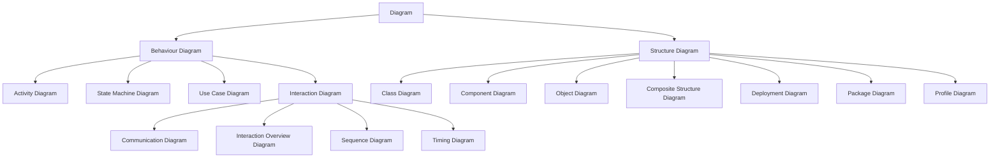
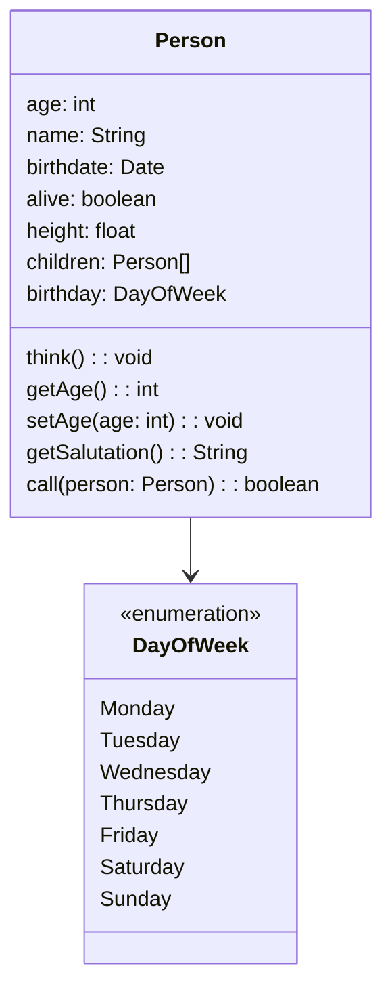
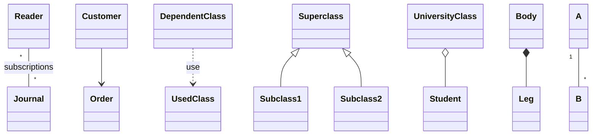
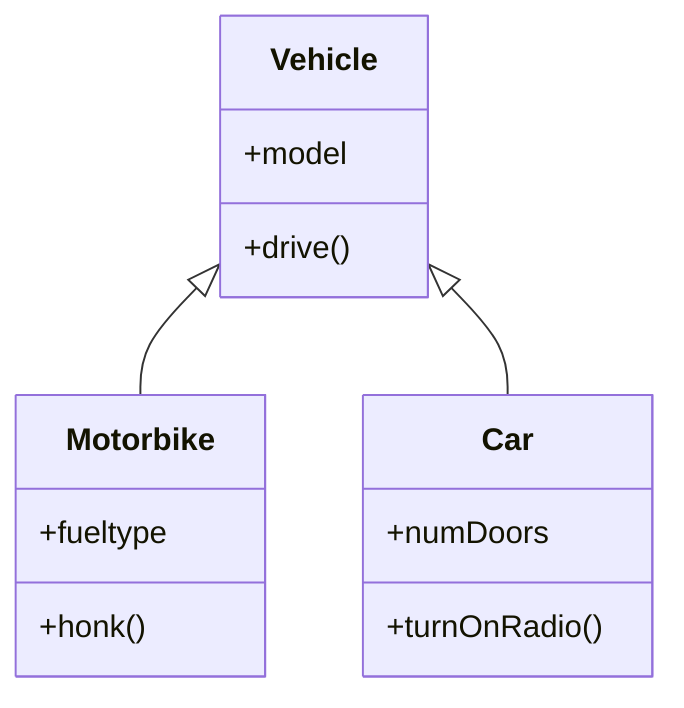
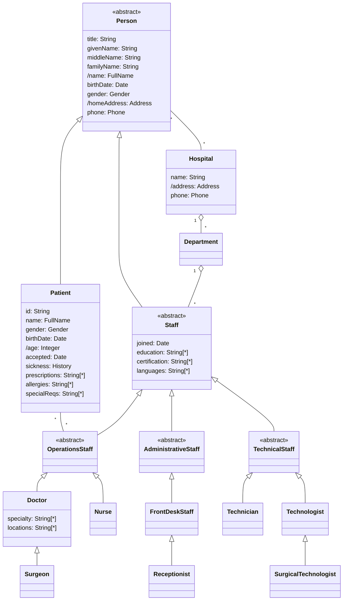
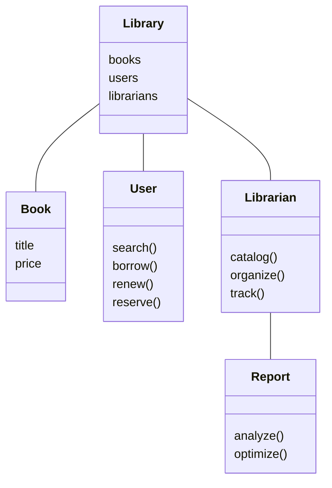
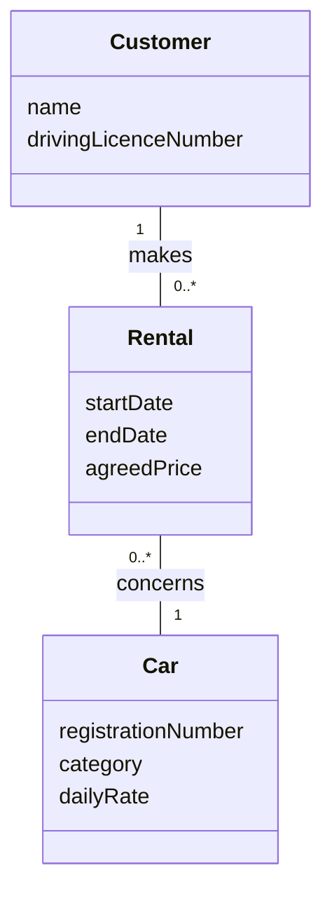
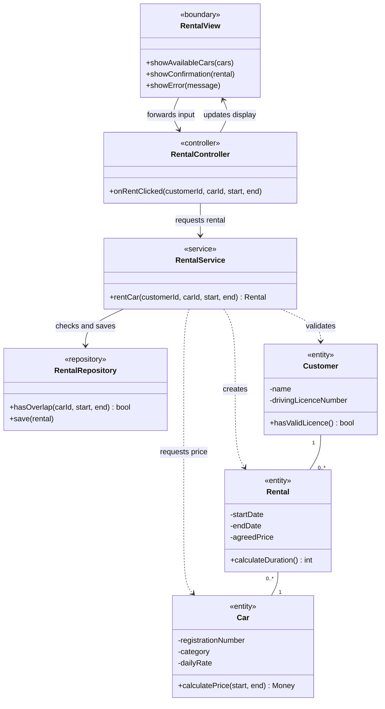
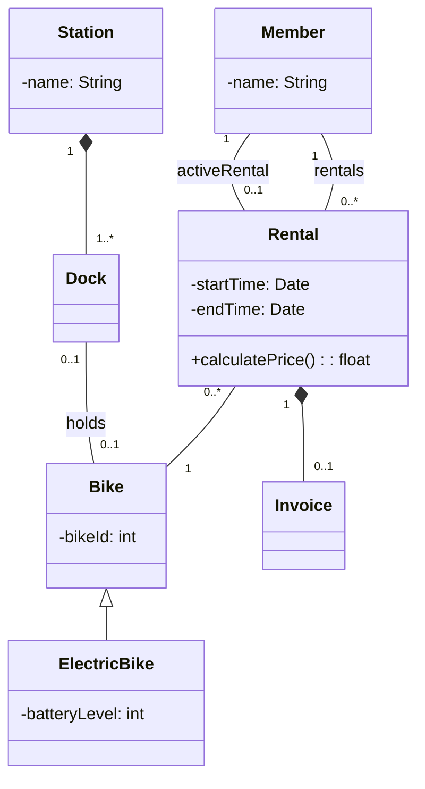

# UML: Designing Classes

> [!Note] 💡 Notation Conventions
> - **Operation = method**, **attribute = property** (slides use both words); written "operation" and "attribute".
> - Visibility symbols: $+$ public, $\#$ protected, $-$ private, $\sim$ package.
> - Multiplicity written $n..m$; $*$ = "any number"; $0..*$ = zero or more.
> - "Generalization" (US spelling) is used for the slides' "generalisation"; "behaviour" kept British.
> - Class names are CamelCase nouns in the singular; attributes/operations are lowerCamelCase.
> - Slide numbers refer to `SWEA_2026_3.pdf` (Lecture 03).
> - **No theorems or proofs** in this lecture.
> - The announcement slides (HIS registration, Applied Idea competition) are administrative and omitted. The last slide of the file is only the title of Lecture 04 ("Modeling system behaviour").

---

## 1. Recap: Object Orientation

> [!Definition] 📖 Object, class
> **1.** **Object**: basic unit of OO programming; a representation of a real-world item. It contains **data** (attributes/properties = variables) and **actions** (operations = functions/methods).
> **2.** **Class**: **abstraction** of the same group/type of objects.
> **3.** Classes **interact**: create objects, call methods; one class can **inherit** data/actions from another.
> **4.** Popular OO languages: **Java, C++, Python**.

> [!Note] 💡 OOP is not everything
> OO is a popular paradigm, but there are others: **functional**, **aspect-oriented**, **procedural**, **logic** programming.

> [!Missing] Figure: TIOBE Programming Community Index (line chart, 2002–2026) for Python, C, C++, Java, C#, JavaScript, Visual Basic, R, SQL, Rust; at the right edge Python is highest. It only illustrates that other languages/paradigms are widely used.

## 📘 Examples & Applications

> [!Example] 📘 Example 1.1 — Cars (slide 6)
> **Using:** object vs. class
> **Solution:**
> **1.** Four cars on a dealer's lot: *Car1, Car2, Car3, Car4* = **objects** (real-world items).
> **2.** The drawing "Car" = **class**: the abstraction shared by all four (same attributes and operations, different values).
> **3.** Relation: $\text{Car1},\dots,\text{Car4}$ are **instances** of class $\text{Car}$.

---

## 2. Unified Modeling Language (UML)

> [!Definition] 📖 UML
> A **standardised, general-purpose, formal** modeling language in software engineering **for object-oriented languages**. It includes **graphic notation techniques** for visual models (use case, activity, class diagrams, and more). Latest specification: **2.5.1** by the **Object Modelling Group (OMG)** (751 pages).

> [!Property] ⚙️ Uses of UML
> **1.** Communication between stakeholders (incl. customers) and developers.
> **2.** Documenting specification/requirements, analysis and design.
> **3.** **Code generation** from the design model.
> **4.** **De-facto standard** in the software industry.

> [!Definition] 📖 Origin
> Developed by **Grady Booch, Ivar Jacobson and James Rumbaugh** at **Rational Software (now IBM)** as a **unification** of several earlier modeling approaches; **standardized in 1997**.

| Year | Milestone (slide 11) |
|---|---|
| 1987 | State Charts (Harel) |
| 1990 | Methodologies proliferate: Booch '91/'93, OMT, OOSE, Fusion, OBA, OOA, OODA, RDD, OOSA, … |
| 1994 | OMT '94, OOSE 94 |
| 1995 | UML 0.8 (OOPSLA '95), UML 0.9 ("3 amigos") |
| 1997 | **UML 1.1 accepted by OMG (Nov 1997)** |
| 2000 | UML 1.3 accepted by ISO (Oct 2000); UML 1.4 published (Nov 2000) |
| 2003 | UML 1.5 |
| 2005 | **UML 2.0** |
| 2007 / 2008 | UML 2.1.2 / UML 2.2 (related languages: SysML 1.1, BPMN 1.1) |

> [!Warning] ⚠️ Possible Gap
> The history figure ends at UML 2.2, while the text names **2.5.1** as the latest version. The figure also shows Unified Process/RUP, OPEN/OML, xUML as related lineages without explanation.

> [!Definition] 📖 UML diagram types
> **Diagram** splits into **Behaviour diagrams** and **Structure diagrams**. The five types in red on slide 13 are the ones used in this course: **Activity, State Machine, Use Case, Sequence, Class**.



## 📘 Examples & Applications

> [!Example] 📘 Example 2.1 — Behaviour or structure?
> **Using:** UML diagram taxonomy
> **Solution:**
> **1.** "Which classes exist and how are they related?" → *Class diagram* (structure).
> **2.** "Who interacts with the system, which functions?" → *Use case diagram* (behaviour).
> **3.** "In which order are messages exchanged?" → *Sequence diagram* (behaviour → interaction).
> **4.** "Which states can an order be in?" → *State machine diagram* (behaviour).
> **5.** "Where is each component deployed?" → *Deployment diagram* (structure).

---

## 3. UML Class Diagram: Notation

> [!Definition] 📖 UML class diagram
> A **static structure diagram** showing the **classes/objects** of the system, their **attributes**, **operations** (methods) and **relationships**. A class is a box with **three compartments**: *class name*, *attributes*, *operations*. The empty compartments may be omitted (name only).

> [!Definition] 📖 Data types, arguments, return types
> **1.** **Attributes** have data types: `name: Type`. **Simple types** are available by default; **complex types** are defined by separate classes or **enumerations**.
> **2.** Use **Array** or **List** (`Type[]`) for several values of the same type.
> **3.** **Operations** have return types and parameters: `operation(arg1: Type, arg2: Type): ReturnType`; each argument is **name, colon, type**, separated by commas.
> **4.** An **enumeration** is drawn as a class with the stereotype «enumeration» listing its literals.



> [!Definition] 📖 Visibility
> Determined by the symbol in front of the name:

| Symbol | Access modifier | Class | Package | Subclass | World |
|---|---|---|---|---|---|
| $+$ | public | yes | yes | yes | yes |
| $\#$ | protected | yes | yes | yes | no |
| $\sim$ | package (default) | yes | yes | no | no |
| $-$ | private | yes | no | no | no |

## 📘 Examples & Applications

> [!Example] 📘 Example 3.1 — Reading the `Person` class
> **Using:** attributes, data types, arrays, enumerations, operations
> **Solution:**
> **1.** `age: int`, `height: float`, `alive: boolean` → simple types.
> **2.** `birthdate: Date` → type assumed available (see warning below).
> **3.** `children: Person[]` → array of the class itself (several values of the same type).
> **4.** `birthday: DayOfWeek` → complex type defined by an **enumeration** (7 literals).
> **5.** `setAge(age: int): void` → one argument `age` of type `int`, no return value; `call(person: Person): boolean` → takes a `Person`, returns `boolean`.

> [!Warning] ⚠️ Possible Gap
> `Date` and `String` are used but not defined on the slide. The lecture's common-mistakes list (F, Section 10) warns against **non-trivial data types not defined in the diagram**; here `Date` is treated as a standard type.

> [!Example] 📘 Example 3.2 — Interactive example "Car" (slides 16, 41, 43): UML ↔ Java
> **Using:** class notation, visibility, UML-to-code mapping
> **UML:** `Car` with `+brand: String`, `+model: String`, `+year: int`, `+color: String`, `+isRunning: boolean`; operations `+start(): void`, `+drive(): void`, `+stop(): void`.
> **Java on slide 43:**
>
> ```java
> public class Car {
>     // Fields (attributes)
>     private String brand;
>     private String model;
>     private int year;
>     private String color;
>     private boolean isRunning;
>
>     // Constructor
>     public Car(String brand, String model, int year, String color) {
>     }
>
>     // Methods representing car behavior
>     public void start() { // .. }
>     public void drive() { // .. }
>     public void stop()  { // .. }
> }
> ```
>
> **Mapping:** UML attribute ↔ field; UML operation ↔ method; type after colon ↔ type before name.

> [!Warning] ⚠️ Possible Gap
> The UML shows all attributes **public** ($+$) but the Java fields are **private**. The slide does not comment on this mismatch; under the visibility table, private attributes would be written $-$ in the diagram.

> [!Example] 📘 Example 3.3 — Visibility table queries
> **Using:** visibility
> **Q1:** Can a **subclass in another package** access a `#protected` attribute? **A:** yes (Subclass column = yes).
> **Q2:** Can a class in the **same package** (not subclass) access a `~package` operation? **A:** yes (Package = yes).
> **Q3:** Which modifiers are accessible by the **world**? **A:** only `+public`.
> **Q4:** Which is the **only** modifier visible to nothing but the class itself? **A:** `-private`.

---

## 4. Relationships between Classes

> [!Definition] 📖 Association
> A **"has a"** relationship: the owning class holds a **reference** to another class. Drawn as a **line** between the class boxes. Different relationship types have **different line styles**.
> **1.** Without an arrow: **bi-directional**.
> **2.** **Directed association**: solid line with an **arrow** from the dependent class (uses the other) to the class it depends on.
> **3.** **Labels:** the relation may have a **name** (near the centre) and **role names** at the ends of the line. A role name is the **data reference**, so it need **not** be listed again as attribute.

> [!Definition] 📖 Dependency / use
> A **weaker** relationship than association: the dependent class uses another class **at some point in time**. An association implies an **attribute** that references the other class; a dependency also exists if the used object is **created in a function** or **received through arguments or returned as a result**. Drawn as **dashed line with arrow** towards the used class, often labelled «use».

> [!Definition] 📖 Generalization / inheritance
> An **"is a"** relationship: one class is a **specialization** of another. Specialized = **subclass**, generalized = **superclass**. Drawn as **solid line with a hollow triangle** at the superclass end.

> [!Definition] 📖 Aggregation
> A specific **"has a"** association; typically a **collection/container** of other classes. **Both can exist when the other is destroyed** ("weak whole-part"). Drawn with an **open diamond** ◇ at the **whole** end.

> [!Definition] 📖 Composition
> A specific **"has a"** association with **strong ownership** ("strong whole-part"): the part **cannot exist independently** of the whole (at least within the system's context). Typically the part is created with the whole and destroyed with it. Drawn as solid line with a **filled diamond** ◆ at the **whole** end.

> [!Definition] 📖 Multiplicity / cardinality
> The **number of instances** of one class that can be associated with an instance of another. Written at the line ends.
> **1** = exactly one · **0..1** = zero or one · **0..\*** = zero or more · **1..\*** = at least one · **n..m** = specific range.
> **Reading** "A $\overset{1}{—}\overset{*}{—}$ B": *each A is associated with any number of B's; each B with exactly one A*.
> Formally, a multiplicity $n..m$ allows $k$ associated instances with $n\le k\le m$.



> [!Property] ⚙️ Line-style cheat sheet (slide 38 legend)
> **1.** Directed association: solid line, open arrow.
> **2.** Inheritance: solid line, hollow triangle.
> **3.** Composition: solid line, filled diamond at whole.
> **4.** Realization/Implementation: **dashed** line, hollow triangle.
> **5.** Aggregation: solid line, open diamond at whole.
> **6.** Dependency: dashed line, open arrow.

> [!Warning] ⚠️ Possible Gap
> **1.** Slide 20 says the arrow points *from the dependent class to the class it depends on*, but then states that *Order depends on Customer*, while the figure draws the arrow **Customer → Order**. These two statements contradict each other; follow the **general rule** (arrow points to the class being used).
> **2.** **Realization/Implementation** appears only in the slide-38 legend; the lecture gives no definition beyond its notation (dashed line, hollow triangle).

## 📘 Examples & Applications

> [!Example] 📘 Example 4.1 — Reader–Journal association with roles (slide 19)
> **Using:** association, role names
> **Solution:**
> **1.** Association name: **subscriptions** (centre of the line).
> **2.** Role at the **Journal** end: `+journals` = the data reference Reader → Journals.
> **3.** Role at the **Reader** end: `+subscribers` = the data reference Journal → Readers.
> **4.** Therefore `Reader` does **not** need an extra attribute `journals`, and `Journal` none for `subscribers`.

> [!Example] 📘 Example 4.2 — Association vs. dependency
> **Using:** association, dependency
> **Q:** `RentalService.rentCar()` creates a `Rental` object locally and returns it; `Customer` stores a list of `Order`. Which relationship each?
> **Solution:**
> **1.** `RentalService` → `Rental`: object created in a function and returned, no attribute → **dependency** «use» (dashed arrow).
> **2.** `Customer` → `Order`: stored as attribute (list) → **association** (solid line).

> [!Example] 📘 Example 4.3 — Generalization (Vehicle)
> **Using:** generalization, inheritance
> **Solution:** `Motorbike` (`+fueltype`, `+honk()`) and `Car` (`+numDoors`, `+turnOnRadio()`) are subclasses of `Vehicle` (`+model`, `+drive()`). Both **inherit** `model` and `drive()`; "Car is a Vehicle" ✓.



> [!Example] 📘 Example 4.4 — Aggregation vs. composition
> **Using:** aggregation, composition
> **Solution:**
> **1.** `UniversityClass` ◇— `Student`: students continue to exist when the class is dissolved → **aggregation**.
> **2.** `Body` ◆— `Leg`: legs do not exist independently of the body → **composition** (create/destroy together).
> **3.** Decision test: *"If the whole is deleted, must the part be deleted too?"* yes → composition; no → aggregation.

> [!Example] 📘 Example 4.5 — Multiplicity statements
> **Using:** multiplicity
> **Solution (slide examples written as ranges):**
> **1.** Person–Passport: $1$ (exactly one: $k=1$).
> **2.** Person–DriverLicense: $0..1$ ($0\le k\le1$).
> **3.** Customer–Order: $0..*$ ($k\ge0$).
> **4.** Company–Employee: $1..*$ ($k\ge1$).
> **5.** Team–Member: $5..10$ ($5\le k\le10$).
> **Diagram "A 1 — * B":** each B has exactly one A; each A has $0..\infty$ B's.

---

## 5. Domain/Analysis Model Examples

> [!Definition] 📖 Analysis (domain) model
> A class diagram built **during analysis** from the problem domain: classes, attributes, associations, multiplicities, generalizations, without implementation detail.



> [!Warning] ⚠️ Possible Gap
> **1.** The slide uses notation **not explained in the lecture**: *italic* class names (here shown as «abstract»), a `/` prefix (derived attribute, e.g. `/age`), a `^` prefix in `Patient` (e.g. `^name`), `{id}` on `name` and `id` (identifier). The meanings given here are the common UML ones, not stated in the slides.
> **2.** Diagram source is uml-diagrams.org (shown as "class Organization").

> [!Missing] Figure: "Real-world example", Microsoft Visio Document Data Diagram (slide 27): a very large class diagram (≈ 50 classes: VisioDocument, Shape, Master, Page, FontEntry, CellType, …) with many associations. It shows that real models grow large and are hard to read (see "kitchen-sink classes" in Section 10).

## 📘 Examples & Applications

> [!Example] 📘 Example 5.1 — Reading the hospital model
> **Using:** generalization, aggregation, multiplicity
> **Solution:**
> **1.** `Patient` and `Staff` are both **subclasses of `Person`** (inherit name, birthDate, phone, …).
> **2.** `Hospital` $\overset{1}{◇}$—$\overset{*}{}$ `Department`: a hospital has many departments (aggregation).
> **3.** `Department` $\overset{1}{◇}$—$\overset{*}{}$ `Staff`: a department has many staff.
> **4.** `Person` $*$—$*$ `Hospital`: many-to-many (a person may be linked to several hospitals).
> **5.** `Patient` $*$—$*$ `OperationsStaff`: a patient is treated by many operations staff, who treat many patients.
> **6.** `Surgeon` **is a** `Doctor` **is an** `OperationsStaff` **is a** `Staff` **is a** `Person` (chain of generalizations).
> **7.** `Surgeon` inherits `specialty` and `locations` from `Doctor` and `joined`, `languages` from `Staff`.

---

## 6. Object-Oriented Analysis (OOA)

> [!Definition] 📖 Steps to build an OO analysis model
> **1.** Identify **system boundaries and actors**.
> **2.** **Class identification**.
> **3.** Find **interactions/associations** between classes.
> **4.** Add **multiplicity**.
> **5.** Find **attributes**.
> **6.** Find **methods**.
> OOA takes place in the **Analysis** phase (phase 02 of the 7 phases, highlighted on slide 28).

> [!Definition] 📖 Abbott's linguistic heuristics (Abbott 1983)
> Derive model components from the grammar of the textual description:

| Grammatical construct | Model component | Example |
|---|---|---|
| Name | Instance / Object | Mike, Mazda, FRA UAS |
| **Noun** | **Class** | Customer, Account |
| **Transitive verb** ¹ | **Operation** | help so., buy sth. |
| Intransitive verb | Event | appear |
| Classifying verb, "to be" | Generalization | is a type of, is one of, is a kind of |
| Possessive verb ², "have" | Aggregation | has, consists of |
| Modal verb | Constraint | must be |
| **Adjective** | **Attribute** | four-sided, heavy, green |

> ¹ has an object in the accusative. ² signals ownership.

> [!Property] ⚙️ Limits of the heuristics
> Abbott provides **rules but does not replace your own thinking**: **nouns** are good candidates for classes, **verbs** for operations, **adjectives** often for attributes. **Manual control and a check for correctness are needed.**

> [!Definition] 📖 Guiding questions
> **1.** Which class **holds** information? **2.** Which class is **responsible for creating** objects? **3.** Which class is **responsible for calling** operations? **4.** How are classes **linked**? **5.** How do we **group** classes into **components**?

## 📘 Examples & Applications

> [!Example] 📘 Example 6.1 — Library management software (slides 30–32)
> **Using:** Abbott heuristics, OOA steps
> **Text:** "A library management software is a comprehensive system … **library** … **books**, patrons, and library resources. It allows **librarians** to catalog, organize, and track library materials, including **titled** books, … **Users** can search for and borrow books, renew items, place holds … generate **reports** … analyze collection data, and optimize resource allocation."
> **Solution:**
> **1.** Nouns → classes: `Library`, `Book`, `User`, `Librarian`, `Report`.
> **2.** Adjective "titled" → attribute `title` of `Book` (and `price` added by the model).
> **3.** Verbs → operations: `Librarian`: `catalog()`, `organize()`, `track()`; `User`: `search()`, `borrow()`, `renew()`, `reserve()` (from "place holds"); `Report`: `analyze()`, `optimize()`.
> **4.** Associations: `Library`—`Book`, `Library`—`User`, `Library`—`Librarian`, `Librarian`—`Report`.



> [!Warning] ⚠️ Possible Gap
> **1.** The slide's result stores `books`, `users`, `librarians` as **attributes** of `Library` *and* draws associations to those classes: this is the **redundancy** that the lecture itself warns against (Section 8).
> **2.** `price` and `reserve()` do not literally appear in the text; `patrons`, `journals`, `multimedia items` are not modeled.
> **3.** The result figure shows no multiplicities, so the OOA steps 4 (multiplicity) are not applied.

> [!Example] 📘 Example 6.2 — The four sentences of slide 33
> **Using:** Abbott table, aggregation, generalization, instance
> **Solution:**
> **1.** *"Table has legs."* → possessive verb "have" → **aggregation/composition** `Table`—`Leg` (legs cannot exist without the table in the system → composition is arguable).
> **2.** *"Customer has account."* → possessive verb → **association/aggregation** `Customer`—`Account`.
> **3.** *"Child is a person."* → classifying verb "to be" → **generalization** `Child` → `Person`.
> **4.** *"Mike is a person."* → "Mike" is a **name** → **instance/object** `mike : Person`, **not** a subclass.
> **Pitfall:** sentences 3 and 4 look identical grammatically; only a **common noun** (Child) gives a class, while a **proper name** (Mike) gives an object.

---

## 7. Naming and Deriving Class Elements

> [!Definition] 📖 Naming classes
> **1.** A **noun in singular**.
> **2.** **Unique** in the package; no two classes with the same name.
> **3.** **Descriptive, not generic**: avoid *Manager, Controller, DataHandler, Helper, Misc, Thing*.
> **4.** **Consistent** terms/naming conventions across classes.
> **5.** In Java: **Uppercase start, CamelCase** (`MyClassName`), no spaces.
> **6.** **Avoid abbreviations**.
> **7.** Use **domain terminology** (eases alignment with domain experts).

> [!Definition] 📖 Deriving attributes
> **1.** Choose by the **responsibility of the class to manage the data** (CRC cards).
> **2.** **Nouns or adjective nouns**, not verbs.
> **3.** Must **not repeat the class name**.
> **4.** No abbreviations.
> **5.** An attribute is a **class attribute** (static) if it has the **same value for all objects**.
> **6.** Use **access modifiers** (public, private, protected, package).
> **7.** **Avoid redundancy**: do not store the same value in multiple classes (inconsistency).
> **8.** **Outsource** attribute sets that have their **own object identity** or exist independently into separate classes (e.g. `Person`, `Street`, `Postcode`, `City`).

> [!Definition] 📖 Deriving methods
> **1.** Defined by the **behaviour the class exhibits externally**.
> **2.** **Model the real-world interaction** with other classes.
> **3.** **Single responsibility**: do **atomic things** or split (✗ `orderAndPay()`).
> **4.** **Prioritize** by importance to the class's responsibility.
> **5.** **Be descriptive** (✗ `processData()`, `calculateResults()`, `helperMethod()`, `handleRequest()`).

> [!Definition] 📖 Deriving associations
> **1.** Start with a **simple association** (single line) between $A$ and $B$ (no cardinality, no aggregation).
> **2.** Ask for a more specific type: is $A$ a **physical component** of $B$? a **logical component**? an **element/member**? does $A$ **use** $B$? does $A$ **own** $B$?
> **3.** **Name** the associations, add **roles**, add **multiplicity**.

> [!Warning] ⚠️ Possible Gap
> **CRC cards** (Class–Responsibility–Collaborator) are mentioned but not explained in the lecture.

## 📘 Examples & Applications

> [!Example] 📘 Example 7.1 — Fix bad names and methods
> **Using:** naming rules, method rules
> **Solution:**
> **1.** `Customers` → `Customer` (singular). **2.** `customer_account` → `CustomerAccount` (CamelCase, no underscore). **3.** `DataHandler` → `InvoiceRepository` (descriptive). **4.** `Acc` → `Account` (no abbreviation).
> **5.** `orderAndPay()` → `placeOrder()` and `payOrder()` (atomic). **6.** `processData()` → `calculateInvoiceTotal()` (descriptive).

> [!Example] 📘 Example 7.2 — Eliminate redundancy and outsource attributes
> **Using:** attribute rules
> **Given:** `Customer { name, street, postcode, city }` and `Supplier { name, street, postcode, city }`.
> **Solution:**
> **1.** `street, postcode, city` form a set with its own identity → class `Address`.
> **2.** `Customer` and `Supplier` each reference `Address` (association, role `address`): no duplicated address storage.
> **3.** `Customer` attribute `customerName` repeats the class name → rename to `name`.

> [!Example] 📘 Example 7.3 — Class attribute
> **Using:** class attribute rule
> **Solution:** In `Car`, `numberOfWheels` $=4$ for **every** object → a **class attribute**; `color` differs per object → instance attribute.

---

## 8. Tools and UML ↔ Code

> [!Definition] 📖 UML/CASE tool categories
> **1.** **Pure drawing tools**: Microsoft Visio, Dia.
> **2.** **Desktop-based professional**: IBM Rational Rose, Sparx Enterprise Architect, Visual Paradigm Desktop, MagicDraw, StarUML, Astah.
> **3.** **Cloud-based/collaborative**: Lucidchart, Visual Paradigm Online, Creately, Miro + UML plugins, Draw.io.
> **4.** **Developer-integrated UML**: PlantUML, Mermaid.js, JetBrains IDE plugins like Code Iris.

> [!Property] ⚙️ Tools shown in the lecture
> **MagicDraw**: Windows and Linux (3ds.com/products/catia/no-magic/magicdraw). **StarUML**: macOS (staruml.io). **Draw.io**: web-based; **default is dark mode, use bright mode for submission**.

> [!Property] ⚙️ UML corresponds to source code
> A class diagram maps to source code (and vice versa): class ↔ class, attribute ↔ field, operation ↔ method (see Example 3.2).

## 📘 Examples & Applications

> [!Example] 📘 Example 8.1 — Choose the tool category (constructed)
> **Using:** tool categories
> **Solution:** diagrams versioned next to code in a repository → *developer-integrated* (PlantUML/Mermaid); simultaneous editing by a student team → *cloud-based* (Draw.io, Lucidchart); model-driven enterprise modeling → *desktop professional* (Enterprise Architect, MagicDraw). For submission in Draw.io, switch from dark to bright mode.

---

## 9. Domain Model vs. Design Model

> [!Definition] 📖 Domain model vs. design model
> **1.** **Domain model**: classes, attributes and associations of the **problem domain**; no technical roles.
> **2.** **Design model**: adds **technical classes** and **operations**; elements carry **stereotypes** (roles): «boundary» (user interface), «controller», «service», «repository», «entity» (domain class with visibility, e.g. `-name`, plus behaviour).





> [!Warning] ⚠️ Possible Gap
> The bottom of slide 44 is cut off, so the entity classes' compartments/multiplicities at the bottom edge may be incomplete. `Money` is used as a return type but not defined (cf. mistake F). The lecture does not define the stereotypes «boundary», «controller», «service», «repository»; their meanings above are inferred from their use in the diagram.

## 📘 Examples & Applications

> [!Example] 📘 Example 9.1 — From domain to design (car rental)
> **Using:** domain model, design model, multiplicity, dependency
> **Solution:**
> **1.** Domain multiplicities: a `Customer` makes $0..*$ `Rental`s; each `Rental` concerns exactly $1$ `Car` (a car can appear in $0..*$ rentals).
> **2.** The same three classes reappear as «entity» classes, now with **private attributes** and **behaviour** (`hasValidLicence()`, `calculateDuration()`, `calculatePrice(...)`).
> **3.** New technical classes: `RentalView`, `RentalController`, `RentalService`, `RentalRepository`.
> **4.** Flow for "rent a car": View `forwards input` → Controller `requests rental` → Service **validates** the `Customer`, **requests price** from `Car`, **creates** a `Rental` (dependencies), then **checks and saves** via the Repository (`hasOverlap(...)`, `save(...)`) and returns the result to the View via the controller (`updates display`).
> **5.** `RentalService` has only **dashed (dependency)** arrows to entities (it uses them locally and does not store them), but a **solid** arrow to `RentalRepository` (needs a reference).

---

## 10. Common Mistakes in UML Diagrams

> [!Warning] ⚠️ Your most popular mistakes
> **A.** Mixing elements of **different diagram types** (e.g. object and class diagrams).
> **B.** Naming classes in **plural, lowercase** or **not using nouns**.
> **C.** **Over-usage** of composition and aggregation.
> **D.** **Incorrect usage of generalization**.
> **E.** **Omitting visibility modifiers**.
> **F.** Using **non-trivial data types** that are not defined in the diagram.
> **G.** **"Kitchen-sink" classes**: a central class with far too many associations to nearly all classes.
> **H.** **Redundant** modelling of attributes and methods in multiple classes.

## 📘 Examples & Applications

> [!Example] 📘 Example 10.1 — Spot the mistake
> **Using:** mistakes A–H
> **Solution:**
> **1.** Class `customers` → **B** (plural + lowercase) → `Customer`.
> **2.** `Order { items: Item[] }` with no class `Item` in the diagram → **F** → add class `Item`.
> **3.** Attributes without `+ − # ~` → **E**.
> **4.** `Mike : Person` inside a class diagram → **A** (object notation mixed with class diagram).
> **5.** `Student` $\blacklozenge$ `Course` ("students cannot exist without a course"?) → likely **C**; students exist independently → **aggregation** or plain association.
> **6.** `Car` inherits from `Wheel` ("a car has wheels") → **D**; correct relation is "has a" (composition/aggregation), not "is a".
> **7.** `System` connected to 15 other classes → **G**; `Manager` in two classes copying `name`, `address` → **H** (extract common superclass or class).

---

## 11. Exam-style Problem (combines Sections 4, 6, 7, 9, 10)

> [!Example] 📘 Example 11.1 — Bike-sharing system
> **Using:** Abbott heuristics, associations, multiplicity, composition, generalization, naming rules, mistakes
> **Text:** "A bike-sharing system lets registered **members** rent **bikes** at **stations**. Each station has many **docks**; each dock holds at most one bike. A member can have at most one **active rental** but a history of many rentals. An **electric bike** is a kind of bike and has a battery level. A rental has a start time and an end time; **invoice** cannot exist without its rental. The system calculates the price of a rental."
> **Tasks:** **(1)** classes; **(2)** relations with types; **(3)** multiplicities; **(4)** attributes and operations with visibility; **(5)** check against the naming rules and mistakes list.
> **Solution:**
> **(1) Classes (nouns):** `Member`, `Bike`, `Station`, `Dock`, `Rental`, `Invoice`, `ElectricBike`. ("system" is the boundary, not a class; avoids a kitchen-sink class, mistake G.)
> **(2) Relations (Abbott):**
> - "is a kind of" → generalization `ElectricBike` → `Bike`.
> - "has many docks" → possessive: a dock cannot exist without its station → **composition** `Station` ◆— `Dock`.
> - "holds" → association `Dock`—`Bike` (bike exists independently of a dock).
> - "cannot exist without its rental" → **composition** `Rental` ◆— `Invoice`.
> - `Member`—`Rental` (two associations, roles `activeRental` and `rentals`), `Rental`—`Bike` association.
> **(3) Multiplicities:**
> **1.** `Station` $1$ — $1..*$ `Dock` (composition, "many docks").
> **2.** `Dock` $0..1$ — $0..1$ `Bike` ("at most one bike"; a bike is in at most one dock, and can be on the road).
> **3.** `Member` $1$ — $0..1$ `Rental` (role `activeRental`).
> **4.** `Member` $1$ — $0..*$ `Rental` (role `rentals`, history).
> **5.** `Rental` $0..*$ — $1$ `Bike`.
> **6.** `Rental` $1$ — $0..1$ `Invoice` (invoice created after rental ends).
> **(4) Attributes/operations:** `Bike`: `-bikeId: int`; `ElectricBike`: `-batteryLevel: int`; `Rental`: `-startTime: Date`, `-endTime: Date`, `+calculatePrice(): float` (price calculated by the rental, which owns the times); `Member`: `-name: String`; `Station`: `-name: String`.
> **(5) Check:** all class names singular, CamelCase nouns ✓; no `Manager`/`Helper` ✓; every attribute has a visibility (E) ✓; only simple types used (F; `Date` assumed standard, price as `float`) ✓; `batteryLevel` only in `ElectricBike` (no redundancy, H) ✓.



---

## 🗂️ Summary

- **OO:** objects (real-world items; data + actions) are grouped into **classes** (abstractions of the same type of objects); classes create objects, call methods, inherit. Java, C++, Python are OO; other paradigms exist (functional, aspect-oriented, procedural, logic).
- **UML:** standardised, formal, general-purpose modeling language for OO; OMG; spec 2.5.1; created by Booch, Jacobson, Rumbaugh at Rational (now IBM); standardized 1997; uses: communication, documentation, code generation; de-facto standard.
- **Diagram types:** behaviour (activity, state machine, use case, interaction: communication/overview/sequence/timing) vs. structure (class, component, object, composite structure, deployment, package, profile). Course focus: **activity, state machine, use case, sequence, class**.
- **Class box:** name | attributes | operations. Attribute `name: Type`; operation `op(arg: Type): Return`; arrays `Type[]`; enumerations via «enumeration».
- **Visibility:** $+$ public (all), $\#$ protected (class, package, subclass), $\sim$ package (class, package), $-$ private (class only).
- **Relationships:** association (solid, "has a", roles/names, bi-directional or directed), dependency (dashed arrow, «use», weaker), generalization (hollow triangle at superclass, "is a"), aggregation (open diamond at whole, parts survive), composition (filled diamond at whole, parts die with whole), realization (dashed + hollow triangle).
- **Multiplicity:** $1$, $0..1$, $0..*$, $1..*$, $n..m$; "A 1 — * B" = each A has many B's, each B exactly one A.
- **OOA steps:** system boundary/actors → classes → associations → multiplicity → attributes → methods (Analysis phase).
- **Abbott:** name → instance; noun → class; transitive verb → operation; intransitive verb → event; "to be" → generalization; "have" → aggregation; modal verb → constraint; adjective → attribute. Needs manual checking. "Mike is a person" = object; "Child is a person" = subclass.
- **Rules:** class names = singular, unique, descriptive, consistent, CamelCase, no abbreviations, domain terms. Attributes = nouns, don't repeat class name, avoid redundancy, outsource independent sets (Address). Methods = atomic, descriptive, externally visible behaviour. Associations: start with a simple line, refine type, name, roles, multiplicity.
- **Models:** domain model (problem domain) vs. design model (adds boundary/controller/service/repository/entity classes, visibility, operations); class diagrams map 1:1 to code (class, fields, methods).
- **Tools:** drawing (Visio, Dia), desktop pro (Rational Rose, Enterprise Architect, Visual Paradigm, MagicDraw, StarUML, Astah), cloud (Lucidchart, Creately, Miro, Draw.io), developer-integrated (PlantUML, Mermaid.js, Code Iris). Draw.io: use bright mode for submission.
- **Mistakes A–H:** mixing diagram types; bad class names; over-using composition/aggregation; wrong generalization; missing visibility; undefined non-trivial types; kitchen-sink classes; redundancy.