> [!Note] 💡 Notation Conventions
> - Slide numbers refer to `SWEA_2026_4.pdf` (Lecture 04). Class-diagram notation from Lecture 03 is reused unchanged.
> - **Visibility:** $+$ public, $\#$ protected, $-$ private, $\sim$ package. **Multiplicity:** $*$ = any number, $0..1$, $1..*$, $n..m$.
> - Stereotypes are written «like this» (slides sometimes show `<<...>>`).
> - **Sequence diagram messages** are written `n : name` (message number, then name), as in the slides.
> - **Object notation:** `objectName : ClassName` (underlined in UML; Markdown/Mermaid cannot underline, so the underline is only stated).
> - **Mermaid limitations:** Mermaid has no object, activity or package diagram type. These are approximated with `classDiagram`, `stateDiagram-v2` (fork/join/choice) and `flowchart`. UML-correct symbols are described in the text.
> - Examples marked **(constructed)** are not in the slides. All others are recreated from the slides.
> - **No theorems or proofs** in this lecture. LaTeX is used only for counting and structural checks.

---

## 1. Where This Lecture Fits: UML Diagram Taxonomy

> [!Definition] 📖 UML diagram types (slide 2)
> **Diagram** splits into **Behaviour diagrams** and **Structure diagrams**. The red boxes on slide 2 mark the types covered in the course:
> **1.** Behaviour: **Activity**, **State Machine**, **Use Case**, **Sequence** (a kind of *Interaction diagram*).
> **2.** Structure: **Object** (new in this lecture; *Class* was Lecture 03).
> **3.** Not covered: Communication, Interaction Overview, Timing (behaviour); Component, Composite Structure, Deployment, Package*, Profile (structure). *Package diagrams get an optional preview at the end (Section 7).

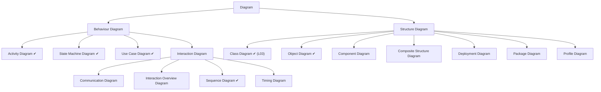

> [!Property] ⚙️ Static vs. dynamic
> **Structure diagrams** model **static** aspects (what exists). **Behaviour diagrams** model **dynamic** aspects (what happens over time). The lecture's closing point: the diagrams are **complementary** and usually **several are needed** for a complete system (see Section 8).

## 📘 Examples & Applications

> [!Example] 📘 Example 1.1 — Classify a diagram (constructed)
> **Using:** taxonomy
> **Solution:**
> **1.** "Snapshot of objects with concrete values" → *Object diagram* (structure).
> **2.** "Flow from activity to activity, with parallel steps" → *Activity diagram* (behaviour).
> **3.** "Messages between objects in time order" → *Sequence diagram* (behaviour → interaction).
> **4.** "Which states can an ATM be in?" → *State machine diagram* (behaviour).
> **5.** "How are classes grouped into modules?" → *Package diagram* (structure).

---

## 2. UML Structure Notation Revisited

> [!Definition] 📖 Class, abstract class, object (slide 3)
> **1.** **Class**: box with three compartments: *Name*, *attributes* (member variables), *methods* (member functions). Visibility prefixes: `+ public_method()`, `# protected_method()`, `- private_method()`.
> **2.** **Abstract class**: the name is written in *italics* **or** marked with the constraint `{Abstract}`. An abstract (*virtual*) method is also written in *italics*; a concrete method is in normal type.
> **3.** **Object**: a box labelled `Objectname: Class`, **underlined**.
> **4.** **Inheritance (is-a)**: solid line with a hollow triangle at the **base** class. Example label: "Derived2 is-a Base".

> [!Definition] 📖 Aggregation, composition (slide 4)
> **1.** **Aggregation** (open diamond ◇ at the **whole**): whole has a part; **lifetimes might be different**; the part **might be shared** with other wholes.
> **2.** **Composition** (filled diamond ◆ at the **whole**): whole has a part; the **lifetime of the part is controlled by the whole**; part objects are **contained in exactly one** whole object.

> [!Definition] 📖 Association and navigability (slide 4)
> **1.** **Association** ("uses, interacts-with"): plain line, optionally with **role names** at the ends ("A's role", "B's role").
> **2.** **Navigability**: an arrow $A \to B$ means you **can reach B starting from A**.

> [!Definition] 📖 Multiplicity (slide 5)
> $*$ any number · $1$ exactly 1 · $n$ exactly $n$ · $0..1$ zero or one · $1..*$ one or more · $n..m$ $n$ through $m$.
> **Reading rule:** follow the line from the start class to the end class, note the multiplicity **at the end**, and say *"Each ⟨start⟩ is associated with ⟨multiplicity⟩ ⟨end⟩s."*

> [!Warning] ⚠️ Possible Gap
> Slide 4 says an aggregated part "might be shared with other Wholes". Lecture 03 only says "both can exist without the other". Both are compatible. Use *shared / independent lifetime* for aggregation and *exclusive / controlled lifetime* for composition.

## 📘 Examples & Applications

> [!Example] 📘 Example 2.1 — Reading "A 1 — * B" (slide 5)
> **Using:** multiplicity reading rule
> **Solution:**
> **1.** Start at A, end at B, multiplicity at B's end is $*$ → "Each A is associated with any number of B's."
> **2.** Start at B, end at A, multiplicity at A's end is $1$ → "Each B is associated with exactly one A."
> **3.** In ranges: from A, $k_B \in [0,\infty)$; from B, $k_A = 1$.

> [!Example] 📘 Example 2.2 — Abstract class and inheritance (constructed)
> **Using:** abstract class, inheritance, visibility
> **Solution:** `Vehicle` is abstract (*italic name*), with abstract method *drive()* and concrete `+refuel()`. `Car` and `Motorbike` are derived (hollow triangle at `Vehicle`), and each implements `drive()`. "Car is-a Vehicle" holds.

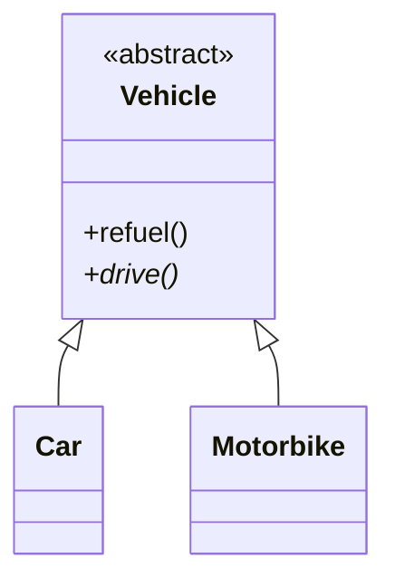

> [!Example] 📘 Example 2.3 — Aggregation or composition? (constructed)
> **Using:** aggregation, composition
> **Solution:**
> **1.** `Playlist` ◇— `Song`: a song can be in several playlists and survives deleting one → **aggregation**.
> **2.** `Invoice` ◆— `InvoiceLine`: a line belongs to exactly one invoice and is deleted with it → **composition**.
> **3.** Decision test: *"Is the part controlled by exactly one whole and deleted with it?"* yes → composition; otherwise aggregation.

> [!Example] 📘 Example 2.4 — Navigability (constructed)
> **Using:** navigability
> **Solution:** $\text{Order} \to \text{Customer}$: from an order you can reach its customer. The customer need not know its orders. A bidirectional line would mean both can navigate.

---

## 3. UML Object Diagrams

> [!Definition] 📖 Object diagram
> A diagram that represents a **snapshot of the instances (objects) of the classes in a system at a particular point in time**. It focuses on the **state of the system** in terms of objects, their **relationships** and **attribute values**, **not** on the class structure.

> [!Property] ⚙️ Object diagram vs. class diagram (slide 8)
> **1.** Contains **object name and corresponding class**; **both are underlined**.
> **2.** **Anonymous objects** are shown **without an object name** (`: ClassName`).
> **3.** Attributes are **assigned a concrete value** with `=` instead of a type.
> **4.** **No operation declarations** (already declared in the class).

| Aspect | Class diagram | Object diagram |
|---|---|---|
| Describes | structure / types | snapshot at one point in time |
| Box title | `ClassName` | `objectName : ClassName` (underlined); `: ClassName` if anonymous |
| Attribute line | `age: int` | `age = 30` |
| Operations | listed | **not** listed |

> [!Warning] ⚠️ Possible Gap
> **1.** **Slide 9** is only a section title ("Interactive example: Object diagram"). The exercise content is not in the file. Example 3.3 is a constructed replacement.
> **2.** In the **slide 6 pair**, the object diagram labels objects `O1 : Order` and `S1 : SpecialOrder` (class `Order`, not `NormalOrder`), shows only the `number` attribute (not `date`), and links each `Order` object to a `SpecialOrder` object. The class diagram has **no association** between `Order` and `SpecialOrder` (it is a generalization). The slide does not explain this.
> **3.** The class diagram re-lists `date` and `number` in both subclasses although they are inherited from `Order` (redundancy, cf. mistake H in Lecture 03).

## 📘 Examples & Applications

> [!Example] 📘 Example 3.1 — Class diagram → object diagram (slide 6)
> **Using:** object diagram, generalization, multiplicity
> **Class diagram:** `Customer` (`-name: String`, `-location: string`, `+sendOrder()`, `+receiveOrder()`) — $1$ to $*$ — `Order` (`-date: Date`, `-number: String`, `+confirm()`, `+close()`). `NormalOrder` and `SpecialOrder` are subclasses of `Order`.
> **Object diagram (snapshot):** `C : Customer` is linked to `O1 : Order` (`number = 12`), `O2 : Order` (`number = 61`), `O3 : Order` (`number = 88`). Each is linked to `S1`/`S2`/`S3 : SpecialOrder` (`number = 43`, `50`, `17`).
> **Check against the class diagram:**
> **1.** One `Customer` has three `Order`s. Multiplicity $1..*$ side: $3 \in [0,\infty)$ ✓.
> **2.** Each object shows a concrete value (`number = 12`), no operations ✓.
> **3.** Objects `S1–S3` show only `number`: attributes may be omitted in a snapshot (see warning).

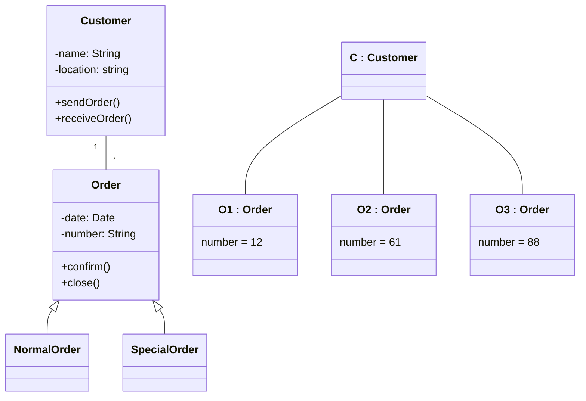

> [!Example] 📘 Example 3.2 — Login controller snapshot (slides 7–8)
> **Using:** object diagram rules (names, anonymity, attribute values)
> **Objects in the figure:**
> **1.** `log : Logger` (named).
> **2.** `loginCtrl : LoginController` with `-attempLimit: Integer = 5`, `-lockoutTime: Integer = 30`, `-loginURI: String = "/users/sign-in"`, `-logoutURI = "/users/sign-out"`.
> **3.** `: UserManager` (**anonymous**) with `-digester: PasswordDigester`, `-authorizationRules: Rules[7]`.
> **4.** `: CookieManager` (**anonymous**) with `+cookieMaxAge: Integer = 1814400`, `+cookieDomain = "abc.com"`, `-crypto: Cryptograph`.
> **5.** `defaultURI : String` with value `"/users/profile"`.
> **Links with role names:** `-log` (from `loginCtrl` and `UserManager` to `log`), `-cookieMgr` (from `loginCtrl` and `UserManager` to the cookie manager).
> **Rule check:** named objects have a name and class; anonymous objects start with a colon; attributes carry values; no operations are shown ✓.
> **Observation:** Example attribute `-attempLimit` appears with this spelling on the slide (typo for *attemptLimit*).

> [!Example] 📘 Example 3.3 — Car-rental snapshot (constructed, replaces the empty interactive slide)
> **Using:** object diagram, multiplicity
> **Class model (Lecture 03 domain model):** `Customer` $1$ — $0..*$ `Rental` $0..*$ — $1$ `Car`.
> **Task:** draw the state "Mike rents car 'DA-XY 123' from 2026-11-10 to 2026-11-12."
> **Solution:**
> **1.** `mike : Customer` with `name = "Mike"`.
> **2.** `r1 : Rental` with `startDate = 2026-11-10`, `endDate = 2026-11-12`.
> **3.** `: Car` (anonymous) with `registrationNumber = "DA-XY 123"`.
> **4.** Links: `mike — r1` and `r1 — car`.
> **5.** Multiplicity check: `mike` has $1$ rental $\in [0,*)$ ✓; `r1` concerns exactly $1$ car ✓.

---

## 4. UML Activity Diagrams

> [!Definition] 📖 Activity diagram
> An important **behavioural diagram**. It describes **dynamic aspects** by modelling the **flow from one activity to another**. It **starts from a pre-condition** (initial node), usually takes **actor input as first step**, then models the system activities, and **ends with a post-condition** (final node).

> [!Definition] 📖 Elements (slides 11–13)
> **1.** **Initial node** (filled circle) = pre-condition. **Final node** (circle with inner filled circle) = post-condition.
> **2.** **Activity** (rounded box), e.g. *User interaction*, *System Activity 1*.
> **3.** **Split / decision** (diamond, outgoing edges labelled *Case 1*, *Case 2*): refers to **conditional if-statements**; **more than two options** are allowed.
> **4.** **Merge** (diamond): the paths **must be merged again** after a decision.
> **5.** **Fork** (thick black bar): starts **parallel processing**. **Join** (bar, shown double-lined on the slide): **waits for all** incoming parallel paths.
> **6.** Parallelism is used when **processes fork or threads** are used (typical code is linear, not parallel).
> **7.** **Partitions / swim lanes**: columns, each assigned to an actor or system component.

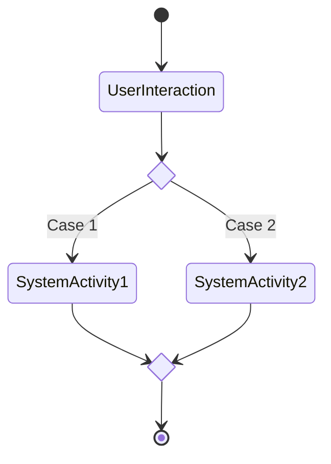

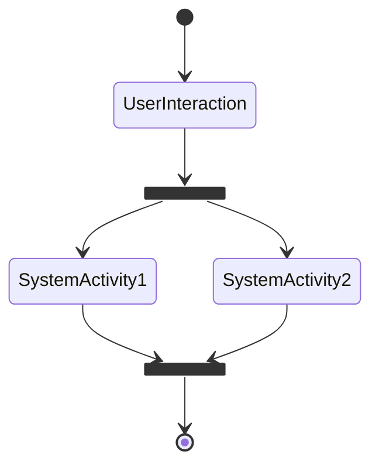

> [!Warning] ⚠️ Possible Gap
> **1.** The slides label the initial/final nodes only as "pre-condition" and "post-condition". The terms *initial node* and *final node* are not used.
> **2.** On slide 12 the merge diamond is drawn with a filled marker inside. Standard merge/decision diamonds are plain; treat it as a merge.
> **3.** **Slide 14** (swim lanes) has **no explanatory text**, only a figure. The description in Example 4.4 is reconstructed from a small image and may miss details.
> **4.** Guard notation on edges (e.g. `[pay with card]`) appears only in the swim-lane and summary figures and is not explained in text.

## 📘 Examples & Applications

> [!Example] 📘 Example 4.1 — Linear flow (slide 11)
> **Using:** initial/final node, activities
> **Solution:** Initial node → *User interaction* (actor input first) → *System Activity 1* → *System Activity 2* → final node.
> **Reading:** pre-condition = state before the first step; post-condition = state after the last.

> [!Example] 📘 Example 4.2 — Branch and merge (slide 12)
> **Using:** split, merge
> **Solution:**
> **1.** After *User interaction* a decision splits into *Case 1* → *System Activity 1* and *Case 2* → *System Activity 2*.
> **2.** Both paths **merge** before the final node.
> **3.** Exactly **one** of the two activities runs per execution (if-statement).
> **4.** Number of executed activities on any run: $1 + 1 = 2$ (user interaction plus one system activity).

> [!Example] 📘 Example 4.3 — Fork and join: car rental (slide 13)
> **Using:** fork, join
> **Solution:**
> **1.** After the customer interaction, a **fork** starts two concurrent activities: *Prepare the car* and *Prepare the rental agreement*.
> **2.** A **join** waits for **both** before *Hand over the car*.
> **3.** If only one finishes, the handover **does not start**.
> **4.** Number of executed activities (fork bar excluded): $1 + 2 + 1 = 4$.

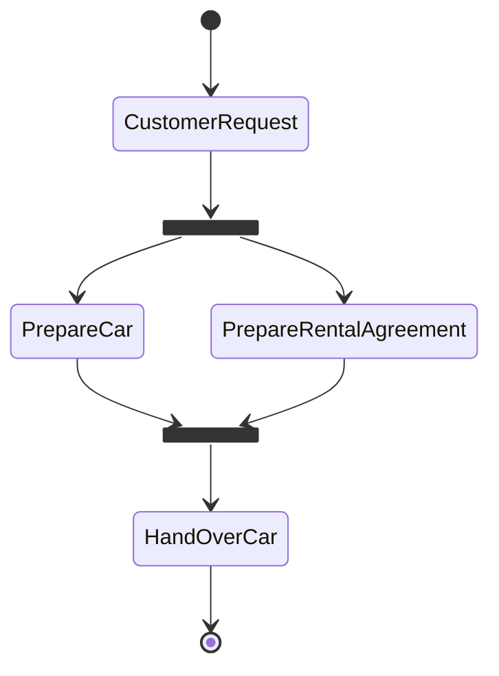

> [!Example] 📘 Example 4.4 — Swim lanes: ticket vending (slide 14, reconstructed)
> **Using:** partitions, decision/merge, object nodes
> **Lanes:** *Commuter*, *Ticket vending machine*, *Bank*.
> **Flow:**
> **1.** Commuter: *Start Session* → machine: *Request Trip Info* → commuter: *Provide Trip Info* → machine: *Process Trip Info*.
> **2.** Machine: *Request Payment* → commuter: *Provide Payment Info* → machine: *Process Payment*.
> **3.** Decision: **[pay with card]** → bank: *Authorize Card Payment*; **[pay with cash]** → directly on. Paths **merge**.
> **4.** Machine: *Dispense Ticket* (object **Ticket** → commuter: *Get Ticket*).
> **5.** Decision: **[paid with cash & with change]** → *Dispense Change* (object **Change** → commuter: *Get Change*). Paths merge.
> **6.** Machine: *Show Thank You* → final node.

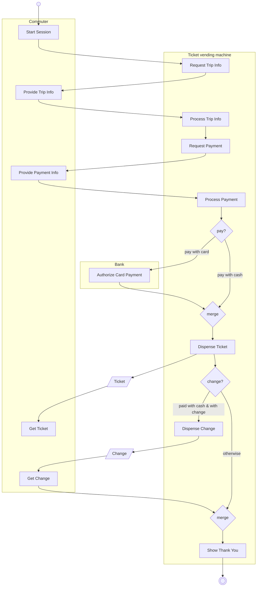

> [!Example] 📘 Example 4.5 — Order processing in the summary figure (slide 33)
> **Using:** decision, fork/join, object node
> **Solution:** *Receive Order* → decision **[order accepted]** → *Fill Order* → **fork**: (*Send Invoice* → *Accept Payment*) in parallel with *Ship Order* → **join** → *Close Order*. **[order rejected]** goes directly to the merge before *Close Order*. A *Requested Order* object enters the flow and an *Invoice* object passes from *Send Invoice* to *Accept Payment*.

---

## 5. UML Sequence Diagrams

> [!Definition] 📖 Sequence diagram
> Models the **flow of events through the system** and shows the **interaction of objects and actors**. **Messages** are sent between objects/actors; sending a message between objects is typically **calling a method**.

> [!Property] ⚙️ Layout and reading rules (slides 17–18)
> **1.** Objects are aligned on a **horizontal axis**, sorted by their time of activity (**earliest to the left**).
> **2.** **Time progresses downward**; diagrams are read **from the top left**.
> **3.** **Actors** are usually on the **left-hand side**. A human being has **no methods to call** (an actor only sends messages).
> **4.** The diagram does **not** show the total time individual operations take.
> **5.** Modeling is **iterative**: tracing the event flow often reveals **additional objects or methods**, so static (class) and dynamic (sequence) aspects are refined together.
> **6.** Typical shape: a rotated **pyramid / wedding cake** (nested activation boxes).

> [!Definition] 📖 Elements (slides 16, 19–21)
> **1.** **Lifeline**: dashed vertical line below the object box (the object's existence over time).
> **2.** **Activation box**: narrow rectangle on the lifeline while the object executes (start occurrence → execution → finish occurrence).
> **3.** **Message**: arrow with name; **message number** `n :` in front. A message to an object is typically followed by a **return** (reply, dashed arrow).
> **4.** **Self-message**: an object calls a method of itself (arrow looping back to its own lifeline, nested activation).
> **5.** **Message types:**
> **(a)** **Synchronous call**: waiting for a response (followed by a reply message).
> **(b)** **Asynchronous call**: **not** waiting for a response.
> **(c)** **Reply message**: dashed arrow back.
> **(d)** **Create object**: dashed arrow to the **object box** (the new object starts lower on the page).
> **(e)** **Destroy object** («destroy» message, **X** at the end of the lifeline = terminate lifeline).
> **6.** **Combined fragments** (frame with operator tag and guard in brackets): `alt, opt, par, loop, neg, assert, break` are listed; the slides demonstrate **opt**, **alt** and **loop** (Section 5.2).

> [!Warning] ⚠️ Possible Gap
> **1.** Arrowhead styles (filled head = synchronous, open head = asynchronous, dashed open head = reply) are visible in the slide-21 figure but **not stated** in the text.
> **2.** The `ref` frame (*Checkout*) in the slide-16 figure is **not explained**.
> **3.** Fragment operators **par, neg, assert, break** are listed in the slide title but **never defined or illustrated**. Do not assume meanings beyond the title.
> **4.** Slide 23 guard reads "[for new each email]" (word order typo on the slide).

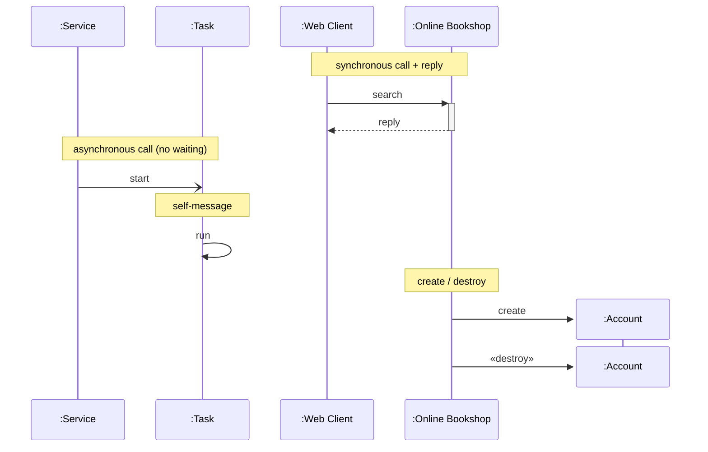

## 📘 Examples & Applications

> [!Example] 📘 Example 5.1 — Online bookshop, initial example (slide 16)
> **Using:** actor, lifeline, activation box, message/return, `loop`, `opt`, `ref`
> **Solution (reading the figure):**
> **1.** Actor `:Web Customer` (left), object `:Online Bookshop`.
> **2.** Inside a **loop** fragment: message *search inventory* → return *search results*.
> **3.** Inside the loop, two **opt** fragments: *view book description* and *add to shopping cart*.
> **4.** After the loop, an **opt** fragment containing a **ref** frame *Checkout* (reference to another diagram).
> **5.** Labelled elements on the slide: Actor, Time (downward arrow), Message, Return, Activation box, Optional fragment, Lifeline.

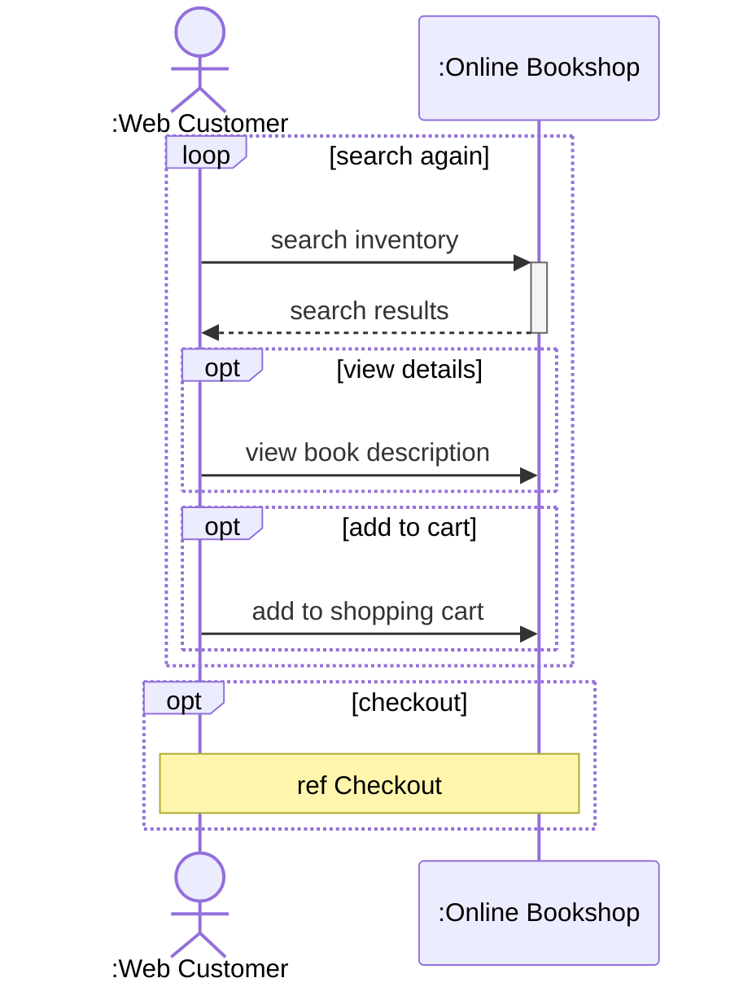

> [!Example] 📘 Example 5.2 — Wedding-cake shape (slide 18)
> **Using:** numbering, nesting, shape
> **Solution:**
> **1.** Lifelines 1–5. Messages: 1 (L1→L2), 2 (L2→L3), 3 (L3→L4), 4 (L4→L5) with reply 5, 6 (L4→L5) with reply 7, then replies 8 (L4→L3), 9 (L3→L2), 10 (L2→L1).
> **2.** Total numbered messages (incl. replies): $10$. Calls: $6$ (1,2,3,4,6 = 5 calls plus … see check below).
> **3.** Check: calls are 1, 2, 3, 4, 6 → $5$ calls; replies are 5, 7, 8, 9, 10 → $5$ replies; $5 + 5 = 10$ ✓.
> **4.** Each activation box is **longer than and encloses** the boxes of the objects it calls → pyramid shape.

> [!Example] 📘 Example 5.3 — Message with return and activation (slide 19)
> **Using:** message numbers, return, activation
> **Solution:** `object : Class2` sends `1 : Message1` to `object1 : Class1`; `object1` returns `2 : Reply1`. The activation box of `object1` starts at the **start occurrence** of message 1 and finishes at the reply (**finish occurrence**); the span between is the **execution**.

> [!Example] 📘 Example 5.4 — Shop with `opt` and `alt` (slide 22)
> **Using:** opt, alt, guards, nested call chain
> **Lifelines:** `u1 : User`, `s1 : Shop`, `p1 : PaymentGateway`, `b1 : Bank`.
> **Solution:**
> **1.** `1 : Purchase` (User → Shop).
> **2.** **opt** *WrappingFragment*, guard **[if user selected gift wrapping]**: `2 : storeWrappingOption`, reply `3 : confirmWrappingOption`.
> **3.** **alt** *PaymentFragment*: operand 1 guard **[if user selected payment with credit card]**: `4 : enterCreditCardDetails`, `5 : payWithCard`, `6 : requestApproval`, replies `7 : confirm`, `8 : confirm`, `9 : showApproval`.
> **4.** Operand 2 (after the dashed separator), guard **[else if user selected bank transfer]**: `10 : payWithBankTransfer`, reply `11 : confirm`.
> **5.** Difference: **opt** has **one** operand (runs or is skipped); **alt** has **mutually exclusive** operands, **exactly one** executes. Messages executed in a run with card: $1 + 8 = 9$ if wrapping chosen; with bank transfer and wrapping: $1 + 2 + 2 = 5$ numbered messages after counting (1; 2,3; 10,11).

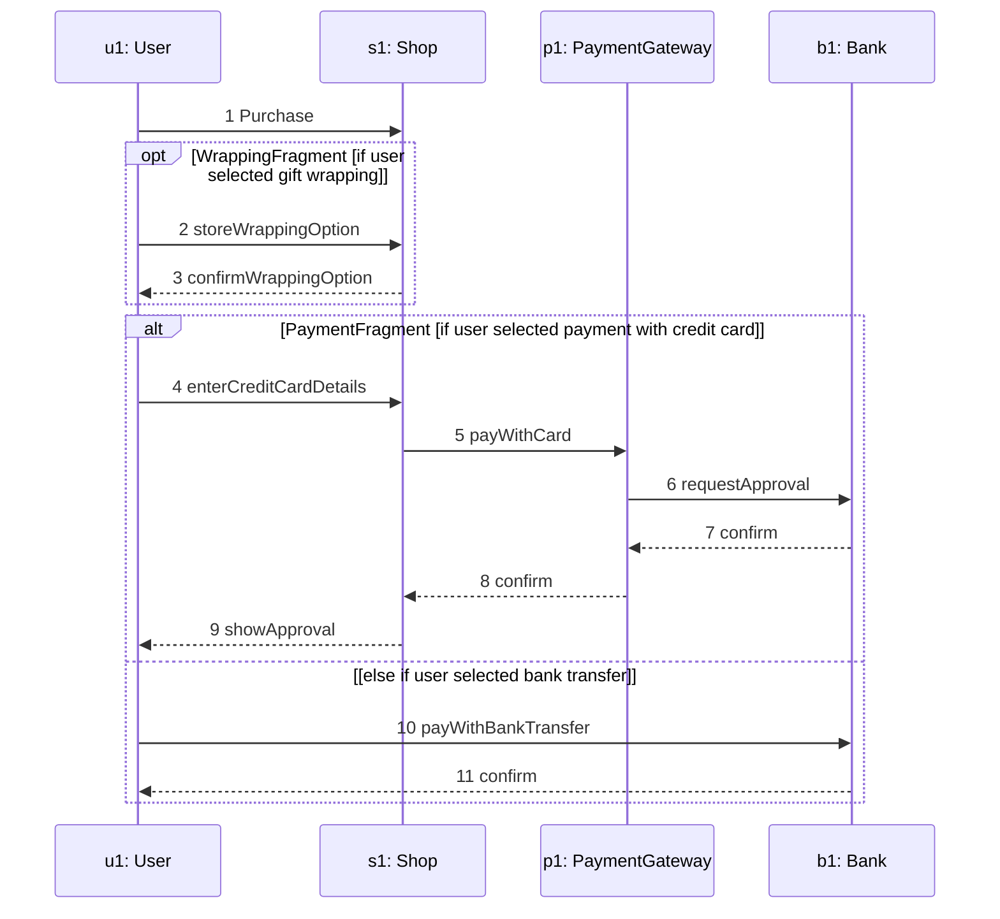

> [!Example] 📘 Example 5.5 — `loop` fragment (slide 23)
> **Using:** loop
> **Solution:** `1 : Message1` (Lifeline1 → Lifeline2). Loop with guard **[for new each email]** repeats `2 : sendNotification` and reply `3 : confirm` **while the condition is true**. After the loop: `4 : Message3`.
> **Count:** if there are $n$ new e-mails, the number of messages executed is $1 + 2n + 1 = 2n + 2$ (the slide numbers one pass as 2–3).

> [!Example] 📘 Example 5.6 — Library lender: three iterations (slides 24–26)
> **Using:** actor, self-messages, `loop`, `alt`, iterative modeling
> **Version 1 (slide 24)** — lifelines `lender : Actor`, `in : Inventory`, `c : Counter`:
> **1.** `1 : search book` (lender → Inventory).
> **2.** `2 : send book to counter` (Inventory → Counter).
> **3.** `3 : add book to counter list` (Counter **self-message**).
> **4.** `4 : report book added` (return), `5 : book is available` (return to lender).
> **5.** `6 : get the book` (lender → Counter), `7 : remove book from list` (self-message), `8 : return the book` (return).
> **Version 2 (slide 25)** adds object `b : Book` and a **loop** **[for each book in list]**: `2 : get title` (Inventory → Book), `3 : return title`, `4 : check if title matches search` (self-message). The old messages are renumbered `5–11`.
> **Version 3 (slide 26)** adds an **alt**: **[if book is available]** → `5 : send book to counter`, `6 : add book to counter list`, `7 : report book added`, `8 : book is available`; **[book is not available]** → `9 : book is not available`. Then `10 : get the book`, `11 : remove book from list`, `12 : return the book`.
> **Message counts:** version 1: $8$; version 2: $11$; version 3: $12$. The growth $8 \to 11 \to 12$ shows how each iteration adds detail (a new object, then a branch).

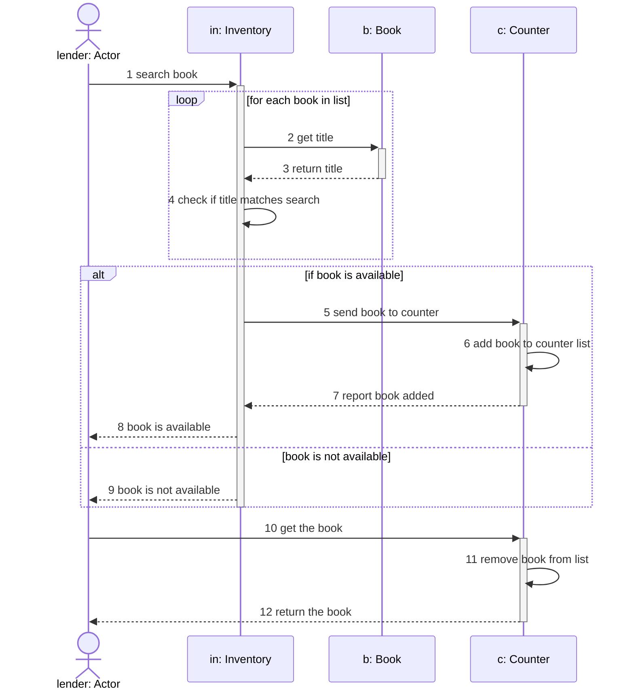

> [!Warning] ⚠️ Possible Gap
> **1.** In versions 2 and 3 the lower part of slides 25–26 is cut off, so the bottom ends of lifelines are not visible.
> **2.** In version 3, messages 10–12 lie **outside** the `alt`, so "get the book" is sent **even if the book is not available**. The slide does not discuss this. A cleaner model would place 10–12 inside the first operand (see Example 9.3).

> [!Example] 📘 Example 5.7 — Choose the message type (constructed)
> **Using:** message types
> **Solution:**
> **1.** `Service` starts a background `Task` and continues immediately → **asynchronous** call.
> **2.** `Web Client` searches and blocks until results arrive → **synchronous** call + **reply**.
> **3.** `Online Bookshop` creates an `Account` after registration → **create** (dashed arrow to the object box).
> **4.** `Bookshop` deletes the account → **destroy** (X on the lifeline).
> **5.** `Task` calls its own `run()` → **self-message**.

---

## 6. UML State Machine Diagrams

> [!Definition] 📖 State machine diagram
> Models the **internal states of a system and their transitions**. Many systems are in a variety of states over time (**finite state machines**). **One and only one state is active at any given time.** It can describe the states of an **object**, a **module** or an **entire system**.

> [!Property] ⚙️ Semantics (slide 29)
> **1.** Transitions are typically triggered by **events**. An event/message that **does not make sense for the active state is ignored**.
> **2.** Transitions are modeled as **instantaneous** (they take no time). If something takes time, it is **modeled as a state**.

> [!Definition] 📖 Notation (slides 30–32)
> **1.** **State**: rounded box. **Transition**: arrow between states.
> **2.** Arrow label forms: `trigger`; `trigger / Action` (action on state change, listed **after** the trigger); `trigger [guard condition]` (transition is taken **only if the guard is true**).
> **3.** **Initial pseudo-state**: filled circle with an arrow to the first state. **Final state**: circle with inner filled circle; it signifies that the **enclosing region is completed**. If that region is directly in a state machine and **all other regions** are also completed, the **entire state machine is completed**.
> **4.** **Composite state**: a state that **contains substates / nested states**; it breaks a **complex state into simpler states** and gives **more organized, modular** modeling.

> [!Warning] ⚠️ Possible Gap
> **1.** The source URL printed on slides 28–32 points to `sequence-diagrams.html` (copy error); the content is state machine material.
> **2.** The words *region*, *pseudo-state* and *entry/exit actions* are used or implied but **not explained** beyond the quoted bullet points.
> **3.** The summary slide (33) shows a state machine without trigger names beyond transition labels such as *vaporization*; no guards or actions appear.

## 📘 Examples & Applications

> [!Example] 📘 Example 6.1 — Bank ATM (slide 28)
> **Using:** initial pseudo-state, states, triggers, "one active state"
> **Solution:**
> **1.** Start → **Idle** (initial pseudo-state).
> **2.** Idle —`in(card)`→ **Active**; Active —`cancel`→ Idle; Active —`done`→ Idle.
> **3.** Idle —`service`→ **Out of Service**; Out of Service —`fixed`→ Idle.
> **4.** Exactly one of $\{\text{Idle}, \text{Active}, \text{OutOfService}\}$ is active at any time ⇒ the active-state indicator is a single value, never a set.
> **5.** If the event `fixed` occurs while the ATM is **Idle**, it is **ignored** (it makes no sense for that state).
> **6.** Count: $3$ states, $5$ transitions.

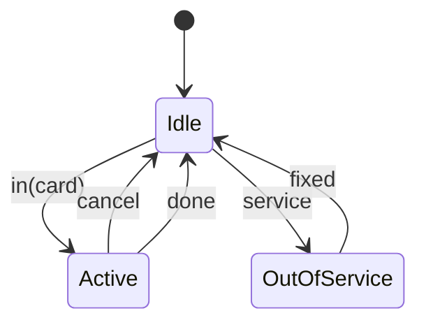

> [!Example] 📘 Example 6.2 — Trigger, action, guard (slide 30)
> **Using:** transition label forms
> **Solution:**
> **1.** `State1 —trigger→ State2`: only a trigger.
> **2.** `State3 —trigger / Action→ State4`: on `trigger`, perform `Action`, then enter State4.
> **3.** `State5 —trigger [guard condition]→ State6`: taken **only if** the guard is true; if false, the event is ignored (the machine stays in State5).

> [!Example] 📘 Example 6.3 — Initial and final (slide 31)
> **Using:** initial pseudo-state, final state
> **Solution:** The initial pseudo-state points to **Waiting for User Input** (first state). A separate arrow ends in the final state, meaning the enclosing region has **completed**. With several regions, the **whole machine** is complete only when **all** regions have reached their final state.

> [!Example] 📘 Example 6.4 — Composite state (slide 32)
> **Using:** composite state
> **Solution:** **Serving Customer** contains the substates **Customer Authentication** and **Transaction**, with its **own** initial pseudo-state → Customer Authentication → Transaction → final state. From outside, Serving Customer is one state; inside it is a small state machine.

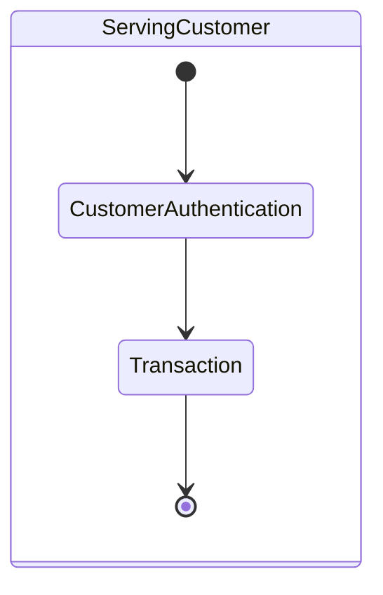

> [!Example] 📘 Example 6.5 — States of water (summary slide 33)
> **Using:** state machine, bidirectional transitions
> **Solution:** states **Plasma**, **Water Vapor**, **Liquid Water**, **Ice or Frost**. Transitions: Plasma ⇄ Water Vapor (*ionization* / *deionization*), Water Vapor ⇄ Liquid Water (*vaporization* / *condensation*), Liquid Water ⇄ Ice or Frost (*melting* / *freezing*), Water Vapor ⇄ Ice or Frost (*sublimation* / *deposition*). Only **one** state is active at a time.

> [!Example] 📘 Example 6.6 — Rental car lifecycle (constructed)
> **Using:** trigger, action, guard, ignored events
> **Solution:**
> **1.** Initial → **Available**.
> **2.** Available —`reserve [period free]`→ **Reserved**.
> **3.** Reserved —`cancel`→ Available; Reserved —`pickup / handOverKeys()`→ **Rented**.
> **4.** Rented —`return [damage found]`→ **InMaintenance**; Rented —`return [no damage]`→ Available.
> **5.** Available —`scheduleMaintenance`→ InMaintenance; InMaintenance —`completed`→ Available.
> **6.** Event `pickup` while **Available** is **ignored** (no reservation). This matches the dictionary meaning of *available car* from Lecture 02.

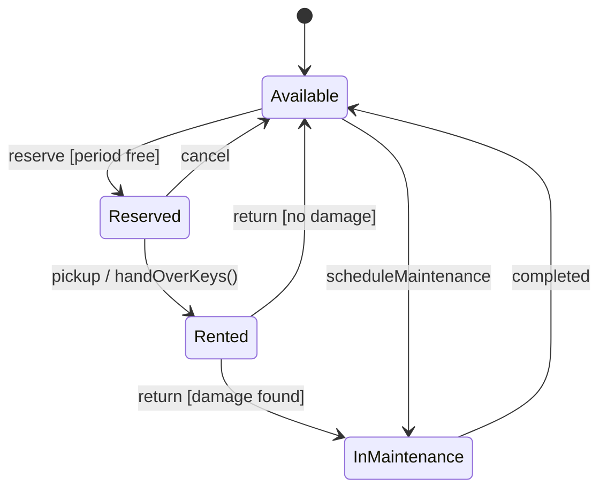

---

## 7. Package Diagrams (Optional Preview for SWED)

> [!Definition] 📖 Package diagram (slides 34–35; marked "(Optional) Preview SWED")
> A **structural** diagram. A **package** is a **named container that groups related classes** (also known as **module / library / folder**).
> **1.** Packages provide **separate name spaces** for classes.
> **2.** Packages can be **nested**.
> **3.** **Dashed arrows** indicate **dependencies between packages**.

> [!Warning] ⚠️ Possible Gap
> **1.** This part is a **preview for another course (SWED)** and is marked optional. Whether it is examinable here is unclear.
> **2.** In the slide-35 figure (Package1 with A, B; Package2 with C, D; Package3 with E, F) the **exact arrow endpoints** are not reliably legible. The diagram below shows only the **package-level** dependency direction, which is what the slide states.

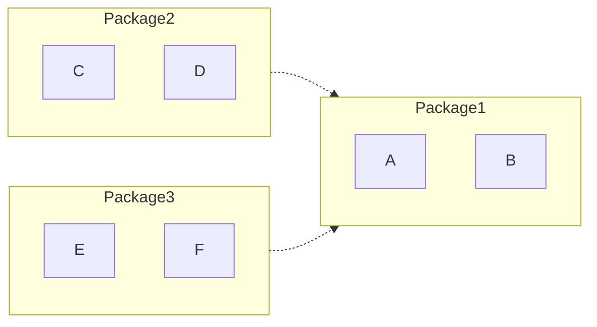

## 📘 Examples & Applications

> [!Example] 📘 Example 7.1 — Car rental packages (slide text; contents constructed)
> **Using:** package, dependency, name spaces
> **Solution:**
> **1.** Packages **Rental**, **Payment**, **Invoice** (named on the slide).
> **2.** `Rental::Rental` (class `Rental` in package `Rental`) and `Invoice::Invoice` may share the *simple* class name `Invoice` only because of separate name spaces, which resolves the "unique in package" naming rule from Lecture 03.
> **3.** Dependencies: **Rental** ⇢ **Payment** (a rental needs payment authorization); **Invoice** ⇢ **Rental** (an invoice refers to a rental). Arrows point **towards the used package**.

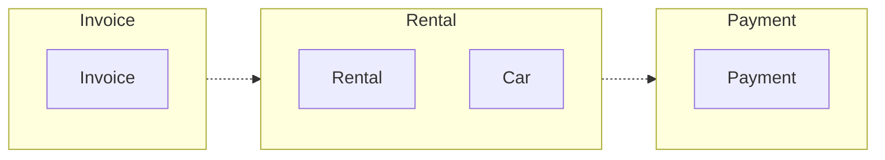

---

## 8. How the Diagrams Fit Together

> [!Property] ⚙️ Complementary diagrams (slides 33, 36)
> **1.** The five diagrams of the summary slide are **use case**, **class**, **sequence**, **activity** and **state machine** (plus **object** from this lecture).
> **2.** They model **different static and dynamic aspects**; **multiple diagrams are needed** to describe the complete system.
> **3.** The analysis model is still **coarse** and is **refined during the design stage**.
> **4.** UML is a powerful **tool to model the results of object-oriented analysis**.

| Diagram | Static / dynamic | Answers the question |
|---|---|---|
| Use case | behaviour (functions) | Who uses the system, and which functions does it offer? |
| Class | static (structure) | Which classes, attributes, operations, relations exist? |
| Object | static (snapshot) | Which concrete instances and values exist at one moment? |
| Activity | dynamic | In which order (incl. branches, parallelism) do activities run? |
| Sequence | dynamic | Which messages do objects/actors exchange, in what order? |
| State machine | dynamic | Which states can an object/system be in, and what triggers changes? |
| Package *(optional)* | static | How are classes grouped, and how do packages depend on each other? |

> [!Note] 💡 Summary figures (slide 33)
> **Use case:** *Hospital Reception* («module») with actor Receptionist and use cases such as *Schedule Patient Appointment*, *Patient Registration*, *Patient Hospital Admission* (with «include»/«extend» and specializations *Outpatient/Inpatient Hospital Admission*, «include» *Bed Allotment*). **Class:** *Online Shopping* (Customer, Account, Web User, Shopping Cart, Order, Payment, LineItem, Product, enumerations). **Sequence:** *Online_Bookshop*. **Activity:** *Process Order*. **State machine:** states of water.

## 📘 Examples & Applications

> [!Example] 📘 Example 8.1 — Which diagram for which question? (constructed)
> **Using:** the table above
> **Solution:**
> **1.** "Which cars can a rental agent manage?" → *use case*.
> **2.** "What attributes does `Rental` have?" → *class*.
> **3.** "Which rentals exist today with their dates?" → *object*.
> **4.** "What happens during a booking, including payment?" → *sequence* (messages) or *activity* (flow).
> **5.** "Can a `Rented` car be reserved?" → *state machine* (event ignored in that state).
> **6.** "Do `Payment` classes depend on `Rental` classes?" → *package* (preview) or *class*.

---

## 9. Exam-style Problem (combines Sections 2–6)

> [!Example] 📘 Example 9.1 — Car-rental booking, four views of one system
> **Using:** class/object diagram, activity (fork/join), sequence (alt, create, self-message), state machine (guards, actions)
> **Scenario (constructed from the car-rental running example):** A customer books a car for a rental period. The system checks availability. If the car is available, the system creates a `Rental`; the payment provider authorizes the payment. In parallel, staff **prepare the car** and **prepare the rental agreement**; after both are done the car is **handed over**. If the car is not available, the customer is informed.
> **Tasks:** **(a)** Draw an object diagram for "Mike books car 'DA-XY 123' for 2026-11-10 to 2026-11-12". **(b)** Draw the activity diagram with decision and fork/join. **(c)** Draw a sequence diagram with `alt`. **(d)** Draw the state machine of `Rental`. **(e)** Count messages for the available case.
> **Solution:**
> **(a)** `mike : Customer` (`name = "Mike"`) — `r1 : Rental` (`startDate = 2026-11-10`, `endDate = 2026-11-12`) — `: Car` (`registrationNumber = "DA-XY 123"`, anonymous). No operations, values instead of types, objects underlined.
> **(b)** Initial → *Enter dates* → *Check availability* → **split**: **[available]** → *Create rental* → *Authorize payment* → **fork** → (*Prepare car* ‖ *Prepare rental agreement*) → **join** → *Hand over car*; **[not available]** → *Inform customer*; both paths **merge** → final.

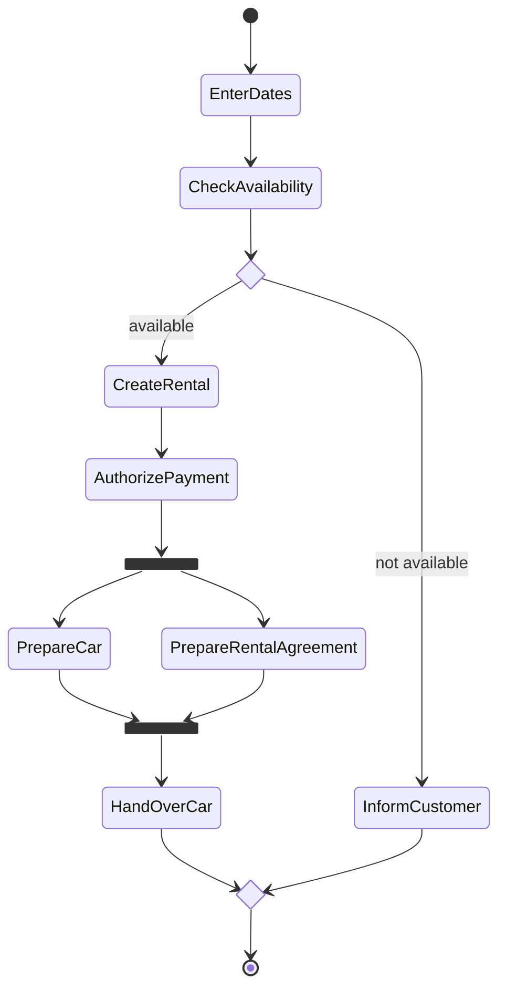

> **(c)** Lifelines: `c : Customer` (actor, left), `s : RentalService`, `p : PaymentProvider`. Messages: `1 : requestBooking`; `2 : checkAvailability` (self-message of `s`); **alt [car available]**: `3 : createRental` (self), `4 : authorizePayment` (s → p), `5 : approved` (reply), `6 : bookingConfirmed` (reply to customer); **[else]**: `7 : carUnavailable` (reply to customer). Nothing of the handover is placed outside the `alt` (cf. warning at Example 5.6).

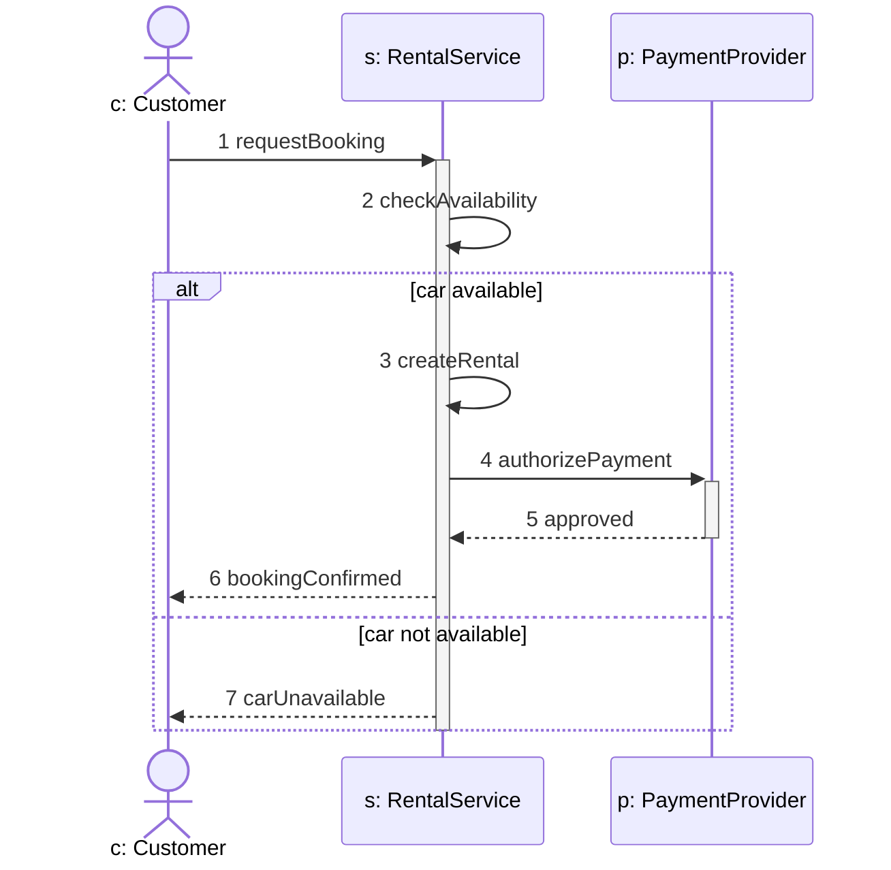

> **(d)** States of `Rental`: Initial → **Created** —`approved`→ **Confirmed** —`pickup / handOverKeys()`→ **Active** —`return`→ **Closed** → final. Also **Created** —`declined`→ **Cancelled** and **Confirmed** —`cancel [before start]`→ **Cancelled**. Event `return` in **Confirmed** is **ignored**.

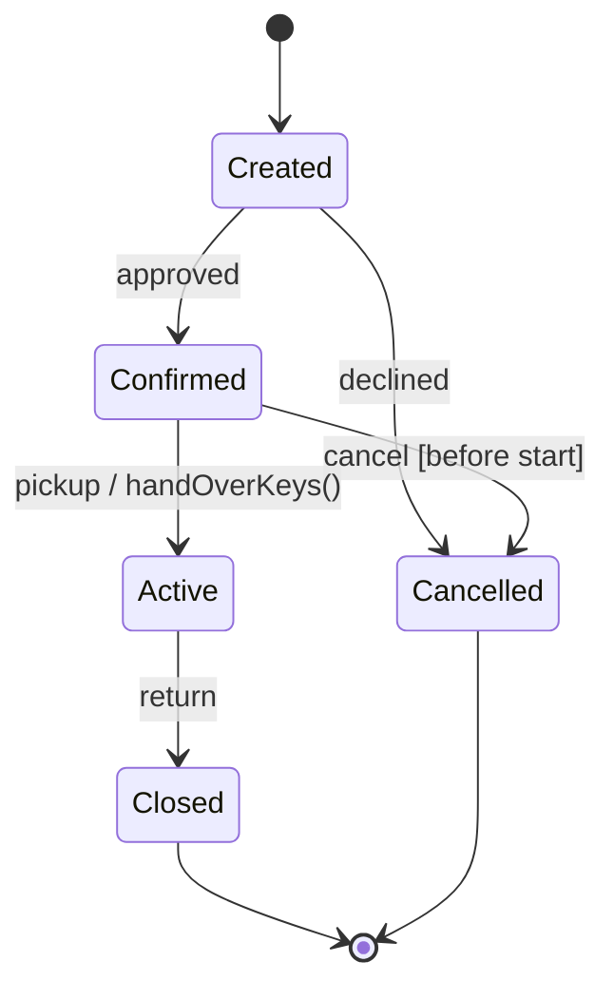

> **(e)** Available case: messages $1, 2, 3, 4, 5, 6$ → $6$ numbered messages (3 calls to self/other services plus 2 replies, plus the request: calls $= 1, 2, 3, 4$; replies $= 5, 6$, so $4 + 2 = 6$). Unavailable case: messages $1, 2, 7$ → $3$ messages. Difference: $6 - 3 = 3$ more messages when the car is available, which equals the size of the first `alt` operand minus the single reply of the `else` operand: $4 - 1 = 3$ ✓.

> [!Example] 📘 Example 9.2 — Find the diagram errors (constructed)
> **Using:** object diagram rules, sequence rules, state machine rules
> **Solution:**
> **1.** An object box shows `+start(): void` → **wrong**: object diagrams show **no operations**.
> **2.** An attribute `age: int` inside an object → **wrong**: use a value, `age = 30`.
> **3.** A **human actor** has a self-message `think()` → **wrong**: a human being has **no methods to call**.
> **4.** Time runs **left to right** in a sequence diagram → **wrong**: time progresses **downward**; the horizontal axis orders objects.
> **5.** An activity diagram has a decision with **no merge** and two dangling paths → **incomplete**: paths must be merged again.
> **6.** A state machine marks **two** states as simultaneously active → **wrong**: one and only one state is active (without regions).
> **7.** A transition from *Rented* to *Available* is drawn with a duration of 2 days → **wrong**: transitions are instantaneous; model the wait as a **state**.

> [!Example] 📘 Example 9.3 — Fix the library lender flow (constructed; refines Example 5.6)
> **Using:** `alt`, scope of operands
> **Problem:** In version 3 of the lender diagram, `10 : get the book` happens even if the book is not available.
> **Solution:**
> **1.** Move messages `10–12` into the **[if book is available]** operand, after `8 : book is available`.
> **2.** Keep `9 : book is not available` as the only message of the `else` operand.
> **3.** Now exactly one of the two branches runs completely: available $\Rightarrow$ $8$ messages after the loop part ($5$–$12$ with $10$–$12$ inside); not available $\Rightarrow$ $1$ message ($9$).
> **4.** Static consequence: if `c : Counter` now only receives `get the book` when available, the class `Counter` needs an operation for that call (iterative static/dynamic refinement).

---

## 🗂️ Summary

- **Taxonomy:** behaviour diagrams (activity, state machine, use case, sequence ⊂ interaction) vs. structure diagrams (class, object, package, …). Course focus: activity, state machine, use case, sequence, class, object.
- **Structure notation:** class = name | attributes | methods; abstract = *italic* or `{Abstract}`; object = `Objectname: Class` underlined; inheritance = hollow triangle at base; aggregation ◇ (shared, independent lifetime) vs. composition ◆ (exclusive, lifetime controlled by whole); association with roles; navigability arrow ($A \to B$: reach B from A); multiplicity $*, 1, n, 0..1, 1..*, n..m$ read as "Each ⟨start⟩ is associated with ⟨multiplicity⟩ ⟨end⟩s".
- **Object diagram:** snapshot of instances at one point in time; shows object name **and** class (both underlined); anonymous objects `: Class`; attributes with `=` values; no operations.
- **Activity diagram:** dynamic flow from pre-condition (initial) to post-condition (final); split (if-statement, $\ge 2$ options) must be merged; fork starts parallel activities, join waits for all; swim lanes assign activities to actors/components.
- **Sequence diagram:** interaction of objects/actors; objects left→right in order of activity, **time downward**, actors on the left, humans have no methods; elements: lifeline, activation box, message (numbered) + return, self-message; message types: synchronous (waits), asynchronous (no wait), reply, create, destroy; fragments `alt, opt, par, loop, neg, assert, break` (demonstrated: opt = optional, alt = exclusive alternatives, loop = while condition true); no timing information; wedding-cake shape; modeling is iterative with the class model.
- **State machine diagram:** finite states, **exactly one active**; transitions triggered by events, **instantaneous** (long actions become states); irrelevant events are **ignored**; labels `trigger`, `trigger / action`, `trigger [guard]`; initial pseudo-state, final state (region complete; all regions complete ⇒ machine complete); **composite states** group substates.
- **Package diagram (optional preview):** named container grouping classes (module/library/folder); separate name spaces; nestable; dashed arrows = package dependencies.
- **Big picture:** diagrams are complementary; several are needed; the analysis model is coarse and is refined in design; UML models the results of OOA.