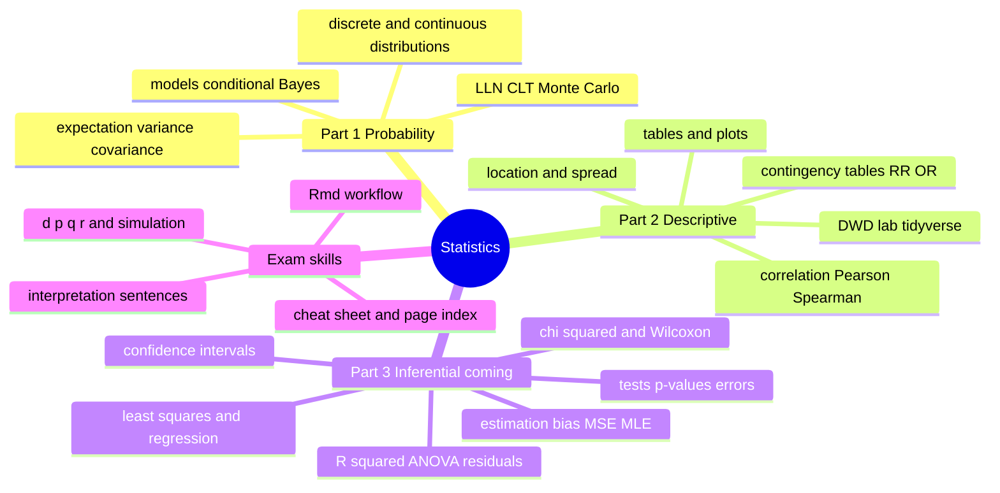

# 📊 Statistics — Study Plan (target 1.0)

> [!abstract] Exam facts (campUAS course page)
> - **Written computer-based exam, 90 min** — tasks combine theory with **data analysis in R** (R Markdown, like the mock exam).
> - **Allowed:** "An Introduction to R" + the **lecture notes** (both provided on the lab PCs) + **one double-sided handwritten cheat sheet** (e.g. R commands). VGU students may bring **their own keyboard** (at own risk).
> - **Mock exam** (campUAS → Mock Exam folder): Question 1 = 40 + 10 bonus points — Titanic data → Bernoulli/Binomial setup → exact probability → CLT approximation → comparison and interpretation → simulation (bonus).
> - Last year's exam was on **Mon 9 Feb 2026** → expect early/mid February 2027 (TBA).
> - VGU exercise groups: **Mon 09:00–11:30** (1-248) or **Fri 14:15–16:45** (1-250), Prof. Falkenberg.
> - **What this means:** you don't need to memorize formulas (the notes are there). You need (1) **speed in R**, (2) **choosing the right method**, (3) **clear interpretation sentences**, (4) **knowing where things are in the notes**.
> - Back to [[00 Start Here]] · [[Master Calendar]]

## 🗺️ Course mind map

## 📍 Topic tracker
| Part | Topic | Lean note | Deck | Practice | Conf. | Status |
|---|---|---|---|---|---|---|
| 1 | Probability models, Bayes | [[P1 Probability]] | [[ST-P1 Probability]] | [Ex02](file:///C:/Users/hongp/OneDrive/Desktop/WS2627/Statistics/Ex/Week2/Ex02_Probability_Theory.Rmd) | | ☐ |
| 1 | Random variables, distributions | [[P1 Probability]] | [[ST-P1 Probability]] | [Ex03](file:///C:/Users/hongp/OneDrive/Desktop/WS2627/Statistics/Ex/Week3/Ex03_Probability_Theory.Rmd) · [redraw game](file:///C:/Users/hongp/OneDrive/Desktop/WS2627/Statistics/Ex/Week4/Challenge_redraw_game.pdf) · [Monty Hall](file:///C:/Users/hongp/OneDrive/Desktop/WS2627/Statistics/Ex/VGU_Monday/monty_hall.R) | | ☐ |
| 1 | Expectation, LLN, CLT | [[P1 Probability]] | [[ST-P1 Probability]] | [Ex04](file:///C:/Users/hongp/OneDrive/Desktop/WS2627/Statistics/Ex/Week5/Ex04_Probability_Theory.Rmd) · [mock Q1](file:///C:/Users/hongp/OneDrive/Desktop/WS2627/Statistics/Ex/MockExam/Question1_Exam_Binomial_CLT_Titanic.Rmd) | | ☐ |
| 2 | Descriptive statistics | [[P2 Descriptive Statistics]] | [[ST-P2 Descriptive]] | [Ex05 DWD lab](file:///C:/Users/hongp/OneDrive/Desktop/WS2627/Statistics/Ex/Week6/Ex05_DWD_Data.pdf) + exercises in Notes Part II | | ☐ |
| 3 | Inferential statistics | *make lean note* | *make deck* | coming | | ☐ |
| — | R basics | [[R Guide for Statistics Part 1]] | (R reflex cards in both decks) | [Ex01](file:///C:/Users/hongp/OneDrive/Desktop/WS2627/Statistics/Ex/Week1/Ex01_Intro_to_R.Rmd) | | ☐ |

Solutions: `WS2627/Statistics/Ex/WeekN/…_with_Solutions.Rmd` — open them **only after** your own attempt. For Part 3 use [[AI Prompts v2#Prompt A — Recall layer for a new lecture|Prompt A]] → lean note + deck "ST-P3 Inference".

## ❓ Pre-questions for Part 3 (answer before it starts)
What does "least squares" minimize? · What does R² = 0.8 mean in words? · What is the difference between an estimator and an estimate? · What does a 95 % confidence interval *really* say? · What is a p-value — and what is it *not*? · Type I vs. Type II error with a medical-test example? · When do you use a paired vs. an unpaired t-test? · When Wilcoxon instead of t-test?

## ⚡ R reflex drills (20 min, timed — repeat until each takes < 1 min)
1. P(X = 3), P(X ≤ 3), P(X ≥ 3) for X ~ Bin(10, 0.3)
2. 95 % quantile of N(100, 15²) · P(|Z| > 1.96)
3. Simulate 10⁵ throws of 3 dice → P(sum ≥ 15)
4. Monty Hall: win probability when switching, by simulation
5. `table` + `prop.table` of `mtcars$cyl`; barplot with ggplot
6. Quartiles, IQR and a boxplot of `iris$Sepal.Length` by species
7. Pearson and Spearman correlation of `mtcars$wt` and `mtcars$mpg` + one interpretation sentence
8. Titanic sex × survived: odds ratio, relative risk, expected counts
9. ECDF of `faithful$waiting` at 70 · histograms with 3 bin widths
10. `dplyr`: mean mpg per number of cylinders
*(after Part 3)* `lm(mpg ~ wt, mtcars)` + `summary` + R² + `confint` · `t.test` · `prop.test` · `chisq.test` · `wilcox.test`

## 🟦 Phase 1 — Study & consolidate (26 Nov – 20 Dec)
**Week 26–29 Nov**
- [ ] Fill the first half of ✍️ in [[ST-P1 Probability]] → start daily reviews
- [ ] Redo **Ex02** in a blank Rmd **without** the solutions → then compare with `Ex02_with_Solutions-2.Rmd`

**Week 30 Nov – 6 Dec**
- [ ] Lecture(s) → 48-hour loop
- [ ] Fill the remaining ✍️ in [[ST-P1 Probability]]
- [ ] Redo **Ex03** (simulation) + **Ex04** (LLN/CLT) from scratch

**Week 7–13 Dec**
- [ ] Fill ✍️ in [[ST-P2 Descriptive]]
- [ ] Redo the **DWD lab (Ex05)** end-to-end in a new Rmd · redraw game + Monty Hall

**Week 14–20 Dec**
- [ ] Lecture(s) → 48-hour loop
- [ ] 🧪 **Mock Q1 under exam conditions**: 45 min, only notes PDF + Intro to R → score /50
- [ ] Course mind map from memory → confidence ratings · ✅ checkpoint: 0 overdue cards

## 🟨 Phase 2 — Revise & close gaps (21 Dec – 24 Jan)
**Mock recipe (90 min, Rmd):** Q1 probability (like the mock) · Q2 descriptive (summary + plot + correlation/contingency + interpretation on a built-in dataset) · Q3 inference (after Part 3: regression or a test). Mark yourself: code runs? numbers right? **every result interpreted in words?**
- [ ] **21–27 Dec:** **cheat sheet v1** (double-sided, see below) · R reflex drills daily
- [ ] **28 Dec – 3 Jan:** fix the top-5 weaknesses from mock Q1 · pre-questions Part 3
- [ ] **4–10 Jan:** Part 3 lectures → loop (lean note + deck) · one 45-min Rmd task on a new dataset (`mtcars`, `iris`, `penguins`, `airquality`)
- [ ] **11–17 Jan:** loop · build your own **"which test when" table** (H0, assumptions, R function, interpretation template)
- [ ] **18–24 Jan:** loop · 🧪 **full mock 1** (90 min, exam conditions, own keyboard)

## 🟥 Phase 3 — Exam mode (E = exam day)
- [ ] **25–31 Jan:** **full mock 2** · cheat sheet v2
- [ ] **E−14 … E−8:** one test type per day (H0/H1 → R → interpretation sentence) + R reflex drill
- [ ] **E−7 … E−3:** **full mocks 3 and 4** · final cheat sheet · practise finding things in the notes PDF fast (page index!)
- [ ] **E−2 … E−1:** Error Log + weakest cards · check your keyboard works with the lab layout · sleep

## ⭐ Gold examples — master these
1. **Mock Q1**: exact Binomial vs. CLT vs. simulation, and *why* they differ → [[P1 Probability]] gold 2
2. **Bayes / medical test** with simulation check → [[P1 Probability]] gold 1
3. **Monty Hall** and the **redraw game** by simulation → Monte Carlo recipe in [[P1 Probability]]
4. **Titanic odds ratio / relative risk / expected counts** → [[P2 Descriptive Statistics]] gold 2
5. **Bin choice** and the bimodal faithful data → [[P2 Descriptive Statistics]] gold 1
6. **Mean vs. median counterexample** → [[P2 Descriptive Statistics]] gold 3
7. **DWD workflow** under time pressure → [[P2 Descriptive Statistics]] gold 5

## 📝 Your cheat sheet (double-sided, handwritten)
- **Side A — R syntax:** d/p/q/r table with the parameter names (`sd`, `rate`!) · `1 - p…(k - 1)` for "≥ k" · simulation recipe · `table/prop.table/addmargins` · `quantile/IQR/summary` · `cor(…, method =)` · `chisq.test()$expected` · ggplot templates (bar, histogram, boxplot, scatter) · dplyr verbs · Rmd chunk basics.
- **Side B — decisions & sentences:** which distribution when · which plot when · robust vs. non-robust · which test when (Part 3) · interpretation templates ("The odds of … are … times …", "With 95 % confidence …", "p = … < 0.05, so we reject H0 …") · **page index** of Notes Part I and II.
