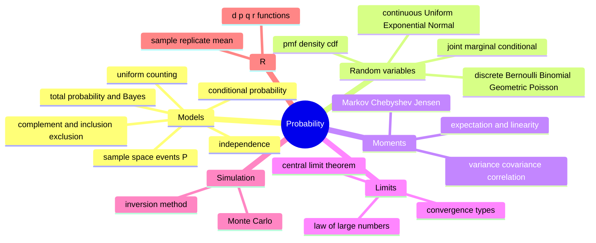

# Part 1 — Probability: Lean Recall Note

> [!tip] How this note fits the exam
> The exam is **computer-based in R (90 min)** and the lecture notes are **on the PC**. So this note is not a formula dump. It trains: (1) recognizing the right model fast, (2) R reflexes, (3) interpretation sentences. Cards: [[ST-P1 Probability]] · R details: [[R Guide for Statistics Part 1]] · Plan: [[00 Statistics Plan]]
> Lecture Notes Part I sections: 1 Probability Models (p6) · 2 Random Variables and Distributions (p20) · 3 Expectation, Variance, Covariance (p29) · 4 Sampling Distributions and Limits (p33). Write these page numbers on your cheat sheet.

## 🗺️ Mind map


## 📋 Which model when? (decision table)
| Situation | Model | Mean · Variance | R (d/p/q/r prefix) |
|---|---|---|---|
| one yes/no trial | Bernoulli(p) | p · p(1−p) | `rbinom(m, 1, p)` |
| # successes in n independent trials | Binomial(n, p) | np · np(1−p) | `dbinom(k, n, p)` |
| # failures before the 1st success | Geometric(θ) | (1−θ)/θ · (1−θ)/θ² | `dgeom(k, θ)` |
| # failures before the r-th success | Negative binomial(r, θ) | r(1−θ)/θ | `dnbinom(k, r, θ)` |
| # rare events in an interval | Poisson(λ) | λ · λ | `dpois(k, λ)` |
| any value in [L, R] equally likely | Uniform[L, R] | (L+R)/2 · (R−L)²/12 | `dunif(x, L, R)` |
| waiting time, memoryless | Exponential(λ) | 1/λ · 1/λ² | `dexp(x, rate = λ)` |
| sums/averages, measurement noise | Normal(μ, σ²) | μ · σ² | `dnorm(x, mean = μ, sd = σ)` |

**R pattern for every distribution:** `d…` = pmf/density · `p…` = P(X ≤ x) · `q…` = quantile · `r…` = random values.
⚠️ `P(X ≥ k) = 1 - pbinom(k - 1, n, p)` · `rnorm` wants **sd** · `rexp` wants the **rate** = 1/mean.

## 📋 Core rules
- P(A ∪ B) = P(A) + P(B) − P(A ∩ B) · P(Aᶜ) = 1 − P(A) · uniform: |A|/|Ω|
- P(A | B) = P(A ∩ B)/P(B) · total probability P(A) = Σ P(A | Bᵢ)P(Bᵢ) · **Bayes** P(Bⱼ | A) = P(A | Bⱼ)P(Bⱼ) / Σ P(A | Bᵢ)P(Bᵢ)
- Independence: P(A ∩ B) = P(A)P(B)
- E[aX + bY] = aE[X] + bE[Y] (always) · Var(X) = E[X²] − E[X]² · Var(aX + b) = a²Var(X)
- Var(X + Y) = Var X + Var Y + 2Cov(X, Y) · Cov = E[XY] − E[X]E[Y] · Corr ∈ [−1, 1] · independent ⇒ uncorrelated (not ⇐)
- Markov P(X ≥ a) ≤ E[X]/a · Chebyshev P(|X − μ| ≥ a) ≤ Var X / a²
- **LLN:** X̄ₙ → μ · **CLT:** X̄ₙ ≈ N(μ, σ²/n), sums ≈ N(nμ, nσ²) · Binomial → normal if np ≥ 10 and n(1−p) ≥ 10 (continuity correction: use k − 0.5)
- Convergence: almost surely ⇒ in probability ⇒ in distribution
- **Inversion:** U ~ Unif[0,1] ⇒ F⁻¹(U) ~ F; Exponential(λ): −ln(1 − U)/λ

**Monte Carlo recipe (5 lines)**
```r
set.seed(1)
B    <- 1e5                          # number of simulated runs
sims <- rbinom(B, size = 200, prob = p)   # or replicate(B, one_experiment())
est  <- mean(sims >= 50)             # fraction of runs where the event happens
se   <- sqrt(est * (1 - est) / B)    # Monte Carlo standard error
```

## ⭐ Gold examples (solve in R first, then open the solution)

> [!example]- 1 · Bayes: medical test (classic exam type)
> Prevalence 1 %, sensitivity 99 %, false-positive rate 5 %.
> P(+) = 0.99·0.01 + 0.05·0.99 = 0.0594 → P(sick | +) = 0.0099 / 0.0594 = **0.1667**.
> Interpretation: only 1 in 6 positive people is sick — the low base rate dominates.
> ```r
> set.seed(1); B <- 1e6
> sick <- runif(B) < 0.01
> pos  <- ifelse(sick, runif(B) < 0.99, runif(B) < 0.05)
> mean(sick[pos])      # ≈ 0.167
> ```

> [!example]- 2 · Mock exam Q1 (Titanic, adult men): exact vs. CLT vs. simulation
> ```r
> tab <- Titanic[, "Male", "Adult", ]     # Class x Survived
> N <- sum(tab); S <- sum(tab[, "Yes"]); p_hat <- S / N   # 1667, 338, 0.2028
> n <- 200
> 1 - pbinom(49, n, p_hat)                                       # exact  P(X >= 50) = 0.0604
> mu <- n * p_hat; s <- sqrt(n * p_hat * (1 - p_hat))           # 40.55, 5.686
> 1 - pnorm(50, mu, s)                                           # CLT    = 0.0483
> 1 - pnorm(49.5, mu, s)                                         # CLT with continuity correction = 0.0578
> set.seed(123); mean(rbinom(2e5, n, p_hat) >= 60)               # bonus: ≈ 0.0007 (exact 0.00071)
> ```
> Why different: the binomial is discrete and right-skewed for p ≈ 0.2, the normal is continuous and symmetric → it underestimates the upper tail; the continuity correction helps. Rule of thumb: np = 40.6 ≥ 10 and n(1−p) = 159.4 ≥ 10 → approximation acceptable, but tail probabilities are its weak spot.

> [!example]- 3 · Inversion method: simulate Exponential(4) without rexp
> ```r
> set.seed(1); u <- runif(1e5)
> x <- -log(1 - u) / 4
> c(mean(x), 1/4)            # both ≈ 0.25
> ```

> [!example]- 4 · See the CLT happen
> ```r
> set.seed(1)
> means <- replicate(1e4, mean(rexp(30, rate = 1)))   # skewed population
> hist(means, breaks = 50)                            # bell-shaped around 1
> c(mean(means), sd(means), 1/sqrt(30))               # sd ≈ σ/√n = 0.183
> ```

## 🔗 Connections
- ↔ [[P2 Descriptive Statistics]] — sample mean/variance estimate E[X]/Var(X); the ECDF estimates the cdf.
- ↔ [[04-Data-Link-MAC-Error-Control]] (CompNet) — BER and error-free frames: P = (1 − BER)ⁿ; ALOHA throughput is a probability model.
- ↔ FY notes (Foundation Year) — your old atomic notes on Bayes, Binomial, Normal etc. still apply.
