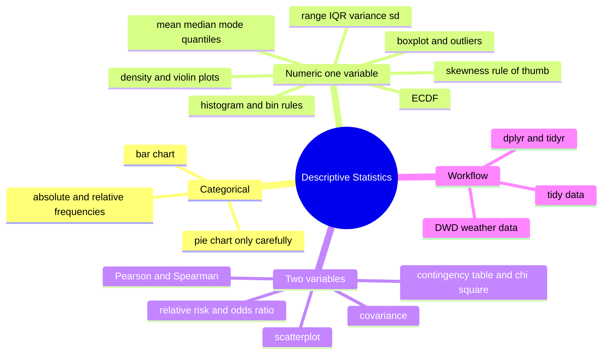

# Part 2 — Descriptive Statistics: Lean Recall Note

> [!tip] How this note fits the exam
> Exam tasks combine **computing in R + choosing the right summary/plot + interpreting it in words**. Cards: [[ST-P2 Descriptive]] · Plan: [[00 Statistics Plan]]
> Lecture Notes Part II page index (for your cheat sheet): frequency tables p6 · histograms p8 · ECDF p9 · location p11 · variability p13 · boxplots p14 · mean/median/mode p15 · density/violin p16 · scatterplots p17 · covariance/correlation p18 · contingency tables p20 · RR/OR p21 · DWD workflow p22 · tidyverse p28.

## 🗺️ Mind map


## 📋 Toolkit: measure → R → robust?
| Measure | R | Robust to outliers? |
|---|---|---|
| mean | `mean(x)` | no |
| median | `median(x)` | **yes** |
| mode | `names(which.max(table(x)))` | — |
| quantiles / quartiles | `quantile(x, c(.25, .5, .75))` | **yes** |
| six-number summary | `summary(x)` (min, Q1, median, mean, Q3, max) | — |
| range | `diff(range(x))` | no |
| IQR | `IQR(x)` | **yes** |
| variance / sd (n − 1!) | `var(x)`, `sd(x)` | no |
| covariance / Pearson r | `cov(x, y)`, `cor(x, y)` | no |
| Spearman ρ | `cor(x, y, method = "spearman")` | **yes** (ranks) |

**Which plot?** categorical → bar chart `geom_bar()` · numeric → histogram `geom_histogram(binwidth = …)`, density `geom_density()`, boxplot `geom_boxplot()`, violin `geom_violin()`, ECDF `stat_ecdf(geom = "step")` · two numeric → scatterplot `geom_point()` · two categorical → contingency table `table(a, b)`.
**Bin rules:** √n (n ≤ 1000) or 10·lg n · Sturges 1 + log₂ n · Rice 2·n^(1/3).
**Boxplot outlier rule:** beyond 1.5·IQR from the box.
**2×2 table:** RR = (f₁₁/f₁·)/(f₂₁/f₂·) · OR = (f₁₁f₂₂)/(f₁₂f₂₁) · expected count = row total × column total / n · χ² = Σ(O − E)²/E → `chisq.test(tab)`.
**Tidy data:** variable = column, observation = row, value = cell · dplyr: `filter select mutate group_by summarise arrange` + joins.

## ⭐ Gold examples (solve in R first, then open the solution)

> [!example]- 1 · How many bins for faithful$waiting (n = 272)?
> Basic √272 ≈ 16.5 → 17 · Sturges 1 + log₂ 272 ≈ 9.1 → 10 · Rice 2·272^(1/3) ≈ 13.0 → 13.
> The waiting times are bimodal: too few bins (Sturges) can blur the two peaks → plot binwidth 1, 3, 10 (notes' exercise) and justify your choice in one sentence.

> [!example]- 2 · Titanic: odds ratio of survival, women vs. men
> ```r
> tab <- margin.table(Titanic, c(2, 4))     # Sex x Survived
> #          No  Yes
> # Male   1364  367
> # Female  126  344
> OR <- (tab["Female", "Yes"] * tab["Male", "No"]) / (tab["Female", "No"] * tab["Male", "Yes"])   # 10.15
> RR <- (344 / 470) / (367 / 1731)          # 3.45: survival risk of women vs. men
> chisq.test(tab)$expected                  # expected counts under independence
> ```
> Interpretation: the odds of survival for women were about **10 times** the odds for men; their survival probability was about 3.5 times as high.

> [!example]- 3 · "In right-skewed data the mean is always larger than the median" — FALSE
> Counterexample: `x <- c(3, 3, 3, 8, 8, 8, 15)` → skewness > 0 (long right tail), but mean = 6.86 < median = 8. Mean > median is only a rule of thumb.

> [!example]- 4 · Pearson vs. Spearman
> ```r
> x <- 1:10; y <- x^3
> cor(x, y)                       # 0.928 — not 1: the relation is not linear
> cor(x, y, method = "spearman")  # 1 — perfectly monotonic
> ```

> [!example]- 5 · DWD lab (exercise sheet 5) — the workflow to reproduce under time pressure
> 1. Get data: `rdwd::selectDWD(id = 1420, res = "daily", var = "kl", period = "recent")` → download → read. *Pitfall:* wrong station/period.
> 2. Inspect: `str()`, `summary()`, what each variable means (units!). *Pitfall:* missing-value codes.
> 3. Clean: dates as `Date`, missing values to `NA`, select/rename columns (`dplyr`, `tidyr`). *Pitfall:* silently averaging over NAs → use `na.rm = TRUE` consciously.
> 4. Explore: summaries per month/year (`group_by` + `summarise`), histograms, boxplots per month, scatterplots, correlations — and one interpretation sentence per plot.

## 🔗 Connections
- ↔ [[P1 Probability]] — sample statistics estimate the model's E[X], Var(X), cdf; χ² links to the χ² distribution.
- ↔ [[2.SQL]] (DB) — `group_by + summarise` = SQL `GROUP BY` with aggregates; `filter` = WHERE; joins = joins.
